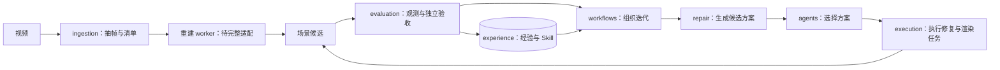

# SimReady Pipeline

从视频观测构建可编辑、可交互的仿真场景，并通过“观测 → 修复 → 独立验收 → 经验复用”闭环提升质量。当前业务样例是变电站中的 Lite3 四足与 Z1 机械臂。

**v0.4 的 Python 包和命令统一使用 `simready`。** 发行包名称保留 `simready-pipeline`。可运行部分包括输入抽帧、Agent 决策接口、修复工作流、任务执行、场景验收与经验复用；真实 VGGT/gsplat/Isaac worker 尚未全部接入，原始视频、模型权重和交付 USD 不在仓库中。

## 先看模块职责

| 模块 | 负责什么 | 主要入口 |
|---|---|---|
| `ingestion` | 视频 → 筛选后的帧与来源清单 | `simready ingestion extract` |
| `workflows` | 组织观测、修复、验收、回退与预算 | `simready workflows run` |
| `agents` | 根据缺陷与经验选择一个已登记修复方案 | `create_decision_provider` |
| `repair` | 修复能力目录、可执行插件、候选方案与任务计划 | `RepairPluginRegistry` |
| `execution` | 执行任务 DAG，管理 CPU/GPU 配额、租约、进程和缓存 | `run_task_graph` |
| `evaluation` | 观测、评分、缺陷生成、候选对比和独立进程验收 | `evaluate_candidate` / `verify_candidate` |
| `experience` | 已验证的经验记录、Skill 配方、晋升与退役 | `EpisodeStore` / `SkillLibrary` |
| `geometry` | 相机坐标和四元数约定 | `geometry/cameras.py` |
| `core` | 文件证据、JSON、哈希、基础校验与类型 | 供各模块复用 |



`workflows` 决定何时调用各模块；`execution` 只执行任务；`evaluation` 只判断证据与质量。依赖方向由 [架构合同](configs/architecture/module_boundaries.json) 和 CI 自动检查。

## 仓库布局

```text
src/simready/       可安装运行时，按职责分模块
configs/           architecture / evaluation / repair 合同
examples/          repair_workflow / task_execution / scene_evaluation 示例
tests/             按对应运行时模块组织的回归测试
scripts/           架构检查、源代码清单、执行基准工具
docs/              当前架构、开发规范、迁移与使用说明
legacy/            历史实验；不进入运行时 wheel
```

历史目录也使用语义名称：`video_ingestion`、`aholo_reconstruction`、`gaussian_repair`、`scene_evaluation`、`warehouse_experiments`、`hackathon_submission`。当前重建路线与未迁移项见 [架构说明](docs/architecture.md)，旧路径映射见 [迁移说明](docs/migration.md)。

## 安装与快速验证

Python 3.10+、Linux。开发环境：

```bash
python -m venv .venv
source .venv/bin/activate
python -m pip install -e '.[test,dev]'
python scripts/check_architecture.py
python -m pytest -q
simready --help

# 三个合成场景：学习配方 → 独立场景验证 → 后续场景复用。
python -m examples.repair_workflow.run_learning_demo --out runs/learning-demo
```

示例无需 API、CUDA 或 Isaac，验证的是运行时闭环，不代表真实重建质量或商业交付通过。生产使用可安装 `.[benchmark,ingest]`；抽帧还需要系统 `ffmpeg`。

```bash
simready ingestion extract --video /path/source.mp4 --out runs/frames
simready workflows run --config runs/learning-demo/scene_0/workflow.json --out runs/another-workflow
simready agents doctor
```

Codex CLI 使用本机已有登录；Responses API 使用环境变量中的 API key。接口和经验生命周期见 [运行时手册](docs/runtime.md)。旧 `simready-pipeline`、`simready-infra`、`simready-benchmark`、`simready-ingest` 命令暂保留转发；旧 Python 包名 `simready_bridge` 已移除。

## 开发与验证

```bash
ruff check src/simready tests examples scripts
ruff check legacy --select E9,F63,F7,F82
ruff format --check src/simready tests examples scripts legacy
python scripts/check_architecture.py
python -m pytest -q
python -m build
```

所有验收结果保持 `release_authorized=false`。真实场景 worker、完整视角覆盖、物理任务采集、密封数据集、生产阈值与权限隔离仍需完成。历史性能和 GPU 结果有独立版本记录，不与本次结构重构混算。

- [架构：边界、依赖、数据流与公开 API](docs/architecture.md)
- [开发规范：命名、代码风格、测试与 CI](docs/development.md)
- [v0.3 → v0.4 迁移](docs/migration.md)
- [Agent / Memory / Skill 运行时](docs/runtime.md)
- [场景验收合同](docs/evaluation.md) · [任务执行与资源设计](docs/execution.md)
- [真实场景 profiling：逐轮时间、失败与 token 来源](docs/profiling.md)
- [变电站三轮实测：耗时、瓶颈与质量边界](docs/audits/2026-11-12-substation-profile.md)
- [本次模块审查](docs/audits/2026-11-12-modularity-v0.4.md)

代码采用 MIT；第三方资产、数据和权重分别遵循其来源许可。
