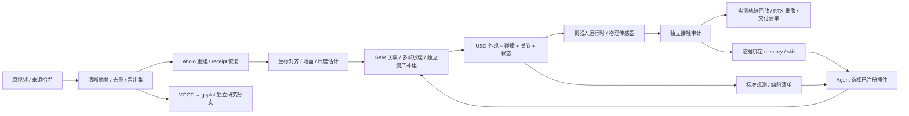

# SimReady Pipeline

**从真实视频到可交互仿真场景：三维重建、资产修复、机器人控制与独立验收。**

[中文技术报告](docs/report/technical-report.md) · [报告发布页](https://github.com/miracle-techlink/aholo-powergrid-simready/releases/tag/technical-report-2026-11-13) · [PDF 下载](https://github.com/miracle-techlink/aholo-powergrid-simready/releases/download/technical-report-2026-11-13/simready-technical-report-zh.pdf) · [两个场景示例](examples/scenes/README.md) · [部署说明](docs/deployment.md)

本项目把视频重建的外观层、可编辑资产与碰撞层、机器人任务运行时连接起来，并提供有预算约束的 Agent 修复框架、独立评测和可复用经验库。当前公开版本包含两个场景适配器：**星巴克场景中的 G2 运动与原生渲染**，以及**变电站中的 Lite3 导航、RGB-D 目标定位和 Z1 接触按压**。

中文技术报告共 **16 页、12 幅图**，包含完整处理链路、统一机器人设备接口、任务证据和部署复现边界。


## 已验证结果

| 场景 / 分支 | 已有证据 | 范围 |
|---|---|---|
| 星巴克 | 3840×2160、30 fps、30 秒完整视频；高斯球谐通道纠正、DLAA 和灯光配置 | G2 使用编排的运动轨迹，未据此验证自主导航 |
| 变电站 | 原生 1920×1080、25 fps、714 帧；已接受任务的 20 项独立审计通过 | 已知地图、模拟里程计、RGB-D 识别指定按钮、Z1 物理接触 |
| 按压任务 | 28.528 秒模拟过程、移动 1.2945 m、一次有效按压；峰值按钮行程 3.130 mm、接触力 1.228 N | 单个选定任务；电气功能、真实尺度、整场景物理属性未获认证 |
| 独立 VGGT→gsplat v3 | PSNR 14.2357 dB / SSIM 0.6205 / LPIPS 0.6117 | 留出集未达 22 dB 门槛；这一路不是交付视频的重建底稿 |

指标及文件哈希见 [公开证据](docs/report/evidence.json)。画面清晰度来自原片约束的纹理恢复、独立几何补建和原生渲染；未观测柜面仍有显式估计。当前原生任务视频没有使用 Difix 生成式逐帧修图。

## 整体链路



**自动化边界：**仓库已封装抽帧、云端任务恢复、已准备场景的录制/物理执行/审计，以及 Agent–插件–评测–记忆框架。两个视频示例使用经过检查的资产包；任意新视频到完整可编辑、可交互场景仍需要场景配准、资产选择和物理参数准备。没有把这些人工准备步骤描述为已经实现的全自动能力。

## 统一机器人接口

G2 与 Lite3+Z1 使用同一设备接口 `RobotInterface`：`describe()` 声明模式和能力，`observe()` 读取后端状态，`command(capability, target)` 只派发已绑定的命令。统一的是调用合同，各机器人的控制能力和验证范围仍需分别声明。

| 接入 | 当前能力 | 状态来源与边界 |
|---|---|---|
| G2 / `kinematic_usd_interface` | `kinematic_demo`，仅 `root_pose` | 读取并写入 USD 根部变换；用于运动编排，未接入物理导航驱动 |
| Lite3+Z1 / `articulation_interface` | `dynamic_physics`，仅 `joint_drive` | 读取 articulation 的物理状态；沿用腿部策略与机械臂控制器，不允许通过该接口改写根部位姿 |
| 新基座、机械臂或组合 | 可用同一 articulation 工厂绑定 | 必须提供关节/被动关节映射、单位、驱动与安装/TCP 标定，再完成对应任务验收 |

独立 Lite3 与独立 Z1 的示例目前是绑定模板，CPU 测试验证接口合同和命令分发；没有对应独立构型的 GPU 任务成功证据。已接受的物理任务使用 Lite3+Z1 组合。

接口使用米和弧度，姿态输出统一为 `xyzw` 四元数，并声明坐标系与观测来源；关节驱动检查名称顺序和张量形状。导航、RGB-D 目标选择、IK/碰撞规划及接触状态机仍属于场景任务代码，尚未抽象成可替换任意机器人的通用任务运行时。导入 USD 不会自动获得步态、导航或操作能力。接入示例与逐项检查见 [机器人接口示例](examples/robots/README.md) 和 [模块架构](docs/architecture.md)。

## 安装：先运行不需要 GPU 的示例

```bash
git clone https://github.com/miracle-techlink/aholo-powergrid-simready.git
cd aholo-powergrid-simready
python3 -m venv .venv
source .venv/bin/activate
python -m pip install -e '.[ingest,aholo]'
python -m examples.repair_workflow.run_learning_demo --out runs/learning-demo
```

最后一条命令运行合成场景的修复、独立验收与经验复用，不调用 API，不代表真实重建效果。核心包支持 Python 3.10+；本次物理运行环境为 Isaac Sim 6.1.0、Isaac Lab 3.0.0、Python 3.12、NVIDIA GB10。ffmpeg 需在运行 worker 的环境中可用。

## 两个视频示例

先按 [场景准备说明](examples/scenes/README.md) 导出 `data/starbucks/bundle.json` 和 `data/substation/bundle.json`。代码、示例配置和导出工具均在仓库中；原视频、第三方机器人模型、策略权重不随 MIT 代码包分发。

```bash
# 规划检查：验证资产哈希，打印命令，不启动 GPU，不提交云任务
simready workflows scene --config examples/scenes/starbucks.json \
  --assets data/starbucks --out runs/starbucks-check --dry-run
simready workflows scene --config examples/scenes/substation.json \
  --assets data/substation --out runs/substation-check --dry-run

# 在包含 Isaac Sim / Isaac Lab 的 Python 环境运行
python scripts/launch_isaac.py --backend local --python /path/to/isaac/python \
  --assets data/starbucks --config examples/scenes/starbucks.json \
  --out runs/starbucks-local --accept-eula
python scripts/launch_isaac.py --backend local --python /path/to/isaac/python \
  --assets data/substation --config examples/scenes/substation.json \
  --out runs/substation-local --accept-eula
```

星巴克输出 `delivery/render/g2_starbucks_4k.mp4`；变电站输出 `delivery/render/navigation_vision_z1_stop.mp4`。每次执行记录 `plan.json`、阶段日志和 `timing.json`，变电站额外保留传感器、接触事件、轨迹和 `audit.json`。输出目录必须新建，失败不会覆盖已接受产物。

## Docker 与服务器

```bash
# 本地构建 SDK 镜像；NVIDIA 基础镜像须遵守其许可
# 构建会安装 Isaac Lab，首次下载耗时不计入场景执行时间。
docker build -t simready-isaac:6.1.0 -f deploy/isaac/Dockerfile deploy/isaac

python scripts/launch_isaac.py --backend docker \
  --assets data/substation --config examples/scenes/substation.json \
  --out runs/substation-docker --accept-eula

# 服务器已有同一版本仓库、Docker 镜像和场景资产包
python scripts/launch_isaac.py --backend ssh --ssh-host rtx-server \
  --repo /srv/simready --assets /srv/data/substation \
  --out /srv/runs/substation-001 --config examples/scenes/substation.json \
  --accept-eula
```

启动器只创建自己的容器，输入只读、输出单独挂载；不会停止机器上既有的 Isaac 服务。SSH 使用已有认证配置，不保存密码；远端服务器尚未执行完整任务，不能把本机结果当作远端验证。服务器数据同步、检查方法和已测试范围见 [部署文档](docs/deployment.md)。RTX 渲染节点需要受支持的 GPU；A100/H100 训练节点不能直接当成等价的 Isaac RTX 渲染节点。

## 新视频重建与后续接入

```bash
simready ingestion extract --video /path/to/new.mp4 --out runs/new/frames
# AHOLO_API_KEY 从环境读取；不写入仓库或运行日志。
# 此命令会上传视频并可能产生云服务费用。
simready ingestion aholo --video /path/to/new.mp4 --out runs/new/aholo --supervise
```

相同输出目录通过 `receipt.json` 恢复原任务；提交结果不明时保留 `submit_intent.json`，禁止自动重复付费提交。云端产物为 PLY/SPZ。完成配准、场景资产与物理合同准备后，使用 `simready simulation export-bundle` 接入场景工作流。VGGT/gsplat 的历史研究实现和 Gaussian/USD 转换脚本见 `legacy/`；它们尚未成为任意场景通用的一键资产化 worker。

本次云端核验仅对已有任务做只读 GET 和 receipt 续接，没有提交新的付费重建。上述命令说明新视频的使用入口，不代表本次已测得新视频重建 E2E。

## 模块与接口

| 模块 | 职责 |
|---|---|
| `ingestion` | 视频观测、来源清单、Aholo 上传与断线恢复 |
| `simulation` | USD 依赖打包、场景组合、机器人设备接口、Lite3/Z1 控制、接触审计、原生录像 |
| `workflows` | 场景交付编排、受限修复闭环、冻结性能实验 |
| `execution` | DAG、资源租约、内容缓存、进程监督、Docker/SSH 命令 |
| `repair` | 缺陷到已注册插件的映射和任务计划 |
| `evaluation` | 资产一致性、视觉/物理证据、独立重算和回归门槛 |
| `agents` | rules / Codex CLI / Responses API 决策提供方 |
| `experience` | SQLite 证据库、失败记忆、配方验证/晋升/退役 |
| `geometry` | 相机和四元数约定 |
| `core` | 严格 JSON、哈希、产物合同 |

依赖方向由 `configs/architecture/module_boundaries.json` 和 CI 强制检查。运行包不导入 `legacy`、示例或原来的外部 `simready_bridge` 仓库。插件和策略代码是可信输入；当前没有多租户恶意代码沙箱。

## Agent 与 RSI

`simready agents doctor` 检查提供方。rules 无 API 调用；Codex CLI 复用用户已登录的本机客户端；Responses API 使用调用者配置的 API 凭据。Agent 只能选择已注册 proposal，不直接生成并执行任意 shell。使用方法见 [Agent / Memory / Skills](docs/runtime.md)。

每轮冻结观测协议，保存缺陷、插件版本、参数、输入/输出哈希、耗时和可用 token usage。通过独立回归的参数配方才允许复用，退化会被拒绝或退役。这里的 RSI 是带证据的工作流经验更新，不是基础模型权重训练，也不能把框架的合成测试外推为跨场景成功率。

## 性能与工程状态

历史约 56 分钟是三次物理、三次录像及工程排查的总窗口，**不是一次重建的 E2E**。一次本地阶段耗时相加约 15 分 13 秒，也不包含新视频云重建。已测试的渲染候选两次完整录像中位耗时约 364.95 秒，相对历史对照约降 18.56%；这不是完整管线加速比例。15 分钟全工作量目标尚未达到，优化实验已暂停。

本次封装以已有资产完成一次本机复现，抽帧、物理、审计和录像的总 wall 时间为 **756.632 秒**。该运行不含云重建或资产再处理，也不作为加速指标。统一机器人接口在这次完整运行后新增，其验证与部署记录单独保存在 [封装核验](docs/report/packaging-validation.json)。

最终 Lite3+Z1 接口另完成 Docker 物理回归，20/20 项审计通过，未重录视频；G2 完成初版接口的 8 帧低分辨率 Docker 预览，以及最终接口的真实 USD 位姿核对。物理回归使用依赖修复前镜像和已有资产包；最终镜像只补做依赖与 Kit 启动检查，新导出包只补做 CPU 迁移验证，未验证三者最终组合的完整 GPU 运行。具体版本、哈希和范围见核验清单。

[时间账本与口径](docs/benchmarks/substation_goal15.md) · [Aholo 历史计时纠正](docs/audits/2026-11-12-aholo-timing-correction.md) · [开发与测试](docs/development.md)

```bash
python -m pip install -e '.[test,dev]'
ruff check src/simready tests examples scripts
python scripts/check_architecture.py
python -m pytest -q
python -m build
```

## 许可与复现范围

原创管线代码采用 MIT。Isaac Sim、机器人资产、预训练权重、场景原视频和云服务遵循各自许可；本仓库的 MIT 不为第三方资产重新授权。参见 [第三方说明](THIRD_PARTY_NOTICES.md)。项目定位为可复现的研究与工程原型，尚未证明任意场景自动交付、整场景资产完备性或真实电气操作能力。
