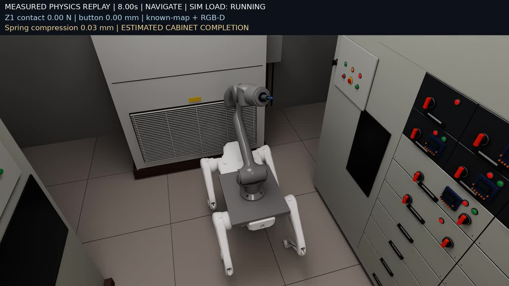
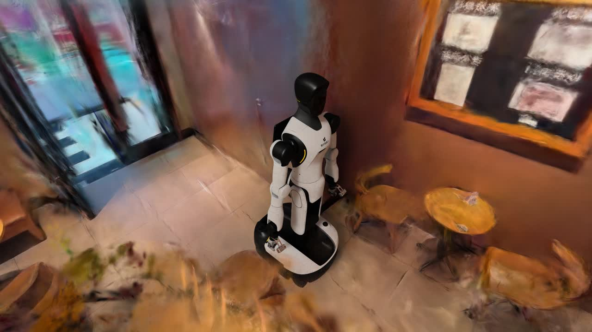
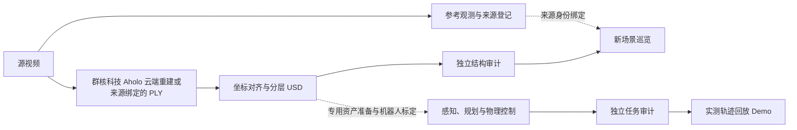

<div align="center">

# Video to SimReady

**从真实场景视频，到可交互、可验证的机器人仿真环境。**

Video reconstruction · USD scene preparation · Robot interaction · Evidence-driven repair

[](https://github.com/miracle-techlink/video-to-simready/actions/workflows/test.yml) [](pyproject.toml) [](docs/physical-assets.md) [](LICENSE)

[快速开始](#快速开始) · [Aholo API 接入](#与群核科技-aholo-api-的关系) · [技术白皮书](https://github.com/miracle-techlink/video-to-simready/releases/download/technical-report-2026-11-13-v5/simready-technical-report-zh.pdf) · [架构与代码](docs/software-architecture.md) · [部署指南](docs/deployment.md) · [示例](examples/scenes/README.md)

</div>

Video to SimReady 将视频观测、三维重建、分层场景资产、机器人控制与独立验收组织成可复用的流水线。系统用 3D Gaussian 表达场景外观，用独立几何、碰撞和关节表达可操作对象，并保存来源、配置、测量和产物之间的关联。

**上游三维重建接入群核科技 Aholo API；本项目负责从重建结果到仿真场景、机器人交互与独立验收的工程流程。** 具体分工与官方入口见 [Aholo API 接入说明](#与群核科技-aholo-api-的关系)。

当前提供**新视频生成场景与巡览、多类语义资产与物性配置、已有场景机器人演示，以及 Agent 修复与经验复用框架**。项目包含 45 页中文技术白皮书、12 张可编辑架构与方法图，以及本地、Docker 和服务器部署代码。本次 v0.8 的新模块与验证单独见[多类物性管线](docs/physical-assets.md)，历史 PDF 不冒充本轮实验报告。

## 演示

| 变电站 · Lite3 + Z1 | 星巴克 · G2 |
|:---:|:---:|
| [](docs/report/technical-report.md) | [](docs/report/technical-report.md) |
| 导航接近 → RGB-D 确认 → 机械臂按压 → 接触审计 | 已准备场景中的移动编排、跟随相机与原生渲染 |

以上为历史已准备场景的实际渲染画面。变电站有物理任务证据；星巴克为 G2 编排展示。新视频通用入口当前输出场景候选和巡览，仍需场景专用的资产准备与机器人适配，才能获得同等级的任务演示。

新增[星巴克双桌搬杯示例](examples/starbucks_grasp/README.md)：G2_90d 用合成 RGB-D 定位独立重建杯子，经关节驱动抓起并放到另一张桌子，保存接触力、实测位姿和独立验收。它覆盖固定基座与局部修复任务区，尚不代表整店修复或自主导航通过。

[星巴克场景修复与 Sim-Ready 验收](examples/starbucks_simready/README.md)为搬杯和原 30 秒巡逻提供统一入口：保留原视频重建，添加连续承托面、静态障碍碰撞、物性来源、实际场景落体检查与任务/路线验收。视觉缺陷和真实物性标定单独记录，不以视频完成代替验收。

场景版本已区分：最初的参数化局部背景只作物理验证；原场景模式保留原视频重建的全量高斯与原桌面外观，并用 `--require-original-video` 检查来源。原重建的模糊、残影等问题仍须单独修复和验收。

[查看真实验证结果](#验证结果) · [两个场景的启动说明](examples/scenes/README.md) · [下载报告与图册](https://github.com/miracle-techlink/video-to-simready/releases/tag/technical-report-2026-11-13-v5)

## 核心能力

- **视频到场景候选**：来源登记、抽帧、Aholo 重建提交与恢复、已有 PLY 复用，以及坐标与高斯格式处理。
- **资产物理化**：Grounding DINO + SAM 多类候选、同视角 RGB-D 关联、逐对象摩擦／质量／惯量声明和独立 USD 检查；外观、碰撞与交互分层。默认参数明确标记为未测量先验。
- **机器人运行时**：统一设备端口，接入步态、RGB-D 定位、FK/IK、路径检查和接触监督；具体能力按机器人与任务验证。
- **独立验收**：分别检查 USD 结构、固定视角质量、资产一致性和机器人任务，保存测量、缺陷、审计与交付记录。
- **Agent 与 RSI**：从注册插件生成有限修复方案，独立复验后决定接受；Memory/Skill 复用经验证的参数配方。
- **可恢复执行**：显式输入与产物哈希、阶段回执、失败目录、进程监督，以及可单独复用的任务图、资源租约和内容缓存。

## 与群核科技 Aholo API 的关系

[Aholo 是群核科技的空间智能开放平台](https://manycoretech.com/product)。Video to SimReady 通过其公开的三维重建 API 上传视频、创建异步任务、查询进度并下载三维高斯产物，以此作为场景外观的初始表示。

| 技术层 | 提供方与职责 |
|---|---|
| 上游云端重建 | **群核科技 Aholo**：运行云端三维重建服务，提供任务状态和 PLY / SPZ 等产物。 |
| 重建结果到机器人仿真 | **Video to SimReady**：实现 API 客户端与可恢复编排、坐标与高斯格式处理、外观／碰撞／交互分层 USD、机器人运行时、独立验收和原生渲染，并提供插件化修复与 Memory／Skill 经验复用框架。 |

本仓库开源 API 接入、工作流编排与仿真处理代码；Aholo 的云端重建模型与训练实现由服务方提供。既有变电站与历史星巴克示例的重建底稿采用 Aholo，VGGT→gsplat 保留为独立研究分支。新增双桌搬杯案例复用 Aholo 三视图重建杯；任务区使用本地 3DGS 配准参考、原片纹理投影和显式几何补建，分别记录来源。将新场景用于机器人任务仍需对应的资产准备、尺度标定和任务验证，具体范围见[验证结果](#验证结果)。

- **Aholo 平台与 API Key 入口**：[Aholo 空间智能实验室 · labs.aholo3d.cn](https://labs.aholo3d.cn/)
- **官方 API 文档**：[接口简介 · labs.aholo.ai/api-docs/intro](https://labs.aholo.ai/api-docs/intro) · [调用流程与密钥配置](https://labs.aholo.ai/api-docs/quickstart)
- **本项目接入代码**：[HTTPS 上传客户端](src/simready/ingestion/aholo_client.py) · [任务提交、恢复与产物下载](src/simready/ingestion/aholo_reconstruction.py)

## 快速开始

### 1. 安装编排包

在 Linux 的 Python 3.10+ 环境中：

```bash
git clone https://github.com/miracle-techlink/video-to-simready.git
cd video-to-simready
python -m venv .venv
source .venv/bin/activate
python -m pip install -e '.[ingest,aholo]'
simready --help
```

Python 要求指宿主编排环境；仿真 worker 使用所选 Isaac 环境的解释器与依赖。发行包名仍为 `simready-pipeline`，CLI 仍为 `simready`。

| 运行方式 | 还需要准备 |
|---|---|
| 新视频 → USD 与巡览 | 原视频、宿主 FFmpeg、匹配的 Isaac 镜像和 RTX 环境；新云任务另需 `AHOLO_API_KEY` |
| 已有场景 → 任务或展示视频 | 对应的资产 bundle、机器人及策略，以及 Isaac worker 环境 |
| CPU 修复框架示例 | 下文的测试依赖；无需 Isaac、GPU、模型账号或私有场景 |

默认渲染后端为 Docker。镜像构建、环境检查、匹配版本与服务器命令见[部署指南](docs/deployment.md)。原视频、机器人资产、权重和 Isaac SDK 由使用者按许可准备。

### 2. 从新视频生成场景

按 [Aholo 官方快速开始](https://labs.aholo.ai/api-docs/quickstart)申请 API Key，通过环境或密钥管理器提供 `AHOLO_API_KEY`，准备好上面的运行环境后：

```bash
simready run --video /path/to/input.mp4 --out runs/new-scene \
  --submit-reconstruction --accept-eula
```

命令串接 **观测 → 重建 → 场景准备 → 独立结构审计 → 原生巡览**。`--submit-reconstruction` 显式允许创建云任务；已有来源绑定产物可通过 `--reconstruction-manifest` 离线复用。`--accept-eula` 用于已阅读并接受适用的 Isaac 许可条款。

常用扩展：

| 参数 | 用途 |
|---|---|
| `--scene-spec /path/to/scene.json` | 声明坐标、尺度来源、对象与物理参数 |
| `--reconstruction-manifest /path/to/reconstruction.json` | 使用与源视频绑定的已有 PLY；无需新云提交 |
| `--resume` | 输入、实现身份与产物均匹配时恢复原运行 |
| `--prepare-only --backend local --python /path/to/usd/python` | 使用兼容 OpenUSD 的解释器，只构建与检查场景 |
| `--dry-run` | 只读检查输入并打印计划 |

主产物包括 `scene.usda`、外观/碰撞/对象层、`asset_catalog.json`、结构审计和 `scene_survey.mp4`。运行根目录的 `summary.json` 指向实际交付位置。

**`SCENE_SURVEY_READY` 表示场景与巡览已生成。** 真实尺度、视觉保真度、全资产完整性和机器人任务仍需各自验证。完整命令、产物目录与恢复示例见[新视频指南](examples/new_video/README.md)。

### 3. 复现变电站或星巴克

先按[资产准备说明](examples/scenes/README.md)导出 `data/substation/bundle.json` 或 `data/starbucks/bundle.json`，再按需选择一条命令：

```bash
# Lite3 + Z1：物理任务 → 独立审计 → 实测轨迹回放
simready run --scene substation --accept-eula

# G2：已准备场景中的编排展示
simready run --scene starbucks --accept-eula
```

程序创建独立运行目录。变电站只有任务审计通过才继续录制，视频与证据位于该次运行的 `execution/delivery/`。`--bundle-spec` 可从已有资产规格导出；`--backend local` 选择本机解释器，已有场景模式另支持 `--backend ssh`，要求远端代码、镜像与资产事先就绪。

资产 bundle 不随源码发布。上述场景入口复现已准备资产；任意新视频的几何、控件与任务参数需要先完成适配。

固定基座 G2 的“从桌 A 搬杯到桌 B”用独立入口：

```bash
python examples/starbucks_grasp/run.py \
  --assets /path/to/cup_assets --out runs/cup_transfer \
  --model-python /path/to/model_env/bin/python --render
```

场景、输入准备、参数先验与限制见[双桌搬杯说明](examples/starbucks_grasp/README.md)。

### 4. 先在 CPU 上体验修复闭环

```bash
python -m pip install -e '.[test]'
python -m examples.repair_workflow.run_learning_demo --out runs/repair-demo
```

默认使用规则 Provider 和三个合成场景，演示修复、独立评分、跨场景验证、Skill 晋升与复用。它用于验证框架合同，不代表真实三维修复质量。更换模型 Provider、接入插件与共享经验库见[Agent / Memory / Skill 手册](docs/runtime.md)。

## 系统如何工作

### 多类语义资产与物性入口

```bash
python -m pip install -e '.[physical-assets,segmentation]'
simready workflows semantic-assets \
  --image /data/scene/image.png --calibration /data/scene/calibration.json \
  --ply /data/scene/splats.ply --scene-spec /data/scene/scene_spec.json \
  --out runs/semantic-assets
```

输入图像必须有匹配的相机与几何；已有场景可先采集同视角 RGB-D。输出分割、逐物体参数、USD、独立审计和分段耗时。默认是静态几何候选；真实材料精度、完整网格和门铰链等行为仍需验证。无需模型或私有数据的[贯通示例](examples/semantic_assets/README.md)、两张真实场景图的分割命令，以及[摩擦／质量 PhysX 响应实验](examples/physical_assets/README.md)均可公开复现。

### 视频与机器人交付路径



三层场景各有职责：**外观层**负责成像，**碰撞层**定义接触空间，**交互层**定义可动部件、关节和事件。通用新视频路径与已有场景任务通过各自合同验收。历史 VGGT→gsplat 是独立重建研究支路，当前交付底稿采用 Aholo。

修复工作流另行组合：冻结观测 → 缺陷清单 → 注册方案 → Agent 选择 → 可信插件执行 → 独立复验 → 接受或回退。经验只在版本和评估规则相容时复用，Skill 晋升需要跨场景验证；真实修复插件仍在逐项接入，新视频默认入口不会隐式运行整个循环。

[完整流程图](docs/report/pipeline-overview.md) · [3D 资产如何成为 SimReady](docs/report/asset-to-simready.md) · [十个代码模块的内部构造](docs/software-architecture.md)

## 验证结果

下表保留各实验的输入与执行范围；演示生成、结构通过和任务通过分别记录。

| 实验 | 已核验结果 | 运行范围 |
|---|---|---|
| 变电站已有场景入口 v0.6 | Lite3+Z1，**20/20** 项审计；一次按压；**713 帧、1080p、28.52 秒** | 入口 wall **1095.164 秒**，含启动和冷 shader；不含新重建或前置资产准备 |
| 星巴克展示 | 历史完整视频为 **4K、900 帧、30 秒**；v0.6 入口另完成 8 帧预览 | G2 编排展示；8 帧预览 wall 281.670 秒，与历史完整视频分别记账 |
| 星巴克双桌搬杯 | 一次固定基座运行通过 **18 项**检查；视觉定位误差 **0.58 mm**，放置误差 **7.05 mm**，松爪后支撑力 **0.834 N** | 合成 RGB-D、已知杯模型/桌面、预设物性；无导航、实物标定或跨场景成功率结论 |
| 新视频入口 v0.7 | 历史原片与声明绑定 PLY：CPU 导出 **7.951 秒**，恢复 **0.246 秒**；Docker 12 帧巡览 **231.874 秒** | 结构通过；原高斯仍有模糊和空洞，未验证视觉保真度、独立尺度或机器人任务 |

这些是功能与任务验证记录，不作为加速对照。包含一次全新云重建的完整端到端时间尚未测得。

证据：[新视频 v0.7](docs/report/new-video-validation.json) · [已有场景 v0.6](docs/report/one-command-validation.json) · [历史任务与研究结果](docs/report/evidence.json) · [性能协议](docs/benchmarks/substation_goal15.md)

### 机器人接入

| 构型 | 统一端口能力 | 当前验证范围 |
|---|---|---|
| Lite3 + Z1 | `joint_drive`，读取 articulation 实测状态 | 已有变电站步态、视觉定位、机械臂操作与接触审计 |
| G2 | `root_pose`，读写 USD authored 变换 | 星巴克编排展示；没有物理导航成绩 |
| G2_90d 双桌任务 | 独立的原生 articulation 关节驱动入口 | 固定基座，右臂抓杯、跨桌放置与接触验收；尚未替换通用 G2 端口 |
| 独立 Lite3 / Z1 | 相同接口的绑定模板 | CPU 合同验证；仍需对应构型的 GPU 任务验证 |

公共端口为 `describe`、`observe`、`command`。新增机器人还需关节映射、策略、安装/TCP、传感器和运动规划适配。见[机器人接入指南](examples/robots/README.md)。

## 扩展与开发

运行包位于 `src/simready`，按十个领域组织；CLI 只负责分发。完整类、函数、调用链和状态归属见[软件架构](docs/software-architecture.md)。

| 要扩展的能力 | 对应模块 | 入口文档 |
|---|---|---|
| 视频输入与重建来源 | `ingestion`、`workflows` | [采集、编排与执行构造](docs/report/code-parts-workflows.md) |
| 资产、机器人、任务与录像 | `simulation`、`geometry` | [仿真模块构造](docs/report/code-parts-simulation.md) |
| 修复插件与模型决策 | `repair`、`agents` | [质量与决策模块](docs/report/code-parts-quality.md) |
| 指标、经验和 Skill | `evaluation`、`experience` | [验收与经验机制](docs/report/code-parts-quality.md) |
| 进程、缓存、资源与证据 | `execution`、`core` | [执行机制](docs/report/code-parts-workflows.md)、[基础模块](docs/report/code-parts-foundation.md) |

```bash
python -m pip install -e '.[test,dev]'
python scripts/check_architecture.py
python -m pytest -q
```

CI 在 Python 3.10/3.12 上执行静态检查、CPU 测试和构包；依赖私有资产或 SDK 的检查按环境执行，GPU 任务证据单独保存。提交修复、插件或机器人适配前，请阅读[开发规范](docs/development.md)，明确输入输出、失败行为和验证范围。问题与建议可通过 [Issues](https://github.com/miracle-techlink/video-to-simready/issues) 提交。

### 后续方向

- 跨场景语义资产化、来源约束的纹理恢复与真实修复插件。
- [物性估计与验证开发计划](docs/plans/physical_properties.md)：参数来源与区间、材料推断、公开数据评测及按钮响应验证。
- 带尺度、实例和留出视角标注的多场景 benchmark。
- 新机器人与新布局的感知、规划、接触和回撤验证。
- 固定质量与任务门槛后的性能优化，以及跨节点调度与存储。

当前完整能力与待完成项见[项目状态](docs/release-status.md)。

## 文档与发布

| 想了解什么 | 入口 |
|---|---|
| 技术原理、公式与真实实验 | [45 页中文白皮书](https://github.com/miracle-techlink/video-to-simready/releases/download/technical-report-2026-11-13-v5/simready-technical-report-zh.pdf) |
| 全链路与模块内部构造 | [流水线总览](docs/report/pipeline-overview.md) / [代码架构](docs/software-architecture.md) |
| 图片、PDF 与可编辑生成源码 | [技术报告发布页](https://github.com/miracle-techlink/video-to-simready/releases/tag/technical-report-2026-11-13-v5) |
| 本地 Docker 与远端服务器 | [部署指南](docs/deployment.md) |
| 新视频配置、恢复与输出 | [新视频指南](examples/new_video/README.md) |
| 已有场景与资产迁移 | [变电站 / 星巴克示例](examples/scenes/README.md) |
| Agent、Memory、Skill 接入 | [运行手册](docs/runtime.md) |

## 许可与技术基础

原创代码采用 [MIT License](LICENSE)。Isaac SDK、场景视频、机器人资产、模型权重及云服务遵循各自许可；第三方材料的使用范围见 [THIRD_PARTY_NOTICES.md](THIRD_PARTY_NOTICES.md)。

项目接入[群核科技 Aholo 三维重建 API](https://labs.aholo.ai/api-docs/intro)，并基于或参考 [3D Gaussian Splatting](https://repo-sam.inria.fr/fungraph/3d-gaussian-splatting/)、[OpenUSD](https://openusd.org/)、[Isaac Sim](https://github.com/isaac-sim/IsaacSim) 与 [Isaac Lab](https://github.com/isaac-sim/IsaacLab)。研究分支及 SAM、DINOv2、Difix 等方法的具体使用范围和出处见技术白皮书。
