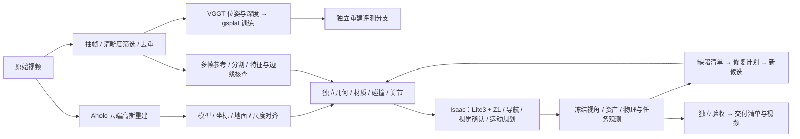

# PowerGrid Sim-Ready：视频到可观测、可修复的仿真场景

本项目把真实视频转换为三维场景、独立资产和机器人可交互的仿真环境，再用冻结观测协议检查修复是否有效。当前样例是变电站/配电房中的 Lite3 四足 + Z1 机械臂。

**本仓库目前提供历史重建实验代码，以及可运行的多场景任务调度与统一 benchmark 基础。完整视频→交付的自动化 worker 适配仍在进行。** 原始视频、训练权重、机器人模型与交付 USD 不包含在源码仓库中。

## 当前真实链路



已展示的估计补全版本使用 Aholo 提供空间底稿，再加入显式 Mesh/PBR 资产；可见场景主要来自独立几何。自训练的 VGGT 位姿→gsplat v3 是独立分支，尚未接入该最终场景。VGGT 使用预训练模型，并非本项目重新训练了 VGGT。

Difix 是可选的二维清晰化预览，不能代替可编辑三维资产修复。低置信度补全必须保留来源与估计标签；仿真按钮触发也不证明真实设备已断电。

## 速度审计结论

| 历史记录 | 耗时 | 解释 |
|---|---:|---|
| Aholo 成功任务 | 约 60 分钟 | 提交到成功，含服务端排队；另有约 89.5 分钟后失败的任务 |
| Difix 250 帧、720p | 23.18 分钟 | 本地可选清晰化预览，逐帧串行 |
| 原生渲染 250 帧、4K | 8.55 分钟 | 一次旧场景运行 |
| 近柜候选渲染 250 帧、4K | 20.41 分钟 | 不同候选，不能与上一行当作重复实验 |
| 机器人任务循环 | 4.51 分钟 | 模拟时间约 28.5 秒；不含 Isaac 启动与场景装载 |

这些是分散历史记录，不能相加当作同一版本的端到端耗时。最新最终视频与 v3 训练尚缺完整分阶段计时。主要已知问题是全局 GPU 锁、等待整机 GPU 空闲、重复启动 Isaac/模型、逐帧串行和高频 CPU↔GPU 同步。[审计证据与优化顺序](docs/PERFORMANCE_AUDIT.md)

大规模部署采用 **CPU / CUDA / RTX / 云端配额四个工作池**。优先让不同场景并行，随后减少局部修复的重算，再做单场景模型/内核优化。A100/H100 没有 RT Core，不受 Isaac Sim 官方支持；A100 池用于训练/视觉，Isaac 使用独立受支持设备。[NVIDIA 要求](https://docs.isaacsim.omniverse.nvidia.com/latest/installation/requirements.html)

## 安装与 CPU 快速验证

Python 3.10+，Linux（设备租约依赖 `flock`）。infra 使用标准库；benchmark 依赖 NumPy、SciPy 与 Pillow。不要求 CUDA 或 Isaac 即可跑以下示例。

```bash
python -m venv .venv
source .venv/bin/activate
python -m pip install -e '.[test]'
python -m pytest -q

# 四个合成场景的 DAG；仅模拟阶段耗时，不做真实重建。
python examples/infra/make_demo.py --out runs/demo-input
python -m simready_bridge.infra \
  --plan runs/demo-input/plan.json \
  --inventory runs/demo-input/inventory.json \
  --out runs/demo-first --cache runs/demo-cache --max-workers 4

# 相同输入，使用新运行目录，复用已校验产物。
python -m simready_bridge.infra \
  --plan runs/demo-input/plan.json \
  --inventory runs/demo-input/inventory.json \
  --out runs/demo-reuse --cache runs/demo-cache --max-workers 4

# 合成 RGB 观测器示例：PASS 仍不授权发布。
python examples/benchmark/make_fixture.py --out runs/benchmark-input
python -m simready_bridge.benchmark run \
  --protocol runs/benchmark-input/protocol.json \
  --candidate runs/benchmark-input/candidate.json \
  --out runs/benchmark-result
```

首次示例预期 16 个阶段成功，第二次 16 次缓存命中。目录必须是新的，避免覆盖既有证据。真实工作负载需用自己的 worker、输入文件、固定运行时身份与经过测量的资源 inventory 替换示例任务。

复现调度测试：

```bash
python scripts/benchmark_infra.py --out runs/scheduler-benchmark.json
```

测试同时比较串行、4 路并行和缓存复用，要求所有产物哈希相同。本机记录为 4.57 秒 → 1.20 秒，约 3.82 倍；16 个阶段缓存命中时为 0.012 秒。结果只代表合成 CPU 调度能力；真实 CUDA、Isaac 与端到端加速尚未测量。[已记录的测试结果](docs/benchmarks/scheduler_cpu_20261112.json)

## 模块边界

| 路径 | 当前职责 |
|---|---|
| `simready_bridge/artifacts.py` | 无数值依赖的内容哈希与并发安全 JSON 写入 |
| `simready_bridge/infra/` | 任务合同、按设备租约、资源预算、DAG、缓存和耗时 |
| `simready_bridge/benchmark/` | 观测、通用资产图比较、缺陷、修复计划、独立进程验收 |
| `configs/benchmark/` | 质量合同、跨场景资产一致性和插件注册 |
| `examples/`、`tests/` | 可重现合成示例与故障/隔离测试 |
| `s0_ingest/`、`s1_aholo/` | 历史抽帧与云重建脚本，需要本地参数适配 |
| `rsi_3dgs/`、`scene_bench/` | 历史修复/评分实验；协议与新 benchmark 不混算 |
| `warehouse_3dgs/` | 历史仓库采集、训练、渲染与 USD 工具 |
| `submission_template/` | 历史参赛提交流程，与场景运行时独立 |

此仓库目前没有 `s2_vggt` 至 `s5_eval` 的完整本地脚本快照，不能按这些不存在的路径复现。历史目录保留原行为，逐步通过 worker 适配器迁移，避免一次性重写丢失验证证据。

## 已实现与待完成

已实现：按设备独占而非整机全局互斥、CPU/RAM/云端并发预算、依赖失败传播、超时终止本任务进程组、输入/输出内容绑定缓存、每阶段日志、独立进程重新计算观测，以及结构/物体/零件/关系层面的资产一致性。

待完成：真实 VGGT/gsplat/Difix/Isaac worker 接入、跨机调度、模型热驻留、自动完整视角采集、物理/任务采集器、真实参考资产提取、密封多场景数据集、生产阈值标定与发布权限隔离。修复插件当前只生成计划，不自动执行。所有验收报告保留 `release_authorized=false`。

- [Infra 架构、任务接口、集群方案与底层优化](docs/INFRA_DESIGN.md)
- [耗时审计、代码冗余与可验证的优化顺序](docs/PERFORMANCE_AUDIT.md)
- [统一 benchmark 与通用资产一致性](docs/BENCHMARK.md)

## License

代码采用 MIT。第三方机器人、场景、模型权重和数据的许可由各自来源规定，不随本仓库授予。
