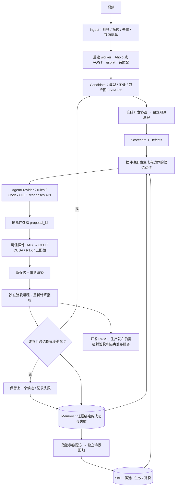

# Agent、Memory、Skill 与修复闭环

运行时只让 Agent 从已登记的修复方案中选择；任务执行、资源分配与验收由宿主代码完成。当前交付的是可运行的框架和合成场景示例，真实场景的重建、渲染、物理采集 worker 仍需适配。



## 模块接口

| 模块 | 输入 → 输出 | 不承担的职责 |
|---|---|---|
| `agent` | 有界 JSON 上下文 → `Decision`、usage、耗时 | 不运行场景命令，不修改验收标准 |
| `pipeline` | campaign 配置 → 迭代记录、最终候选指针 | 不直接实现训练、重建或渲染 |
| `plugins` | 缺陷、场景族、已验证配方 → 可执行任务模板 | 不接受 LLM 任意 shell/code |
| `infra` | 可信 DAG、inventory → 哈希绑定产物与日志 | 目前不是跨机器调度器 |
| `benchmark` | 冻结协议、候选 → 观测、缺陷、scorecard | 不提供尚未接入的物理/任务测量 |
| `memory` | 有证据的 episode → 按作用范围检索 | 不把未经验证的叙述当成功记录 |
| `skills` | 已验收成功经验 → 版本化参数配方 | 不修改基础模型权重，不自动安装任意代码 |
| `ingest` / `geometry` | 视频 / 显式坐标约定 → 帧清单 / 变换 | 不推断真实尺度或相机内参 |

所有运行产物放在用户指定的新目录；SQLite memory 可跨运行共享。模板、inventory 是可信本地配置，worker 以调用用户的 OS 身份运行。这些边界用于一致性校验，不构成恶意插件沙箱。

## 快速运行

```bash
python -m pip install -e '.[test,dev]'
python examples/agent/run_demo.py --out runs/agent-demo
```

三个合成场景依次完成：生成候选配方、在不同场景的预声明 validation campaign 中验证并晋升、检索生效 Skill 并复用。示例修改一个程序化模型的亮度参数并重新生成图像，不读取/复制参考图。仅允许在 `observer_calibration`、`synthetic_gt` 协议中执行，不能作为真实三维修复质量证明。

配置由示例写到 `runs/agent-demo/scene_0/campaign.json`。单次运行：

```bash
simready-pipeline run --config runs/agent-demo/scene_0/campaign.json --out runs/another-campaign
```

Python 接口：

```python
from pathlib import Path
from simready_bridge.artifacts import read_json
from simready_bridge.pipeline import run_campaign

config_file = Path('runs/agent-demo/scene_0/campaign.json').resolve()
result = run_campaign(read_json(config_file), base=config_file.parent,
                      out='runs/python-campaign')
```

`run_campaign(..., provider=custom_provider)` 支持实现 `AgentProvider.decide(context, out, timeout=...)` 的自定义适配器。返回 `ProviderResult(Decision(...), provider_name, usage, seconds, request_id)`，宿主重新验证动作和 usage。当前上下文是缺陷、提案与经验摘要 JSON；没有自动发送图像的多模态接口，也没有 HTTP 多租户服务。

## Codex 账号接入

```bash
codex login
codex login status
simready-pipeline doctor
python examples/agent/run_demo.py --out runs/codex-demo --provider codex --scenes 1
```

`CodexProvider` 复用本机 Codex 的已有登录。若要使用 ChatGPT 账号，先确认 `login status` 显示 `Logged in using ChatGPT`；doctor 仅返回状态，不读取或复制 `auth.json`。适配器清除子进程的 API key 环境变量，但已有 CLI 登录模式仍由 Codex 管理。

调用使用 `codex exec` 的结构化输出、JSON 事件流、只读沙箱、临时会话和独立工作目录，忽略用户配置并关闭 shell、unified_exec、multi_agent；输出 schema 固定，发生工具执行事件即拒绝该轮结果。当前 CLI 兼容性实测版本为 **0.167.0**，不宣称兼容所有历史 CLI。`--model` 可指定模型；省略时由 CLI 选择。

2026-11-12 的一次真实账号测试：1 次调用、1 轮修复，合成开发协议通过；输入 15,502、输出 80、总计 15,582 tokens，campaign 约 10.60 秒。计数包含 CLI 上下文开销，不能当作真实场景重建的 token 估算。只提交脱敏汇总，原始事件日志留在忽略目录。

参考：[Codex 非交互调用](https://learn.chatgpt.com/docs/non-interactive-mode)、[登录方式](https://learn.chatgpt.com/docs/auth)。持久交互会话可后续接 [app-server](https://learn.chatgpt.com/docs/app-server)，当前实现使用 CLI 子进程。

## Responses API 接入

将 campaign 的 `agent` 改为：

```json
{"kind": "responses", "model": "YOUR_SUPPORTED_MODEL", "key_env": "OPENAI_API_KEY"}
```

在进程环境中配置 API key，不写入 campaign、Git 或 memory。请求使用 `/v1/responses`、严格 JSON schema、`store=false`、显式模型和输出 token 上限。失败不自动重试，以免重复付费；HTTP 错误仅记录状态码。支持自定义 key 环境变量名。

Responses 请求结构与异常分支通过 mock 测试，尚未做真实 API key 付费调用。官方协议：[Structured Outputs](https://developers.openai.com/api/docs/guides/structured-outputs?api-mode=responses)。

## Memory / Skill 生命周期

1. 独立 verifier 产出 before / after scorecard；Memory 校验文件哈希，并自行比较结果。
2. 持久化场景、协议作用范围、插件版本、参数、动作、结果和证据。SQLite WAL 支持本机并发写入与重复记录去重。
3. 按场景族、benchmark 定义及代码身份、缺陷类型检索；同一场景/候选/协议上的失败动作不重复尝试。证据缺失或被改写的经验不会参与复用。
4. 只有改善且通过开发协议的 episode 可蒸馏为候选 Skill。
5. 至少两个不同注册场景通过，其中一个预声明为 validation，才能晋升。这里的 validation 是可见开发回归集，**不是密封发布集**。场景独立性由场景注册与数据管理保证，两个不同字符串本身不证明数据独立。
6. 插件代码/声明输入改变后，版本指纹改变；benchmark 代码/检查合同改变后，policy key 改变。旧 Skill 不跨这些边界自动复用。
7. 生效 Skill 若导致可测退化，自动退役；手动退役后不能静默重新激活。单纯执行错误会记为失败，不据此断言配方质量退化。

```bash
simready-pipeline skill-show --memory runs/agent-demo/experience.sqlite --skill-id SKILL_ID
simready-pipeline skill-promote --memory runs/agent-demo/experience.sqlite --skill-id SKILL_ID
simready-pipeline skill-retire --memory runs/agent-demo/experience.sqlite --skill-id SKILL_ID
```

这里的 Skill 是可审计的插件参数配方，不是 Codex 原生 `SKILL.md` 安装包，也不是模型自训练。经验随已声明插件能力积累，不能凭此宣称 Agent 学会了新的重建算法。

## 插件与验收合同

可执行注册表必须显式包含 `schema_version=1`、`execution_enabled=true`。每个插件声明 ID、版本、支持缺陷/场景族/profile、有界参数 schema、参数变体和任务 DAG。最后一个任务必须输出 `candidate.json`；模型和渲染产物也必须声明为输出。示例注册表由 `examples/agent/run_demo.py` 生成。

宿主绑定 `{input:candidate}`、`{input:protocol}`、`{input:parameters}` 和观测证据文件；插件只写本轮的新目录。参数文件含 `parameters` 与 `asset_ids`。`candidate.json` 必须符合 benchmark 合同并引用本轮真实产物。真实 worker 应固定环境/模型版本、显式输入依赖与随机种子；不能只固定一个会原地更新的模型路径。旧 `configs/benchmark/plugin_registry.v1.json` 是计划目录，与启用执行的注册表用途不同。

新候选始终在独立解释器进程重新验收。同一协议下，必选指标任何数值退化都会拒绝，即使总分变好或仍高于阈值；没有进展也不会接受。候选失败时保留上一个已接受候选指针，不覆盖输入。

停止条件：开发通过、缺少可用方案、Agent 请求停止/新证据、最大轮次、调用次数、累计 token、时间预算或异常。usage 未知时停止执行修复。token 预算在调用返回后核算，单次调用可能超过剩余额度，**不是服务端硬扣费上限**。wall budget 限制子进程和后续派发；哈希/本地 IO 与线程清理不保证精确到毫秒中断。当前不恢复崩溃进程现场，可用保留的候选和 memory 在新目录重新启动。

生产发布尚需：真实重建/渲染/物理 worker、完整视角覆盖、源资产清单、跨场景密封集、阈值标定，以及 verifier / worker / publisher 的 OS 或服务权限隔离。目前所有报告均为 `release_authorized=false`。
