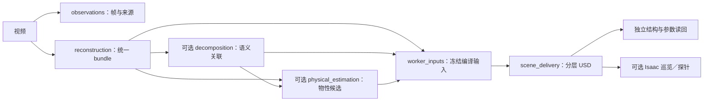

# 开发者指南：模块架构、baseline 与 benchmark 接入

本文面向首次接触仓库的算法与工程开发者，适用 `main` 的 v0.10 系列。项目将视频／已有重建结果转换为带来源证据的 USD 场景，并提供独立验收与 Isaac Sim 容器执行。阅读后应能定位实现、接入自己的重建算法、准备评测数据并提交可复现的改动。

这里的 **baseline** 指待比较的算法及其固定实现、权重和配置；**benchmark** 指固定的数据、划分、观测、指标和评分协议。二者通过产物文件连接，算法不直接向评分器提交自报成绩。

阅读路径：[模块与依赖](#模块与依赖) → [规范流水线](#规范流水线) → [接入重建 baseline](#接入重建-baseline)／[接入 benchmark](#接入-benchmark) → [测试与合并](#测试与合并)。方法综述和历史实验见完整分支的 [tech report](https://github.com/miracle-techlink/video-to-simready/blob/e15d71b77d40aae9867ac00b67adeb4a4af38e01/docs/report/technical-report.md)。

继续开发的任务、顺序和验收标准见[下一步 infra 开发交接](#下一步-infra-开发交接)。

当前完整主链支持 Gaussian PLY、保守碰撞代理、显式 box/button 资产及其参数读回。新算法可复用接入接口，但本仓库不因此宣称已复现 AnySplat、VGGT 或其它论文；任意视频的遮挡几何补全、真实物性辨识和完整机器人任务验收仍需专项开发。

## 设计原则

1. **一个职责，一处实现。** CLI 只分发；workflows 编排；assets 编译；execution 管进程与资源；evaluation 独立读回。共用文件按具体对象或行为命名，避免万能工具模块。
2. **先固定输入输出，再换算法。** 阶段以版本化配置、文件哈希、坐标尺度、环境身份和回执连接；新增 baseline 优先复用现有接口，有实际第二种实现再增加抽象。
3. **生成与验收分开。** 候选不能自证质量。命令成功、结构通过、物理响应和真实准确率分别记录；先验、推断、测量保留各自来源，未知保持未知。
4. **失败也留下证据。** 不覆盖成功回执，不隐藏失败样本；恢复前核对身份，升级保存新旧计划。耗时工作放隔离 worker，取消、期限与 GPU 租约统一交给 execution。
5. **保持核心范围。** 机器人专用任务、Agent 修复、经验库和活动资料在 [`aloho-hackson`](https://github.com/miracle-techlink/video-to-simready/tree/aloho-hackson)；通用修复按依赖单独移植，不整支回合并。

## 模块与依赖

仓库的运行实现集中在 `src`，配置、演示输入和测试各自维护：

```text
src/simready/       核心运行代码，按八个职责域组织
configs/           架构依赖约束、评测规则目录
examples/          pipeline / reconstruction / assets 三组最小示例
tests/             按职责域组织的回归测试；fixtures 为测试专用数据生成器
deploy/isaac/      Isaac Sim Dockerfile 与容器检查
scripts/           架构检查、CI 门禁检查、Isaac 启动入口
.github/workflows/ PR 与 main 的自动检查和安装包交付
docs/README.md     本开发指南
```

目录位于 [src/simready](../src/simready)。下表列出已存在的基础功能；允许依赖是代码边界，不是流水线执行顺序。[机器可检查的合同](../configs/architecture/module_boundaries.json)是依赖约束的唯一来源。

| 模块 | 职责 | 允许依赖 |
|---|---|---|
| [core](../src/simready/core) | JSON、SHA256、证据引用、重建 bundle 合同、基础类型与校验 | 无 |
| [geometry](../src/simready/geometry) | 坐标变换、相机参数、深度反投影、多边形运算 | 无 |
| [execution](../src/simready/execution) | 任务图、进程／容器、嵌套取消、超时、GPU 租约、产物缓存 | core |
| [assets](../src/simready/assets) | Gaussian 外观、mask 的空间关联、物性来源与候选采用、分层 USD 编译 | core、geometry |
| [ingestion](../src/simready/ingestion) | 视频抽帧；artifact/command/Aholo；Grounding DINO＋SAM、语义分割适配；NeRF2Physics 数值适配 | core、geometry、execution、assets |
| [simulation](../src/simready/simulation) | Isaac 环境检查、相机标定与 RGB-D、场景巡览、物性探针 | core、geometry、execution、assets |
| [evaluation](../src/simready/evaluation) | RGB／深度／实例／资产图指标、冻结协议评分、独立 USD 结构和参数读回 | core、execution |
| [workflows](../src/simready/workflows) | 配置解析、计划与阶段回执、恢复／升级、语义资产编排、baseline 矩阵 | 除 geometry 外的上述领域 |

域内按以下职责组织；core、geometry 及小型仿真 worker 保持平铺：

```text
execution/
  resources/       资源池、GPU 能力与物理设备身份
  processes/       子进程、监督、嵌套取消、远端状态轮询
  workers/         Isaac 启动、容器与设备租约、清理恢复
  tasks/           任务 schema、环境、依赖图与缓存
workflows/
  contracts/       字段／路径校验、阶段身份与回执
  stages/          语义、物性和视频执行等阶段组合
  planning/        视频合同、pipeline 计划与输入冻结
  pipelines/       配置入口、完整视频链、语义资产链、baseline 矩阵
ingestion/
  reconstruction/ artifact／command／Aholo 适配与重建产物规范化
  segmentation/   检测／分割后端适配
  video_frames.py 视频抽帧与来源记录
  nerf2physics.py  缓存特征回归／预测回放
assets/
  appearance/     Gaussian 外观解码与资产写入
  association/    mask、标定与空间语义关联
  physics/        物性规格、来源、先验、候选采用与 USD 参数写入
  compilation/    场景规格校验、碰撞代理、USD 图层与场景组合
evaluation/
  inspection/     独立解释预期、读取 USD、数值比较与检查报告
  域根文件        原始观测、资产图、协议、评分、进程隔离验证
```

依赖从组合层指向基础层，例如 workflows 的 pipelines 可以调用 planning/stages/contracts，contracts 不反向调用 pipelines；具体规则以合同为准。compilation 内分开规格校验、碰撞几何、USD 写入和场景组合；inspection 内分开期望解释、数值比较、物理检查和报告。架构检查同时拒绝越界依赖、子模块反向依赖、实际导入环、未分类根模块及未声明的动态导入。运行时代码不导入 tests 或 examples；evaluation 不导入资产 writer；模型和 SDK 在选定 worker 内加载，`--help` 不启动它们。

代码按“薄入口 → 配置与计划 → 阶段函数 → 隔离 worker → 文件产物 → 独立验收”构造。查一条实际调用链可以从 [cli.py](../src/simready/cli.py) 的命令分发开始，再看 [pipeline_config.py](../src/simready/workflows/pipelines/pipeline_config.py)、[video_pipeline.py](../src/simready/workflows/pipelines/video_pipeline.py)、[providers.py](../src/simready/ingestion/reconstruction/providers.py)、[scene_preparation.py](../src/simready/assets/compilation/scene_preparation.py) 和 [inspection](../src/simready/evaluation/inspection)。CLI 不承载算法；模型推断、USD 编译和指标计算各留在所属模块。

v0.10 调整了内部 Python 模块路径，公共 `simready` 命令、配置 schema 与验收阈值保持不变；已有八个 simulation 资产兼容入口继续转发到唯一实现。自定义 Python 调用应更新到对应子包。代码身份覆盖子目录，旧运行不能伪装为新代码结果；使用新目录或显式 `--upgrade`，保留旧计划及证据。

`tests/` 与实现同版本维护；`scripts/` 只保留架构检查、CI 门禁检查和 Isaac 启动入口；`.github/workflows/` 配置自动执行这些检查。三者留在 main，便于 PR 审查及复现；测试与脚本不进入安装用 wheel，源码包保留它们。

## 规范流水线

入口：`simready run --pipeline pipeline.json --out runs/<新运行>`。与 `--video` 共用视频工作流及阶段回执。配置解析见 [pipeline_config.py](../src/simready/workflows/pipelines/pipeline_config.py)，可运行输入见 [CPU 示例](../examples/pipeline/README.md)。



重建支持 `artifact` 导入、`command` 隔离算法和 `aholo` 云任务；新云提交须显式 `--submit-reconstruction`。统一 bundle 记录算法、文件、坐标尺度、所用数据及执行方式。**当前 USD 主链支持 Gaussian PLY**；mesh 等新表示需要真实转换器和独立验收，不能只登记名称。

可选 `decomposition.provider=semantic_projection` 消费已有 mask、标定和来源关联；完整分割命令在[语义示例](../examples/assets/README.md#语义关联)。目前产出可见表面的盒体代理，完整遮挡几何仍待实现。

可选 `physics.provider=nerf2physics` 消费 request，`provider=candidate` 导入已有候选，详见 [NeRF2Physics 示例](../examples/assets/README.md#nerf2physics)。当前是缓存特征回归／预测重放，不含新视觉模型推断。采用质量须匹配明确 box 对象、kg 单位及尺度证据；与显式质量冲突则拒绝，不自动改变运动类型或接触参数。独立 USD 读回只证明写入正确，真实物性仍需测量对照。

| 操作 | 含义 |
|---|---|
| `--dry-run` | 校验配置、生成计划 |
| `--until reconstruction` | 只交付中间产物，不代表场景完成 |
| `--resume` | 计划完全一致，核验后复用成功阶段 |
| `--upgrade` | 保存新计划，只复用身份仍一致的阶段 |

配置路径相对配置文件；未知字段、缺失文件和非法预算提前拒绝。阶段身份绑定配置、输入、代码、环境及上游；成功回执保存在 `stages/<阶段>/<身份>.json`，失败另记。外部 Python／Docker 须提供带 SHA256 的 `execution.environment_manifest`。带 secrets 的 command 要求新运行目录，不支持规范 pipeline 的恢复／升级。

输出包括计划、`summary.json`、阶段回执、观测与重建文件、冻结的 worker 输入，以及 `scene.usda`、`appearance.usdc`、`collision.usda`、`objects.usda`、对象目录和检查报告。以回执记录的实际路径和哈希读取产物。`SCENE_EXPORTED` 表示导出与结构检查通过；`SCENE_SURVEY_READY` 另包含巡览与编码检查，二者均保持 `task_validated=false`。

## 开发与扩展

| 要增加什么 | 从哪里接入 | 必须一起验证 |
|---|---|---|
| 重建 baseline | [command 适配示例](../examples/reconstruction/README.md) → reconstruction bundle | 输入／权重／环境身份、格式与尺度、失败及恢复 |
| 语义、物性或新资产表示 | ingestion 产候选，assets 关联／编译 | 对象绑定、单位、来源、真实转换，evaluation 独立读回 |
| Isaac 功能 | simulation worker，复用 execution launcher | 有限期限、嵌套取消、GPU 生命周期及原始输出 |
| 指标或质量门槛 | evaluation、每次评测的冻结协议与[规则目录](../configs/evaluation/suite.v1.json) | 正负例、缺失证据、数据划分、阈值版本与独立评分 |

开发顺序：先定义输入输出与失败条件 → 添加最小可复现实例 → 实现所属模块 → 补独立验证 → 比较升级前后结果。改 schema、单位或阈值要显式版本化；不要为了让新算法通过而放宽旧门槛。

优先用配置接入已有合同。确需新代码时，外部模型适配放 `ingestion`，通用表示转换放 `assets`，纯指标放 `evaluation`，多阶段组合放 `workflows`；不要在 CLI 或示例脚本中复制运行实现。新子模块同步声明架构归属。代码身份会递归覆盖子目录；新增外部权重、配置和依赖也须纳入文件身份。

## 接入重建 baseline

### 1. 先跑通现有接口

在仓库根目录、已激活的 Python 环境执行。首次安装见[测试与合并](#测试与合并)，需要系统 FFmpeg。以下目录必须尚不存在；重跑时换新的目录名。

```bash
python examples/reconstruction/prepare_fixture.py --out runs/baseline-inputs
simready run --pipeline runs/baseline-inputs/synthetic_cpu.json \
  --out runs/baseline-one --until reconstruction
simready workflows baseline-matrix --matrix runs/baseline-inputs/matrix.json \
  --out runs/baseline-matrix --dry-run
simready workflows baseline-matrix --matrix runs/baseline-inputs/matrix.json \
  --out runs/baseline-matrix --until reconstruction
```

这会生成一个 command 后端和一个 artifact 导入后端，验证接口与来源绑定；合成单点 Gaussian 不产生模型精度结论。生成器 [prepare_fixture.py](../examples/reconstruction/prepare_fixture.py) 是可修改的接入起点。

### 2. 为自己的模型写薄适配器

适配器接收 `--video <输入>`、`--out <输出目录>`，调用固定版本的模型实现，导出实际 PLY，并在输出目录写 `reconstruction.json`。可参照 [cpu_fixture.py](../examples/reconstruction/cpu_fixture.py) 的文件协议；替换其中的合成数据生成部分。

以下是适配器输出清单的结构示意，尖括号须替换为实际值，不能直接执行：

```json
{
  "schema_version": 1,
  "status": "COMPLETE",
  "source_video_sha256": "<原视频 SHA256>",
  "artifacts": [
    {"kind": "ply", "path": "scene.ply", "sha256": "<PLY SHA256>", "bytes": 12345}
  ]
}
```

路径位于输出目录内，`bytes` 是实际文件长度；清单完成后才成功退出，失败返回非零退出码。下游会检查来源与文件内容，再生成包含算法、坐标、数据划分和执行来源的标准 `reconstruction_bundle`；模型不必自己拼装执行器回执。

### 3. 冻结后端配置与环境

修改生成器中的 command 配置，重新生成文件；`provider.json` 的内容放入 pipeline 的 `stages.reconstruction`，不是只填它的文件名。

| 字段 | 开发者需要提供 |
|---|---|
| `provider` / `representation` | `command` / `gaussian_ply`；已有结果使用 `artifact` 及哈希绑定的 `manifest` |
| `algorithm` | `name`、固定 `version`、`implementation_sha256`；实现哈希必须对应一个 `input_files` 文件 |
| `argv` | 字符串数组；占位符仅支持 `{python}`、`{video}`、`{out}`、`{input:NAME}`；可执行文件用绝对路径或 `{python}` |
| `input_files` | 实现文件、模型权重、模型配置等命名依赖，每项为 `{path, sha256}`；同时固定实际代码版本与完整环境，不能只追踪启动脚本 |
| `runtime_identity` | 环境清单的 `{path, sha256}`，记录 Python、关键依赖、模型版本等；清单是声明，不会自动安装环境 |
| `environment` | 显式继承变量与 secrets；参考生成配置，勿把密钥写进 argv 或清单 |
| `resources` | `{"kind":"cpu"}` 或 `{"kind":"cuda","gpu":"0"}`；GPU 通过共享租约申请 |
| `frames` | `status`、不相交的 `training` / `heldout`（各项含 `id`、`sha256`）与 `evidence` |
| `coordinates` | `frame`、`unit`、`scale_status`、`evidence`；米制验证必须有尺度证据 |

所有文件引用使用实际 SHA256；可以复用 `core.evidence.reference(path)` 生成。保留明确的 `base_dir`。不知道的数据划分／尺度应保持 `unknown`；完整字段与校验见 [reconstruction_contract.py](../src/simready/core/reconstruction_contract.py)。

`{python}` 指执行适配器的当前解释器，不会创建模型环境。先在固定环境中安装模型；更换 pipeline 的外部解释器或 Docker 环境时，同时提供 `execution.environment_manifest`。执行层负责期限、取消和资源，不负责替模型解析依赖。

### 4. 从重建升级到完整场景

先用 `--until reconstruction` 验证产物，再按照 [pipeline 示例](../examples/pipeline/README.md)补充 scene spec、坐标尺度和执行环境，完成 CPU USD 编译及独立读回；需要渲染时再启用 Isaac。标准 bundle 合同可描述 mesh/point cloud，但当前后端规划与 USD 主链仅接受 `gaussian_ply`。新表示需要实现转换、资产编译和对应验收，不能仅修改配置名称。

### 5. 比较多个 baseline

[矩阵](../examples/reconstruction/README.md#比较后端)至少包含两个成员，每个成员绑定自己的 pipeline。`fixed_observations` 固定观测和非重建配置；`end_to_end` 允许端到端差异。固定数据、预算及环境，分别报告新推断、导入和缓存命中，保留失败与未执行成员；默认止于重建，`--full` 才继续场景交付。

真实质量比较需要 `purpose=quality_comparison`，共享的 `evaluation.protocol`、`evaluation.camera_evidence` 和每个成员的 `candidate`，均用 `{path,sha256}`。candidate 必须引用实际重建产物，并提供 `comparison_evidence` 中的视频、PLY、相机 SHA256。protocol/candidate 的 fit 声明须匹配重建训练帧，参考视图须属于不相交的 heldout 集。

**矩阵不会自动渲染并创建 candidate。** 可先运行模型、冻结重建、在固定相机下生成候选视图，再使用 artifact 配置比较已有结果；这次运行计为导入，模型推断成本单独报告。合成或估计参考在当前质量矩阵中保持 `NOT_EVALUATED`。标记 heldout 不会阻止模型访问完整视频，实际数据隔离仍需开发者保证；矩阵不自动排名或晋升默认后端。

## 接入 benchmark

### 已有评分能力与扩展位置

评测由四部分组成：**数据适配器 → 冻结 protocol → 候选产物与固定视图 → 独立评分**。当前没有任意数据集的一键下载／注册接口；新数据集要先转换成下述文件合同，原始数据和模型权重保存在仓库外。

| 已有能力 | 代码与使用范围 |
|---|---|
| RGB PSNR、SSIM | [observations.py](../src/simready/evaluation/observations.py)：均值、P10、最差区域；8-bit RGB，同尺寸，不自动曝光拟合或缩放 |
| 深度误差与有效率 | 同上：米制 `.npy` 深度；有效率与 MAE 分别记录，缺失预测不当作零误差 |
| 实例与资产关系 | 像素实例缺失／多余／类别与中心误差；[asset_graph.py](../src/simready/evaluation/asset_graph.py) 检查声明的对象、位姿、尺寸、状态和关系 |
| USD 与物性一致性 | [inspection](../src/simready/evaluation/inspection)：重新读取 USD 与原始声明比较，不代表真实物性测量 |
| NeRF2Physics 数值评估 | [nerf2physics.py](../src/simready/evaluation/nerf2physics.py)：独立数值评估入口；未自动并入所有场景评分 |

LPIPS、CD、法向一致性、F1、ADD-SB，以及通用机器人策略评分尚未接入当前场景评分器。添加新指标时在 `evaluation` 实现计算与原始证据读取，接到 `observe()` 的 metrics，再加入版本化 protocol 的 checks；不能只在 JSON 中添加指标名。缺少测量或未标定阈值会得到 `INCOMPLETE`。

### 数据与文件合同

1. 固定数据版本、许可、场景／拍摄会话／帧划分、单位、相机与预处理。fit 包括重建、相机估计和纹理拟合；评测帧不得参加这些步骤。数据转换器只转换格式，不接触候选成绩。
2. 创建每次评测的 `protocol.json`：定义参考观测、profile、phase、指标与阈值。`configs/evaluation/suite.v1.json` 是项目规则目录，**不能直接作为 CLI 的 protocol**。
3. 每个算法创建 `candidate.json`：绑定 protocol 哈希、实际模型产物、按相同 `view_id` 渲染的 RGB／可选深度和实例数据。相机、分辨率和裁剪在评测前固定；评分器不会自动寻找最佳对齐。
4. 用独立评分入口运行，保存完整输出；按场景汇总时保留失败、缺失样本和未测指标，再报告统计值。

| 文件 | 必需内容与常用扩展 |
|---|---|
| `protocol.json` | `schema_version=1`、`benchmark_id`、`phase`、`profile`、`views`、`checks`；可选 fit 声明、asset_graph 与 evidence_files |
| `protocol.views[]` | `view_id`、`asset_id`、`frame_id`、与 phase 一致的 `split`、`reference_kind`、哈希绑定的 `rgb`；可选 camera、regions、depth、instances |
| `protocol.checks[]` | 唯一 `check_id`、track、metric、op、limit、required、severity、calibration |
| `candidate.json` | `schema_version=1`、`candidate_id`、`protocol_sha256`、非空 artifacts、views；如实声明 fit 帧与图像哈希 |
| `candidate.artifacts[]` / `views[]` | 产物含 `artifact_id/path/sha256`；视图含 `view_id/rgb`，可附预测 depth／instances |

引用路径相对各自 JSON 所在目录。RGB／ROI 至少 11×11；depth 为米制二维数组，参考视图声明 `depth_unit="m"`。`reference_kind` 区分 `real_capture`、`synthetic_gt`、`estimated`。具体校验以 [protocol.py](../src/simready/evaluation/protocol.py) 为准。

`observer_calibration` profile 只要求 coverage、appearance；`reconstruction` 还要求 source、geometry；`simready` 再要求 instances、physics、tasks、delivery。当前通用 collector 尚未覆盖全部 track；完整 profile 需补齐真实采集与评分，不能通过删除必需 track 获得完整验收结论。

### 最小可运行评分示例

下面独立生成一对相同的合成图，演示文件合同和评分入口。它是评分器自检，不能作为重建算法成绩。命令在仓库根目录运行，输出目录须尚不存在。

```bash
python - <<'PY'
from pathlib import Path
import numpy as np
from PIL import Image
from simready.core.artifacts import digest, write_json
from simready.core.evidence import reference

root = Path("runs/benchmark-inputs").resolve()
root.mkdir(parents=True, exist_ok=False)
pixels = np.random.default_rng(7).integers(0, 256, (64, 64, 3), dtype=np.uint8)
for name in ("reference", "render"):
    Image.fromarray(pixels).save(root / f"{name}.png")
(root / "fixture.bin").write_bytes(b"synthetic observer fixture; not a model")
protocol = {
    "schema_version": 1, "benchmark_id": "observer-demo-v1",
    "profile": "observer_calibration", "phase": "development",
    "fit_frame_ids": [], "fit_image_sha256": [],
    "views": [{
        "view_id": "front", "asset_id": "scene", "frame_id": "heldout-001",
        "split": "development", "reference_kind": "synthetic_gt",
        "rgb": reference(root / "reference.png")
    }],
    "checks": [
        {"check_id": "coverage", "track": "coverage",
         "metric": "coverage.observation_fraction", "op": ">=", "limit": 1,
         "required": True, "severity": "critical", "calibration": "structural"},
        {"check_id": "rgb", "track": "appearance",
         "metric": "appearance.psnr_db.mean", "op": ">=", "limit": 22,
         "required": True, "severity": "major", "calibration": "legacy_development"}
    ]
}
write_json(root / "protocol.json", protocol)
write_json(root / "candidate.json", {
    "schema_version": 1, "candidate_id": "observer-fixture",
    "protocol_sha256": digest(root / "protocol.json"),
    "artifacts": [{"artifact_id": "fixture", **reference(root / "fixture.bin")}],
    "views": [{"view_id": "front", "rgb": reference(root / "render.png")}],
    "fit_frame_ids": [], "fit_image_sha256": []
})
PY
simready evaluation run --protocol runs/benchmark-inputs/protocol.json \
  --candidate runs/benchmark-inputs/candidate.json --out runs/benchmark-score
```

预期 `PASS` 且 `release_authorized=false`。22 dB 仅为该开发示例阈值；真实 benchmark 必须按其协议固定指标定义与阈值。输出为 `observations.json`（重算指标与输入证据）、`scorecard.json`（逐项评分）、`verifier_code/`（评分代码快照），development 另有 `defects.json`。退出码：通过为 0，失败／未完成为 2，非法输入为 3。

`sealed_release` 不输出缺陷列表，编排接口也不向修复方返回详细观测；文件访问仍需部署侧隔离。哈希保证身份一致，不证明渲染来源可信；当前结果不授予发布权限。单独的物理读回、探针或数值报告，需实现证据适配后才能进入统一 scorecard。

### 新 benchmark 的最小交付

提交数据格式适配代码、可公开的小型合成夹具、协议版本与指标定义、复现命令，以及正常／缺失／错配输入的验证。至少覆盖“相同观测通过、可见错误失败、缺视图不通过、哈希变化被拒绝、fit 与评测重叠被拒绝”。新增指标应用独立数值参考核对。测试放 `tests/evaluation`，不得以候选自报分数或 success 标志作为测量。

## 测试与合并

| 层级 | 验证目的 |
|---|---|
| 合同与边界 | 非法输入、哈希／对象错配、架构依赖、缺失证据必须失败 |
| 阶段 CPU 测试 | 数值、参数编译、独立读回、取消与资源清理 |
| 完整链与安装包 | 合成视频 → USD → 验收，恢复／局部升级；仓库外安装 wheel 后运行 |
| 真实算法／GPU | 固定数据、模型和镜像，实际推断／Kit 渲染／PhysX 与独立对照 |

需要 Python 3.10+、系统 FFmpeg；开发环境执行：

```bash
python -m pip install -e '.[dev,test,physical-assets]'
ruff check src/simready tests examples scripts deploy
ruff format --check src/simready tests examples scripts deploy
python scripts/check_architecture.py
python -m pytest -q
python -m build
```

日常先跑受影响测试，提交前走完整检查；共享夹具放 tests/fixtures。场景验收要求必需项全部通过，候选自报成功不能替代证据；密封集诊断不返回修复流程。合成数据、结构通过或 CPU 测试均不证明真实场景质量，报告保持 `release_authorized=false`。

[CI 工作流](../.github/workflows/test.yml)执行静态检查、Python 3.10/3.12 完整测试、sdist/wheel 隔离安装与 CPU pipeline；`merge-gate` 要求全部成功。PR 检查当前提交，正常合并后 main 重跑并交付绑定 SHA 的安装包；不自动部署 GPU 或发布 PyPI。[保护配置](../.github/main-protection.json)须在 GitHub 实际生效，不能只提交文件或绕过检查。

提交 PR 时说明改动属于哪一层、接口是否变化、如何复现、实际跑过哪些测试、还有哪些未验证项。算法 PR 附固定输入／模型／环境身份与失败记录；指标 PR 附定义、独立数值对照和缺失数据规则。依赖放对应的可选 extra 或隔离模型环境，避免增加所有用户的安装负担；不提交权重、大型数据或密钥。

## 容器与运行

构建与启动检查见根目录 [Isaac 快速开始](../README.md#isaac-sim-worker)。[Dockerfile](../deploy/isaac/Dockerfile)固定 Isaac Sim 6.1.0，额外使用 `usd-exchange==3.0.1` 提供高斯 schema；宿主 CPU 编译需 OpenUSD 26.8+。CPU 编译和 Kit 在独立进程运行，镜像不包含模型权重、场景或密钥。

规范配置使用 `execution.backend=docker`、不可变 `execution.image`、环境清单及 `delivery.mode=prepare/survey`；Docker／渲染须接受许可 `--accept-eula`。源码和输入只读挂载，输出独立。自定义启动用 `scripts/launch_isaac.py --worker <Python argv…>`，worker 参数放最后；容器路径为 `/workspace`、`/assets`、`/output`。完整视频命令见[新视频示例](../examples/pipeline/README.md#真实视频)，动力学检查见[物性示例](../examples/assets/README.md#显式物性)。

execution 统一持有物理 GPU UUID 租约，嵌套本地 worker 经受控凭据借用；取消沿所属进程组与继承管道传播。容器未确认停止就保留设备隔离，使用 `simready execution recover-device --help` 查看核查恢复入口，不手动删锁。CPU／CUDA／RTX 资源分别声明；CUDA 可见性不等于 Vulkan 隔离，未知显存不虚报容量。

任务是可信代码，worker 进程分离不提供安全沙箱。环境变量显式声明，secrets 或未跟踪的旧环境关闭缓存；密钥不写入配置／argv。多机调度尚未实现，SSH 使用预备环境且断线不保证远端已取消。GPU 改动必须另存输入、实际镜像 ID、日志和验收结果，CPU CI 不代替这项检查。

## 下一步 infra 开发交接

本节可直接交给 Claude 或其他开发者执行。**这是下一轮开发计划，下面标为“拟新增”的接口和模块目前尚不存在。** 核对基线为 2026-11-14 的 main `e63f77b`（v0.10.0）；本指南通过 [PR #20](https://github.com/miracle-techlink/video-to-simready/pull/20) 更新。开工时核对最新 main 和该 PR 状态，在工作分支开发并保留已有改动；按最新代码调整路径，不重置他人的工作区。

### 本轮目标与范围

交付一条可复现的评测执行链：

```text
冻结数据与相机、模型配置、渲染配置、评分协议
  → 重建／导入 → USD 编译 → 固定视角观测
  → 自动构建 candidate → 独立评分 → 多成员／多场景汇总
```

用户应能提交配置后获得逐视图指标、缺失／失败记录和来源证据，无需手工生成 candidate。同一结果可核验后恢复；修改相机只重跑渲染及评分，修改评分阈值只重跑候选绑定／评分；上游模型结果保持可复用。

本轮负责合同、编排、执行、证据与测试。第一条实际渲染路径为现有 Gaussian USD＋Isaac；先用合成夹具和来源绑定的真实重建产物验证。新增模型推理通过现有 command 接口另行适配，不把模型训练或下载大型数据集设为 CPU 开发前提。任意 mesh 转换、物体补全、完整 NeRF2Physics 视觉链、机器人策略、Agent 修复和跨节点调度列为后续工作，不纳入本轮完成声明。

### 开始前必须理解的现状

| 现状／代码入口 | 下一步如何使用 |
|---|---|
| [providers.py](../src/simready/ingestion/reconstruction/providers.py) 已有 command/artifact/Aholo | 复用后端执行与 bundle，保留导入／新推断／缓存的区别 |
| [stage_ledger.py](../src/simready/workflows/contracts/stage_ledger.py) 的 `stage_identity`、`StageLedger` | 为渲染与评分分别保存身份和回执，调用方继续负责运行锁与 attempt 目录 |
| [baseline_matrix.py](../src/simready/workflows/pipelines/baseline_matrix.py) 的 `plan_matrix`、`execute_matrix` | 当前串行执行成员，candidate 必须在规划时存在；需增加“运行后生成候选”的路径，保留已有外部 candidate 路径 |
| [depth_observation.py](../src/simready/simulation/depth_observation.py) | 已有单视图相机转换、RGB-D 捕获和输入哈希；优先封装复用，不能直接把巡览截图当作参考相机渲染 |
| [verification.py](../src/simready/evaluation/verification.py) 的 `verify_candidate` | 使用新进程重算，带超时和 protocol 身份；不要从编排器直接填成绩 |
| [execution/tasks](../src/simready/execution/tasks) 与 [execution/workers](../src/simready/execution/workers) | 复用任务图、GPU 租约、容器和清理；不再增加第二套 scheduler／锁目录／重试器 |
| [module_boundaries.json](../configs/architecture/module_boundaries.json) | 保持 evaluation 不依赖 assets writer／simulation／workflows；新增代码按现有层次归属 |

当前评分器只有部分 collector，`reconstruction`／`simready` profile 的所有必需 track 尚未贯通。首轮明确报告“外观／观测评测”的范围；可复用 `observer_calibration` 开发协议验证链路，真实模型比较另附来源与数据划分证据。不得仅改 profile、删除检查或自报 success 就声明完整 simready 通过。

### 分五个可独立审查的 PR 实现

#### PR 1：冻结 benchmark 输入合同

交付 benchmark manifest 的版本化 schema、纯校验器及正反例。schema 先覆盖本地文件，不接任意下载器。需要固定的数据分为：

| 合同 | 必须表达的内容 |
|---|---|
| dataset | dataset ID／版本／来源与许可；scene、capture、frame 身份；fit／development／sealed 划分；图像与可选深度的文件哈希 |
| view set | 唯一 view ID、相机证据、分辨率、内外参、坐标与单位、畸变和预处理；所有模型共享同一组目标视图 |
| render request | scene／reconstruction 身份、view set、渲染器代码与环境、图像设置、光照策略、随机种子及预算 |
| evaluation request | 冻结的 protocol、candidate 来源模式、评分器版本和期限；阈值与渲染配置分别保存 |

公共文件引用与最小 schema 可放拟新增 `core/benchmark_contract.py`；pipeline 配置的解析与计划仍在 workflows。只有需要跨领域共享的数据合同进入 core，模型逻辑和数据集专用解析留在 ingestion。不要把每种数据集变成顶层领域。

验收：未知字段、重复 ID、缺失文件、非有限值、路径逃逸、哈希错配、fit/评测重叠均提前拒绝。相机估计、纹理拟合也计入 fit 访问。持有完整原视频的进程没有自动获得数据隔离；没有受限输入与实际访问证据时，只能报告“声明划分”。若要支持仅含 fit 帧的训练输入，显式记录其与原始 capture 的映射，不得替换视频哈希冒充同一文件。

#### PR 2：固定相机批量观测 worker

拟新增 `simulation/benchmark_observation.py` 作为批量入口，复用现有相机与 RGB-D 捕获实现；只有实际复用需要时抽取内部函数，避免复制一套相机变换。worker 只接受冻结 render request，输出逐视图 RGB、可选深度、实际渲染设置和 receipt。编排层通过现有 Isaac launcher 执行，模型／Kit 仍在隔离 worker 中加载。

必须解决现有 worker 的几个具体限制：

- 当前只接受无畸变、零 skew、`opencv_c2w` 且 `fx=fy` 的相机。先明确拒绝不支持的输入；需去畸变或重采样时，把新相机和图像预处理一起冻结并验证，不得静默拉伸。
- 当前标定文件绑定某个 PLY 和 `source_to_world`。共享 benchmark 相机应独立于成员，再结合每个成员固定的坐标变换生成派生标定及证据；不能通过修改哈希伪装成同一标定。
- 当前无光源时自动补光。benchmark 要显式冻结光照／背景／曝光政策并记录实际值，禁止根据参考图为每个候选单独调参。
- 当前捕获要求 RGB 和有效深度同时成功，且会拒绝近乎均匀图像。新合同应区分 RGB-only 与 RGB-D，使用明确的质量检查策略，不把合法空白背景默认为失败，也不能用静默重试隐藏渲染错误。
- 当前输出含“repaired scene”来源文案。通用入口须按真实输入记录原始／修复状态；渲染成功不证明场景已修复。
- `metersPerUnit=1` 只建立数值单位关系，不证明真实尺度。渲染深度须标明 camera-z 与有效像素规则，不冒充实测深度；米制误差需要独立参考及尺度证据。

验收：至少两组不同相机的真实 Kit 捕获与像素投影对照；记录输入 USD／引用层、PLY、相机、渲染设置、代码、环境和实际镜像 ID。输入保持只读，使用 session layer。渲染崩溃、超时、取消不会发布完整成功回执；中间失败保留，不用旧图补齐缺失视图。

#### PR 3：candidate 组装与独立评分阶段

拟新增 `workflows/stages/benchmark_evaluation.py` 负责阶段组合，`evaluation` 负责独立证据读取和评分。candidate builder 从已经核查的 render receipt 构建视图引用，并绑定实际模型产物、相机与 protocol。worker 的 `COMPLETE` 标志不足以通过：必须核对预期 view ID、输出哈希、分辨率、来源绑定及配置身份。

阶段至少分为“原始观测渲染”和“候选绑定／评分”。渲染身份只依赖真实影响像素的输入和设置，不包含无关评分阈值；评分身份包括 protocol、原始观测和评分代码。使用现有 StageLedger，失败写新 attempt，不覆盖旧成功记录。输出搬入运行目录后使用有效的相对引用，不能依赖已清理的临时目录。

验收：缓存命中也要重新核查文件；相机改变重跑渲染与评分，阈值改变只重算评分，PLY／坐标改变使对应下游失效。篡改任一图像、receipt、protocol 或评分实现不能复用旧成绩。开发集输出可定位缺陷；sealed 不把原始观测或细节反馈交回修复流程。`release_authorized=false` 保持不变；本轮没有部署可信渲染／数据／发布服务。

区分“评分进程正常结束但候选 FAIL/INCOMPLETE”和“worker 崩溃／超时／取消／输入 INVALID”；前者也有有效 scorecard，不能被包装成执行成功即质量通过。任何复用行为都记录实际模式和成本，未知 GPU 时间、费用、token 保持空值。

#### PR 4：矩阵自动评测与多场景汇总

在现有 baseline matrix 上增加自动 render/evaluate 选项；沿用显式注册分支，保留手工 candidate 模式。以下均为拟新增语义，具体字段名在 PR 1 确定后写入版本化 schema：

- 外部候选模式：规划时冻结 candidate 及其依赖，延续当前行为。
- 自动候选模式：规划时冻结 renderer、视图和评分合同；执行后按预期身份核对新产物，再冻结 candidate。不得为了读取未来文件而放宽现有输入哈希校验。
- 重建中间产物模式：`--until reconstruction` 保持原含义，不触发隐式渲染或宣称质量已测。

先完成单场景多成员；再用薄的 suite 编排逐场景复用矩阵实现。若需要新增入口，可放 `workflows/pipelines/benchmark_suite.py`，不要把另一份模型执行／评分逻辑复制进去。第一版顺序执行即可，之后再用已有 task graph 增加受预算限制的并发。

汇总保留每个 scene×member 的执行状态、评分状态、产物引用、失败原因、耗时、执行模式和缺失指标；分母固定为计划中的全部样本。先按场景统计，再明确跨场景聚合方式，避免帧数多的场景主导结果；失败率与有效样本上的质量分别报告，缺失质量不能填零或悄悄丢弃。不给不同 protocol／数据划分的成员做统一排名，不自动晋升后端。

验收：两场景×两成员，其中一个成员在一个场景注入失败，结果仍保留四行。中途取消后停止下游，恢复只复用身份和证据均有效的阶段。沿用现有取消传播与物理 GPU 租约；检查容器实际退出后才释放租约，未确认清理的设备保持隔离。

#### PR 5：安装包、CI 与实际回归

CPU CI 增加合同、fake worker 故障注入、candidate 构造和独立评分测试；fake worker 明确标为合成，仅验证执行语义。将最小示例合并进现有 `examples/reconstruction`，测试夹具放 `tests/fixtures`，不增加散落的运行脚本或多份说明文档。

扩展现有 package smoke：在仓库外安装 wheel 后，运行新增 CPU 示例与恢复；确认运行模块没有从 examples/tests 导入。保留当前 Python 3.10/3.12、静态检查和严格 `merge-gate`。真实 GPU 验证单独执行并保存证据；没有 GPU 时可以交付 CPU 部分，但将 GPU 项标为未验证，不能把 fake worker 结果计作实际渲染通过。

GPU 回归至少包含一次固定两视图捕获和一次取消／超时清理；记录准确源码 commit、镜像 ID、设备能力、日志、输出哈希与独立检查。CI/CD 本轮仍交付可核验安装包，不自动上线 GPU 服务。若涉及 GPUFree Starbucks 部署，先读工作区 AGENTS 指定的 deployment guard；原 12-keyframe 诊断预览不能报告为修复结果。

### 必须覆盖的验收矩阵

| 场景 | 预期结果 |
|---|---|
| 合成模型／两视图／全部文件正确 | CPU 接口链通过，报告仍标合成；不产生真实算法准确率结论 |
| 缺一个视图／多出未声明视图／重复 ID | 缺失不通过；未声明或重复输入被拒绝 |
| 复制另一成员的渲染或替换一张图 | 来源／哈希／成员绑定不匹配时拒绝；不宣称能识别主动伪造的完整来源链 |
| 渲染中途被取消／超时 | 所属进程和容器停止，下游不运行，清理证据或设备隔离记录保留 |
| 候选图像质量低 | 独立评分 FAIL，执行状态与质量状态分别记录 |
| 不变输入恢复／只改阈值／只改相机 | 分别复用全部成功阶段／仅重新评分／重新渲染与评分 |
| 指标缺失／无标定阈值 | INCOMPLETE 或明确未测，不默认为 PASS |
| fit/heldout 重叠／sealed 数据 | 重叠拒绝；sealed 细节不输出给模型或修复方 |
| 一场景失败／安装 wheel 后运行 | 失败保留在完整汇总；仓库外仍可执行 |
| 真实模型输出＋真实参考评测 | 提供实际数据来源、相机／尺度证据和失败记录；缺输入时该项保持未完成 |

每个 PR 运行对应领域测试及架构检查；提交前执行[完整检查](#测试与合并)。重点回归文件是 [test_baseline_matrix.py](../tests/workflows/test_baseline_matrix.py)、[test_stage_ledger.py](../tests/workflows/test_stage_ledger.py)、[test_candidate_scoring.py](../tests/evaluation/test_candidate_scoring.py)、[test_depth_observation.py](../tests/simulation/test_depth_observation.py)、[test_nested_execution.py](../tests/execution/test_nested_execution.py)、[test_device_leases.py](../tests/execution/test_device_leases.py) 和 [test_isaac_lifecycle.py](../tests/execution/test_isaac_lifecycle.py)。增加能证明故障处理和指标正确性的测试，不用只复制实现逻辑的测试凑覆盖率。

### 给 Claude 的执行要求与最终交付

先阅读本指南和当前配置／测试，再按 PR 1→5 实施。先提交最小合同与测试，再补真实 worker；每一步完成后给出实际结果。不要重做已经完成的模块拆分、嵌套取消或 GPU 租约；不要将 `aloho-hackson` 整支合回 main。发现现有实现不满足上述合同，记录具体原因并在对应层修复。

交付必须包含：可运行代码、最小配置与命令、正反例测试、受影响模块说明、逐项验收记录、证据目录及 PR 链接。总结分别列出“已实现且实测”“仅 CPU／合成验证”“未实现／缺外部输入”，不把文档、接口或配置占位算作模型与 benchmark 已接入。没有实际模型、数据、镜像或 GPU 时，先完成不依赖它们的 infra，并明确剩余验证条件；不得伪造真实运行结论。
