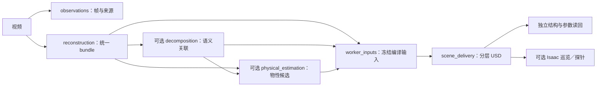

# 工程指南

main 维护视频到 USD 的核心 pipeline、独立验收和 Isaac Sim 容器。本文集中说明代码如何组织、测试和扩展；可执行命令紧邻对应示例。方法综述和历史实验见完整分支的 [tech report](https://github.com/miracle-techlink/video-to-simready/blob/e15d71b77d40aae9867ac00b67adeb4a4af38e01/docs/report/technical-report.md)，不在此重复。

## 设计原则

1. **一个职责，一处实现。** CLI 只分发；workflows 编排；assets 编译；execution 管进程与资源；evaluation 独立读回。共用文件按具体对象或行为命名，避免万能工具模块。
2. **先固定输入输出，再换算法。** 阶段以版本化配置、文件哈希、坐标尺度、环境身份和回执连接；新增 baseline 优先复用现有接口，有实际第二种实现再增加抽象。
3. **生成与验收分开。** 候选不能自证质量。命令成功、结构通过、物理响应和真实准确率分别记录；先验、推断、测量保留各自来源，未知保持未知。
4. **失败也留下证据。** 不覆盖成功回执，不隐藏失败样本；恢复前核对身份，升级保存新旧计划。耗时工作放隔离 worker，取消、期限与 GPU 租约统一交给 execution。
5. **保持核心范围。** 机器人专用任务、Agent 修复、经验库和活动资料在 [`aloho-hackson`](https://github.com/miracle-techlink/video-to-simready/tree/aloho-hackson)；通用修复按依赖单独移植，不整支回合并。

## 模块与依赖

目录位于 [src/simready](../src/simready)。下表是允许的跨领域依赖，不是调用顺序；[机器可检查的合同](../configs/architecture/module_boundaries.json)是唯一约束来源。

| 模块 | 职责 | 允许依赖 |
|---|---|---|
| core | JSON、文件身份、证据引用、基础校验 | 无 |
| geometry | 坐标、相机、投影等纯几何 | 无 |
| execution | 进程／容器、取消、设备租约、缓存 | core |
| assets | appearance / association / physics / compilation | core、geometry |
| ingestion | 视频、重建适配、分割与物性候选 | core、geometry、execution、assets |
| simulation | Isaac 环境、RGB-D、巡览、物性探针 | core、geometry、execution、assets |
| evaluation | 独立指标、结构及参数读回 | core、execution |
| workflows | 配置、阶段编排、恢复／升级、baseline 比较 | 除 geometry 外的上述领域 |

架构检查拒绝越界依赖、环及未声明的动态导入。运行时代码不导入 tests 或 examples；evaluation 不导入资产 writer；模型和 SDK 在选定 worker 内加载，`--help` 不启动它们。

## 规范流水线

入口：`simready run --pipeline pipeline.json --out runs/<新运行>`。与 `--video` 共用视频工作流及阶段回执。配置解析见 [pipeline_config.py](../src/simready/workflows/pipeline_config.py)，可运行输入见 [CPU 示例](../examples/pipeline/README.md)。



重建支持 `artifact` 导入、`command` 隔离算法和 `aholo` 云任务；新云提交须显式 `--submit-reconstruction`。统一 bundle 记录算法、文件、坐标尺度、所用数据及执行方式。**当前 USD 主链支持 Gaussian PLY**；mesh 等新表示需要真实转换器和独立验收，不能只登记名称。

可选 `decomposition.provider=semantic_projection` 消费已有 mask、标定和来源关联；完整分割命令在[语义示例](../examples/semantic_assets/README.md)。目前产出可见表面的盒体代理，完整遮挡几何仍待实现。

可选 `physics.provider=nerf2physics` 消费 request，`provider=candidate` 导入已有候选，详见 [NeRF2Physics 示例](../examples/nerf2physics/README.md)。当前是缓存特征回归／预测重放，不含新视觉模型推断。采用质量须匹配明确 box 对象、kg 单位及尺度证据；与显式质量冲突则拒绝，不自动改变运动类型或接触参数。独立 USD 读回只证明写入正确，真实物性仍需测量对照。

| 操作 | 含义 |
|---|---|
| `--dry-run` | 校验配置、生成计划 |
| `--until reconstruction` | 只交付中间产物，不代表场景完成 |
| `--resume` | 计划完全一致，核验后复用成功阶段 |
| `--upgrade` | 保存新计划，只复用身份仍一致的阶段 |

配置路径相对配置文件；未知字段、缺失文件和非法预算提前拒绝。阶段身份绑定配置、输入、代码、环境及上游；成功回执保存在 `stages/<阶段>/<身份>.json`，失败另记。外部 Python／Docker 须提供带 SHA256 的 `execution.environment_manifest`。带 secrets 的 command 要求新运行目录，不支持规范 pipeline 的恢复／升级。

## 开发与扩展

| 要增加什么 | 从哪里接入 | 必须一起验证 |
|---|---|---|
| 重建 baseline | [command 适配示例](../examples/reconstruction_backends/README.md) → reconstruction bundle | 输入／权重／环境身份、格式与尺度、失败及恢复 |
| 语义、物性或新资产表示 | ingestion 产候选，assets 关联／编译 | 对象绑定、单位、来源、真实转换，evaluation 独立读回 |
| Isaac 功能 | simulation worker，复用 execution launcher | 有限期限、嵌套取消、GPU 生命周期及原始输出 |
| 指标或质量门槛 | evaluation 与 [冻结协议](../configs/evaluation/suite.v1.json) | 正负例、缺失证据、数据划分、阈值版本与独立评分 |

开发顺序：先定义输入输出与失败条件 → 添加最小可复现实例 → 实现所属模块 → 补独立验证 → 比较升级前后结果。改 schema、单位或阈值要显式版本化；不要为了让新算法通过而放宽旧门槛。

用 [baseline 矩阵](../examples/baselines/README.md)冻结同一数据和预算，分别记录导入、缓存及新推断；失败／未执行保留在分母。观察帧标记 heldout 不代表算法已隔离完整视频访问，训练访问与渲染对应仍需核查；没有真实参考时质量记为 `NOT_EVALUATED`，不按导出成功率排名。现有合成示例不代表已复现其他论文。

## 测试与合并

| 层级 | 验证目的 |
|---|---|
| 合同与边界 | 非法输入、哈希／对象错配、架构依赖、缺失证据必须失败 |
| 阶段 CPU 测试 | 数值、参数编译、独立读回、取消与资源清理 |
| 完整链与安装包 | 合成视频 → USD → 验收，恢复／局部升级；仓库外安装 wheel 后运行 |
| 真实算法／GPU | 固定数据、模型和镜像，实际推断／Kit 渲染／PhysX 与独立对照 |

需要 Python 3.10+、系统 FFmpeg；开发环境执行：

```bash
python -m pip install -e '.[dev,test,physical-assets]'
ruff check src/simready tests examples scripts deploy
ruff format --check src/simready tests examples scripts deploy
python scripts/check_architecture.py
python -m pytest -q
python -m build
```

日常先跑受影响测试，提交前走完整检查；共享夹具放 tests/fixtures。场景验收要求必需项全部通过，候选自报成功不能替代证据；密封集诊断不返回修复流程。合成数据、结构通过或 CPU 测试均不证明真实场景质量，报告保持 `release_authorized=false`。

[CI 工作流](../.github/workflows/test.yml)执行静态检查、Python 3.10/3.12 完整测试、sdist/wheel 隔离安装与 CPU pipeline；`merge-gate` 要求全部成功。PR 检查当前提交，正常合并后 main 重跑并交付绑定 SHA 的安装包；不自动部署 GPU 或发布 PyPI。[保护配置](../.github/main-protection.json)须在 GitHub 实际生效，不能只提交文件或绕过检查。

## 容器与运行

构建与启动检查见根目录 [Isaac 快速开始](../README.md#isaac-sim-worker)。[Dockerfile](../deploy/isaac/Dockerfile)固定 Isaac Sim 6.1.0，额外使用 `usd-exchange==3.0.1` 提供高斯 schema；宿主 CPU 编译需 OpenUSD 26.8+。CPU 编译和 Kit 在独立进程运行，镜像不包含模型权重、场景或密钥。

规范配置使用 `execution.backend=docker`、不可变 `execution.image`、环境清单及 `delivery.mode=prepare/survey`；Docker／渲染须接受许可 `--accept-eula`。源码和输入只读挂载，输出独立。自定义启动用 `scripts/launch_isaac.py --worker <Python argv…>`，worker 参数放最后；容器路径为 `/workspace`、`/assets`、`/output`。完整视频命令见[新视频示例](../examples/new_video/README.md)，动力学检查见[物性示例](../examples/physical_assets/README.md)。

execution 统一持有物理 GPU UUID 租约，嵌套本地 worker 经受控凭据借用；取消沿所属进程组与继承管道传播。容器未确认停止就保留设备隔离，使用 `simready execution recover-device --help` 查看核查恢复入口，不手动删锁。CPU／CUDA／RTX 资源分别声明；CUDA 可见性不等于 Vulkan 隔离，未知显存不虚报容量。

任务是可信代码，worker 进程分离不提供安全沙箱。环境变量显式声明，secrets 或未跟踪的旧环境关闭缓存；密钥不写入配置／argv。多机调度尚未实现，SSH 使用预备环境且断线不保证远端已取消。GPU 改动必须另存输入、实际镜像 ID、日志和验收结果，CPU CI 不代替这项检查。
