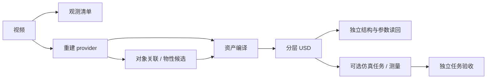

# 模块架构

运行时是 `src/simready` 下的十一个领域。CLI 选择入口，workflows 组合阶段，领域模块处理数据，execution 管进程和资源，evaluation 独立判定结果。实际配置和恢复合同见 [Pipeline](pipeline.md)。

观测与重建均可消费原视频；抽帧声明不会自动限制后端访问留出帧。通用主链目前输出场景候选，完整网格、自动跨视角关联和任意机器人任务仍见[待完成项](release-status.md#待完成)。

## 责任与依赖

| 领域 | 负责 | 边界 |
|---|---|---|
| core | JSON、文件身份、证据引用、基础合同 | 无业务域依赖 |
| geometry | 坐标、变换、投影和纯几何 | 不初始化仿真器 |
| ingestion | 视频、重建适配、分割／材料输入 | 算法环境与宿主隔离 |
| assets.appearance | 高斯解析与外观表示 | 资产域只依赖 core / geometry |
| assets.association | 掩码与标定提升为对象代理 | 关联证据不等于完整几何 |
| assets.physics | 参数声明、候选采用和 USD 物性写入 | 推断不自动升级为测量 |
| assets.compilation | scene spec 组合、USD 和资产清单 | 不自行判定交付成功 |
| simulation | 引擎、机器人控制、测量和渲染 | 杯任务分运行／控制／记录；其余任务逐步迁移 |
| evaluation | 冻结协议、指标、独立读回与任务审计 | 不依赖 writer 或候选自报通过 |
| workflows | 计划、阶段、恢复、修复接收／回退 | 不再实现算法或第二套执行器 |
| execution | 子进程、容器、期限、取消、设备租约、缓存 | 不解释任务成功；单机合同不等于集群调度 |
| agents / repair / experience | 受限决策／注册插件／已验证经验 | 密封测试不得作为修复反馈或技能训练数据 |

资产子包属于同一个 assets 领域；agents、repair、experience 是三个独立领域。完整允许依赖及公开函数由 [module_boundaries.json](../configs/architecture/module_boundaries.json) 和架构测试约束。

## 接入与升级

| 新能力 | 应修改的位置 | 必需验证 |
|---|---|---|
| 重建 baseline | ingestion 的 artifact / command 适配；必要时新增 provider | 视频绑定、表示解码、算法／环境身份、恢复、独立留出质量 |
| 资产表示或生成器 | assets 的转换与编译 | 尺度、位姿、完整依赖、碰撞与独立读回；当前路由仅 Gaussian PLY |
| 物性估计器 | ingestion 出候选，assets.physics 编译，evaluation 读回 | 单位、对象关联、区间／来源、缺测和真实评测 |
| 机器人或任务 | simulation 的端口与控制，独立任务审计 | 构型、传感器、接触、失败处理和真实动力学 |
| 修复算法 | repair 注册受信任工具，经现有 execution 执行 | 固定观测前后比较、回退、预算和经验适用范围 |

模型依赖留在各自 worker 环境。现有资产旧导入是薄别名；新增代码使用规范路径，见[迁移表](migration.md)。新接口须有版本化输入输出、来源和失败语义，不先建没有实现的空抽象层。

## 执行与验收

`run-plan.json` 固定输入、配置、实现及环境；阶段先写独立 attempt，验证后发布不可变成功回执。`--resume` 要求同计划，`--upgrade` 显式生成新计划，只复用身份与证据均未变的阶段。细节归 [Pipeline](pipeline.md)，进程、取消与设备隔离归[执行合同](execution.md)。

宿主只编排，worker 运行模型／USD／Isaac。嵌套取消和 GPU UUID 租约共用 execution；不确定容器状态保留隔离，不能直接释放设备。运行状态与业务验证分开：成功产生候选不代表视觉、真实物性或机器人任务通过。

开发验证依次覆盖合同负例、CPU 阶段、完整链恢复／升级、目标模型与 GPU 实测。[CI](ci-cd.md)执行前三类可移植检查；真实场景证据单独保存。后续优先级归[项目状态](release-status.md)，历史方法图与旧实验归[历史索引](history.md)。
