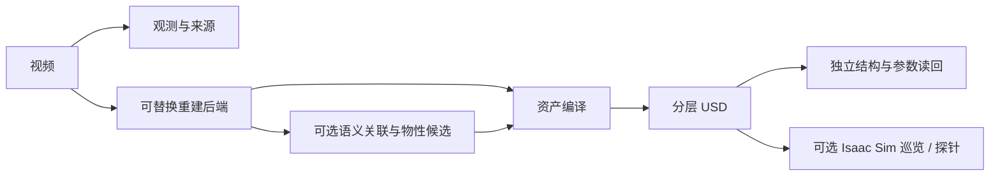

# 核心模块架构

| 领域 | 唯一职责 |
|---|---|
| core | 文件身份、JSON、证据引用和版本合同 |
| geometry | 坐标、相机和纯几何运算 |
| ingestion | 视频、重建 provider、语义／物性候选输入 |
| assets | appearance、association、physics、compilation；只依赖 core / geometry |
| simulation | 通用 Isaac 环境、RGB-D、巡览与合成物性探针 |
| evaluation | 独立观测、指标、结构和参数读回；不依赖资产 writer |
| execution | 进程、容器、期限、嵌套取消、GPU 租约与身份缓存 |
| workflows | 配置、阶段回执、恢复／升级、语义管线和 baseline 比较 |

[依赖合同](../configs/architecture/module_boundaries.json)及架构测试约束反向依赖、动态导入、环和公开接口。宿主只编排；模型、USD、Isaac 分别运行在所选 worker。详细输入输出见 [Pipeline](pipeline.md)。

新增 baseline 优先接 `ingestion.reconstruction_providers` 的 command 合同；资产扩展放 assets，独立读回放 evaluation。当前实际 USD 路由仅支持 Gaussian PLY；新增 mesh 后端须实现转换与验收，不能仅声明 provider 名称。

执行成功、候选生成、结构通过和真实质量分别记账。抽帧中的留出标记不自动限制后端访问完整视频；先验或推断不升级为测量。机器人专用控制器、Agent 修复和经验库由完整分支维护。
