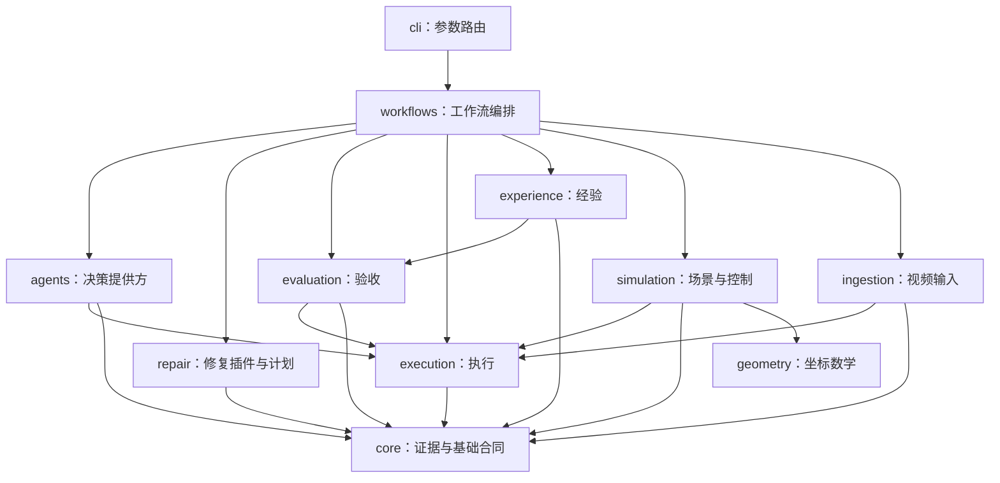

# 模块架构

代码使用 `src/simready` 布局。一个模块对应一个职责，模块名描述能力，避免用实验顺序、某个场景或宽泛的 infra/bridge/runner 命名当前运行时。

## 依赖层级

这是允许的 Python 依赖方向。`core` 不引用业务模块；`execution` 不知道修复策略；`evaluation` 不引用 Agent、修复器或经验；`agents` 不直接导入修复执行逻辑。`geometry` 提供纯坐标工具，供外部 worker 使用。入口 `cli.py` 延迟导入各域 CLI，`__main__.py` 只转发。

规则源文件是 [module_boundaries.json](../configs/architecture/module_boundaries.json)。新增跨域依赖必须修改规则、说明原因并通过测试，不能通过动态导入或修改 `sys.path` 绕开边界。当前检查器对源码 import 和声明依赖图做静态校验，不是恶意代码沙箱。

## 模块内部职责

| 模块 | 内部文件 | 输入 → 输出 |
|---|---|---|
| `simulation` | `asset_bundle.py`、`robot_interface.py`、`substation_mission.py`、`mission_audit.py`、`mission_video.py`、`cafe_video.py` | 可迁移资产与任务配置 → 机器人能力绑定、实测控制、审计和原生录像 |
| `ingestion` | `video_frames.py`、`aholo_reconstruction.py`、`cli.py` | 视频和抽帧参数 → 帧、来源哈希、切分清单 |
| `agents` | `contracts.py`、`provider_factory.py`、`prompting.py`、`token_usage.py`、`providers/` | 缺陷/提案/经验摘要 → `RepairDecision` 与 token usage |
| `repair` | `planning.py`、`plugin_registry.py`、`cli.py` | 缺陷和能力目录 → 建议；已启用插件和有界参数 → 可信任务 DAG |
| `execution` | `task_schema.py`、`task_graph.py`、`task_worker.py`、`resource_pool.py`、`processes.py`、`artifact_cache.py` | 任务计划和设备清单 → 已校验产物、日志、资源/耗时记录 |
| `evaluation` | `protocol.py`、`observations.py`、`asset_graph.py`、`scoring.py`、`regression.py`、`verification.py` | 冻结协议与候选 → observations / defects / scorecard |
| `experience` | `database.py`、`episodes.py`、`skills.py` | 验收证据 → 成功/失败经验、版本化参数配方、晋升/退役状态 |
| `workflows` | `config.py`、`repair_loop.py`、`repair_step.py` | workflow 配置 → 有预算的修复迭代与最终候选指针 |
| `geometry` | `cameras.py` | 显式坐标约定 → 相机变换和四元数 |
| `core` | `artifacts.py`、`evidence.py`、`validation.py`、`types.py` | 基础文件/JSON/数值 → 一致性校验与类型合同 |

`repair_loop` 管理预算、选择、接受/回退和经验写入；`repair_step` 执行并验收一轮，不自行发布候选或晋升 Skill。`task_graph` 只调度任务；`task_worker` 负责一个任务的进程、产物校验与缓存发布。SQLite schema 与事务统一归 `experience.database`，EpisodeStore 和 SkillLibrary 不再分别假设数据库的归属。

运行时性能优化使用同样的依赖方向：`workflows.performance_loop` 编排冻结实验，`evaluation.performance_video` 在独立进程重算视频质量，`evaluation.performance_gate` 固定阈值并比较耗时，`experience.performance` 保存限定 benchmark 的运行配方与失败记忆。它不把一次场景提速自动晋升为跨场景 Skill。协议与使用方式见 [性能 RSI 手册](benchmarks/runtime_rsi.md)。

`execution.worker_groups` 管理一个父租约下的有限并发；`remote_polling` 负责已有远端作业的状态监控，`process_supervision` 负责自己的 worker 崩溃恢复与总超时。供应商协议、提交收据和资产下载放在 `ingestion.aholo_reconstruction`，通过 `simready ingestion aholo` 调用；执行层不依赖 Aholo 客户端或业务状态机。试验结果与恢复用法见 [15 分钟优化账本](benchmarks/substation_goal15.md)。

## 公开 Python API

| 入口 | 作用 |
|---|---|
| `simready.workflows.run_repair_workflow` | 完整开发修复闭环 |
| `simready.workflows.performance_loop.run_performance_workflow` | 固定工作量的性能实验、质量门槛、回退与经验复用 |
| `simready.execution.run_task_graph` | 单机任务 DAG 执行 |
| `simready.agents.create_decision_provider` | 构造明确指定的决策提供方 |
| `simready.repair.RepairPluginRegistry` | 加载并绑定可执行修复插件 |
| `simready.repair.planning.plan_repairs` | 生成不执行的修复建议 |
| `simready.evaluation.scoring.evaluate_candidate` | 重新计算候选观测并评分 |
| `simready.evaluation.verification.verify_candidate` | 在独立解释器进程执行验收 |
| `simready.experience.EpisodeStore` | 验证并存取修复经验 |
| `simready.experience.SkillLibrary` | 配方生成、验证、晋升、检索与退役 |
| `simready.ingestion.video_frames.extract_frames` | 抽帧并生成来源清单 |
| `simready.simulation.robot_interface.RobotInterface` | `describe` / `observe` / `command` 设备合同 |
| `simready.simulation.robot_interface.articulation_interface` | 绑定已有物理 articulation 的关节驱动 |
| `simready.simulation.robot_interface.kinematic_usd_interface` | 绑定编排演示的 USD 根部位姿 |

Python 类型提示用于说明接口；外部 JSON 的字段仍由所属模块的运行时 schema 检查，不把 `dict` 类型提示当作数据已验证。领域包不统一做大型 eager import；可选数值依赖仅在需要时载入，CLI 帮助不要求 CUDA/Isaac/NumPy。

## 机器人设备合同与任务边界

`RobotInterface` 将机器人设备访问与场景任务逻辑分开。`describe()` 返回执行模式、组件、能力及关节/单位约定；`observe()` 读取绑定后端的状态；`command(capability, target)` 拒绝未声明能力。物理调用方先执行 step/update，再读取状态；返回的原生张量可能与后端共享存储，应只读使用。接口用于可信控制进程内部，不是序列化 RPC 或远程机器人服务。

| 适配器 | 模式与命令 | 后端 |
|---|---|---|
| `kinematic_usd_interface` | `kinematic_demo` / `root_pose` / `RootPoseTarget` | G2 的 USD 位移与 yaw，读取 authored transform |
| `articulation_interface` | `dynamic_physics` / `joint_drive` / `JointDriveTarget` | Lite3、Z1 或组合 articulation，读取当前物理状态张量 |

物理绑定要求驱动分组与被动关节完整且不重复地覆盖实际 articulation。位置单位为米、角度为弧度，每个关节显式声明 `m` 或 `rad`，effort 分别为 N 或 N·m；绑定方声明后端四元数顺序，观测输出规范为 `xyzw`。命令的关节顺序必须与已绑定 articulation 一致，position/effort 张量形状均为 `(1, joint_count)`。有限值、关节限位、动作范围与控制稳定性仍由具体控制器检查；物理接口不开放 `root_pose`。

物理观测声明 `root_frame=world`、`observation_source=physics`；G2 声明 `root_frame=parent`、`observation_source=usd_authored`。二者的根位姿不能不经变换直接混用。G2 只接受 meter、Z-up stage 上 translate/rotateZ 的变换序列，不是任意六自由度控制器。

基座、机械臂和末端可作为组件组合，但组件声明本身不生成控制器。当前 Lite3 步态、Z1 FK/IK、RGB-D 感知、路径检查与接触状态机仍在变电站任务中；G2 仍为编排运动。接入新构型必须准备资产/碰撞/质量与关节映射、控制策略、基座到机械臂安装变换、工具 TCP、传感器坐标，以及接触与任务回归。接口通过不等于任务通过；单独 Lite3 或 Z1 的绑定能力不代表已完成对应独立任务的实机或仿真验收。详见 [机器人示例](../examples/robots/README.md)。

## 一轮修复的数据流

1. `workflows.config` 校验配置、预算与开发协议，绑定输入和验收代码身份。
2. `evaluation.verification` 调用独立 worker，生成真实 measurements 与缺陷。
3. `experience` 检索兼容的经验和生效配方；`repair` 生成有边界的提案。
4. `agents` 返回 `RepairDecision(action, proposal_id, reason)`。它不能提交任意命令或自报验收通过。
5. `repair` 将选中提案绑定为任务图；`execution` 执行修复/渲染 worker，生成新候选。
6. 独立 verifier 再次计算；`evaluation.regression` 判断是否改善且无必选指标退化。
7. `workflows` 接受或保留上个候选，`experience` 记录结果。满足独立场景回归条件才可晋升 Skill。

JSON protocol/candidate/plugin/episode 数据格式和 SQLite schema 在 v0.4 中保持原版本；代码身份变化会自然使旧缓存与旧 Skill 的兼容性校验失效，不篡改旧证据。

## 两种修复目录的区别

- `configs/repair/adapter_catalog.v1.json` 是**能力目录**：描述可能的修复、所需数据、影响范围与接入状态。`simready repair plan` 只给出建议。
- workflow 的 `registry` 指向**可执行插件注册表**：必须声明 `execution_enabled=true`、参数边界、受信任 argv、输入/输出和资源需求。`RepairPluginRegistry` 才会将它绑定为可执行计划。

因此“登记了能力”不代表“已有可运行实现”。示例中的程序化亮度修复插件仅供合成校准，不能代替真实三维修复。

## 当前业务链路与历史实验

原视频可直接提交 Aholo 获得高斯空间底稿；抽帧也可供 VGGT 位姿/深度→gsplat 分支与参考观测使用。对齐、资产分割、清晰来源选择、几何/PBR/碰撞/关节建立、Lite3+Z1 导航与按压，是完整业务目标中的 worker。当前已将两个场景的控制、审计、录像迁入 simulation，并封装 Aholo 恢复客户端；完整资产化算法仍有历史代码和场景准备依赖，尚未全部纳入自动修复闭环。

历史代码集中在 `legacy/`，运行时禁止导入它。修复历史算法需要另做数据与 GPU 回归；不能因目录更清楚就声称真实场景质量已提升。当前结果仍不授予生产发布权限。
