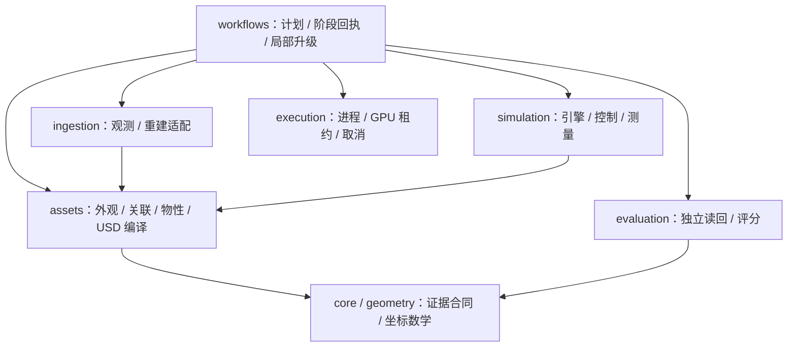
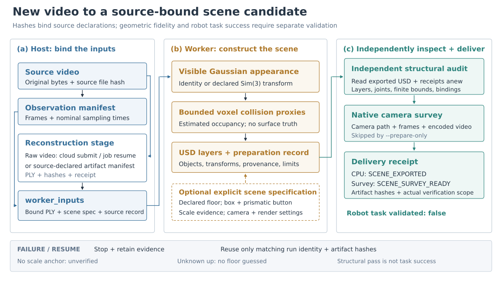
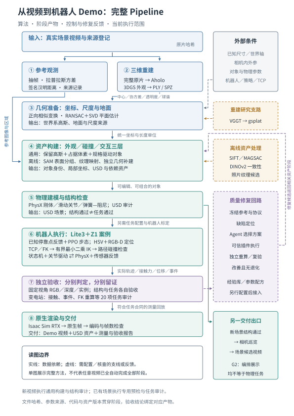
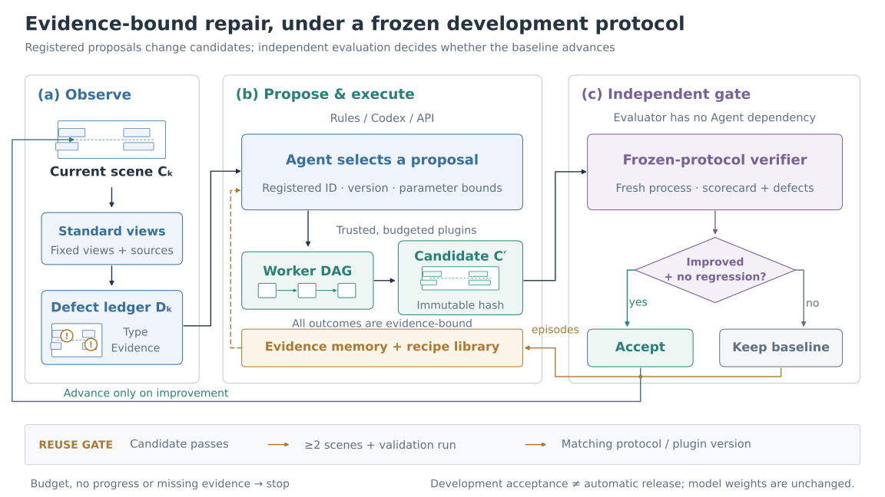
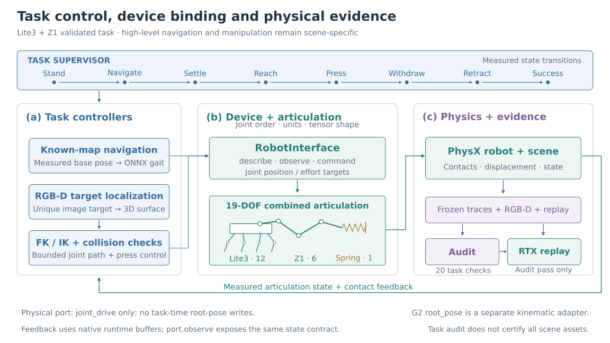

# 方法架构与代码边界

系统把“恢复外观”“准备可交互资产”“运行机器人任务”“独立判定结果”分开实现。数据流由产物合同连接；Python 模块依赖只约束代码组织，不代表算法阶段已经自动化。

各代码部分的内部组件、调用、状态与扩展方式见[软件架构与代码模块构造](software-architecture.md)。它与本页的方法边界说明配套，详细内容同时编入技术白皮书。

## 当前规范入口与分层

`simready run --pipeline` 加载版本化配置，复用 `video_pipeline` 的阶段执行；旧 `--video`、`--scene` 保持兼容。实际数据流、完整配置和 baseline 示例见[规范 pipeline](pipeline.md)，迁移路径见[迁移表](migration.md)。本轮验证见[验收记录](audits/2026-11-14-modular-pipeline.md)。以下 v0.7 图表保留历史方法语义，资产实现路径以当前迁移表为准。

此图展示主要职责及调用关系，完整允许依赖以架构合同为准。assets 禁止反向依赖 simulation、evaluation、workflows；evaluation 不依赖资产 writer。修复决策、插件和经验库仍由 agents、repair、experience 各自持有。没有新增第二套调度器。

重建适配器支持 artifact、Aholo、显式 command，当前交付路由只接受可解码 Gaussian PLY；完整 mesh 后端还需新增 converter 与验收。阶段身份绑定实际输入、配置、环境及实现，升级只复用身份和产物都未变的阶段；独立质量验收不因导出成功自动通过。

## v0.7：新视频的可执行路径

`workflows.pipeline_entry`按`--video`与`--scene`选择互斥模式。新视频由`video_pipeline`登记视频/配置/源码身份并编排观测、重建、worker输入和交付；阶段成功必须提交真实产物哈希。恢复只复用身份和哈希匹配的阶段，失败worker保留在独立attempt目录。

| 模块 | 输入和处理 | 输出与边界 |
|---|---|---|
| `ingestion.reconstruction_stage` | 视频与显式云提交，或来源绑定的本地manifest；receipt恢复和有限等待 | PLY/SPZ与可复用manifest；不校准几何、语义或真实尺度 |
| `simulation.gaussian_asset` | 标准3DGS PLY；指数尺度、sigmoid透明度、四元数规范化、SH通道排列 | 可见USD高斯；源外观不等于纹理网格 |
| `simulation.scene_preparation` | 显式Sim3、可选地面/参数、有限点采样和体素占据、声明的box/button | 三层USD与asset_catalog；地面/碰撞是估计，显式对象不是自动语义分割 |
| `evaluation.scene_package` | 独立打开USD，检查组合引用、包内依赖、有限包围盒、碰撞与滑动关节合同 | 结构检查；不重算图像保真度、不证明真实尺度或任务成功 |
| `simulation.scene_video` | 当前场景包围盒或显式相机、原生RTX采样、ffmpeg编码与ffprobe核验 | 运动相机巡览及逐帧证据；不包含机器人或自由空间导航 |

`SCENE_EXPORTED`和`SCENE_SURVEY_READY`描述生成流水线的完成等级；`task_validated=false`始终保留。带真实测量的任务仍须单独绑定机器人控制与独立任务审计。参数和输出合同见[新视频示例](../examples/new_video/README.md)。下面的中文总图区分已交付任务链路与新视频候选路径，原有照片纹理、柜体补建和多帧注册并未由上述通用生成器全部自动替代。

## 六个阶段与真实执行范围

| 阶段 | 输入 → 处理 → 输出 | 当前实现位置与状态 |
|---|---|---|
| M1 观测登记 | 视频 → 哈希、抽帧、清晰度与去重 → source/frame manifest | `ingestion.video_frames`，可执行 |
| M2 空间底稿 | 视频 → Aholo 任务提交/恢复 → PLY/SPZ | `ingestion.aholo_reconstruction`，可执行客户端；供应商内部算法不由本项目实现 |
| M2 研究支路 | 图像 → VGGT 相机/深度 → gsplat 模型 | `legacy/` 独立研究；未替代交付底稿 |
| M3 资产准备 | 底稿与来源 → 配准、纹理、几何/碰撞/关节 → 审查后资产 | 场景参数与离线准备仍必要；`simulation.asset_bundle` 负责可执行导出 |
| M4 任务执行 | bundle 与任务 → 感知/策略/规划/控制 → 测量日志与轨迹 | `simulation.substation_mission`；G2 为独立编排演示 |
| M5 独立验收 | 固定协议与测量 → 事件/定位/FK 重算 → audit | `simulation.mission_audit`；失败阻止交付录像 |
| M6 原生回放 | 已验收轨迹 → 独立回放层/RTX/编码 → MP4 与帧证据 | `simulation.mission_video`；G2 使用 `cafe_video` |

`workflows.scene_delivery` 编排已有场景的来源检查与执行阶段；`simready run --scene`提供统一入口。`--video`另提供上述通用构建路径；只有显式`--submit-reconstruction`才可新提交云任务。完整纹理补建和真实修复插件仍未覆盖任意新视频。

v0.6 的 [独立验证清单](report/one-command-validation.json) 记录变电站完整物理/审计/回放和星巴克 8 帧短预览，并绑定输入、运行源码及后续失败分支改动。执行方式见 [README](../README.md)，阶段方法和新旧实测范围见 [技术报告](report/technical-report.md)。

## 数据对象与三个运行层

- **来源对象**：视频 SHA-256、名义 fps 采样时间（非原视频帧 PTS）、相机/坐标、观测或估计标签。
- **外观层**：高斯、独立几何和 PBR/纹理，保留原片约束与未观测区域。
- **碰撞层**：地面、柜体、控件代理及物理参数，与外观分离。
- **交互层**：按钮/旋钮关节、工具和模拟状态机，明确阈值与去抖。
- **运行包**：`bundle.json` 关联来源与三层资产，保存文件大小、原始和导出哈希。
- **任务证据**：传感器、RGB-D、事件、实测轨迹、audit、视频与 timing。

来源证据是一条贯穿各阶段的关联链，不是第四种几何层。包校验、USD 引用闭包、来源一致性和任务审计各自回答不同问题。改变路径布局后重新导出的包，也必须保留新的身份，不能仅凭相同文件名继承旧 GPU 结果。

`asset_bundle` 区分相同 USD 内容在不同来源目录中的引用上下文。自定义 MDL 仅支持 UTF-8 自包含模块，导入、限定模块名与资源类型明确拒绝；只有 SDK 白名单 `OmniPBR.mdl` 可保留外部依赖。本地同名 MDL 优先复制并接受相同检查。

## 修复闭环：提案、执行、判定

候选 `C_k` 包含模型、资产图与证据引用；冻结协议对已提供的 RGB、深度和实例重算观测并生成缺陷 `D_k`。这些符号表示数据对象，不引入新的训练损失。缺陷根因默认为 `UNCONFIRMED`；声明视角的完成率不等于真实表面覆盖率，采集器真实性仍需另外核验。

1. `evaluation.verification` 独立生成 measurements / defects / scorecard。
2. `experience` 检索兼容经验；`repair` 将可执行插件与有界参数组成 proposal。
3. `agents` 返回 `RepairDecision(action, proposal_id, reason)`，不发送任意 shell。
4. `repair` 绑定版本、声明输入和任务 DAG；`execution` 执行并检查产物。
5. verifier 重新计算新候选，`evaluation.regression` 要求至少一项必选检查改善且没有必选项退化；中间候选可尚未整体 PASS。
6. `workflows` 接受或保留旧候选；`experience` 保存成功、失败与证据。

能力目录 `configs/repair/adapter_catalog.v1.json` 仅描述可能能力。可执行注册表必须设置 `execution_enabled=true`，声明可信 argv、版本、参数范围及输入输出。目录项没有实现，不会成为 Agent 可执行动作。

`repair_loop` 管理预算和接受/回退；`repair_step` 执行一轮，不自行发布候选。Episode 只有通过开发协议才可蒸馏为候选 Skill；预声明的跨场景回归通过后晋升，版本变化使兼容性失效，退化触发退役。这里更新的是参数配方，不是基础模型权重。

## 机器人任务与设备端口

任务监督器负责已知地图接近、RGB-D 唯一目标、FK/IK、路径与接触检查。设备端口只提供 `describe()`、`observe()`、`command(capability, target)` 和 `joint_indices()`，不生成导航、步态、TCP 或碰撞规划。

| 工厂 | 已绑定能力 | 观测来源与坐标系 |
|---|---|---|
| `kinematic_usd_interface` | G2 `kinematic_demo` / `root_pose` | USD authored transform / parent |
| `articulation_interface` | Lite3+Z1 `dynamic_physics` / `joint_drive` | 当前物理状态 / world |
| 独立 Lite3、Z1 的同一工厂 | 绑定模板与 CPU 合同测试 | 无独立构型 GPU 任务成功声明 |

物理分组和被动关节完整覆盖后端关节，position/effort 张量形状必须为 `(1, joint_count)`，名称顺序逐项一致。角度/速度/effort 为 rad、rad/s、N·m；滑动关节为 m、m/s、N。驱动负责有限值、限位和稳定性，端口只检查元数据，不同步 GPU 数值到 CPU。

输出四元数规范为 `xyzw`；调用方显式声明后端顺序。物理侧先 step/update，再读取可能与后端共享存储的只读状态。G2 只支持米制 Z-up 的 translate/rotateZ 序列，父坐标系与物理世界坐标系不能直接混用。物理接口拒绝 `root_pose`。

接入新机器人需另行准备策略、安装变换、TCP、相机和传感器标定，分别验收支撑、可达、轨迹、接触与回撤。组件声明不完成机械装配。完整模板见 [机器人接入](../examples/robots/README.md)。

## 模块责任与依赖约束

| 模块 | 负责 | 不负责 |
|---|---|---|
| `core` / `geometry` | 严格 JSON、哈希、基础合同、显式坐标数学 | 不推断真实尺度，不调业务 worker |
| `ingestion` | 视频登记、抽帧、供应商 receipt 与下载 | 不构造完整交互资产 |
| `assets` | 外观表示、对象关联、物性声明、USD 编译 | 不运行机器人控制，不判定自身交付通过 |
| `simulation` | 既有 bundle 导出、引擎、机器人控制、测量、渲染 | 不选择修复策略；通用资产 writer 已移入 assets |
| `execution` | DAG、进程、资源租约、缓存、容器/SSH | 不知道缺陷含义，不是跨节点调度平台 |
| `evaluation` | 冻结协议、观测、评分、独立验证 | 不读取 Agent 自报通过作为结果 |
| `repair` | 缺陷到插件映射、参数和执行计划 | 不运行任意模型生成代码 |
| `agents` | rules / Codex CLI / Responses 决策 | 不直接调用仿真控制器或修改门槛 |
| `experience` | 证据库、失败经验、Skill 晋升/退役 | 不训练基础模型 |
| `workflows` | 阶段与修复闭环编排、预算和退出 | 不重新实现各阶段算法 |

源码位于 `src/simready`。依赖规则由 [module_boundaries.json](../configs/architecture/module_boundaries.json) 和 `scripts/check_architecture.py` 检查：`core` 不引用业务域；`evaluation` 不依赖 Agent、修复器或经验；`execution` 不依赖供应商或修复策略。运行包禁止导入 `legacy` 和示例。CLI 延迟导入，查看帮助不要求 CUDA/Isaac。

进程与哈希边界用于结果一致性，不是恶意代码沙箱。可信插件以调用用户的 OS 身份运行；生产隔离、密封集与独立发布权限需要额外实现。

## 扩展入口

| Python API | 用途 |
|---|---|
| `simready.workflows.run_repair_workflow` | 受预算约束的开发修复闭环 |
| `simready.execution.run_task_graph` | 可信 DAG 的资源与进程执行 |
| `simready.agents.create_decision_provider` | 选择决策提供方 |
| `simready.repair.RepairPluginRegistry` | 绑定可执行插件 |
| `simready.evaluation.verification.verify_candidate` | 独立进程重算候选 |
| `simready.experience.EpisodeStore` / `SkillLibrary` | 证据与参数配方生命周期 |
| `simready.simulation.robot_interface.RobotInterface` | 机器人设备访问合同 |

性能实验使用相同职责：`performance_loop` 编排，独立质量 worker 重算，固定门槛判断，经验库保存限定 benchmark 的配方。优化目前暂停；既有实验与当前场景启动分开记账，见 [性能协议](benchmarks/runtime_rsi.md)。
