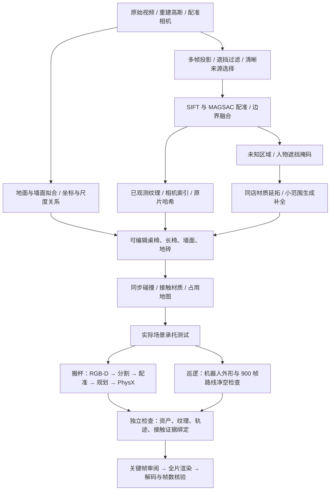

# 星巴克原场景：可见资产修复与任务交付

修复开始于 2026-11-13，最终验证与录制于 2026-11-14。本文区分**可见结构修复、模拟物理可用性、原片保真、真实物性**，不将其中一项通过代替其他项。

## 交付范围

两项演示使用原星巴克视频的重建、配准相机和布局依据：固定基座 G2 双桌搬杯（22.5 秒）和 G2 通道编排巡逻（30 秒）。画面采用原生 Isaac RTX 渲染；视频由逐帧渲染编码，不经过逐帧生成式视频美化。

原始高斯 USD 完整保留。搬杯任务抑制 502,273 个被替换的高斯；巡逻关闭原有 1,053,483 个高斯的可见性，用原片约束的显式几何承担可见场景。关闭残留高斯是去除巡逻画面雾状残影的关键。原层、抑制索引和替换图层分别保存，可以检查或回滚。

这次复用了变电站修复的核心方法：**清晰来源选择 → 显式资产替换 → 原外观分层保留 → 独立验收**。只增加碰撞层或在高斯背后放补面，无法解决此前看到的空洞、模糊和残影。

## 从原片到交付的链路



| 层 | 实际处理 | 来源和限制 |
|---|---|---|
| 纹理 | 遮挡检查、清晰源选择、平面配准，保留来源索引 | 每第七个相机从来源选择中留出；这不等于已经完成留出视角的画质评测 |
| 可见资产 | 9 张圆桌、1 张共享桌、7 把椅子、7 把高脚凳、2 组长椅及墙面、地砖 | 布局受原片和重建约束，几何厚度、细部及部分实例位置为估计；没有全实例人工真值 |
| 桌面材质 | 使用原店干净木纹样本，去掉烘焙在桌面照片中的杯子与菜单 | 木纹复用是材质估计，不是每张桌面的逐像素恢复 |
| 人物遮挡 | Grounding DINO/SAM 掩码限制修复区域，生成小块壁画，配准后写入纹理 | 生成区域始终标为未观测；提示词、输入输出哈希、生成图和掩码保留 |
| 碰撞 | 从新可见几何建立静态碰撞，同步占用体素，禁用对应旧代理 | 搬杯 38 组、巡逻 42 组替换碰撞；还保留地面等必要支撑 |
| 物性 | 静态家具绑定摩擦与恢复系数；动态杯质量 0.085 kg | 家具静/动摩擦 0.65/0.50、恢复系数 0，均为工程预设，非测量结果 |
| 搬杯 | 合成头部 RGB-D、已知杯模型配准、笛卡尔路径、真实关节与接触 | 固定基座；放置修正使用仿真刚体真值，不能称为实机视觉力控闭环 |
| 巡逻 | 收拢双臂的 G2 姿态、分层外形净空检查、高位跟随视角 | 编排根位姿与轮子动画，不是自主导航或底盘动力学验证 |

## 物理修复与最终验收

新增家具接触材质后，240 Hz 对照发生放杯失败。改用 480 Hz 后还发现一次悬空松爪造成的 17.4 mm 横向偏移，超过原有 15 mm 门槛。最终控制先把杯底落到目的桌面再打开夹爪；没有调宽门槛、添加杯子附着关节或覆盖杯子运动位姿。

调整后复核一次放置误差为 11.99 mm；完整入口再次从 RGB-D 开始运行，最终放置误差为 **12.13 mm**，两次均通过独立检查。这只是两次当前任务验证，不构成跨场景成功率或鲁棒性评测。

| 最终搬杯指标 | 结果 |
|---|---:|
| 实际场景承托检查 | 35 / 35 通过 |
| 独立任务检查 | 18 / 18 通过 |
| 单次合成视角定位误差 | 0.672 mm |
| 持杯阶段最小离桌间隙 | 149.65 mm |
| 松爪后目的桌支撑力 | 0.83385 N |
| 最终放置偏差 | 12.13 mm |
| 最终杯体倾角 | 0.338° |
| 受监测机器人—环境接触 | 0 N |

杯子与夹指、起始桌、目的桌的瞬态接触峰值分别为 28.68、33.32、65.97、22.92 N，全部原样保留。这些峰值及工程预设物性尚未通过实物校准，不能用视频成功推导现实按同样参数即可运行。

新家具使原 4.8 米长路线无法通过净空检查；本次使用 x=2.2–3.5 的 **1.3 米通道**，保留 30 秒时序和转向。不能把它称为原路线的等价性能结果。完整视频必须与最终场景和新路线的独立验收一致。

## 复现与证据

代码入口和部署要求见 [星巴克 Sim-Ready 示例](../../examples/starbucks_simready/README.md) 与 [Isaac 部署](../deployment.md)。桌面交付包同时提供原始视频、两段成片、资产、源码、一键脚本和证据。

```bash
bash 运行演示.sh all
# 或只运行一个案例
bash 运行演示.sh grasp
bash 运行演示.sh tour
```

脚本在本机使用已有 Python 与模型环境；换机器时通过 `SIMREADY_PYTHON` 和 `SIMREADY_MODEL_PYTHON` 指定环境，安装 `simulation,physical-assets` 与分割依赖，并准备 `simready-isaac:6.1.0`、NVIDIA GPU 和模型权重。代码与资产在容器中只读，输出写到新的复现目录。

证据包括 `physical_assets.json`、纹理已观测/估计掩码与来源索引、原始高斯抑制索引、`probe.json`、`audit.json`、`readiness.json`、`route_check.json`、原始物理轨迹和逐阶段 `timing.json`。资产候选清单不在验收后改写，最终状态以这些独立证据为准。

代码检查：611 项测试通过、1 项跳过；新增覆盖清晰来源选择、留出相机隔离、几何闭合、嵌套纹理哈希绑定与缓存私有副本。还执行了真实 Isaac 物理与渲染检查。

## 尚未获得的结论

- 无法证明未知壁画、被遮挡物体与真实场景完全一致；局部纹理仍受原片分辨率和拼接误差限制。
- 没有全店所有视角、全部物体及动态交互的覆盖性验收；本次交付范围为两段已检查的演示路径。
- 摩擦、质量、接触刚度和尺度没有实物测量闭环；本次是仿真演示交付，不是已校准数字孪生。
- 任意新视频仍需配准、布局与资产配置；本例没有把案例专用配置包装成通用全自动重建。

耗时以交付包中的最终账本为准：准备资产后的验证与录制单独计时，不包含云重建，也不冒充从原视频开始的端到端耗时。自动任务本身没有调用 LLM；开发对话与小块图像生成不在其 token 统计内。

## 最终成片核验与计时

搬杯为 1920×1080、30 fps、675 帧、22.5 秒；巡逻为同分辨率与帧率、900 帧、30 秒。两片均完整解码，未发现空白帧或相邻重复帧；分别抽查 12 个覆盖全程的关键帧，并另检查原生分辨率画面。巡逻最终场景通过 24/24 承托测试与 900/900 路线净空检查。复制到桌面后，两套场景重新审计通过，53 个被检查的纹理引用均在包内解析。

巡逻首轮录制发现编辑器参考线后中止；关闭 `/app/viewport/grid/enabled` 并从头重录，最终画面不含该参考线。

固定 6 个 RTX 子帧的最终成功入口：搬杯验证与成片 **25 分 24.74 秒**，巡逻验证与成片 **20 分 1.05 秒**，两个入口相加 **45 分 25.79 秒**。这是准备资产后的两段高质量录制账本，不是全部修复开发时间，也不是从原视频重新重建的端到端耗时。失败、重试与重叠队列等待在交付包账本中分别列出。
