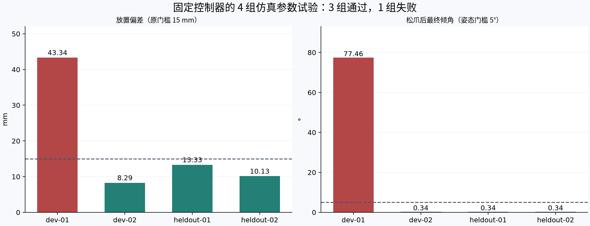

# 搬杯物性随机化：首轮真实运行

运行日期：2026-11-14。4 回合串行，240 Hz CPU PhysX / TGS，通过本机 Docker Isaac 6.1.0 执行；全流程 320.26 秒，包括独立进程启动、准备和审计。固定基座、固定原控制器、已准备的两张桌与重建杯；未加载咖啡店背景。

结果：3/4 通过。Wilson 95% 区间为 [0.301, 0.954]；这是四个假设参数样本的检查，不能推广为真实机器人可靠性或优化收益。

| 回合 | 分组 | 杯质量 g | 放置偏差 mm | 最终倾角 ° | 任务 | 回合耗时 s |
|---|---|---:|---:|---:|---|---:|
| dev-01 | development | 115.96 | 43.34 | 77.46 | FAILED | 85.88 |
| dev-02 | development | 103.51 | 8.29 | 0.34 | PASS | 79.17 |
| heldout-01 | heldout | 74.34 | 13.33 | 0.34 | PASS | 77.09 |
| heldout-02 | heldout | 111.68 | 10.13 | 0.34 | PASS | 78.07 |

四回合的 USD 与运行时质量/材料检查全部通过，说明扰动实际进入本次仿真。失败的 dev-01 仍有完整 5,400 帧和十阶段轨迹：保持/转移姿态超限、最终倾角约 77.46°、放置误差约 43.34 mm；原 15 mm 等阈值没有放宽。不能把多项同时改变的实验单独归因于杯质量。

原 worker 的动作失败退出码经 Isaac shell 变为 1，初版宿主汇总将该完整失败误分类为执行未完成。已修复分类，并对同一份四回合 USD/轨迹重新独立检查；成功数仍为 3/4。保留 report.json、episode.json 原始结果和 report_rechecked.json，不覆盖失败证据。

控制器、运动学、审计代码与输入哈希见 results.json 对应的运行 manifest。原完整交付曾使用 480 Hz；本轮是明确声明的 240 Hz，且没有背景几何，因此不能直接把本轮指标与旧成片比较为加速或性能提升。

新增测试验证采样复现、跨 split 种子冲突拒绝、参数篡改拒绝、质量/惯量一致性、接触绑定、缺失结果留在分母，以及 shell 包装的完整任务失败分类。全仓测试初次 627 passed / 1 skipped；后续分类修复另有定向回归，最终检查结果见开发交付说明。

下一步应在 development 样本上定位滑移/姿态失稳，增加受限夹持或运动反馈；再冻结新控制器，在未用于调整的新测试种子上成对比较。当前没有策略训练，没有真实物性标定。

