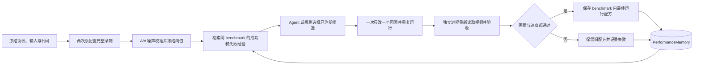

# Pipeline 性能 benchmark 与 RSI 优化

这套闭环把性能优化变成可重复实验：冻结工作量和验收规则，执行控制组，测量候选，独立验收，将成功和失败写入经验库，再选择下一轮方案。

当前已实现并接入真实变电站的是 **完整视频录制运行时**：714 帧、1920×1080、25 fps、相同物理轨迹和相机逻辑。它是整条管线的一个性能 track；不是重新从原视频训练三维模型的 E2E benchmark。

[首轮真实实测](../audits/2026-11-12-substation-runtime-rsi.md)已完成：原配置中位 448.0938 秒，关闭后台视口候选单次 360.8313 秒；起始帧误差超限，候选被拒绝并保留基线，失败已进入 memory。

## 1. 管线分层与当前覆盖

| Track | 固定输入与工作量 | 验收边界 | 当前状态 |
|---|---|---|---|
| 输入与资产生成 | 原片、模型、参考锚点、分割/资产配方 | 帧清单、资产与几何一致性、来源一致性 | 历史逐阶段基准已保存；尚未接入本轮性能 RSI gate |
| 物理任务 | 场景、机器人、策略、dt、接触判据 | 独立物理审计、轨迹、按钮事件与力峰值 | 已有运行器/审计和深度 profiling；本轮保持原始证据，不改变物理 |
| **render_replay** | **冻结的物理回放、USD、相机、灯光、子帧、分辨率、编码** | **逐帧、局部网格、时序、SSIM、输入/代码哈希、重复耗时** | **可运行，首轮真实 RSI 实验使用此 track** |
| 本地交付 E2E | 资产处理→物理→审计→录制的任务图 | 上述各阶段联合验收 | 现有 DAG 可执行；性能 RSI 的联合 gate 待扩展，不能把录制提速直接写成整链路提速 |
| 新视频云端重建 | 原片→新 Aholo / VGGT→新模型 | 独立重建和跨视角 benchmark | 当前没有执行新云端任务，不计入本轮 |

历史输入和账本见 [优化基准](substation_optimization_benchmark.md)，具体 GPU 热点见 [深度 profiling](../audits/2026-11-12-substation-deep-profile.md)。

## 2. 自动闭环



工作流有轮数和每个 worker 的超时限制；不是无限运行。候选只能来自冻结 registry 的 argv，选择器不能改协议、工作量或返回“验收已通过”。已执行过且证据未变的失败方案不会在相同 benchmark 中再次尝试。

第一轮候选仅关闭录制进程的后台预览视口。未降低帧数、分辨率、子帧数、物理频率或接触检查频率。

## 3. 首版验收协议

### 工作量与来源

- 输入 USD、纹理、机器人合同、完整回放、传感器日志、结果、实现文件与 verifier 文件绑定 SHA256。
- 检查 GPU 型号和驱动身份；后台 streaming/桌面仍存在，结果属于共享机器上的配对样本。
- 成片必须为 714 帧、1920×1080、25 fps，实际解码数量与 `ffprobe` 结果均需匹配。
- 要求 renderer 实现哈希、来源 scene/replay/result 哈希一致；录制过程不能重新运行或伪造物理。
- verifier 在新 Python 进程中运行冻结的代码副本；视频改变、解码失败、帧数改变或协议改变会拒绝。

### 图像质量

所有帧使用原生分辨率直接比较，不自动配准、不拟合曝光、不裁掉错误区域。每帧同时切成 6×8 的固定网格，防止小按钮、机械臂或柜门局部退化被全图平均值掩盖。

| 指标 | 预先声明的绝对上限/下限 |
|---|---:|
| 全片平均 MAE，8-bit 像素单位 | ≤2.0 |
| 帧 MAE 的 p95 | ≤4.0 |
| 最大单帧 MAE | ≤8.0 |
| 全部局部网格 MAE 的 p99 | ≤8.0 |
| 最大局部网格 MAE | ≤25.0 |
| 相邻帧误差变化的平均 MAE | ≤2.0 |
| 固定关键帧的最低 SSIM | ≥0.97 |
| 全片边缘强度比 | 0.97–1.03 |

固定 SSIM 帧索引：`0, 25, 125, 240, 270, 300, 375, 400, 500, 550, 575, 650, 713`。这些帧覆盖站立、导航、接近、按压和回撤；SSIM 使用既有 evaluator 的 Gaussian 11×11 定义。

绝对界限不是最终“允许损失量”。真正候选阈值先由两个原配置的 A/A 对照生成：误差类指标取 `min(绝对上限, 1.5×A/A误差 + 预声明噪声下限)`；SSIM 对损失作同样处理。公式和下限写在协议中，**在读取候选结果前冻结**。原配置本身超过绝对界限就标记 `BASELINE_UNSTABLE`，不能通过放宽候选标准获得提升。

这些是首版运行时相对保真门槛，不是原视频资产一致性或商业交付认证；原场景已有的估计补全、模糊或来源差异仍需要其他 track 验收。

### 性能与失败

- 原配置至少 2 次，候选至少 2 次；比较包含进程启动和退出的 worker wall time 中位数。
- 要求中位耗时减少至少 **8%**；原配置最慢/最快不能超过 **1.10**；候选最慢样本不能超过原配置最慢样本的 **1.10 倍**。
- 两个耗时样本只报告样本数、范围和中位数，不声称可靠的 p95。
- 两次重复用于首版探索筛选与 benchmark 内配方；正式推广仍沿用总账本至少三对交替/随机对照和完整 E2E 验收的要求。
- 任一质量失败即停止该候选后续重复，保留基线或已有最佳配方。超时、worker 错误和 verifier 错误保留耗时及日志。
- 少跑失败候选是减少试验成本，不作为同工作量的 pipeline 加速。

## 4. Memory 与 Skill 的复用边界

`PerformanceMemory` 使用同一个 SQLite schema 所有者，新增 `performance_experiments` 表。数据库由 v1 自动兼容迁移到 v2，保留已有 scene repair episodes/skills。

每条性能经验保存协议身份、候选配方、控制与候选耗时、独立质量报告、验收结论、失败原因和证据哈希。耗时从被绑定的 profile JSON 重读，不能由 Agent 直接填写一个更快的数字；同一试验文件不能冒充两次独立重复。

- **同一 benchmark**：可检索成功配方、跳过已拒绝的相同候选；被修改或丢失的证据自动失去可信复用资格。
- **不同场景或协议**：不会自动沿用此次通过结论。当前配方标记 `exact_benchmark_only`，`cross_scene_skill_active=false`。
- **原有 SkillLibrary**：仍要求两个不同成功场景和单独验证 campaign 才能激活通用 repair skill。性能经验不绕过这个规则，也不授予发布权限。

本轮优化方案由当前代码 Agent 提出，执行选择器默认使用 `rules` 以保持试验可复现。代码复用已有 `DecisionProvider`，可明确配置既有 `codex` 或 `responses` provider；候选仍是受限 registry，验收仍由独立 verifier 决定。这里没有宣称模型权重发生了自训练。

## 5. 运行方式

从一个已有且物理验证成功的部署生成本机 benchmark。数据和 Isaac 不随 pip 包分发：

```bash
python -m examples.deployment_profiling.prepare_speed_benchmark \
  --deployment /path/to/frozen/deployment \
  --mission /path/to/verified/mission \
  --dependency-plan /path/to/frozen/task_plan.json \
  --isaac-python /path/to/isaac/venv/bin/python \
  --out runs/runtime-benchmark

# 用快照里的完整运行器执行，防止开发中的代码变化影响已冻结协议。
PYTHONPATH="$PWD/runs/runtime-benchmark/verifier" \
  .venv/bin/python -m simready workflows optimize-runtime \
  --protocol runs/runtime-benchmark/protocol.json \
  --out runs/runtime-campaign \
  --memory runs/runtime-memory.sqlite
```

输出目录必须是新的，历史试验不会被覆盖。扩展实现、依赖或验收规则时生成新版本协议，不修改旧协议后继续记在同一轮。

```bash
simready experience runtime-history \
  --database runs/runtime-memory.sqlite \
  --benchmark-key '<status.json 中的 benchmark_key>'
```

关闭视口候选由 adapter 从固定 worker 生成并独立绑定哈希。解释器路径保留虚拟环境的 `bin/python` 位置，不能解引用符号链接后绕过虚拟环境。

## 6. 产物与耗时口径

```text
benchmark/
  protocol.json                 冻结 workload、阈值公式、配置与输入/代码身份
  workspace/                    隔离 baseline/candidate worker；大资产只读引用
  verifier/                     完整 Python 代码快照
campaign/
  baseline_0/、baseline_1/       完整原配置录像、元数据与 profile
  calibration_observation/      独立 A/A 观测及其耗时
  calibration.json              候选运行前生成的固定质量阈值
  decision_1.json                决策和 provider token usage
  round_1/trial_*/               候选录像、日志与 worker 耗时
  round_1/verification_*/        独立逐帧评分与耗时
  round_1/episode.json           完整实验结论与证据链
  selected_runtime.json          当前 benchmark 内保留的配方
  status.json                   整体状态、工程窗口和 worker 成本汇总
memory.sqlite                   可复用经验；包含被拒绝候选
```

分别记录 worker 服务时间、所有实验加总、campaign 墙钟、独立验收时间。使用 `no_llm` 的渲染和验证进程 token 为 0；规则选择器 token 也为 0。**这不等于当前工程 Agent 的 token 为 0**；没有绑定会话用量证据时记为未知。

## 7. 代码边界与测试

| 模块 | 文件 | 职责 |
|---|---|---|
| evaluation | `performance_video.py` | 独立解码并重新计算每帧质量 |
| evaluation | `performance_gate.py` | A/A 校准、固定质量规则、重复性能判定 |
| workflows | `performance_loop.py` | 实验预算、候选选择、执行、接受/回退 |
| experience | `performance.py` | 证据绑定的性能经验与限定范围复用 |
| execution | 既有 `profiling.py` / `processes.py` | 前台子进程、超时、阶段耗时与 token 来源 |
| deployment example | `prepare_speed_benchmark.py` | 适配外部 Isaac worker、冻结输入和代码 |

回归覆盖局部错误被平均数掩盖、错误/非有限指标、基线不稳定、候选不能改阈值、重复不足、收益不足、失败后的自动回退、下次运行跳过已失败方案、证据篡改、v1 数据库迁移、虚拟环境解释器身份。合成测试只验证框架行为，真实吞吐和图像结果另存实测报告。

## 8. 后续优化队列

按已有实测热点推进，每项单独生成协议版本和证据，不把几个改动一起记为一次 kernel 加速。

| 优先级 | 候选 | 保持的工作量 | 加入前还需完成的验收 |
|---|---|---|---|
| 1 | 关闭后台预览视口 | 完整 714 帧、相同采样和轨迹 | 首轮已拒绝：起始帧误差超限；下一候选检查关闭时机与预热历史 |
| 2 | 录制副本中停用遗留 TaskRGB RenderProduct | 正式录制目标；物理阶段视觉输入保留 | 相同视频 gate；先确认该 RenderProduct 是否真的产生 GPU 工作 |
| 3 | 状态快照复用、设备侧接触归约、批量回传 | 每步相同控制、接触检查与记录语义 | 新 physics track：独立审计、停止事件、轨迹误差、接触峰值；先做 A/A 确定数值噪声 |
| 4 | TGS 求解提交链 / 引擎实现优化 | dt、24/8 求解迭代、模型、接触配置 | CUDA trace、物理 gate；不得把降低求解精度记成等价实现加速 |
| 5 | 多场景 worker 池与内容寻址缓存 | 相同任务及完整输出 | 多场景成功率、scenes/hour、队列等待、峰值显存；缓存命中与冷启动分开计时 |

历史范数和掩码操作合计约 2.77 秒，优先级低于分钟级录制和物理求解。每个新 track 应单独定义输入合同、结果合同和 verifier，再由同一调度层编排；当前实现不会接受未支持的 scope 并假装通过。
