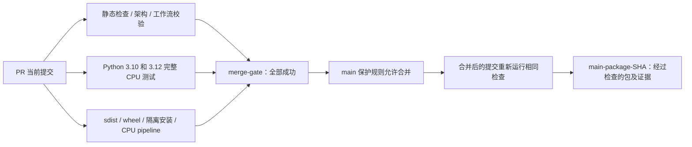

# PR 检查、合并门槛与 main 交付

入口为 [portable-ci](../.github/workflows/test.yml)。PR 到 main、新提交、重新打开 PR、main 推送均运行；也支持手动运行和将来启用 merge queue 时的 merge_group 事件。没有 paths 过滤，文档修改也会产生完整的必需状态。新 PR 提交取消同 PR 的旧运行；main 交付不因此取消。



## 检查职责

| 检查名 | 验证内容 |
|---|---|
| static-checks | Ruff、格式、8 领域依赖、编译、actionlint 工作流语法与表达式 |
| cpu-tests (3.10 / 3.12) | 完整 pytest；显式安装 FFmpeg 和 USD，保留 JUnit 和依赖清单；一个版本失败不取消另一个版本 |
| package-smoke | 构建和 twine 元数据检查；隔离 venv 安装 wheel，从仓库外以 `-I` 运行 CLI、合成 CPU pipeline 和恢复，检查独立物性读回和全阶段复用 |
| merge-gate | 始终汇总 static / test / package；仅三个依赖均 success 时通过。失败、跳过、取消、缺失或畸形结果均拒绝 |
| main-artifacts | 仅 main 的 push 且本次门槛通过后，从本次运行下载已测试候选包，验证 SHA256 后保存交付产物 |

PR 包名为 `package-candidate-<被测试 SHA>`，保留 14 天；通过 main 门槛的包名为 `main-package-<合并后 SHA>`，保留 30 天。包括 wheel、sdist、CPU smoke 摘要、commit/run URL 清单和 SHA256SUMS。PR 默认测试 GitHub 生成的合并提交，其 SHA 可能不同于 PR 分支 HEAD；正式交付绑定合并后的 main 提交。

这里的 CD 是通过检查的安装包交付，不自动发布 PyPI、建立公开 Release 或部署 Isaac/GPU 服务。CPU 成功不代表模型精度、机器人行为或真实设备生命周期通过。版本号升级与正式发布仍需另行确定。

## main 的保护规则

[main-protection.json](../.github/main-protection.json) 保存可复核配置：要求 PR，必需检查 `merge-gate` 只能由 GitHub Actions（app ID 15368）提交，分支必须包含最新 main，审查讨论必须处理；管理员也受约束，禁止 force push 和删除 main。

当前不强制额外审批人数（0），避免在未指定独立审查人的仓库中形成无法完成的人工审批条件。自动门槛不是人工审查；增加协作者后可将审批数改为 1，并配置代码所有者。不要使用 `--admin` 绕过失败检查。

保护配置属于 GitHub 仓库设置，仅提交 JSON 不会自动生效。本轮由维护者权限显式应用并回读检查。需要重新应用时，先读取现有规则并比较，避免覆盖新增要求，再执行：

```bash
gh api repos/miracle-techlink/video-to-simready/branches/main/protection
gh api --method PUT repos/miracle-techlink/video-to-simready/branches/main/protection \
  --input .github/main-protection.json
gh api repos/miracle-techlink/video-to-simready/branches/main/protection
```

工作流仅有 contents:read，不保存 Git 凭据，不用 pull_request_target 执行 PR 代码；actions 固定提交，actionlint 下载固定版本并验证固定 SHA256。工作流没有仓库管理或发布令牌。

## 日常合并顺序

1. 提交 PR，说明行为变化、迁移及验证范围；等待当前提交全部检查完成。
2. 检查失败日志和 JUnit。修复后推送新提交，不能用旧提交的结果代替。main 前进时更新分支并重跑。
3. 检查 diff、审查讨论与 PR HEAD，再使用正常合并；自动化操作应使用 `gh pr merge --match-head-commit <已检查 HEAD>`，防止检查后分支变化。
4. 合并后确认 main 的同套检查及 main-artifacts 成功，下载对应 SHA 的包。失败时保留上一份已验证交付，修复通过新 PR 进入。

GitHub 规则行为依据：[受保护分支](https://docs.github.com/en/repositories/configuring-branches-and-merges-in-your-repository/managing-protected-branches/about-protected-branches)、[merge queue 事件](https://docs.github.com/en/repositories/configuring-branches-and-merges-in-your-repository/configuring-pull-request-merges/managing-a-merge-queue)。

`aloho-hackson` 保存完整版本；核心 PR 以 main 为基线。不得将完整分支整支回合并到 main，以免重新引入已分离的功能。
