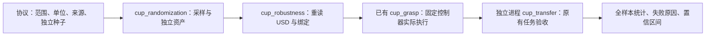

# 搬杯参数随机化与固定控制器评测

新增入口把“固定物性下成功一次”扩展为可重复的参数扰动实验。只改变杯质量、杯/夹爪/桌面的接触材料，不改变控制轨迹、初始位姿、几何或成功阈值。它是鲁棒性评测，不是策略训练或真实材料辨识。

## 一键入口

使用已经准备好的搬杯资产目录，其中包含 `task.usda`、`plan.json`、`robot.usdc`、`cup.usdc`。准备方式沿用[双桌搬杯示例](../examples/starbucks_grasp/README.md)。

```bash
# CPU 上采样、写入独立 USD，并独立重读检查；不启动 Isaac
simready workflows cup-robustness \
  --protocol examples/starbucks_grasp/robustness.json \
  --assets /path/to/prepared-cup-assets \
  --out runs/cup-robustness-prepared --prepare-only

# Docker 内真正执行所有回合并独立验收；每次使用新输出目录
simready workflows cup-robustness \
  --protocol examples/starbucks_grasp/robustness.json \
  --assets /path/to/prepared-cup-assets \
  --out runs/cup-robustness-run --accept-eula
```

本地 Isaac Python 可传 `--backend local --python /path/to/isaac/python.sh`；Docker 可传 `--image`、`--gpu`。物理频率用 `--physics-hz 240` 或 `480` 明确指定并进入实验清单。比较两个控制器时必须固定同一频率和样本，不把步长变化归因于物性变化。

`--prepare-only` 输出 `PREPARED`，没有动作成功率。执行模式的 `COMPLETE` 仅说明所有回合完成，动作结果看 `all.success_rate` 与逐回合 `success`；不是用流程退出码代替动作成绩。

## 本轮支持范围

| 参数 | 示例分布 | 生效方式 |
|---|---|---|
| 杯质量 | 0.06–0.12 kg 均匀采样 | 修改杯 MassAPI；显式惯量随质量等比例缩放，自动惯量保留由引擎根据不变几何计算 |
| 杯静摩擦 | 0.55–1.0 | 杯碰撞体独立接触材料 |
| 右夹爪静摩擦 | 0.6–0.95 | 右夹爪各碰撞体独立于场景材质绑定 |
| 两个桌面静摩擦 | 0.4–0.8 | 只绑定两个承托面，不随机静态桌子的无效质量 |
| 动/静摩擦比例 | 0.7–0.9 | 动摩擦不大于静摩擦；每个回合固定 |

这些区间是探索假设，没有实物测量依据。两侧材料均声明 PhysX `average` 合成规则，报告杯—夹爪、杯—桌面的有效动摩擦，不只记录杯子的单侧系数。恢复系数固定为零。

## 模块和证据



- `manifest.json` 在执行前冻结协议、样本、原资产、控制器/运动学/审计代码哈希与仿真频率。种子跨 development/heldout 不允许重复，调整回合顺序不会改变每个样本。
- 每回合保留独立 `assets/`、`randomization.json`、`parameter_audit.json`、`artifacts/physics/rollout.npz`、`result.json`、`task_audit.json` 和 `episode.json`。原始资产不会被改写。
- USD 重读检查真实材质绑定、质量和惯量。Isaac 运行时另读取 PhysX 刚体质量与已注册材料参数；原有 worker 同时绑定随机化回执哈希。
- 任务审计沿用原来的抬升、双侧接触、释放、承托、姿态、碰撞及 15 mm 放置偏差门槛。参数评测不修改这些门槛。
- 未运行、进程错误和动作失败均保留在预先声明的分母。报告按 split 分组，并给 Wilson 95% 区间；小样本只能检查链路和暴露失败，不能证明真实机器人可靠性。
- `plan.json` 保持不变，因此其中杯质量说明仍是历史名义值；实际回合质量以组合 USD、随机化回执和引擎读数为准。

## 尚未覆盖

当前是固定基座 G2 的已准备双桌场景，没有加入咖啡店背景、真实导航、位姿/视觉噪声、控制延迟、按钮行程随机化或策略学习。放置反馈仍使用仿真真值位姿。只有随后改变控制器并在未用于优化的新测试清单上验证，才能说动作适应性提高。

本轮运行证据见 [2026-11-14 评测记录](benchmarks/cup-robustness-20261114/README.md)。
