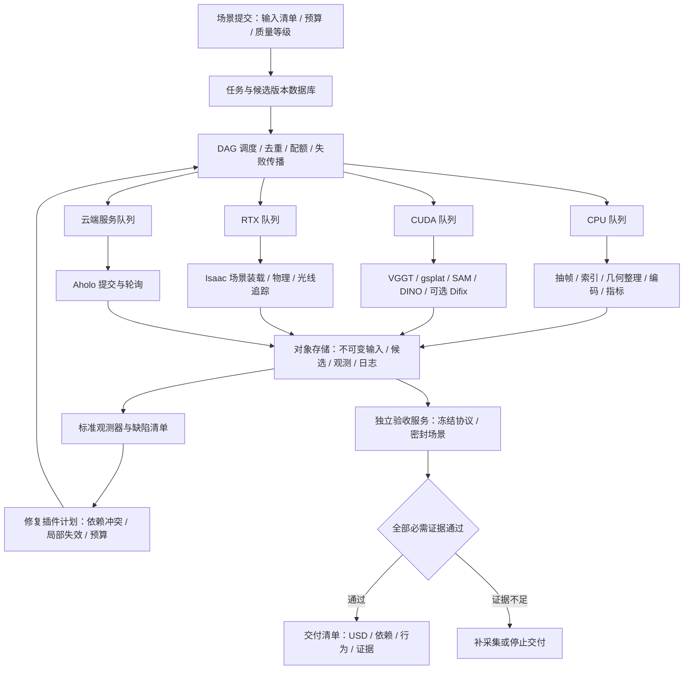

# 多场景重建、观测与修复的执行架构

状态：2026-11-12，v0.4。当前实现单机调度基础和可迁移的验收模块；下面的集群部署与常驻模型池是下一阶段设计，尚未部署。

2026-11-14 可靠性收敛：任务环境已改为显式继承合同，旧计划保留执行能力但关闭未约束环境的缓存；Isaac 本地 / Docker 启动器共用有期限的进程执行器。当前接口见下文及[部署说明](deployment.md)。历史吞吐设计仍保留，性能提速实验保持暂停。

同日后续完成[嵌套取消和统一租约](audits/2026-11-14-remaining-delivery.md)：DAG、worker_groups、launcher 及公开 GPU 工作流复用同一个 ResourcePool。旧执行状态和历史缓存规则保持可追溯；没有增加第二个调度器。

## 单机取消、设备与恢复合同

`run_process` 为每个子进程建立所属进程组，同时通过继承管道向嵌套 owner 传递取消。父进程关闭管道或死亡后，合作 worker 逐层退出并记录终态；收到合作确认后最多等待 20 秒，再回收所属进程组。Docker 清理预算最多 15 秒。刻意绕开协议的 detached 进程、不可中断内核 I/O 和远端 SSH 作业不保证被本地取消回收。

宿主按物理 GPU UUID 获取同目录 `.lease` 锁；已持有租约的嵌套本地 worker 通过密封 capability 和锁 FD 借用，不用环境变量布尔开关跳过检查。DAG 的 MIG inventory 必须声明 `physical_uuid`，同卡 MIG 归并到父设备锁。GPU 发现失败时拒绝执行；`resource_kind="cpu"` 不发现／租用 GPU，CPU Docker 不传 `--gpus`。

公开场景入口和语义 CUDA 推断持租约。容器由宿主 launcher 在整个生命周期持租约；`scene_execution`、`video_execution` 和仿真 worker 是内部执行器，不在容器内重复发现或获取宿主租约。直接调用内部 SDK 不属于调度保证。RTX 不能仅靠 CUDA_VISIBLE_DEVICES 隔离，本地多卡需已审查的 renderer 隔离 inventory。

容器清理未确认时在同一租约文件内隔离设备；后续任务拒绝占用，不默默释放为“可用”。恢复入口：

```bash
.venv/bin/python -m simready execution recover-device \
  --gpu-uuid GPU-实际物理UUID --lock-dir /tmp/simready-device-leases \
  --out runs/device_recovery_01 --timeout-s 15
```

恢复必须验证本次容器 ownership 后移除，或确认已知完整容器 ID 不存在；否则保留隔离并返回 `NEEDS_REVIEW`。输出目录不可复用。命令不删除其他任务的锁／容器。当前真实 CPU 生命周期和受控设备锁测试已通过，真实 Docker daemon 清理与 GPU 行为仍需目标环境回归。

## 先提高吞吐，再缩短单场景延迟

不同场景可以同时处理。同一场景则必须遵守相机、重建、资产、渲染和验收之间的依赖。一次修复只应使相关资产、视角和下游物理证据失效，未受影响的任务可复用。最终覆盖检查仍需覆盖全部预声明视角，不能只拍修好的位置。



## 硬件池不能混用

| 池 | 适合工作 | 限制 |
|---|---|---|
| CPU + 本地 NVMe | 抽帧、图像索引、资产打包、部分指标与视频编码 | 限并发 CPU、RAM、磁盘读写，避免全部任务同时解码 |
| CUDA 推理/训练 | VGGT、gsplat、分割、特征、Difix | 按显存实测峰值分配；先独占，稳定后再考虑共享 |
| 支持的 RTX/渲染设备 | Isaac/Omniverse、物理观测和渲染 | 需要匹配驱动、平台和渲染设备绑定；CUDA 环境变量不能隔离 Vulkan |
| 云端 Aholo | 服务端重建 | 受服务配额和排队影响，本地增加 GPU 不能直接加速 |

NVIDIA 官方列明：无 RT Core 的 A100、H100 不受 Isaac Sim 支持。因此 A100x8 应作为 CUDA 工作池，Isaac 使用单独的受支持设备。当地 GB10 的实际运行记录不能替代对目标容器、驱动与平台的兼容性验证。[Isaac 硬件要求](https://docs.isaacsim.omniverse.nvidia.com/latest/installation/requirements.html)

## 已实现的模块

- `src/simready/execution/task_schema.py`：版本化任务、资源、输入、输出、依赖和超时验证。
- `execution/resource_pool.py`：按物理 UUID 的协作式独占锁；不同卡可同时运行；同一卡跨进程互斥；子进程继承锁，父调度器退出不会立刻把仍忙的 GPU 当空闲。
- `execution/task_graph.py`：有界并发、依赖失败传播、CPU/RAM/云端配额与设备绑定。
- `execution/task_worker.py`：单任务子进程、超时清理、产物校验、缓存发布与任务日志。
- 缓存键绑定代码引擎、声明输入内容、运行时标识、参数、种子、质量协议、依赖内容及命令。复用前复核输出哈希；执行前后复核输入；不完整产物不进入缓存。发现损坏缓存会失败并保留现场。
- `core/artifacts.py`：IO 与数值模块解耦，使用唯一临时文件及原子 JSON 替换，避免并发写入共用 `.tmp`。
- `evaluation/`：统一观测、缺陷输出、通用资产一致性及独立进程验收。修复插件注册与计划器由 `repair/` 拥有；验收不依赖修复。执行调度器不修改验收阈值。

锁目录必须由同一主机上的所有宿主调度器共享；launcher 管理的容器由宿主持锁，不需要容器内再挂载同一路径竞争。检测到历史 `/tmp/*.gpu.lock` 时不删除他人锁：DAG 可等待到队列期限，直接 launcher 则返回资源忙。锁只对遵守协议的进程生效；旧工作负载最好放在独立 GPU/节点中，待迁移后再共享。

CPU、RAM 和云端配额目前按调度进程计算，不是跨进程的系统级硬限制；GPU 锁才是跨进程的。生产中一台主机一个调度器，或使用容器/cgroup 配额。显存值来自受信 inventory，未知显存不会当作无限容量；GB10 统一内存应由实测可用预算填写。

## 任务接口

计划顶层为 `schema_version: 1` 与 `tasks`，每个任务声明：

| 字段 | 语义 |
|---|---|
| `id`, `scene_id`, `stage`, `deps` | 安全任务 ID、场景、阶段、上游任务 ID |
| `argv` | 无 shell 的参数数组；支持 `{python}`、`{out}`、`{input:name}`、`{dep:task:file}` |
| `inputs` | 名称到文件路径；相对路径基于计划文件目录。脚本、权重清单、协议与配置也应声明为输入 |
| `outputs` | 相对于任务产物目录的显式文件名；不允许越界路径或输出文件符号链接 |
| `runtime_identity` | 固定镜像摘要、驱动、依赖与设备架构身份；必须由部署端正确填写 |
| `seed`, `parameters`, `quality_profile`, `env` | 进入缓存键的执行配置；worker 必须实际消费这些配置 |
| `environment.inherit` | 显式允许继承的非秘密变量名；图启动时冻结，最终有效值的摘要进入缓存身份 |
| `environment.secrets` | 必需凭据变量名；只在内存中读取值，不将值或值摘要写入环境回执；此任务禁用缓存 |
| `resources` | `kind=cpu/cuda/rtx/cloud`、`cpu`、`ram_gb`；GPU 另需 `vram_gb` |
| `timeout_s`, `queue_timeout_s` | 运行期限和资源等待期限 |
| `cache` | 可复现的纯计算任务可开启；付费提交、外部副作用和最终独立验收应关闭 |

`SIMREADY_SEED` 和 `SIMREADY_OUT` 被传入 worker。CUDA worker 通过 `CUDA_VISIBLE_DEVICES=<UUID>` 看到所选设备（内部通常是逻辑卡 0）。RTX inventory 必须声明外部已完成隔离 `rtx_isolated=true`，例如专用单卡渲染容器；这不是自动 Vulkan 隔离或兼容性检测。

任务是可信代码，当前执行器不是安全沙箱。显式声明 `environment` 后，仅继承 `inherit` / `secrets` 所列变量，再应用非秘密 `env` 字面量和调度器设备 / 输出 / 种子绑定；不会自动继承 PATH、HOME 或 PYTHONPATH。`{"environment":{"inherit":[]}}` 适用于使用绝对解释器路径且无宿主环境依赖的 CPU 夹具。普通部署可按实际需要列出 PATH、LANG、动态库路径等，并固定这些路径指向的运行环境与输入闭包；环境字符串的摘要不能证明磁盘依赖内容未变。

未声明 `environment` 的旧 v1 计划保持完整宿主继承，在图启动时冻结快照，但不读取或发布缓存，回执给出 `legacy_environment_untracked`。显式 `secrets` 同样关闭缓存，原因是 `secret_environment`；既有 `cache=false` 仍有效。普通变量缺失与空字符串有不同身份；`env` 覆盖同名普通继承值，以最终有效值计算身份。秘密变量必须存在，且不能与 `inherit` / `env` 重复；所有合同都不能覆盖调度器保留键。

计划中的 `env` 仅允许非秘密设置。保存到运行目录的 `plan.json` 会脱敏这些字面量并标记 `environment_values_redacted`，标记后的回执不能作为可重放计划提交；应保留原始配置并重新提供凭据环境。秘密值不进入环境元数据或摘要；可信 worker 自己输出的日志不属于自动脱敏范围。密钥不要放在计划、`argv` 或仓库中。

每次执行使用新的 `--out`。重启时使用相同 `--cache` 复用已完成阶段；失败阶段重新执行。云端提交不自动重试，生产适配器还必须实现提供商任务 ID 的持久化及幂等去重。阶段成功表示命令与产物合同成立，**不表示场景验收通过**。

## 面向多机的落地顺序

1. **统一阶段接口**：把本地脚本中的绝对路径、全局锁、`SimulationApp` 生命周期与场景参数移到 worker 适配器。重建、清晰化预览、可编辑资产修复保留不同输出类型。
2. **三类常驻 worker**：CUDA worker 按模型/权重版本保持模型驻留；RTX worker 保持 Kit 与 shader 缓存，按场景重置 USD/物理状态；CPU worker 批量处理 IO。每个阶段细分装载、计算、同步、编码时间。
3. **跨节点队列**：任务数据库记录状态、租约与心跳；对象存储保留不可变清单与大文件；本地 NVMe 缓存热数据；按资源标签分配节点。Ray actors 或 Kubernetes workers 都可承载既有阶段合同，先选一个，避免双重调度。
4. **多租户与恢复**：全局云服务配额、显存/内存限制、任务取消、worker 崩溃回收、租约 fencing、发布幂等和垃圾回收。模型热驻留需要显式内存生命周期。
5. **独立验收与发布**：密封参考集置于另一权限域。修复 agent 无权修改协议、读取密封反馈或发布交付物。

Ray 的 GPU 份额是调度资源，不能自动约束显存；模型池采用长期 actor 也必须管理泄漏与回收。[Ray accelerator scheduling](https://docs.ray.io/en/latest/ray-core/scheduling/accelerators.html)

## 逐项优化及等价性门槛

| 优先级 | 改动 | 为什么可能更快 | 必须守住的证据 |
|---|---|---|---|
| P0，本 PR 基础 | 每卡队列、阶段缓存、去掉 IO 临时文件冲突 | 跨场景并发、重复任务跳过 | 输入/输出哈希、失败传播与锁测试 |
| P1，待接入 | Isaac 常驻、复用着色器缓存、卸载/重置场景 | 减少每次启动与编译 | 冷/热各测 p50/p95、场景间无残留状态 |
| P1，待接入 | 观测先全景定位缺陷，再重跑受影响的视角/资产 | 减少每轮完整 4K 视频与修复调用 | 最终全部视角覆盖、原片保真、资产关系与物理检查 |
| P1，待接入 | gsplat 模型一次上传、相机分块批量渲染 | 避免每个视角重建张量 | 保持 SH 阶数、坐标、尺度、分辨率、色彩和逐视角像素误差界限 |
| P1，待接入 | Difix 按视角块并行、批量推理、异步写盘 | 消除逐帧串行与 IO 等待 | 固定种子映射，检查时序/结构一致性；仅作预览，不冒充资产修复 |
| P2，需 profile | 物理控制张量留在 GPU，日志缓冲，减少 `.cpu().numpy()` | 降低高频 GPU↔CPU 同步 | 保留原控制/观测频率与 physics dt，重放轨迹/接触/成功率 |
| P2，需 profile | pinned memory、异步传输、解码与编码流水、NVMe 热缓存 | 让 IO 与 GPU 工作重叠 | 核对帧序、时间戳、丢帧与内存峰值 |
| P3，证据充分后 | 多卡单场景 gsplat、精度/编译/kernel 优化 | 加速超出单卡容量或确属计算瓶颈的任务 | 同协议质量门槛、通信成本、OOM/恢复测试 |

gsplat 提供多相机 rasterization 和分布式模式，分布式模式有相机数量及负载分配约束；不能假定八张卡等于八倍单场景速度。[gsplat rasterization](https://docs.gsplat.studio/main/apis/rasterization.html)

Isaac 的性能参数应通过官方手册结合本项目场景实测，不能用减少画质或物理步数后的时间冒充等价加速。[Isaac performance handbook](https://docs.isaacsim.omniverse.nvidia.com/latest/reference_material/sim_performance_optimization_handbook.html)

## 容量与观测

某阶段有 `n` 个独占 worker、平均服务时间 `t` 秒，则理想服务上限约 `n/t` 个任务/秒；真实吞吐还受排队、缓存命中率、传输及失败重试影响。整条流水线由最紧张的资源池限制。先测各阶段服务时间，再采购或扩容，不能直接把完整管线的串行耗时除以 GPU 数。

上线需统一记录：场景端到端 p50/p95、每池队列等待、冷/热模型装载、计算和同步、读写/编码、GPU 忙时与显存峰值、缓存命中率、失败/OOM、每轮缺陷收敛、独立验收通过率、token/云服务成本。当前执行器只有队列、子进程和 worker 总耗时，尚未测得的成本/显存为 `null`，不填 0。
