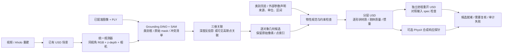
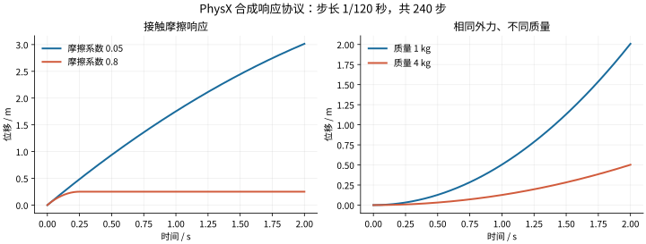
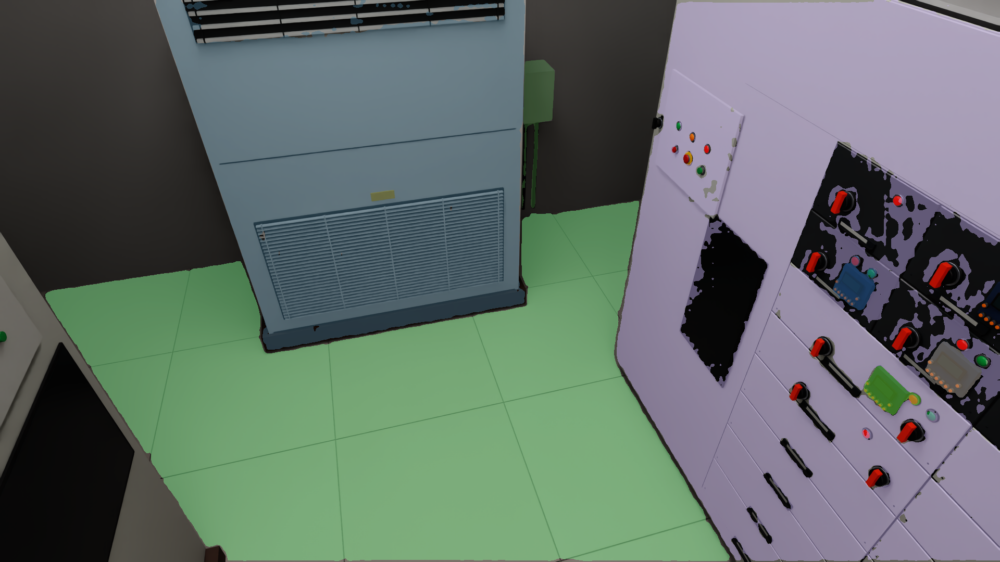
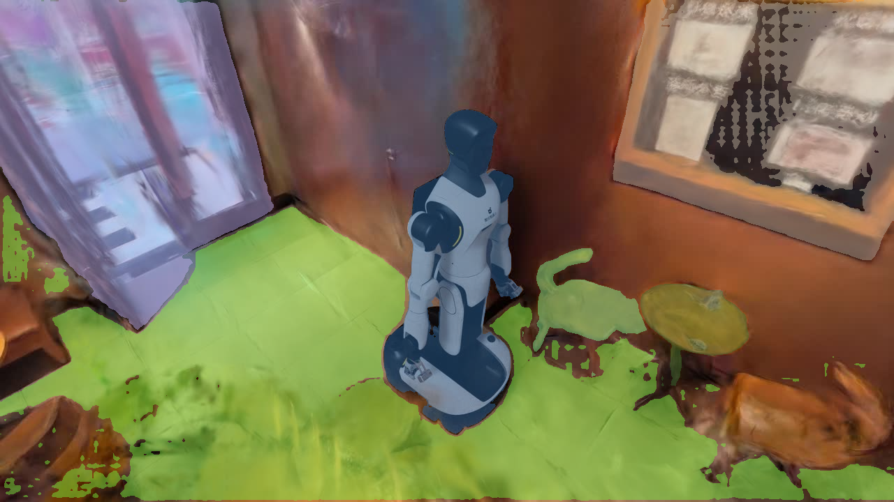

# 多类资产语义分割与物性管线

本次实现将物性处理从按钮扩展到柜体、柜门、地面、桌椅等类别，提供模型分割、带来源的逐物体参数、USD 写入和独立验收。默认生成的是**静态、不可见的碰撞候选**，保持重建外观；需要动态行为时显式提供质量、尺度和运动模型。

这是一版可运行、可复现的工程实现。类别先验尚未变成实测参数，单视角盒体尚未变成完整高质量网格，两个场景尚未通过语义准确率和全资产任务验收。

新增 [NeRF2Physics 质量候选接线](nerf2physics.md)：候选／编译决定／USD 独立读回进入视频主链。语义工作流的分割、CPU 投影、USD 写入和审计现在共享有限期限与取消；GPU 推断遵循统一租约。真实模型推断与实物参数精度不由工程接线验证替代。

## 1. 实际链路

`simready workflows semantic-assets` 是分割、三维关联、物性写入和独立审计的一键入口。[公开示例](../examples/semantic_assets/README.md)不需要私有场景或机器人权重。新视频巡览会导出逐帧标定；修复后的场景可以使用独立 RGB-D 观测器，避免将旧高斯几何强行当作新可见资产的深度。

## 2. 模块构造与输入输出

| 责任 | 实现 | 输入 → 输出 |
|---|---|---|
| 开放词汇分割 | `ingestion/grounded_segmentation.py` | 图像、类别短语 → 检测框、SAM 原始掩码、互斥派生掩码、拒绝清单 |
| 固定类别基线和导入 | `ingestion/semantic_segmentation.py` | SegFormer 图像推理，或带哈希的外部分割 → 统一 manifest |
| 标准观测 | `simulation/depth_observation.py` | USD、指定相机、来源 PLY/spec → 同次 RGB、camera-z depth、标定与来源 |
| 渲染标定 | `simulation/camera_calibration.py`、`scene_video.py` | 实际 eye/target、焦距、图像 → OpenCV c2w/K 与图像／点云身份 |
| 三维关联 | `simulation/semantic_projection.py`、`depth_projection.py` | mask + K/c2w + 深度或 PLY → 静态表面 AABB、源索引和拒绝原因 |
| 类别先验 | `simulation/category_priors.py` | 类别 → 版本化、未测量的接触参数假设；未知类不自动回退 |
| 物性规范 | `simulation/physical_spec.py` | 声明 → 有数值域、SI 单位、来源与区间的规范对象 |
| USD 写入 | `simulation/physical_authoring.py`、`scene_preparation.py` | 规范对象 → 独立材质绑定、刚体、质量、质心、惯量与 metadata |
| 独立检查 | `evaluation/physical_assets.py` | 原始 spec + 组合 USD + catalog 路径映射 → 逐项差异、哈希与状态 |
| 数值响应 | `simulation/physical_probe.py` | 冻结合成协议 → 真实 PhysX 轨迹、解析对照、源码和 SDK 版本 |
| 编排 | `workflows/semantic_assets.py` | 参数和输入证据 → 全流程目录、失败回执、分段时间和用量 |

领域边界保持原有十领域架构：`workflows` 负责跨域调用，`evaluation` 不导入资产写入实现，`simulation` 不导入识别模型。模型可以安装在独立 Python 环境，用 `--segmentation-python` 调用；USD worker 与模型依赖不必混装。

## 3. 分割结果怎样成为物理候选

Grounding DINO 根据类别短语给出候选框；SAM 根据框给出像素掩码。默认查询柜体、门、桌、椅、地面和机器人，也可以显式指定其他类别。

分割不是完整资产清单：柜门可能包含于柜体，机器人底座可能被误判为桌子。系统先保留全部原始掩码，再按机器人／人物优先、检测分数次之生成互斥掩码，记录被移除的像素。保留面积不足 20% 的片段进入拒绝清单；有歧义的结果不能被视作真值。SegFormer 连通区域同样不等于真正的物体实例。

三维关联有两种明确区分的路径：

- **同次深度观测**：使用相机 z-depth，按 `p_world = T_c2w · [z K⁻¹(u,v,1), 1]` 反投影。深度和 RGB 必须同分辨率、同相机、同帧；不能把沿射线距离直接当 z-depth。有效深度最多确定性采样 20 万点，索引是原始像素线性编号。
- **已有 PLY 近似关联**：将高斯／点云中心投影到像素，使用最近深度缓冲剔除后方中心。保留原始 PLY 索引；不模拟高斯的透明度累积与屏幕覆盖，因此只是近似。原始高斯与修复后柜面差异很大时，该路径应失败或要求重新观测。

两个路径都只形成可见表面的稳健包围盒，不能推断未观测的背面、内部空腔或真实体积。默认不另建背景体素，以减少与语义代理重复碰撞；若显式开启背景地面且同时生成语义地面，会进入复核状态。新代理与已有显式对象相交时拒绝生成，防止挡住已有按钮行程。

候选场景的外观仍由输入 PLY 写入；修复场景的 RGB-D 用于改善物性代理，不会自动将该场景的全部网格、纹理和原有控件合并进候选。接回已有机器人任务时，还需要已有 USD 对象映射、碰撞去重与任务回归。深度点索引属于完整 `width × height` 栅格；有效像素数量和索引范围分别记录，空洞不会改变索引含义。

标定文件必须绑定 `image_sha256`、`ply_sha256` 和 `source_to_world_sha256`。读取前冻结输入身份，处理结束再复核；处理中更换相机、图像、掩码或参数文件会失败，不能把新哈希贴到旧计算结果上。坐标哈希一致只证明文件身份，不等于真实尺度或配准精度已验证。

## 4. 参数契约：类别、几何与物性分开

为兼容原有 scene spec，首版在 schema v1 的 `objects[*]` 增加可选 `physics` 和 `visible`。完整 v2 档案迁移继续保留在[长期计划](plans/physical_properties.md)中。

| 字段 | 含义与检查 |
|---|---|
| `category` | 语义类别，可扩展；不决定几何或可操作行为 |
| `type` | 当前为 `box` 或显式 `button`；柜门不会因名字自动变成铰链 |
| `visible` | 是否参与外观渲染；不可见碰撞代理仍保留 CollisionAPI |
| `physics.motion_type` | `static`、`kinematic`、`dynamic`；动态盒体要求明确质量与尺度声明 |
| `mass_kg` | 质量，严格正值；静态类别先验不自动填质量 |
| `center_of_mass_m` | 物体局部坐标中的质心；要求质量已给定 |
| `inertia_kg_m2` | 局部轴上的三个主惯量，检查正值和三角不等式；不接受任意矩阵或隐含主轴旋转 |
| `contact` | 静摩擦、动摩擦、恢复系数；检查范围和动摩擦不大于静摩擦 |
| `provenance` | 逐参数来源、单位、区间；向量参数按 `.x/.y/.z` 记录 |

来源类型包括 `default`、`user_declared`、`category_prior`、`catalog`、`measured`、`derived`、`vision_prior`。填写 `measured` 只是调用方的来源声明，不能绕过独立验证。所有新物性记录的真实验证状态仍由输出生成，输入不能自报“已经验证”。

每个对象创建独立物理材质，绑定到具体碰撞形状；不会再用一次全局遍历覆盖所有对象。接触对的最终摩擦还取决于仿真后端的组合规则和对方材质。视觉粗糙度、材料类别和接触摩擦不是同一个参数。

默认先验按类别提供不同的摩擦／恢复假设，但它们**不是材料估计模型的预测**。区间是敏感性测试的探索范围，不是统计置信区间。现阶段尚未运行 GaussianProperty、NeRF2Physics 或型号检索来生成可评估的材料参数；不得将其写成已接入。2026-11-14 [代码复审](audits/2026-11-14-pipeline-architecture.md)确认此状态，并明确了独立研究 worker、候选合同和公开数据评分的接入顺序。

同轮补接：`simready run --video` 的 scene spec 含显式对象时，worker 在结构检查后运行独立物性审计，宿主复核其输入与依赖哈希。`physical_asset_validation=PASS` 仅表示声明对象的 USD 参数读回一致；没有显式对象时为 `NOT_EVALUATED`，不自动生成语义实例或物性预测。

## 5. 独立验收与状态

| 层次 | 本版检查 | 不能推出的结论 |
|---|---|---|
| 图像与来源 | 文件哈希、维度、互斥派生 mask、原始掩码与来源 | 语义类别必然正确、完整资产无遗漏 |
| 几何候选 | 已标定关联、最低三维支撑、像素覆盖、代理交叠与旧对象保护 | 完整网格、封闭体积、可导航自由空间准确 |
| USD 结构和值 | 外部 spec 与重新打开的组合 USD 逐项比对，检查绑定、质量、惯量、关节和来源 | 参数符合现实、接触响应与实物一致 |
| 合成动力学 | 固定摩擦／质量响应协议和完整轨迹 | 变电站按钮、所有物品或机器人任务已经验证 |
| 真实参数误差 | `NOT_EVALUATED` | 没有真实观测时不宣称实物标定成功 |

`CANDIDATE_READY` 表示候选生产和结构检查完成，`release_authorized` 仍为 false。单类占图超过 95%、有效三维支撑少于 10%、有效像素覆盖少于 1%、没有非结构资产、代理相交或掩码歧义等条件会返回 `REVIEW_REQUIRED`。这些是最低拒绝条件，不是准确率 benchmark。物性读回不一致返回 `AUDIT_FAILED`；超时和输入损坏保留 `FAILED` 回执。

模型自身声明的语义复核要求也会向下传递，USD 数值检查不能将其清除。当前开放词汇模型输出仍要求语义复核；公开合成夹具的 `CANDIDATE_READY` 只用于验证接口。

## 6. 本次真实测试与耗时口径

| 变电站：同次 RGB-D 分割候选 | 星巴克：图像分割候选 |
|---|---|
|  |  |

图中的颜色只是候选 mask。变电站新观测仍把一处设备附件误分为桌子；星巴克仍把海报误分为柜体，因此不展示“全部识别成功”的结论。原始轨迹、模型对照和逐段测量见[可追溯的 benchmark 记录](benchmarks/multiclass-physics-20261113/results.json)。

模型测试运行于本机 CPU PyTorch，均保存固定模型版本、权重哈希、实际设备和计时。CUDA 接口存在；本机所用 Torch 为 CPU 版本，未将 CPU 实测包装为 CUDA 加速结果。

| 实验 | 实际结果 | 时间及边界 |
|---|---|---|
| SegFormer B0，原高斯变电站巡览 | 几乎全图识别为墙 | 1.89 秒；明确失败样例 |
| SegFormer B0/B5，清晰变电站／星巴克图 | 有漏检、碎片与错误类别 | 已保存对照；没有像素真值，不报告 mIoU |
| Grounding DINO + SAM，变电站完整帧 | 机器人、地面、两个柜体；重叠门片进入拒绝清单 | 11.05 秒，缓存权重、CPU worker；不含初次安装下载 |
| 同模型，星巴克图 | 产生桌椅等候选；海报误识别为柜体 | 10.86 秒，保留误检说明，不当作语义 PASS |
| 修复场景 RGB-D 观测 | 新1920×1080图像与camera-z深度绑定；地板反投影 Z 跨度约1.78×10⁻⁷ | 容器全程31.79秒，复用shader缓存；仍是渲染深度 |
| 新观测 → 物性候选一键入口 | 4 个静态候选，USD审计PASS，语义仍REVIEW_REQUIRED | 11.87秒，其中新分割11.01秒；不含观测或新重建 |
| 公开五类资产夹具 | 5 套对象材质、6 个碰撞体，355 项独立检查 | 真实 OpenUSD 写入与重读 |
| 固定 PhysX 合成响应 | 9 项检查通过；低／高摩擦滑动 3.015／0.251 米；1 kg／4 kg 位移比 4.0 | Docker 完整 25.13 秒，其中 Kit 23.44 秒、240 步与964条采样 0.069 秒 |
| 逐帧标定烟测 | 真实 USD 相机与导出矩阵一致，24 项检查通过 | 两帧 197.49 秒；新缓存触发 RTX/driver shader 编译，不能按纯渲染耗时理解 |

`workflow.json` 单独记录分割、投影／参数、USD 写入、独立审计以及编排开销。合成探针同时记录 worker 内部分段和外层容器完整时间。模型下载未被独立计时的部分明确缺测；并行实验不相加冒充 E2E。

完整本地检查为 **587 passed、1 skipped**；跳过项依赖未配置的历史机器人夹具。Ruff、格式、十领域边界与16个公开函数签名检查通过，wheel和sdist已构建。可读的互斥计时表见[本轮 benchmark](benchmarks/multiclass-physics-20261113/README.md)。

本地分割和物性工作流没有调用 LLM API，因此这部分 API tokens 为 0。Grounding DINO 使用自己的文本编码器，另记本地 detector token 数；开发 agent 的对话 token 不在运行时计数范围内，本次没有伪造开发 token 账本。

## 7. 三小时首版的范围与下一阶段

三个 agent 分别开发分割、物性写入／数值探针、独立验收；主 agent 负责三维关联、入口、跨模块审查与真实场景串联。代码、CPU 测试并行，Isaac GPU 运行排队，避免同时冷启动争抢资源。

首版的完成目标是：公开命令可复现、多类参数能够独立写入、真实模型确实执行、失败结果能阻断、原按钮接口兼容。长期计划中的所有研究和实物验证没有被压缩成三小时完成：

1. **固定跨场景语义真值集**：标注柜体、门、桌椅、把手、开关、工具等类别及部件关系，报告实例匹配、漏检／误检和三维定位误差；当前默认六个查询类别只是示例。
2. **改善几何而非盲填参数**：多视角关联、可见面／未见面分开、物体级网格和柜门关节；深度和体积不可靠时拒绝质量推断。
3. **接入有评估的参数估计**：材料候选、型号资料、NeRF2Physics 公开测量集；分别评估摩擦、硬度和质量，避免把硬度直接当按钮弹簧刚度。
4. **任务相关敏感性和辨识**：按钮力—行程／回弹、工具接触、门铰链、桌椅稳定性；有真实轨迹再拟合，无真实轨迹保留区间。
5. **再接入 RSI 参数配方晋升**：冻结独立验收协议，将方法和失败规则写入 Memory/Skill；不能把一次候选成功当作真实物性知识。

## 8. 第三方模型与许可

- [Grounding DINO tiny 模型卡](https://huggingface.co/IDEA-Research/grounding-dino-tiny)与 [SAM ViT-B 模型卡](https://huggingface.co/facebook/sam-vit-base)标记 Apache-2.0；本仓库不打包权重。
- [SegFormer 官方许可](https://github.com/NVlabs/SegFormer/blob/master/LICENSE)限制研究／评估用途。它仅作为可选对照，不能因为仓库代码为 MIT 就视作权重也同样授权。
- 上游三维重建仍通过[群核科技 Aholo API](https://labs.aholo.ai/api-docs/intro)接入；本次分割、物性与验收扩展由本项目实现，没有重新训练或替换 Aholo 服务模型。
