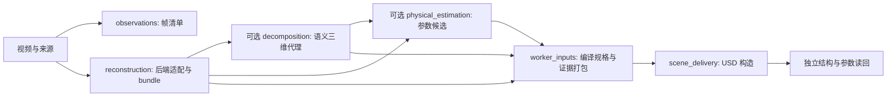

# 规范化 pipeline 与重建 baseline 接入

规范入口为 `simready run --pipeline pipeline.json --out runs/<新运行>`。它与旧 `--video` 入口委托同一个视频工作流和唯一阶段回执实现；进程、容器与 GPU 继续使用 execution 域。已有 `--scene`、独立语义、修复和杯任务入口保持兼容。

## 当前实际分层



观测抽帧与重建都是视频的消费者；当前重建后端可以消费完整视频或自己声明的冻结帧，不能把观察阶段的 heldout 标记误当作后端已隔离训练访问。新的联合方法可通过重建 bundle 描述所用帧、坐标与证据；尚未提供任意多输出 DAG 插件 API。

| 工程域 | 唯一职责与主要实现 |
|---|---|
| `core` / `geometry` | 文件证据与版本合同；坐标、深度反投影与变换校验 |
| `ingestion` | `reconstruction_providers` 固定后端配置和产物；保留视频／分割／材料适配 |
| `assets.appearance` | 高斯解析、表示转换与外观资产 |
| `assets.association` | 分割与标定提升为有来源的对象代理 |
| `assets.physics` | 参数声明、候选采用规则、刚体／材质写入 |
| `assets.compilation` | scene spec 组合成 USD 和资产清单 |
| `simulation` | 引擎、机器人控制、测量与渲染；杯任务已拆运行／控制／记录 |
| `evaluation` | 独立读回、指标与特定任务验收；不依赖资产 writer |
| `workflows` | 配置、阶段依赖、恢复／升级、baseline 矩阵和修复闭环 |
| `execution` | 所属进程、GPU 租约、期限、取消、任务缓存 |
| `agents` / `repair` / `experience` | 受限修复决策、插件与已验证经验；尚非新视频默认全自动闭环 |

新增 assets 只依赖 core / geometry，不能依赖仿真器、工作流或验收器。旧 simulation 资产模块保留模块别名或 CLI 委派，只有一份规范实现；旧 monkeypatch 与导入仍指向同一实现。其他仿真大 runner 和通用完整 mesh／关节生成属于后续迁移，不以新建空子目录冒充功能。

## 最小配置与操作

```json
{
  "schema_version": 1,
  "input": {"video": "scene.mp4"},
  "stages": {
    "observations": {"provider": "video_frames", "fps": 2},
    "reconstruction": {
      "provider": "artifact",
      "manifest": {"path": "reconstruction.json", "sha256": "<实际 SHA256>"}
    },
    "assets": {"provider": "scene_spec", "scene_spec": "scene-spec.json"},
    "delivery": {"provider": "usd_scene", "mode": "prepare"}
  },
  "execution": {"backend": "local", "runtime_identity": "my-reviewed-environment-v1"}
}
```

路径以配置文件目录为基准。未知字段、未注册 provider、缺文件或非法预算提前拒绝。默认本地 CPU 导出；`mode=survey` 需要 Isaac 环境，Docker／渲染仍要求 `--accept-eula`。外部解释器或 Docker 环境还必须提供 `execution.environment_manifest={path,sha256}`；这是可复核的操作者环境清单，不等于独立检测全部已安装依赖。实际 worker checkout 源码和解释器文件在规划、运行前及发布前检查。

```bash
# 生成可直接运行的合成 CPU 示例；不是算法质量 benchmark
python examples/pipeline/create_fixture.py --out /tmp/pipeline-inputs
simready run --pipeline /tmp/pipeline-inputs/pipeline.json --out /tmp/pipeline-run --dry-run
simready run --pipeline /tmp/pipeline-inputs/pipeline.json --out /tmp/pipeline-run --until reconstruction
simready run --pipeline /tmp/pipeline-inputs/pipeline.json --out /tmp/pipeline-run --resume
# 修改配置或 scene-spec 后，显式接受生成新计划版本
simready run --pipeline /tmp/pipeline-inputs/pipeline.json --out /tmp/pipeline-run --upgrade
```

`--until` 成功返回 `STAGE_READY` 和 `delivery_level=INTERMEDIATE`，不声称完整交付。`--resume` 要求计划完全一致；`--upgrade` 保存新旧计划，重验并复用身份相同的阶段。旧 `--video` 运行保持严格恢复语义，迁入配置入口使用新目录。

阶段身份包含 provider、版本、配置、输入、运行环境、规范实现及其公共依赖、上游身份。观测帧数调整只影响实际消费该帧集的阶段；当前 provider 并不自动消费抽帧清单。质量参数改变会让物性／编译／交付失效，保持不依赖它的重建。公共编排或合同代码变化会保守失效多个阶段。新旧成功回执位于 `stages/<阶段>/<身份>.json`，`stages/<阶段>.json` 是兼容索引；失败单独记账，不覆盖旧成功。

## 接入重建方法

支持三种受控后端：

- `artifact`：校验并导入已有来源绑定的 reconstruction.json。算法身份可未知，但不能据此报告新推断。
- `aholo`：委托既有云任务入口；新提交需要显式 `--submit-reconstruction`，已知 receipt 可恢复。
- `command`：显式 argv、实现／权重／环境清单引用及 CPU/CUDA 资源，委托现有执行器。在工作目录写 reconstruction.json，随后验收统一 bundle。完整示例见 [reconstruction_backends](../examples/reconstruction_backends/README.md)。

新增本地 baseline 通常只需一份 command 配置和输出格式适配；不修改仿真控制或验收门槛。bundle 记录表示、算法身份、训练／留出声明、坐标尺度、文件哈希和本次 import/fresh_command/cloud/cache 模式。当前主链实际支持可解码 Gaussian PLY；mesh／point cloud 虽有声明类型，进入当前 USD 路由会拒绝。完整 mesh 后端需要新增实际 converter 和验收，不能重命名文件绕过。

command 和 Aholo 按阶段身份保存工作目录，支持已完成算法在主流程回执发布前中断后的恢复。未知提交状态和失败命令不盲目重跑。依赖 `environment.secrets` 的 command 允许新运行，但规范 pipeline 禁止其 `--resume/--upgrade`，要求新 `--out`；计划和回执不保存 secret 值或其 hash。

当前仓库可运行的示例是合成 CPU command 和 artifact 导入。没有把历史已知相机姿态的 gsplat 脚本标成完整 VGGT→gsplat 链，也没有运行 AnySplat / VGGT / TRELLIS 等新模型。

## 可选语义与物性阶段

`decomposition.provider=semantic_projection` 接收 manifest、calibration 及明确的 association（当前视频／重建 SHA256、原因、证据引用），生成 scene spec 和点分配证据；随后进入同一次 USD 编译。当前使用已提供的 mask，不在规范入口自动下载或调用分割模型。完整独立分割流程仍可先通过 semantic-assets 运行。

`physics.provider=nerf2physics` 使用 request，或 `provider=candidate` 使用 candidate；详情见 [NeRF2Physics](nerf2physics.md)。候选必须匹配生成后的对象 ID。语义 `REVIEW_REQUIRED` 传入摘要，精度维持 NOT_EVALUATED、release_authorized=false；参数读回通过不升级为完整几何或真实物性通过。

## baseline 对比与升级测试

```bash
python examples/baselines/prepare_fixture.py --out /tmp/baseline-inputs
simready workflows baseline-matrix --matrix /tmp/baseline-inputs/matrix.json --out /tmp/baseline-run --dry-run
simready workflows baseline-matrix --matrix /tmp/baseline-inputs/matrix.json --out /tmp/baseline-run
```

矩阵默认执行到 reconstruction；`--full` 执行完整配置。固定观测与端到端模式分别记账。失败／未执行保留在分母，缺真实参考帧时质量为 NOT_EVALUATED；不按导出成功率排名，不自动晋升后端。带真实留出数据时复用独立 verifier，训练访问和相机／渲染对应的操作者声明仍单列。sealed 诊断返回 WITHHELD，不能进入修复反馈。详细输入见[矩阵示例](../examples/baselines/README.md)。

回归分四类：合同负例、阶段 CPU 夹具、完整链恢复／升级、目标环境模型/GPU 对照。已验证旧／新资产入口同输入 USD 字节一致、只改质量时上游复用、改变 PLY 后旧语义关联被拒绝、阶段发布前源码变化不污染缓存。模型精度、真实物理和 GPU 生命周期必须在相应环境另行验证。
