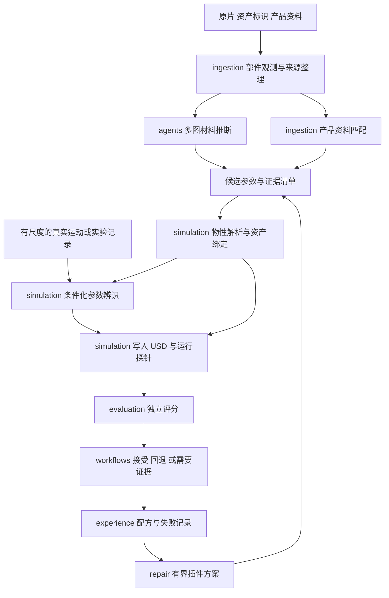

# 物性估计与验证开发计划

日期：2026-11-13。代码基线：`3f2d898f1e54b63cf8c4a1be0d94db898dadc2a5`。状态：开发设计，本文中的新增文件、命令、接口与验收目标尚未实现。

本阶段把现有物理预设升级为有来源、有适用范围、可以独立评估的物性配置。开发顺序为物性契约、资产写入、材料与产品资料推断、公开数据评估、条件化参数辨识，最后接入 Agent 和 Memory/Skill。优先覆盖变电站按钮、工具头及其局部碰撞；固定柜体维持静态碰撞，不要求估计整柜质量。

没有实物时，交付范围是参数来源可追溯、公开数据上的预测误差、数值收敛与参数区间内的任务鲁棒性。真实变电站按钮的力学精度仍需要对应的真实观测。现有 20/20 项任务审计作为历史仿真基线保留。

## 1 开发目标与范围

| 优先级 | 本阶段交付 | 完成条件 |
|---|---|---|
| P0 | 刚体、材料、接触对和关节的物性契约；旧配置迁移 | 预设不会自动升级为测量值；旧示例保持兼容；USD 重读结果与生效参数一致 |
| P1 | 材料候选、型号资料匹配、部件映射与公开数据评估 | 能运行一个真实模型推断适配器，保留输入输出和用量；与固定基线比较预测误差 |
| P1 | 桌面按钮仿真基准和变电站局部探针 | 解析测试、步长收敛、区间扫描、未触发及释放失败均有可重放记录 |
| P2 | 有条件的运动参数辨识与经验复用 | 无可辨识证据时返回证据不足；有数据时在留出轨迹上验证；测试集不进入记忆 |

首版不包含任意场景全自动语义资产化、全场景材料认证、完整柔性体重建或替换默认物理引擎。Newton/MuJoCo 对照在物性契约和基准稳定后另立任务；不与首版接口迁移绑定。历史 15 分钟性能优化继续保持暂停。

## 2 现有代码与具体缺口

| 现有位置 | 已有能力 | 本阶段改动 |
|---|---|---|
| [scene_preparation.py](../../src/simready/simulation/scene_preparation.py) 的 `_objects()` | 显式 `box`、`button`；按钮质量、刚度、阻尼、行程 | 从按钮字段扩展到有类型、有证据的物性引用；保留旧字段适配 |
| 同文件 `_bind_contact_material()` | 创建一套摩擦与恢复系数并绑定该层全部碰撞 | 改为按碰撞形状绑定材料；编译并核对目标接触对的有效参数 |
| 同文件 `_write_objects()` | 写入 `MassAPI.mass`、滑动关节与线性驱动 | 加入质心、惯量与关节响应模型；区分驱动限幅、触发条件与任务力上限 |
| [press_tool.py](../../src/simready/simulation/press_tool.py) | 被动柱塞与工具惯量；工具摩擦硬编码 0.9/0.8 | 材料、接触偏移和工具物性集中配置；旧值明确标为默认值 |
| [scene_contract.py](../../src/simready/simulation/scene_contract.py) | 已有任务文件路径解析 | 增加物性档案解析、绑定、冲突检查与 worker 输入打包 |
| [substation_mission.py](../../src/simready/simulation/substation_mission.py) | 接触力、按钮位移、工具压缩与关节状态 | 保留旧日志；增加可审计的力口径、时间、物性和后端身份 |
| [button.py](../../src/simready/simulation/button.py)、[panel_controls.py](../../src/simready/simulation/panel_controls.py) | 接触与行程共同驱动触发、释放、去抖 | 保留任务语义；物性估计器不得修改触发阈值来制造成功 |
| [agents/contracts.py](../../src/simready/agents/contracts.py)、[prompting.py](../../src/simready/agents/prompting.py) | 有界文本上下文，只选择已有修复方案 | 单独增加多图材料推断契约；不把现有 `DecisionProvider` 当作视觉估计器 |
| [evaluation/protocol.py](../../src/simready/evaluation/protocol.py) | v1 协议要求 RGB 视图与图像类检查 | 增加物性协议分支，允许参数表、力曲线与轨迹作为观测 |
| [verification.py](../../src/simready/evaluation/verification.py)、[regression.py](../../src/simready/evaluation/regression.py) | 独立进程验收、冻结协议、前后比较 | 复用过程边界；增加物性指标和数值波动容差，不改旧协议语义 |
| [video_pipeline.py](../../src/simready/workflows/video_pipeline.py)、[video_execution.py](../../src/simready/workflows/video_execution.py) | 输入哈希、恢复、worker 打包；只接受 scene spec v1 | 支持显式 v2 与物性依赖包，防止恢复时复用过期物性 |
| [plugin_registry.py](../../src/simready/repair/plugin_registry.py) | 可信命令模板、有限参数变体、任务图执行 | 注册估计、拟合、应用和扫描插件，输入使用有哈希的清单 |
| [episodes.py](../../src/simready/experience/episodes.py)、[skills.py](../../src/simready/experience/skills.py) | 证据绑定、拒绝密封测试入库、跨场景晋升 | 增加参数语义与适用范围身份；复用方法与配置配方，不跨物体复制测量值 |

当前 `physical_parameters_measured=False` 是对象级标记，不能表达某个参数来自资料、另一个参数来自默认值。新契约必须细化到每个参数。

## 3 模块归属与调用关系

沿用[模块依赖合同](../../configs/architecture/module_boundaries.json)。`workflows` 负责跨域编排，低层模块只交换文件契约；不允许 `simulation` 导入 `agents` 或 `evaluation`，也不让 `evaluation` 反向导入仿真实现。



下表是拟新增文件，按 PR 分批创建。只负责转发的空壳模块不单独建立。

| 所属域 | 拟新增文件 | 职责与输入输出 |
|---|---|---|
| `core` | `parameter_evidence.py` | 通用来源、区间、引用和验证记录；不存物理字段规则或模型逻辑 |
| `ingestion` | `part_observations.py` | 原图、掩码、相机和部件 ID → 多视角部件观测清单 |
| `ingestion` | `property_sources.py`、`physical_datasets.py` | 产品资料、公开数据 → 规范化来源和评测记录 |
| `agents` | `material_inference.py`、`providers/material_vlm.py` | 多图请求 → 材料候选、可见结构与证据引用；记录模型及调用用量 |
| `simulation` | `physical_spec.py` | 物理字段的唯一权威解析器；验证单位、引用、运动类型与适用条件 |
| `simulation` | `material_projection.py`、`physical_estimation.py` | 部件映射；组合材料、资料与几何，产生带条件的参数候选 |
| `simulation` | `physical_authoring.py` | 生效档案 → USD 质量、材料、关节属性及写入报告 |
| `simulation` | `joint_identification.py`、`physical_probe.py` | 一维按钮辨识、按压与滑移探针、可重放轨迹 |
| `evaluation` | `physical_protocol.py`、`physical_observations.py`、`physical_metrics.py` | 冻结数据分割，独立计算误差、覆盖、收敛和失败边界 |
| `workflows` | `physical_pipeline.py` | 来源、推断、绑定、辨识、探针、验收的有限状态流程 |
| `experience` | 优先扩展现有 `episodes.py`、`skills.py` | 兼容性指纹、物性配方和有效性检查 |

若需要体积积分与惯量计算，纯几何函数放在 `geometry/mass_properties.py`，不依赖 USD、模型服务或任务工作流。公开函数有类型、单位和失败行为；在架构合同登记必要的公开入口。

## 4 物性契约

### 4.1 四类实体分别管理

| 实体 | 核心字段 | 写入或使用位置 |
|---|---|---|
| 刚体 | `motion_type`、`mass_kg`、`center_of_mass_m`、`inertia_kg_m2`、惯性坐标系 | `RigidBodyAPI`、`MassAPI`；静态柜体不强制填写动态质量 |
| 表面材料 | 材料候选、表面状态、静动摩擦先验、恢复系数；可选密度 | `MaterialAPI`；密度用于质量估计时需有体积证据 |
| 接触对 | 两侧碰撞体和材料 ID、合成规则、期望有效系数、适用载荷与速度范围 | 后端适配与独立接触探针 |
| 关节或机构 | 轴、上下限、行程、回复刚度、阻尼、预紧、力限幅；可选分段曲线 | `PrismaticJoint`、`DriveAPI` 或显式机构响应实现 |

不把图像材质粗糙度写成物理摩擦，不把杨氏模量或 Shore 硬度直接写成按钮弹簧刚度。`object.max_force` 迁移为驱动限幅，任务的 `contact.max_force_N` 仍是控制与审计上限，两者不得合并。

### 4.2 每个参数的证据

下例仅演示旧默认值的规范化记录，不代表经过测量，也不凭空给旧值补一个误差区间。

```json
{
  "parameter_id": "button_001.cap.mass",
  "value": 0.02,
  "unit": "kg",
  "interval": null,
  "estimate_kind": "default",
  "source_refs": ["legacy_button_defaults_v1"],
  "method": "legacy_scene_spec_migration",
  "conditions": {"component": "moving_cap"},
  "validation": {"status": "unvalidated", "report_refs": []}
}
```

约定如下：

- `estimate_kind` 区分 `measured`、`catalog`、`derived`、`vision_prior`、`dynamic_fit`、`default`、`unknown`。它与验证状态是两个维度。
- `interval.kind` 区分先验范围、测量不确定性与经验校准后的预测区间。模型自报置信度、多个视角投票比例不得冒充 95% 统计置信区间。
- 来源清单保存本地引用、SHA256、原始单位、采集或访问日期、资料版本、型号、页码或图像区域。网址是补充定位，运行依赖使用内容快照。
- 派生参数记录父参数与算法身份。例如质量引用密度、体积、空腔假设和尺度来源；上游变化使下游验证失效。
- `unknown` 使用空值并显式说明缺少什么证据。可运行预览需要默认值时，另生成 `default` 生效记录，不改写未知记录。
- 来源互相冲突时保留候选和冲突原因。只有型号、部件、量纲和使用条件一致的数据才能合并；人工覆盖也不提升证据等级。

### 4.3 档案与绑定

新增 `physical_properties.json`，具有独立的 `schema_version=1`、`artifact_type=physical_properties`、`sources`、`parameters`、`bodies`、`materials`、`contact_pairs`、`joints` 和 `bindings`。一个档案绑定源视频、重建、几何和资产目录的哈希。

部件 ID、碰撞 prim、刚体 prim、关节 prim 与原高斯索引分别记录。材料推断结果必须先经部件绑定，不能因为两个区域都像塑料就直接作用于所有按钮。高斯点序或模型变化时，旧索引绑定失效。

验证包括有限数值、单位转换、动态质量正值、有效惯性矩阵与主惯量约束、合法轴和行程、被动材料恢复系数范围。未知真实尺度禁止执行密度乘体积的质量估计；仅写入米制元数据不满足这一条件。

### 4.4 场景与任务兼容

scene spec v1 继续接受原字段且保留原行为。scene spec v2 通过有哈希的 `physical_properties` 引用新档案。规范化结果只生成一套生效参数；旧字段与新档案对同一对象冲突时拒绝执行并报告冲突。

需要同步修改 `video_pipeline.make_plan()`、`worker_inputs` 打包、`video_execution` 校验及 `scene_preparation` 解析，不能只放宽一个 schema 检查。档案和全部本地来源依赖被打包到 worker 目录，拒绝路径逃逸；变更物性、模型版本或来源后，恢复与缓存身份必须改变。

已有变电站通过 `scene_contract.mission_config()` 加载可选物性引用，工具、按钮、接触材质都读取同一份生效档案。已有 bundle 的相对路径与依赖闭包由 [asset_bundle.py](../../src/simready/simulation/asset_bundle.py) 同步维护。

## 5 资产写入与测量接口

### 5.1 USD 写入

从 `_write_objects()`、`_bind_contact_material()`、`build_spring_plunger()` 抽取真正共用的物性写入函数到 `physical_authoring.py`，保留几何构造函数的职责。

写入后由独立进程重新打开最终组合 USD，读取实际绑定的质量、惯量、材料、关节和组合层结果。验收比较生效值与档案，不只比较 Python 中准备写入的字典。输出 `physical_authoring_report.json`，列出每个目标 prim、实际值和来源。

接触对不是一个可直接通用于所有引擎的 USD 属性。首版明确记录材料合成规则，只支持能够由当前后端表达的组合。测得的成对摩擦若无法由现有材料绑定一致表达，报告 `UNSUPPORTED_CONTACT_PAIR`；不得静默替换为全场景平均值。多接触对相互冲突是验收失败，而非让最后一次绑定覆盖前一次。

### 5.2 测量口径

保留历史 `target_contact_N`、`target_depth_m`、`tool_spring_force_N`；新增带版本的 `physical_observations.jsonl`：

- 每条记录包含仿真时间、步长、物理步号、接触双方 ID、坐标系和后端身份。
- 力记录说明是冲量换算、法向分量、切向分量还是矢量范数；当前 API 不支持的量记缺失，不填零。
- 保存按钮行程、工具压缩、速度、控制输入和事件状态。弹簧 `k*x` 保留为模型估算，不标成传感器真值。
- 保留原始与滤波数据；滤波、重采样、时间对齐方法写入协议。比较冲量时保留原始时间步权重。
- 带上完整物性、后端版本、求解器、迭代数、碰撞几何、接触偏移与控制器身份。

步长收敛实验固定物理秒数、控制更新频率和传感器采样口径；不能在步长减半时同时把策略调用频率翻倍。

## 6 材料估计与产品资料接入

### 6.1 输入先标准化

`part_observations.py` 接收部件实例、原片 crop、掩码、帧 ID、相机与可用尺度。优先原片清晰区域，渲染视图作为有明确来源的补充。没有相机配准或可靠部件映射时，只输出二维材料候选，不强行映射到三维 prim。

首版允许使用已确认的变电站部件清单作为输入，再增加 SAM 多视角候选适配；不把“已给部件 ID”的条件隐藏为自动全场景分割成功。部件样本至少区分柜壳、按钮帽、工具头、地面和未知区域。

### 6.2 单独建设材料推断契约

新建 `MaterialInferenceProvider.infer(observations, output, *, timeout)`，输出材料候选、可见结构、资料检索线索和不确定项。现有 `DecisionProvider.decide()` 继续只选择已注册方案，原来的决策 JSON 不添加材料预测字段。

首版实现规则基线、离线记录回放和一个实际多模态 Provider。接入真实 Provider 需要图片载荷、响应 schema、模型身份、用量和超时记录；只跑 mock 不算模型接入完成。厂商特定请求放在 `agents/providers`，不在工作流写模型名称分支。

推断分两步：先识别部件和材料候选，再结合可追溯的属性资料产生参数范围。视觉可以推测按钮帽材料，不能直接确定内部弹簧刚度或电气功能。密度、摩擦和硬度等缺少来源时保留为视觉先验。

基础契约、资料导入与数值评分保持 CPU 可用；视觉模型作为可选依赖或隔离 worker 接入。`pyproject.toml` 不把研究仓库的旧版 Torch/SAM 依赖强加给现有 Isaac 环境。固定研究提交、模型权重、提示词与环境身份；第三方代码和数据的使用范围同步到 `THIRD_PARTY_NOTICES.md`。CUDA 任务声明 GPU 租约，模型服务与 CPU 任务不能隐式占用仿真 GPU。

### 6.3 研究方法接入方式

| 适配器 | 实现路线 | 验收范围 |
|---|---|---|
| 类别与资料基线 | 部件类别、型号及固定材料表 | 确定性、可离线重放；资料匹配失败返回未知 |
| GaussianProperty 类适配 | 部件分割、多图材料推理、三维映射与跨视角聚合 | 材料与属性候选；绑定和预测误差分别评价 |
| NeRF2Physics 参考基线 | 在隔离环境运行固定版本研究实现，使用其支持的输入表示 | 论文方法基线；不要求把当前 Aholo 主链全部改成 NeRF |
| 几何与密度派生 | 已知米制尺度、封闭或可解释体积、材料密度 → 质量与惯量候选 | 记录空腔和壁厚假设；缺失体积条件时停止派生 |

[GaussianProperty](https://gaussian-property.github.io/) 使用分割、视觉语言推断和多视角映射；其[官方仓库](https://github.com/EnVision-Research/Gaussian-Property)在核对时已发布属性预测代码，物理仿真模型和配置仍列在待发布项。因此先接属性预测，不将完整物理演示当作现成依赖。

[NeRF2Physics 官方仓库](https://github.com/ajzhai/NeRF2Physics)提供质量评估脚本及摩擦、Shore 硬度数据入口。研究环境的依赖、模型版本和输入前提单独固定；本项目的适配结果与论文原实现成绩分开记录。

### 6.4 型号匹配

先支持提供的型号与本地资料目录，再接 OCR 发现型号和受控资料检索。保存原文、页码、单位、条件、候选型号及匹配依据。多个型号均可能匹配时保留候选集合；原片模糊到无法辨认时返回 `NEED_EVIDENCE`。

同一来源的重复网页不能算多个独立证据。最大额定按压力、操作力、机构驱动力上限与安全控制上限分别存储，避免字段名相似导致误写。

## 7 公开数据与独立 benchmark

### 7.1 数据清单先于跑分

首个数据入口采用 NeRF2Physics 官方数据和质量评估说明。新增 `physical_datasets.py`，生成本地 `dataset_manifest.json`：数据集版本、对象 ID、原始文件哈希、实际标签、单位、测量方法、接触对、有效样本和排除原因。

先做下载与元数据审计，不预先承诺可用样本数量。只存在公开链接但未下载校验时，状态为 `DATA_PENDING`。若摩擦标签缺少接触对象或条件，仅报告该数据集定义下的预测误差，不将其导入成变电站工具的实测摩擦。

同一物体的多个视角、同型号重复资料按组划分，不能随机拆图片后声称泛化。开发、验证、最终测试清单固定；提示词、材料表、拟合超参数只看开发和验证集。来源为生成视频、合成轨迹、真实采集的样本分别记账。

最终测试标签由独立评测读取，不进入推断请求、资料检索索引或缓存。公开预训练模型可能已接触公开对象资料，应在报告注明这一限制，不能宣称完全排除了预训练数据重合。

### 7.2 协议扩展

当前 v1 图像协议继续原样验证。新增 v2 物性协议，profile 为 `physical_properties` 或 `physical_response`，使用 `samples`、`parameters`、`trajectories` 和 `checks`；不伪造 RGB 图像来通过旧协议校验。

`evaluation/protocol.py` 按版本和 profile 显式分发到 `physical_protocol.py`。`scoring.py`、`verification.py` 保留统一进程和 scorecard 接口；新增观察器从原始参数、参考标签和探针记录重新计算指标。

已有 `compare_scorecards()` 的固定检查集合、无退步且有进步规则保留给 v1。物性 v2 若增加数值容差，必须在协议中提前固定，并由比较器核对前后容差一致；不能在看到候选结果后放宽。

### 7.3 分开报告四类成绩

| 评测层 | 主要指标 | 能证明什么 |
|---|---|---|
| 来源与绑定 | 完整率、单位错误、冲突数、部件映射精度和未覆盖率 | 参数是否可解释地写到正确对象 |
| 公开物性预测 | 质量 MAE/中位绝对对数误差；摩擦 MAE；同一 Shore 标尺硬度误差；区间覆盖与宽度 | 指定数据集与条件下的预测能力 |
| 数值与机构响应 | 解析残差、稳态力、冲量、行程、回弹、约束漂移、步长收敛 | 给定模型和参数下的数值可信度 |
| 任务鲁棒性 | 成功率、过载、滑移、未释放、无接触误触发，及置信区间 | 指定参数和工况范围内的任务表现 |

参考值接近零时不使用无保护的相对误差；低力段不以单帧力峰作唯一指标。不同 Shore 标尺不直接混算，也不从硬度误差推导按钮刚度精度。

正式通过门槛在小规模预实验后冻结。来源、单位、标签泄漏、未映射对象和必需观测缺失属于硬失败。模型效果需要在相同测试对象上与固定默认、类别资料基线、研究基线对比，并报告对象级重采样的不确定性；只生成一份报告不等于效果通过。

公开静态属性数据不能验证按钮力—行程曲线。若没有匹配的公开或自采按钮响应数据，该项标为 `NOT_EVALUATED`，不得用仿真自身生成的曲线替代真实标签。

## 8 条件化辨识与无实物路径

### 8.1 输入与可辨识性

辨识记录必须提供轨迹时间、尺度、部件身份、控制或外力来源、测量频率、滤波方式和数据分割。先固定几何、相机与时间标定，再评估所选参数是否对观测敏感。

| 证据 | 允许的输出 |
|---|---|
| 静止原片与重建 | 材料、结构、尺度候选；未知机构参数保持先验 |
| 有尺度的按下和释放视频，无外力 | 行程与可观测响应；可能约束 `k/m`、`c/m`，不强行分别估计绝对参数 |
| 同步力与位移、多个速度 | 一维按钮的刚度、阻尼、预紧或分段响应候选 |
| 已知条件的滑移观测 | 该材料对、速度和载荷范围下的摩擦候选 |
| 生成视频 | 生成先验或压力测试输入，不升级为真实标定证据 |

`joint_identification.py` 首版使用有界最小二乘、多起点和有限差分敏感性分析；不依赖 PhysX 可微。检查参数相关性和多解性；需要时固定有独立证据的参数，只拟合可辨识组合。非线性迟滞只有在观测支持且留出误差改善时才增加模型复杂度。

留出按整段轨迹、速度条件或对象划分。拟合与验收使用同一数据切片是失败。没有足够观测返回 `NEED_EVIDENCE`，并列出下一种最有价值的观测，而不是继续调参至任务成功。

[PIN-WM](https://www.roboticsproceedings.org/rss21/p153.html)提供了基于真实交互轨迹、可微物理和高斯观测损失进行辨识的研究路线。本项目首版先实现一维、可解释的按钮辨识，复杂端到端反演作为后续扩展。

### 8.2 没有真实运动时

无实物默认路径为：保留参数范围 → 做敏感性筛选 → 对重要参数进行联合采样 → 运行探针 → 输出鲁棒性和失败边界。范围来自资料或明确假设，参数之间的关联和约束一起保存；采样边界不根据结果事后收窄。

对于代表性工况，分别比较 2 ms、1 ms、0.5 ms 和固定求解配置，观察稳态力、冲量、行程和事件时间收敛。未知真实按钮参数不会因此自动变成已标定。

解析测试使用独立公式或独立实现的 ODE 参考；生成合成数据和拟合器不能共用同一数值实现后宣称独立验证。无输入时检查被动系统能量行为，有控制输入时计入外部做功。

## 9 变电站的最小验证范围

从一个已审计目标按钮及工具头开始，导出局部夹具和固定机械臂基座版本。局部探针隔离步态与导航因素，随后再接回 Lite3+Z1 完整任务。另选不同位置或外形的按钮做映射与鲁棒性验证，不能仅改 ID 复制同一个样本。

| 工况 | 检查内容 |
|---|---|
| 未接触接近 | 不能提前触发；接触偏移与可见表面位置可解释 |
| 中心慢速按压 | 力、行程、工具压缩、触发和释放时序 |
| 偏心与斜向接近 | 滑移、局部碰撞、横向力可观测性及失败处理 |
| 行程不足或按钮更硬 | 正确报告未触发，不改变审计阈值 |
| 高阻尼或释放受阻 | 不能错误宣称已经回弹或任务完成 |
| 局部碰撞几何扰动 | 物理参数估计不能通过改变几何补偿未知尺度或穿模 |

历史配置先跑兼容基线，再跑新档案的等价迁移，最后跑新的参数候选。保留 20 项任务审计的含义，新增物性报告独立展示。相同代码和配置的重复波动先测量，候选比较使用预先冻结的容差。

## 10 Agent 与 Memory/Skill 接入

注册插件建议为 `infer_material_prior`、`match_product_spec`、`fit_button_response`、`apply_physical_profile`、`sweep_physical_uncertainty`。注册表参数使用有限枚举、标量和范围；复杂档案通过有哈希的输入清单传递，不把整个物性字典塞进目前只支持标量的 `parameter_schema`。

Agent 只选择宿主生成的方案。实际拟合器、USD 写入器和探针由可信 worker 执行；独立评测决定接受或回退。任务成功率可以作为控制鲁棒性指标，不能作为质量、刚度或摩擦估计正确的替代目标。

扩展 `workflows/config.py` 的 policy identity，使其包括参数语义版本、指标、参考条件、校准规则和物性观察器身份。扩展的兼容性描述进入 episode payload 与 skill recipe：材料对、部件类别、尺度要求、有效参数范围、后端与控制器语义、估计器版本。

优先复用现有 episode/skill 表。若为检索增加表或索引，只通过 `experience/database.py` 做有测试的版本迁移。历史配方没有新字段时保持原图像任务可用，但不得自动成为物性配方。

可复用内容是检索方法、估计器选择、初始化与采样配置、失败诊断和适用条件；一个按钮的实测刚度不自动复用于另一个按钮。仍需至少两个不同场景的通过证据和独立 validation campaign，并检查对象或资料来源是否实际上相同。最终测试证据不进入 episode、提示词或技能晋升。

现有哈希绑定证明内容身份，不证明生产者可信。独立观察与最终测试使用隔离输出目录和访问权限；未部署可信采集和发布服务前继续保留 `release_authorized=false`。

## 11 入口与产物

以下是拟新增命令，不是当前可执行入口：

```bash
# 独立验证和编译物性档案
simready simulation physical-spec --scene-spec examples/physics/button/scene.v2.json --out runs/button-spec

# 推断材料或导入已有候选，并输出可运行档案
simready workflows physical-properties --config examples/physics/button/workflow.json --out runs/button-properties

# 用冻结协议独立评价公开属性数据或按钮响应
simready evaluation physical-properties --protocol configs/evaluation/physical_properties.v2.json --candidate runs/button-properties/candidate.json --out runs/button-evaluation
```

工作流支持显式 `--resume` 和 `--dry-run`，由自身契约定义行为。不同于当前 `run_task_graph()` 的“新目录加内容缓存恢复”，档案工作流的原目录恢复必须重新核查阶段回执与依赖哈希，不能混用两种恢复语义。

未来新视频入口通过 scene spec v2 引用已生成的物性档案，首版不默认隐式调用收费推断或重新提交 Aholo。已有来源绑定的 PLY 可以复用，物性开发不要求重跑整套云重建。

USD 写入和 GPU 探针复用 `execution/isaac_launcher.py` 的兼容 worker 环境；宿主的纯 Python 推断流程不直接初始化 Kit。新档案和候选写入独立运行目录，接受后通过明确引用选择；回退恢复旧档案引用及其控制配置，不覆盖原始场景资产。

```text
runs/<campaign>/
  plan.json                       # 配置、代码、数据、后端与预算身份
  sources/manifest.json           # 原片、资料、公开标签和分割
  parts/observations.json         # 部件、视图、掩码和绑定
  inference/                     # 请求身份、原始结果、模型和用量
  candidates/physical_properties.json
  compiled/physical_properties.json
  compiled/physical_authoring_report.json
  identification/                # 仅在证据可辨识时执行
  probes/                        # 命令、状态、力、位移和事件
  verification/                  # 独立 scorecard、缺陷及输入身份
  profiling.json                 # 阶段墙钟、排队、模型用量和缓存
  summary.json                    # 各类验证状态及未评估项
```

总状态分别记录 `schema_validated`、`properties_estimated`、`usd_binding_verified`、`numerical_response_verified`、`heldout_observed_response_verified`、`task_robustness_evaluated`。没有真实响应参考时，相应状态为未评估，不被其他 PASS 抵消。

## 12 PR 拆分与验收

工作量为规划估计的人日，不是实测时间或模型 token 预算。

| PR | 任务与主要文件 | 前置 | 核心验收 | 人日 |
|---|---|---|---|---:|
| PHYS-01 | `core/parameter_evidence.py`、`simulation/physical_spec.py`；v1/v2 兼容和规范化 | 无 | 来源、单位、未知值、冲突、静态对象、错误惯量与迁移测试 | 2–3 |
| PHYS-02 | `physical_authoring.py`；改 `scene_preparation`、`press_tool`、`scene_contract`、打包链 | 01 | 两个不同材质确实分别绑定；USD 重读一致；旧按钮与工具行为兼容 | 3–4 |
| PHYS-03 | `part_observations.py`、`property_sources.py`、`physical_datasets.py` | 01 | 真实数据清单、对象分组、单位和来源审计；缺数据有明确状态 | 2–3 |
| PHYS-04 | 多图 Provider、`material_projection.py`、`physical_estimation.py`；研究环境适配 | 01、03 的输入契约 | 一次真实模型调用与离线重放；跨视角绑定；型号冲突与未知材料拒绝猜定值 | 4–6 |
| PHYS-05 | 物性 v2 评测协议、观察器与指标；旧协议回归 | 01；03 提供数据 | 独立重算、分割泄漏检查、区间覆盖/宽度、基线对照和冻结门槛 | 3–4 |
| PHYS-06 | `joint_identification.py`、`physical_probe.py`、测量日志 | 02、05 | 解析基准、无外力不可辨识、留出曲线、步长收敛与失败工况 | 4–5 |
| PHYS-07 | `physical_pipeline.py`、插件注册、策略身份和经验兼容 | 04、05、06 | 接受、回退、预算停止、需要证据；密封测试不入库；跨范围技能不可复用 | 2–3 |
| PHYS-08 | 变电站局部与整机回归、README、示例和报告 | 02–07 | 新目录可复现；历史审计保留；推断/数值/任务/真实验证分别出报告 | 2–3 |

合计约 22–31 人日，另留集成、数据适配和 GPU 环境问题的缓冲。三条开发线并行并有一位集成负责人时，首个包含真实推断和公开数据评分的 MVP 预计 8–10 个工作日；包含条件化辨识、鲁棒性与经验闭环的版本预计 15–20 个工作日。单人串行约 25–35 个工作日。数据访问、模型账号和兼容 GPU 环境延迟另计；没有真实按钮数据时不承诺完成真实响应标定。

### 12.1 并行工作边界

| 开发线 | 文件与职责 | 不应独立改动 |
|---|---|---|
| A 物性与仿真 | PHYS-01、02、06；`simulation`、纯几何函数 | Agent 提示词、评测阈值 |
| B 材料与资料 | PHYS-03、04；`ingestion`、材料 Provider | USD 写入、测试标签与最终测试划分 |
| C 评测与集成 | PHYS-05、07、08；`evaluation`、`workflows`、`experience` | A/B 的内部实现与已冻结来源 |

共同修改的 `cli.py`、架构合同、schema 版本、README 和依赖配置由集成负责人处理。先合并 PHYS-01 的输入输出契约再并行；GPU 探针与整机回归统一排队，CPU 数据审计和协议测试可同时进行。本次仅给出分工，不启动并行开发 agent。

## 13 测试与失败策略

| 测试层 | 拟新增或扩展测试 | 必须覆盖 |
|---|---|---|
| 契约 | `tests/simulation/test_physical_spec.py`、核心证据测试 | 量纲错误、NaN、非法惯量、未知来源、静态质量、相互冲突的覆盖 |
| 写入 | 扩展 `test_scene_preparation.py`、`test_passive_press_tool.py` | 最终组合 USD 材料绑定、质量/惯量/关节重读、接触对不可表达 |
| 推断 | `tests/agents/test_material_inference.py`、资料导入测试 | 图片输入、schema 拒绝、未知候选、预算、原始证据、真实调用独立记录 |
| 评测 | `tests/evaluation/test_physical_protocol.py`、指标测试 | 同物体跨视角泄漏、零值相对误差、硬度标尺混用、参考缺失、候选自报 PASS |
| 辨识 | `tests/simulation/test_joint_identification.py` | 独立解析数据、噪声、多解、参数不可辨识、无外力只估比值 |
| 运行 | 桌面探针和变电站 GPU 集成记录 | 无接触误触发、偏心滑脱、行程不足、释放失败和控制频率一致 |
| 经验 | 扩展 `tests/experience`、`tests/workflows` | 协议变更失效、旧配方兼容、测试数据不可入库、无进步不晋升 |

CPU CI 执行纯契约、数据与数值测试；具备 USD 的环境执行真实读写测试；Isaac/GPU 回归保存独立证据。必要 SDK 缺失必须标记 skipped，不能将其统计为动态验证通过。沿用仓库 Ruff、架构检查、构包和既有回归要求。

真实模型无法运行时，PHYS-04 停在接口测试阶段；公开数据下载失败时，PHYS-05 不生成真实评分；候选效果没有优于固定基线时保留失败结果，继续使用基线。缺少硬件和真实曲线不会阻塞契约、公开数据及仿真鲁棒性的交付。

## 14 时间与 token 记账

复用 [execution/task_worker.py](../../src/simready/execution/task_worker.py) 的执行时间、排队、资源和缓存记录，以及 [agents/token_usage.py](../../src/simready/agents/token_usage.py) 的用量归一化。当前 worker 的 `token_usage`、`provider_cost`、`peak_vram_bytes` 可能为空；新适配器需显式采集，不能把字段存在当作已经有测量。

每次 campaign 记录总墙钟、各阶段起止时间、模型加载/推断、API 等待、探针步进、独立验证、缓存命中和输入输出 token。缓存 token 单独列出；供应商未提供用量时写未知并限制后续调用次数，不用字符串长度伪造 token。

总耗时按起止与关键路径计算，重叠的排队、API 等待和 worker 时间不再次相加。初版先建立可信账本，不在物性开发中承诺整个视频管线达到新的分钟级目标。

## 15 首批可执行任务

1. 固定一个变电站按钮、工具头和局部碰撞的输入快照，登记现有默认值、日志口径与历史审计身份。
2. 完成 PHYS-01 的 schema、单位、来源状态与旧配置迁移，并确认材料对如何在 PhysX 中表达。
3. 先迁移按钮和工具的默认值到新档案，跑 USD 重读和等价探针，确认没有借迁移改变任务行为。
4. 并行整理官方公开数据清单与部件观测输入，再开发一个真实多图材料 Provider 和独立评分器。
5. 根据是否具有真实运动证据选择辨识或区间扫描，最后接入插件调度和经验复用。

实现完成后，项目应能回答每个关键参数来自哪里、为何采用它、在什么条件下验证、哪些观测会使它失效，以及未知参数会怎样影响按钮操作。只有对应实测证据到位，才增加真实响应精度的交付结论。
