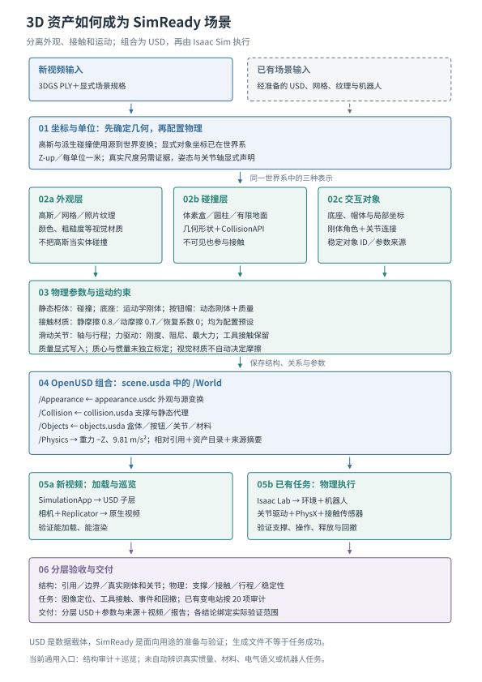

### 从 3D 资产到 SimReady：碰撞、物理参数与 USD 集成

#### SimReady 是一组可验证条件，而不是一种文件后缀

三维资产能够显示，只说明外观表示可被渲染。要在机器人任务中使用，还需回答：机器人会在哪里碰到它，哪些部分固定、哪些可动，受到力后如何响应，传感器读取的是哪个对象，以及整套依赖能否在另一运行环境中重新加载。本项目把 SimReady 解释为针对指定用途补齐几何、物理、关系和来源信息的过程；导出 USD 是承载这些信息的手段，不等于已经获得完整动力学或任务认证。

新视频路径的输入是 3DGS PLY 与显式场景规格；已有场景路径则接收已经准备的 USD、机器人和任务资产。通用构建器不自动把任意三角网格转换为关节化设备，也不直接把透明高斯视为实体。两条路径最终都要形成可解析的 USD 场景与可核对的参数来源，之后才进入 Isaac Sim 的渲染或物理执行。[图](#fig-asset_simready_pipeline) 给出这一过程。

<!-- portrait-float -->

<!-- endportrait-float -->

#### 第一步：统一单位和局部坐标，确定部件角色

场景准备首先对高斯外观及其派生碰撞应用源坐标到世界坐标的正向相似变换，写入 Z-up 和每单位一米的场景元数据。显式盒体的 bounds_world 与按钮的 position_world 已使用世界坐标，不重复应用该变换；当前也没有自动推断高斯区域与显式对象 ID 的对应关系。源模型的尺度仍需外部证据；写入米制标签不会把未知单位自动变成真实米制。对象局部坐标决定按钮轴、关节锚点、碰撞形状和工具接近方向，因而必须在设置质量与驱动之前确定。

随后按任务区分三种物理角色。柜体和地面作为静态环境，只需要碰撞形状；按钮底座作为运动学刚体，其姿态由场景或程序规定；按钮帽作为动态刚体，其状态由物理积分和约束求解决定。视觉网格或高斯可以绑定到这些对象以获得一致运动，但可视表面与碰撞形状无需完全相同。这样的分离允许用简单代理控制接触计算成本，同时保留较丰富的外观。

<!-- table: 资产角色决定应赋予的 USD 物理结构。表中列出当前构建器的实际行为。 -->
<!-- columns: 0.75,1.20,1.05 -->

| 角色与例子 | 写入的结构 | 运行语义 |
|---|---|---|
| 外观：高斯、纹理 | 高斯字段或可视几何、视觉材质 | 参与渲染；高斯不附实体碰撞 |
| 静态：地面、柜体代理 | 几何体上的 `CollisionAPI` | 可阻挡动态对象，自身不做自由刚体运动 |
| 运动学：按钮底座 | `RigidBodyAPI`，开启 kinematic | 按规定姿态运动；不会因接触力自行被推走 |
| 动态：按钮帽 | `RigidBodyAPI`、`MassAPI`，子形状有碰撞 | 受重力、接触与关节约束，积分得到运动 |
| 连接：单轴按钮 | `PrismaticJoint`、线性 `DriveAPI` | 限定行程，以弹簧与阻尼回到静止位置 |

这些概念遵循 OpenUSD 的物理描述规范；UsdPhysics 保存跨工具可交换的描述，Isaac Sim 的物理后端执行它。规范说明见 https://openusd.org/release/api/usd_physics_page_front.html 。

#### 第二步：为外观生成适合任务的碰撞代理

当前通用入口从通过透明度筛选的高斯中心采样，排除已识别的地面邻域，再将剩余点按空间体素分组。满足最小点数的格子生成不可见的盒形碰撞体；数量超出资源预算时增大体素边长，并记录最终粒度。地面则由显式或估计平面与场景有限边界生成两个三角形，提供局部支撑，不添加无限平面来掩盖缺失几何。

对于已配置的盒体和按钮，使用显式几何而非继续堆叠体素。按钮帽与底座的圆柱分别具有碰撞，按钮附近冲突的占据代理被剔除，避免粗盒子占据可动行程。碰撞形状不可见只影响显示，不取消物理碰撞。代理越粗，狭缝、把手和薄板越可能被封住或漏掉；因此碰撞数量受控是资源属性，不能替代几何精度评估。

已有网格资产也可以采用简单原语、凸包、凸分解或其他后端支持的碰撞近似，但当前新视频构建器实现的是上述体素、盒体、圆柱和地面组合，不能把所有网格碰撞策略都列作已实现算法。历史变电站使用经过离线核查的独立碰撞与按钮结构，其接触成绩不自动适用于新生成的粗占据场景。

#### 第三步：赋予质量与接触材质，区分测量值和预设值

物理参数至少分为两类。第一类是刚体质量属性：质量、质心和转动惯量，决定物体对外力与力矩的响应；第二类是接触材料：静摩擦、动摩擦和恢复系数，决定接触滑移与碰撞恢复。视觉材质中的颜色、粗糙度属于渲染，不会自动变成物理摩擦。当前代码用 `UsdShade.Material` 保存接触材料，并以 `materialPurpose="physics"` 绑定到碰撞形状，和视觉表面材质分开。

通用接触预设为静摩擦 0.8、动摩擦 0.7、恢复系数 0；配置校验要求动摩擦不超过静摩擦。按钮帽质量默认 0.02 kg，由 `MassAPI.mass` 显式写入。当前生成器没有显式填写或标定质心、主惯量和惯性主轴，也没有从图像识别密度；未指定项交由后端按适用的碰撞几何和质量规则处理。因而报告不能把“可计算的质量属性”写成“已恢复真实材料参数”。OpenUSD 质量属性定义见 https://openusd.org/release/api/class_usd_physics_mass_a_p_i.html 。

若未来对象需要真实动力学一致性，需用测量、厂商资料或辨识实验确定这些参数，并在固定外力与观测条件下验证响应。对于理想均匀几何，解析惯量可作为建模依据；对于空心柜体、非均匀工具和复杂装配，外形近似不足以确定真实质心与惯量。本项目当前只声明使用了哪些显式值、哪些仍由后端补全，没有新增参数辨识实验。

#### 第四步：用关节、限位和驱动表达可操作性

按钮结构由底座刚体、动态帽体和一个滑动关节构成。`body0`、`body1` 关系连接真实刚体，局部锚点对齐两侧坐标，`axis` 规定运动方向；当前生成器支持 X、Y、Z 轴，行程限定在负行程到零之间。默认行程为 0.004 m。底座与帽体之间关闭关节连接体的相互碰撞，以避免装配本身产生错误阻挡；工具与帽体的接触仍保留。

线性驱动采用力模式，目标位置为零，默认刚度 400 N/m、阻尼 4 N·s/m、最大驱动力 8 N。帽体受到工具力而压入后，回复驱动与约束共同决定运动；这不是逐帧写按钮位姿的动画。驱动的设定力不能代替接触传感器的测量值，任务层仍须读取实际位移与工具—帽体接触，并经过连续采样、去抖和释放条件识别操作事件。

生成按钮也不意味着生成设备功能。一个红色圆柱不会自动成为急停、通电或断电开关。业务状态映射、允许接触对象和触发阈值由独立任务配置给出；默认新视频场景只构建物理结构，未自动绑定机器人任务或电气语义。

#### 第五步：把分层资产组合成可迁移 USD

通用导出器写出三个被引用的资产层和一个总场景。`appearance.usdc` 保存高斯外观及变换，`collision.usda` 保存支撑面和静态代理，`objects.usda` 保存显式对象、关节和材料。`scene.usda` 在 `/World/Appearance`、`/World/Collision`、`/World/Objects` 下以相对引用组合它们，并创建 `/World/Physics`，重力方向为负 Z、大小为 9.81 m/s²。各层设置默认 prim，使引用进入父场景后能够解析正确的根对象。

相对引用允许整个目录迁移，而不依赖作者机器的绝对路径。输出还包括 `asset_catalog.json` 和 `preparation.json`：前者记录对象、真实 prim 路径、碰撞统计与接触材质，后者记录坐标、参数来源、估计限制以及文件摘要。现有场景的资产打包器另行收集几何、材质、纹理及 USD 依赖，避免“主 USD 存在但贴图或子层丢失”。这种引用闭包是可复现的前提，不负责证明外观或物理准确。

#### 第六步：在 Isaac Sim 中加载，再按用途验证

新视频巡览 worker 启动 Isaac 的 `SimulationApp`，将生成的 `scene.usda` 作为当前 stage 的子层载入，添加相机、灯光和 Replicator 渲染输出。这个入口验证场景能组合和成像，默认不执行机器人接触任务。已有变电站 worker 则通过 Isaac Lab 启动 Kit，组合环境和机器人场景后打开 stage，建立仿真上下文、关节驱动与接触报告，再推进物理步。两者共享 USD 表达，但后者需要额外的机器人模型、控制策略、任务和传感器绑定。

载入后的检查分三层进行。结构层重新打开 USD，核对包内依赖、有限包围盒、独立碰撞和关节目标；物理层应检查支撑、接触响应、约束行程、释放与数值稳定；任务层验证目标识别、接近、操作和回撤。当前新视频默认完成结构审计与可选巡览，已有变电站另有 20 项任务审计。`physics_configured` 只表示写入了碰撞，`physics_ready` 的现有定义是具备结构碰撞、地面与用户声明尺度，二者均不等于动态或任务已经通过。

Isaac Sim 的物理组件和仿真运行机制见 https://docs.isaacsim.omniverse.nvidia.com/latest/physics/simulation_fundamentals.html 。本节说明来自静态源码核对，沿用历史实测，不新增动力学成绩。

#### 与代码构造和上下游的对应

`simulation.gaussian_asset` 负责外观解码与坐标变换；`simulation.scene_preparation` 负责规格校验、碰撞代理、对象、材料、关节与 USD 组合；`evaluation.scene_package` 在独立进程检查结构；`simulation.scene_video` 负责新场景巡览，`simulation.substation_mission` 负责已有任务的真实物理执行。外层 `workflows.video_execution` 按“准备 → 结构检查 → 巡览”顺序调用这些 worker，并把交付状态绑定到实际输入和产物。这样，资产构建层决定世界里有什么，物理运行层决定它如何响应，验收层决定哪些结论可以成立。
