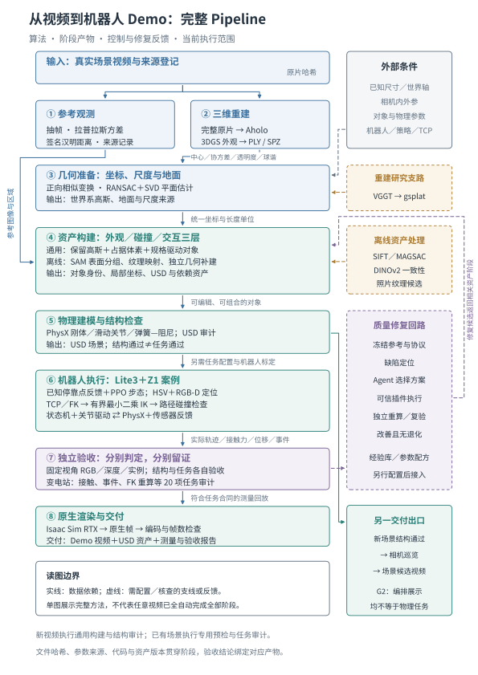

# 从场景视频到机器人 Demo：技术链路总览

目标是把视频中的空间外观，转化为机器人能够观察、移动、接触并被独立验证的仿真环境，最终输出任务演示视频及其证据。可看见的场景、可交互的场景、任务成功是三个连续但不同的交付层次。

## 一条主线，三类信息逐步补齐

**原视频 → 三维空间底稿 → 坐标与尺度 → 独立可见资产 → 碰撞与交互 → 机器人任务 → 独立验收 → 原生 Demo。**

原视频同时抽取参考观测，供底稿核对、资产修复与质量评测使用；当前 Aholo 路径接收完整原视频，两路在资产化阶段汇合。

视频主要提供外观证据。空间尺度需要测量或外部约束，交互需要对象结构与物理参数，机器人任务需要本体、策略、感知和控制。系统以三层场景表示承接这些信息：外观层负责可见画面，碰撞层负责支撑与障碍，交互层负责可动部件及其状态。来源记录贯穿三层，明确哪些内容来自观测、哪些经过估计。

| 阶段 | 输入 | 核心方法与目的 | 输出 |
|---|---|---|---|
| 1. 观测组织 | 原始场景视频 | 按时间抽帧，测量清晰度，过滤重复，保存来源与参考视角，为重建核对和局部修复提供依据 | 带来源、采样时间和质量记录的参考图像集 |
| 2. 三维重建 | 完整原视频；研究分支使用多视角图像 | 当前交付底稿采用 Aholo 高斯重建；中心、协方差、不透明度和球谐共同表达空间外观。VGGT→gsplat 保留为独立研究分支 | 可从不同相机视角渲染的高斯空间底稿 |
| 3. 坐标与尺度 | 底稿、地面证据、外部尺度约束 | 统一方向和坐标，以相似变换连接重建空间与仿真世界，明确尺度来源 | 对齐后的底稿、变换与尺度状态 |
| 4. 可见资产化 | 底稿与原片参考 | 历史变电站以局部分割、平面/实例几何、来源图像选择与配准补建柜体、门板、仪表与控件；另行探索多帧一致性及冻结特征核查候选 | 可独立编辑的几何、材质、对象身份与对应证据 |
| 5. 物理与交互建模 | 可见资产、任务需求和参数声明 | 分离外观与碰撞；加入地面、障碍代理、质量/摩擦、关节与限位。按钮以弹簧滑动结构表达行程；已绑定任务适配器另以成对接触测量判断按压 | 可以支撑运动与指定接触行为的场景 |
| 6. 闭环质量控制 | 固定视角观测与资产清单 | 定位模糊、空洞、错位、漏检等缺陷；选择对应修复动作，再用固定协议独立重测，避免局部改善伴随其它视角退化 | 接受的场景候选、缺陷账本和修复记录 |
| 7. 机器人任务执行 | 已准备场景、机器人本体/策略、目标约束 | 已有 Lite3+Z1 任务沿已知场景接近目标，以 RGB-D 确认目标位置，计算机械臂姿态与路径，驱动按压并回撤 | 真实仿真状态、接触测量、事件与任务轨迹 |
| 8. 独立验收 | 记录的状态、测量与冻结任务条件 | 重算定位、运动学、位移、接触和持续触发条件；场景结构、视觉保真和任务成功分别判断 | 可审计的验收结果与适用范围 |
| 9. 原生渲染与交付 | 接受的场景和实测轨迹 | 用展示相机回放实测状态，执行原生 RTX 渲染、编码和视频检查，绑定场景、轨迹和视频身份 | Demo 视频、场景包、实验记录与验收证据 |

DINO 与多帧一致性支线的改进候选仍有未通过晋升门槛的版本，没有替换正式环境；其指标不与已接受场景的任务审计合并报告。

“变清晰”主要发生在第 4 阶段：原片约束的纹理恢复与独立几何补建。灯光、抗锯齿和渲染参数改善呈现，但不能恢复没有观测依据的结构。缺少参考的部分须保留估计标记；生成式画面修复应单独标识，不能替代几何与任务验证。

## 观测—修复闭环如何贯穿主线

先固定参考视角、对象清单、指标与阈值，再生成当前候选的观测。每条缺陷关联对象或空间区域、参考图像和量化差异，由调度器选择匹配的纹理、几何、配准或物理修复动作。修复产生新候选，独立评测判断是否改善且没有必选指标退化；成功与失败都记录，符合回归条件的参数配方才进入 Memory/Skill 复用。这属于开发阶段的经验复用，不更新基础模型权重。

当前已有观测、缺陷、插件接口、调度和验收框架；历史高质量场景仍包含专用离线准备。真实修复插件尚未覆盖任意新视频，闭环不等同于已具备无人值守的全场景修复能力。

## 当前实际运行到哪里

| 路径 | 已执行范围 | 证据及限制 |
|---|---|---|
| 变电站任务案例 | 历史原片/Aholo底稿、离线修复资产、Lite3+Z1任务、独立审计与原生回放 | v0.6已有场景入口通过20/20审计，输出713帧、1080p、28.52秒视频；新视频的资产准备没有在这轮入口里重新完成 |
| 星巴克展示案例 | 已有场景与G2运动编排、原生渲染 | 历史完整视频900帧、4K、30秒；展示编排不作为物理导航证据 |
| v0.7新视频入口 | 观测、可恢复重建接入、通用场景准备、结构检查与相机巡览 | 已复用历史原片/PLY实测12帧巡览；未提交新云重建，画面仍有模糊与空洞，尚无独立尺度、视觉保真或机器人任务通过结论 |

从任意新视频到任务级 Demo，仍需补齐自动语义资产化、可靠尺度与物理参数、真实修复插件，以及机器人在新场景中的任务适配。按钮的真实电气功能需要外部确认；当前按压任务使用已配置的模拟语义。

完整方法、公式、实验与后续路线见[技术白皮书](technical-report.md)。运行方式与字段约定在[新视频示例](../../examples/new_video/README.md)、[已有场景示例](../../examples/scenes/README.md)和[部署说明](../deployment.md)中说明。
