<!-- frontmatter -->

# 从场景视频到机器人交互演示

**SimReady 技术白皮书：重建、资产化、物理交互与闭环验收**

SimReady Pipeline · v0.7.0 · 2026 年 11 月 13 日

<!-- endfrontmatter -->

## 摘要

将一段场景视频变成机器人能够接近、观察和操作的仿真环境，关键不止是恢复看起来相似的三维外观。视频中的柜面需要获得统一坐标和尺度，视觉上的按钮需要对应独立的可动部件，机器人动作需要产生可测量的接触，演示视频则必须能够追溯到实际执行记录。外观重建、资产结构、物理行为与任务成功分别依赖不同证据，任何一项都不能由一段清晰录像替代。

本白皮书提出并实现一条以证据贯穿的工程流程：原视频登记与观测组织，三维空间底稿重建，坐标和尺度对齐，实例资产分解与清晰化修复，碰撞和交互建模，机器人感知、移动与操作，独立验收，以及原生渲染交付。场景以外观、碰撞、交互三个运行层组合；缺陷通过固定观测定位，修复候选经独立回归后才能替换基线。系统同时保存阶段输入、参数来源、版本和产物摘要，使失败恢复与结果归属可以复查。

两个案例分别验证任务操作与视觉展示等部分：变电站验证 Lite3+Z1 的选定按钮操作，星巴克展示 G2 的编排运动与原生视觉效果。v0.6 变电站整轮完成 20/20 项任务审计、一次实际按压和 713 帧原生 1080p 回放，入口总耗时 1095.164 秒。v0.7 新增可恢复的新视频入口，以历史原片和操作者声明关联的既有 PLY 完成场景再生成与 12 帧巡览，命令耗时 231.874 秒；原始底稿仍有明显模糊和空洞。这些结果分别证明固定任务执行与通用构建路径的功能贯通，没有合并为任意新视频全自动资产化或视觉质量达标的结论。

<!-- toc -->

## 问题、目标与系统假设

### 为什么三维外观不能直接成为可交互场景

视频首先约束的是光线到相机的观测。相似图像可能由不同的深度、尺度和材料解释；视野之外的表面更没有直接观测。即使三维高斯能够重现某些视角，也不意味着柜门具有独立拓扑、按钮具有运动轴、地面能够稳定支撑机器人，或红色控件已经连接到正确的设备状态。

系统因此把目标分成连续而不同的三个层次。第一层是**可观察场景**：空间外观能加载、渲染并与来源关联。第二层是**可操作资产**：关键实例具有明确几何、碰撞、关节、参数和状态语义。第三层是**可验证演示**：机器人在规定任务中依据观测执行动作，保存能够独立重算的测量，并由这些测量生成最终录像。上一层为下一层提供条件，但不能替下一层作出通过判定。

本文以变电站中的“接近指定面板、定位目标按钮、按压并回撤”为主要任务，以星巴克通道中的 G2 编排展示为对照。前者要求感知、运动、接触和状态变化共同成立；后者主要检验外观组合、运动编排及原生渲染。把二者分开，才能说明哪些机制已经获得物理证据，哪些只是视觉演示。

### 适用输入与必须显式给出的知识

系统输入包括场景视频、可用的三维底稿、坐标与尺度来源，以及任务所需的资产和机器人配置。视频应提供足够的视角变化和可识别结构；严重模糊、反光、遮挡和未覆盖区域会直接限制后续恢复。单目视频没有外部测量锚点时，真实米制尺度不可由文件单位自动确定。质量、摩擦、弹簧刚度与设备电气功能也不能仅凭外观可靠获得。

机器人侧假设模型、关节映射、碰撞、限位、安装关系和工具标定已准备，运动策略适用于该构型。现有 Lite3+Z1 案例在已准备地图和选定目标上执行；统一设备端口负责一致地读写状态，并不自动提供任意机器人、任意布局的导航与操作策略。

### 当前能力与证据等级

<!-- table: 方法链中的实现状态与证据。此表集中界定自动化范围，后文按完整因果链解释方法。 -->
<!-- columns: 0.80,1.15,1.05 -->

| 环节 | 当前实现 | 已有证据与使用条件 |
|---|---|---|
| 观测与重建接入 | 抽帧、来源登记、显式云提交、凭据恢复、本地复用 | CPU 回归与既有任务恢复；本轮未新提交云重建 |
| 通用场景构建 | 高斯导入、显式对齐、有界碰撞、规格驱动对象、结构审计、巡览 | v0.7 历史视频/PLY 功能贯通；尺度和配对仍有外部声明 |
| 资产分解与清晰化 | 多帧区域关联、平面配准、照片纹理与柜面补建 | 已用于案例的离线准备；未自动接入任意新视频 |
| 机器人操作 | Lite3+Z1 固定策略、面板感知、运动与接触监督 | 已准备变电站的选定模拟任务；G2 另为编排展示 |
| 闭环修复与经验复用 | 固定观测、插件提案、独立回归、参数配方晋升 | 框架可执行；真实插件与跨场景覆盖尚不完整 |
| 通用自主重建与操控 | 全实例语义恢复、真实参数推断、任意机器人任务 | 尚未形成完整验证能力 |

## 从视频到 Demo 的总体流程

一条完整的交互演示链，需要先回答场景是什么、部件在哪里，再回答机器人如何操作以及证据是否成立。[图](#fig-architecture_overview) 将主线与不同执行范围放在同一张图中。原视频分别进入参考观测登记与云重建两路：前者为后续检查保留画面证据，后者直接上传完整视频。空间底稿经过对齐与资产准备进入仿真；独立验收决定候选能否被接受，录像是最后的可追溯表达。

输入端保留视频身份和观测出处。重建端提供空间外观，配准端统一世界坐标。资产端将外观、碰撞与可动部件分离，使视觉清晰化不会悄悄改变接触几何。机器人端以当前传感器状态推进任务；验收端重新读取日志而非复述控制器的成功标记。发现缺陷时，系统回到对应资产或配置进行有限修复，而不是以整段演示“看起来合理”作为退出条件。


### 分层场景使修改与验证有明确对象

外观层保存高斯、可见几何和材质，用于呈现场景；碰撞层保存支撑面、障碍物和接触代理，用于物理计算；交互层保存运动轴、限位、驱动和状态转换，用于表达可操作性。三层可以共同引用一个实例，但不承担相同职责。例如，照片纹理能够改善柜面可读性，却不能证明柜体尺寸准确；按钮碰撞体能够承受接触，却不能证明该按钮对应真实设备中的同一功能。

来源证据贯穿三层：视频与帧标识、观测区域、几何与参数版本、未观测部分的估计标签，以及运行结果分别保存。文件摘要用于确定“本次读到的是哪份数据”，估计标签用于说明“哪些属性来自观察、外部声明或推测”。二者共同防止资产更新后仍引用旧任务成绩。

### 一条方法链，三种执行范围

完整方法不意味着每个入口都自动执行所有环节。当前新视频入口先完成通用构建与诊断巡览；已有变电站入口从预先准备的资产继续执行机器人任务；开发修复工作流则在另行冻结的观测协议下迭代候选。这三种范围共享产物和验收思想，但使用不同的输入和成功条件。

这一区分也解释了为何历史精修场景与新生成底稿可能具有明显画质差距：历史案例已经经过照片纹理、独立几何和人工检查，新入口默认保留重建外观，并未自动补做这些工作。系统将这一差距作为需要定位和修复的质量问题，而不是通过渲染成功掩盖它。

<!-- portrait -->

<a id="fig-architecture_overview"></a>
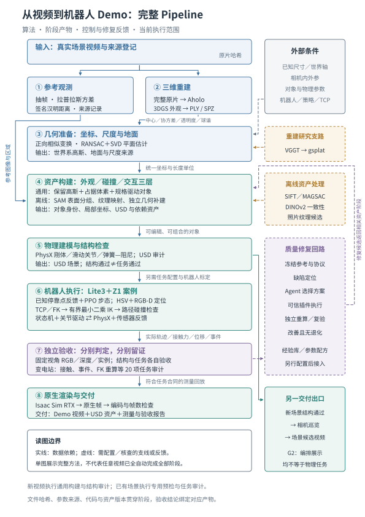

<!-- endportrait -->

## 从原片观测到空间底稿

### 观测组织：让每一次判断回到具体画面

原视频提供连续观测，但相邻帧高度重复，快速运动和失焦又会削弱几何约束。观测组织的目标是在保留来源的同时，建立可重复的采样与检查集合。程序按名义时间网格抽取 JPEG，记录清晰度、亮度、重复度、源文件摘要和图像摘要。这样，某个控件为何被识别、某块纹理来自哪里，才能回到具体帧核对。

清晰度使用灰度离散拉普拉斯方差，反映局部强度变化：

$$
L_{u,v}=I_{u-1,v}+I_{u+1,v}+I_{u,v-1}+I_{u,v+1}-4I_{u,v},\qquad S(I)=\operatorname{Var}(L).
$$

去重将灰度图缩放到 $32\times32$，由交错像素差形成 $16\times16$ 梯度，再按均值二值化为 256 位签名。当前帧与前一张保留图的汉明距离不超过阈值时被丢弃。它用于减少局部重复，不代表全视频已经获得均匀视角覆盖。

底层观测函数默认以 2 fps 抽样，清晰度下限为 60，重复距离阈值为 6；新视频入口仍默认 2 fps，但将后两者设为 0，以保留模糊帧的质量证据，仅过滤签名完全相同的连续样本。保留序列每 10 帧取一个留出样本。其时间为 fps 网格的名义时间，留出集合也仍来自同一视频；云端 Aholo 接收的是完整原视频，不能据此声称云服务未见过本地留出帧。

历史变电站原片为 91.626 秒、1280×720，历史观测集合为 136 帧，其中 122 帧参考/训练、14 帧留出。v0.7 验证使用新的取帧实参得到 183 帧，两组数量不合并统计。[图](#fig-module_input_gaussians) 将输入观测与后续高斯表示连接起来。

<a id="fig-module_input_gaussians"></a>
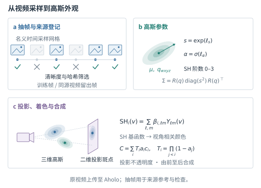

### 三维高斯为何适合成为空间底稿

3D Gaussian Splatting [1] 以一组带颜色与透明度的各向异性高斯表达空间外观。第 $i$ 个高斯具有中心 $\boldsymbol\mu_i$、方向 $R(q_i)$、尺度 $\mathbf s_i$ 和不透明度 $\alpha_i$。标准 3DGS 文件以对数尺度和透明度 logit 保存参数，进入渲染前需解码为

$$
\mathbf s_i=\exp(\boldsymbol\ell_i),\qquad
\alpha_i=\frac{1}{1+e^{-o_i}},\qquad
\Sigma_i=R(q_i)\operatorname{diag}(\mathbf s_i^2)R(q_i)^{\mathsf T}.
$$

空间协方差决定高斯的椭球形状，球谐系数描述随观察方向变化的颜色。渲染后端把高斯投影到相机平面并完成着色、排序与透明度合成。该表示能够保留复杂外观与视角效应，但本身没有可靠的闭合表面、对象拓扑或碰撞语义。因此，本系统把它作为空间底稿和外观层，而不是直接当作可接触的实体。

正确解码同样重要。旋转四元数按文件的 wxyz 顺序读取并归一化；高阶球谐从通道优先布局转换为逐系数 RGB 布局。当前支持完整的 0–3 阶球谐，$K=(d+1)^2$ 个系数对应每个高斯的颜色表示。漏掉系数、混淆通道顺序或把对数尺度直接当作长度，都会在后续场景中产生系统性错误。格式、数组形状和资源上限见附录。

### 两条重建路线及其取舍

当前交付场景以 Aholo [7] 重建产物作为底稿。服务内部训练过程不属于本项目实现；系统负责显式提交、任务身份、有限等待、下载校验与恢复。只有明确授权才创建新的云任务；已有凭据继续监控同一任务，提交结果未知时停止再次提交，完整本地产物则离线复用。该设计解决的是可重复运行与成本边界，而非重建算法优劣。

另一条研究路线用 VGGT [2] 估计相机与深度，再接 gsplat 优化。它便于研究视角、几何和训练过程，但相机估计、跨块配准与尺度错误会共同影响结果。历史 v3 的 PSNR 为 14.2357 dB、SSIM 为 0.6205、LPIPS 为 0.6117，低于内部 22 dB 门槛，因此没有替换交付场景的 Aholo 底稿。研究支路的指标与经过资产补建后的 USD 观感属于不同对象，不能互相代替。

## 从空间底稿到可操作资产

### 坐标与尺度决定所有后续物理量的含义

重建点的位置只有在世界坐标、重力方向和长度单位确定后，才能支持机器人导航、接触和尺寸判断。系统使用正向相似变换连接源坐标与世界坐标：

$$
\mathbf p_W=sR\mathbf p_S+\mathbf t,\qquad
T_{WS}=\begin{bmatrix}sR&\mathbf t\\0&1\end{bmatrix},\quad
s>0,\quad R^{\mathsf T}R=I,\quad\det R=1.
$$

变换检查拒绝剪切、反射和非均匀缩放。外观变换施加在高斯父坐标系上，使中心、方向、尺度和球谐参考系一起变化，避免只移动点的位置却破坏局部颜色解释。世界文件统一使用 Z-up 和每单位一米的约定；这只是数值解释，真实米制精度仍需已知尺寸、测量或外部标定锚点。

地面估计以已声明的向上方向为前提。系统最多抽取 1 万个确定性样本，在高度最低的 40% 中进行 128 次三点 RANSAC，法向与 +Z 的夹角不超过 20°，默认点面阈值为 0.05 个世界单位。平面与内点关系为

$$
\mathbf n^{\mathsf T}\mathbf p+d=0,\qquad
\left|\mathbf n^{\mathsf T}\mathbf p_i+d\right|\leq\tau_{\mathrm{floor}}.
$$

获得足够内点后，用 SVD 重新估计法向和偏移；至少需要 20 个内点，并达到候选规模约 15% 的门槛。退化或方向不符时不输出地面。未知 up 时也不自动猜地面。拟合残差只能说明点与模型一致，不能独立证明这就是实际地面；外部平面和尺度声明也分别保留其来源。

<a id="fig-module_registration_geometry"></a>
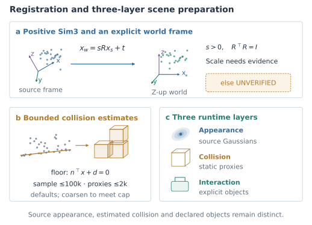

### 资产分解：从可见区域到可编辑实例

机器人需要操作的是具体对象。柜体、灯、按钮、旋钮和门必须具有稳定身份、局部坐标及父子关系，才能把像素中的目标连接到运动学和碰撞对象。仅把整片重建裁成若干点集仍不够：关键控件还需要明确几何边界、运动轴、接触区域和状态语义。

历史变电站的已接受任务使用专用离线准备的几何、纹理与交互资产。围绕该场景另行开展的资产研究使用 SAM [3] 区域候选、多帧对应和柜面配准，研究产物是否进入正式环境需要单独判定。其共同几何原则是让图像区域与场景表面在同一投影关系下对应：对近似平面的柜面，像素经相机射线与已配准平面关联，纹理由原片中的有效区域提供。遮挡、透视变化和重复结构需要核对，不能把视觉相似直接当作同一实例。

对观察充分的正面，照片纹理可以提高字符、边缘和控件邻域的可读性；对未观测侧面和背面，补建只能作为显式估计。外观修复与几何补建分别记录，使读者能够辨别“原片恢复的信息”和“为仿真闭合而增加的假设”。当前低压资产中有 121 个按钮和 49 个旋钮候选；另一个未统一配准高压场景的 22/6 不可相加，更不能用数量替代完整实例标注与召回率评测。

v0.7 通用入口采取更有边界的做法：保留高斯外观，从显式场景规格生成独立 box/button。它提供可组合的资产形式，尚不自动完成上述语义分解、照片纹理恢复与柜面补建。这也是本轮新巡览外观明显弱于历史精修演示的主要原因之一。

### 清晰化修复必须接受固定观测的约束

清晰化的目标应当是减少有证据的缺陷，而不是仅增加高频细节。2026 年 11 月 11 日的远端柜面来源一致性支线，在拟合帧中选择照片纹理和曝光候选，再以留出画面核查。冻结 DINOv2-small [4] 接收 392×392 图像，提供 28×28 个 patch 的特征；有效区域的特征余弦距离与边缘、红绿灯位及 RGB 差异共同组成检查量：

$$
E=0.45E_{\mathrm{DINO}}+0.20E_{\mathrm{edge}}+0.25(1-\operatorname{Dice}_{\mathrm{RG}})+0.10E_{\mathrm{RGB}}.
$$

特征提供较高层的外观约束，显式灯位项补充其对小控件布局的不足。纹理来源按配准支持、可见性和采样密度检查，缺少支持的区域不补画新控件。该支线没有训练 DINOv2、3DGS 或机器人策略，也不是端到端可微几何优化。

局部误差下降后，整柜覆盖与遮挡门槛仍未通过；后续细节候选也没有替换正式环境或生成新的最终交付视频。其意义在于展示“局部改善仍应被完整验收阻挡”的机制，不能用来证明已有任务场景经过了完整视觉闭环。该支线与专用离线资产补建、默认新视频构建分别记录，实验结果见后文。

当缺陷被定位到某个视角和实例后，修复动作应明确改变哪一类状态：重新配准、替换纹理、调整独立几何，或修正控件属性。视觉改善不能抵消关键实例缺失，也不能借修改接触几何使任务变容易。系统因而把独立观察和回归置于修复流程之外：提出修改者与判定修改是否被接受者使用不同职责。

### 碰撞代理将外观转化为可计算的空间约束

高斯的视觉覆盖不能直接作为实体碰撞。通用构建器从不透明度至少 0.1 的高斯中心中确定性抽样，默认最多 10 万点，配置上限为 20 万点。若存在地面，仅保留其上方有符号高度超过 $2\tau_{\mathrm{floor}}$ 的点；再以体素箱体形成有限占据近似：

$$
\mathbf g_i=\left\lfloor\frac{\mathbf p_i-\mathbf o}{h}\right\rfloor,\qquad
B_{\mathbf g}=[\mathbf o+h\mathbf g,\;\mathbf o+h(\mathbf g+\mathbf1)].
$$

默认体素边长为 0.25 个世界单位，至少 2 个点才保留一个体素，代理目标上限为 2000 个，配置硬上限为 5000。超过上限时边长逐轮加倍，并记录实际粗化程度。显式对象周围的重叠代理会被剔除，避免堵住按钮行程；这一操作也可能留下需要检查的空隙。

该方法的价值是资源可控、输入与结果可追溯，而不是保证接触几何精细。在本轮实测中，体素边长从 0.25 粗化至 4.0 个声明世界单位，说明预算约束已经显著影响几何分辨率。细长结构、柜内间隙和可达空间仍需独立验证，不能仅因代理已生成就宣称具备安全通行能力。

## 让资产产生可测量的物理交互

### 从按钮外形到弹簧关节

一个可操作按钮至少需要底座、活动按钮帽、运动轴、限位、质量和回复机制。系统以运动学底座连接动态按钮帽，两者均具有刚体属性，通过滑动关节规定单轴运动。默认参数为半径 0.02 m、行程 0.004 m、按钮帽高度 0.01 m、质量 0.02 kg、刚度 400 N/m、阻尼 4 N·s/m、最大驱动力 8 N；它们是仿真预设，真实尺度和材料未标定时不能视为从视频测得。

相对平衡位置的弹簧—阻尼回复力可写为

$$
F_{\mathrm{spring}}=-kq-c\dot q.
$$

PhysX 负责积分、接触和驱动限幅。回复力与外部工具接触力是不同测量，不能用设定的弹簧力推算“已经按下”。历史 Z1 工具另有被动柱塞，采用 4 mm 行程和 800 N/m 刚度，与新生成按钮的默认 400 N/m 属于不同组件。

### 从接触测量到状态转换

交互事件应由实际接触与位移共同触发，而不是由机器人进入某个动画时刻触发。系统给按钮和工具绑定接触对，读取连续的位移 $d_k$、接触力 $F_k$ 与时间戳。在允许触发的状态下，只有连续采样满足条件才产生一次状态边：

$$
b_k=\mathbf1[d_k\geq d_{\rm press}\land F_k\geq F_{\rm press}],\qquad
N_{\rm press}=\left\lceil t_{\rm debounce}/\Delta t\right\rceil.
$$

触发后必须持续回到更低的释放阈值，才能重新允许下一次触发。默认按压与释放去抖时长均为 0.04 秒；位移、力阈值由具体按钮合同定义。重复采样、非法值和过快采样被拒绝，缺帧或时间断档则清零累计，防止离散日志把不连续接触拼成持续按压。

物理结构、事件识别和业务语义因此分开。新入口可以生成弹簧按钮，但不会自动给它绑定设备状态或机器人任务。历史变电站的模拟负载状态由已绑定的接触事件更新；该证据验证仿真内的因果链，不构成真实电气功能认证。

<a id="fig-module_button_contact"></a>
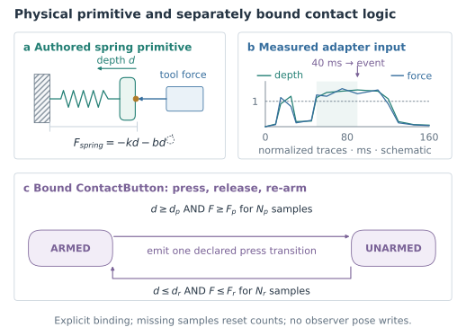

## 从场景理解到机器人移动与操作

### 设备接入与任务策略是两种能力

变电站在 Isaac Sim / Isaac Lab [5,6] 中使用 Lite3 底盘、Z1 六轴机械臂和被动工具，共 12 个腿关节、6 个臂关节和 1 个工具关节。设备端口统一关节名称、顺序、单位与当前状态，控制器再依据该构型的策略下发目标。旋转关节使用 rad、rad/s 和 N·m，滑动关节使用 m、m/s 和 N；公开端口的四元数顺序为 xyzw。

物理步长为 0.002 秒，腿部策略每 6 步更新。冻结的 PPO ONNX 接收 45 维观测：机身角速度、投影重力、速度命令、12 维相对关节角、12 维关节速度及上一动作；输出 12 维腿部目标。角速度乘 0.25、关节速度乘 0.05，策略输出再按既定缩放与默认姿态转换。该策略实现平衡与运动控制，不能由统一端口自动移植到任意底盘。

G2 使用另一种能力：在 USD 中编排根位姿与轮部运动，读取的是已写入的场景状态，当前没有物理导航驱动。独立 Lite3/Z1 的绑定模板可以复用同一端口形式，但尚无独立 GPU 任务成功记录；新构型仍需安装、工具、相机和接触标定。

### 感知把像素目标变成可达空间目标

机器人任务首先需要确认操作的是唯一目标。当前检测器针对已建模的白色面板族，利用 HSV 连通域、中心环以及两排灯/按钮的相对布局识别红色瞬时控件；零候选或歧义均停止任务。它是有适用范围的面板感知器，不是通用开放词汇控件识别。

目标中心邻域深度仅保留 $0.05<d<4$ 的有限样本，至少 3 个样本取中位数。OpenUSD 相机沿负 Z 观察，图像纵坐标需变号，像素反投影及世界变换为

$$
\mathbf p_C=\left[\frac{u-W/2}{f}d,-\frac{v-H/2}{f}d,-d,1\right]^{\mathsf T},\qquad
\mathbf p_W=T_{WC}\mathbf p_C.
$$

世界点随后通过基座—机械臂安装变换和工具 TCP 形成操作目标。配置中的碰撞前表面只供独立审计比较，不作为 IK 的目标捷径。Z1 运动学链从 USD 构造，数值 IK 受关节限位约束，并配合离散路径与在线包围盒检查。

### 状态推进依赖测量而非固定动画时间

监督器依次组织站立、接近、停稳、伸臂、按压、退出接触、回撤和成功阶段。到位、基座稳定、臂到达和接触条件来自当前测量。若感知歧义、目标不可达、接触不合规或阶段超时，任务应保留失败证据，而不是继续录制预设动作。

展示相机与机器人 RGB-D 相机也分开：前者为观众选择跟随和特写视角，后者参与感知与控制。这样，视频中看得清楚不被误解为控制器已经获得相同观测。[图](#fig-robot_control_runtime) 展示控制目标、物理测量和审计证据的闭环关系。

<!-- portrait -->

<a id="fig-robot_control_runtime"></a>
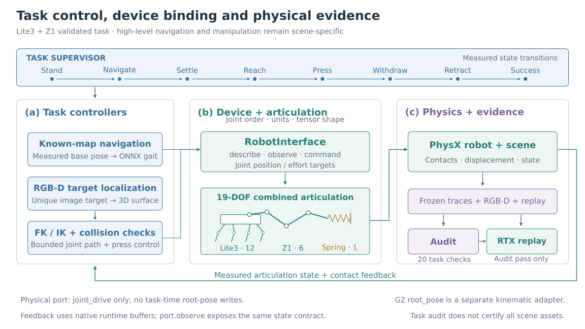

<!-- endportrait -->

## 以独立观测约束修复和任务验收

### 先固定观测，再判断质量是否改善

一段巡览视频无法证明全场景保真。可比较的视觉验收应预先固定视角、参考图、区域、实例和门槛，避免修复后重新选择更有利的相机。参考与候选图必须具有相同分辨率和区域定义，不做隐式缩放或曝光拟合。协议还应登记用于训练、位姿拟合、纹理拟合和经验学习的图像，防止与声明评测集重叠。

对归一化 RGB，像素误差与 PSNR 为

$$
\operatorname{MSE}=\frac1M\sum_j(I_j-\widehat I_j)^2,\qquad
\operatorname{PSNR}=-10\log_{10}\max(\operatorname{MSE},10^{-12}).
$$

SSIM 采用 11×11 高斯窗口、$\sigma=1.5$ 与总体协方差，裁去边界后平均。系统同时保留整帧均值、低分位和区域最差值，避免小而关键的控件缺陷被全图平均掩盖。深度在参考有效区域统计候选可用比例，并在共同有效像素计算 MAE；实例按固定 ID 对应，统计缺失、多余、类别错误和中心偏差。资产图另检查父子关系、材料、尺寸、状态与操作能力。

这些指标回答不同问题。像素相似不能替代关键实例存在，实例标签正确不能替代实际接触。缺失测量或未标定门槛被记录为未完成，不能折算成零误差。观测齐全只表示协议要求的数据已提供，也不等于真实表面的覆盖完整。

<a id="fig-module_observation_acceptance"></a>
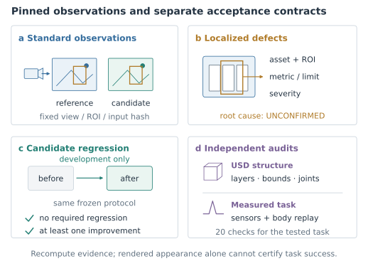

### 修复循环如何防止“局部变好、整体变坏”

修复流程先从独立观测生成缺陷，再由注册插件给出有边界的候选动作。Agent 读取缺陷、候选动作和兼容经验，只选择动作编号及理由；可信执行器实际运行插件，新的验证进程重新计算结果。模型文本不直接作为任意 shell 命令执行，也无权降低验收门槛。

比较前要求协议、检查集合、必选属性、指标、算子和阈值不变。设 $\mathcal I_k$ 为必选项改善集合，$\mathcal R_k$ 为必选项退化集合，则中间候选的接受条件为

$$
\operatorname{accept}(C_{k+1})\iff |\mathcal I_k|>0\;\land\;|\mathcal R_k|=0.
$$

已有通过项变为不通过、有限测量变为缺失，或数值沿错误方向变化，都可能形成退化；数值比较容差为 $10^{-9}$。因此，中间候选可以在仍有未解决缺陷时被接受，但必须存在改善且无必选项退化。开发改进与最终整体通过分别保存，不能把一次局部提升直接升级为发布授权。

经验库保存成功与失败 episode。只有被接受且候选整体通过的 episode 才可形成候选 Skill；晋升要求至少两个不同场景的通过记录，其中至少一次为 validation。自动晋升需显式开启，默认关闭。Skill 复用的是与场景族、协议策略、缺陷类型和插件版本兼容的参数配方，出现退化可退役，不改变基础模型权重。


### 结构、外观与任务使用不同验收门槛

<!-- table: 三类独立验收及其证据。每一行都有自己的输入与通过条件，不能以平均分跨行抵消失败。 -->
<!-- columns: 0.70,1.15,1.15 -->

| 验收对象 | 判定依据 | 能证明的范围 |
|---|---|---|
| 场景结构 | 重新打开 USD，检查组合引用、包内依赖、有限包围盒、碰撞与关节结构 | 文件可组合、声明结构一致；不执行动力学 |
| 来源与候选质量 | 固定视角的 RGB、深度、实例和资产图，独立重算指标 | 声明观测范围内的质量；依赖可信参考与门槛 |
| 机器人任务 | 传感器、事件、RGB-D、轨迹、配置和运动学链 | 特定模拟任务中的接触、运动和回撤一致性 |

当前结构审计要求恰好一个 Gaussian 外观，且该外观不附实体碰撞；滑动关节必须具有限定的有效行程和真实刚体目标。任务审计则重放按钮事件识别器，核对一次按压、模拟负载变化及阶段顺序，并重新计算图像定位、关节 FK 和工具端点。

变电站合同要求停靠图像点到碰撞前表面的误差小于 3 mm，FK 位置差小于 $10^{-5}$ m，保存工具点的重算差小于 $10^{-6}$ m；还检查超过 1 m 的物理位移、足地接触、非目标接触、力上限、按钮释放、臂回撤、关节速度、倾角及零根/按钮位姿写入。17 个基础检查加被动工具压缩、未到底与释放 3 项，共 20 项全部成立才通过。这些阈值验证仿真实现与记录的一致性，不是实机测量精度。

<!-- portrait -->

<a id="fig-repair_closed_loop"></a>
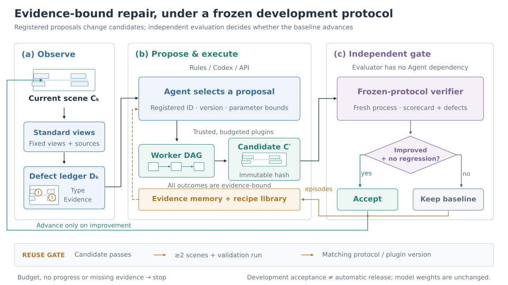

<!-- endportrait -->

## 从通过的证据到原生演示视频

### 巡览与测量回放使用不同运动来源

诊断巡览用相机观察固定场景，帮助检查外观、空洞、尺度感和资产布局。默认相机以包围盒中心为目标，从 $[1,-1,0.55]$ 方向乘最大边长设置初始视点，绕 Z 轴扫过 60°；也可由场景规格显式给出视点、目标和扫角：

$$
\mathbf e_j=\mathbf t+R_z(\theta_j)(\mathbf e_0-\mathbf t),\qquad
\theta_j=\theta_{\max}\frac{j}{\max(1,F-1)}.
$$

这一轨迹用于诊断观看，不规划机器人自由空间，也不保证相机净空或最优可见性。新视频入口默认配置为 1280×720、120 帧、24 fps、8 个渲染子帧；本轮短预览另用较小工作量，结果章节明确列出实参。

机器人回放则读取已通过任务审计的实际刚体测量。它在隔离回放层中关闭物理积分，逐帧写入保存姿态，再配置跟随或接触特写相机。这样，展示的是被审计的同一条轨迹，而不是重新模拟出一条相似但不同的运动。历史回放末帧可能早于成功事件，最终状态仍以完整日志为准。

<a id="fig-module_render_evidence"></a>
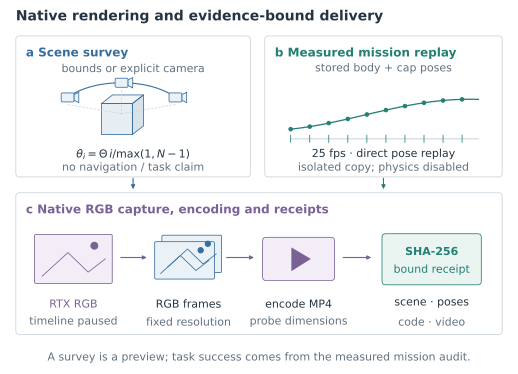

### 交付检查不能只看进程退出码

渲染后等待帧写入完成，检查数量和分辨率，再以连续编号交给 ffmpeg 编码 H.264。ffprobe 独立核对宽、高、帧数和平均帧率；新巡览还保存逐帧均值、标准差与摘要，全帧近乎均匀时拒绝。最终交付必须绑定场景、配置、录像及必需审计文件，进程返回 0 但缺少产物仍判失败。

这一机制在本轮真实运行中拦截了一个具体问题：Isaac 应用关闭直接结束进程，导致关闭后的编码没有执行。首次运行已有原生帧，却缺少 MP4 和渲染凭据，因而没有被算作成功。编码和凭据生成移到关闭之前后，重新执行完整入口并保留首次失败记录。可播放文件和可信成功状态必须同时有依据。

## 实验设计与真实案例

### 以不同实验分别回答功能、质量与任务问题

现有证据分为三个层次：历史接受任务用于解释接触和运动测量；v0.6 一键运行用于验证已准备资产的完整执行与交付；v0.7 用于验证新视频入口的构建、恢复和短巡览。每份记录绑定对应输入、源码与结果，既不把不同时期数值拼成一轮实验，也不把分项检查组合成未经实际执行的全链成功。

v0.6 与 v0.7 的部署验证使用 aarch64、NVIDIA GB10、驱动 580.159.03 和 Isaac Docker 环境。单次功能运行没有形成跨场景成功率或性能加速基准。以下分别报告验证对象、实际工作量与可见结果。

### 变电站：从原片准备到一次可重算的操作

历史变电站将原片中的面板区域与独立几何、照片纹理和估计柜面组合，再接入 Lite3+Z1 的感知与操作。任务要求机器人沿已知场景接近停靠区，重新观察目标，在接触约束下按压并回撤。原片、场景准备与回放相机不是像素对齐关系，因此下图用于说明输入与任务上下文，不作为重建误差图。

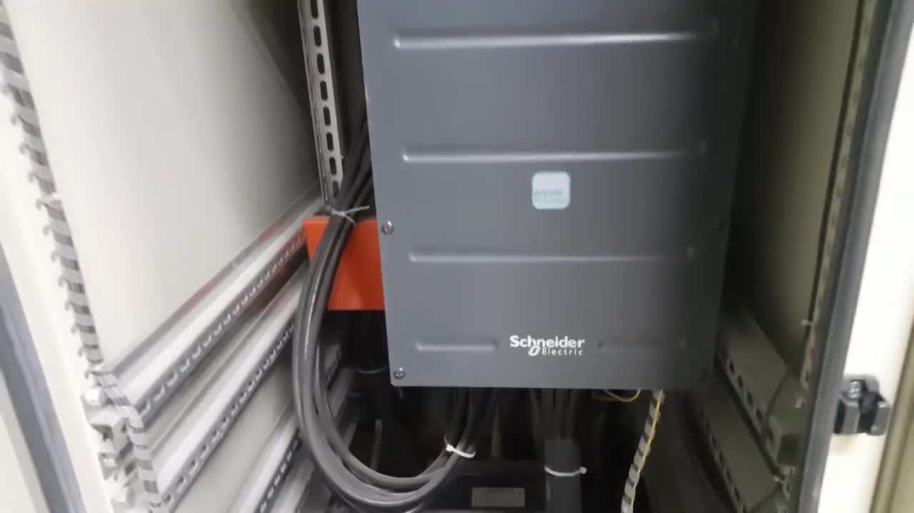


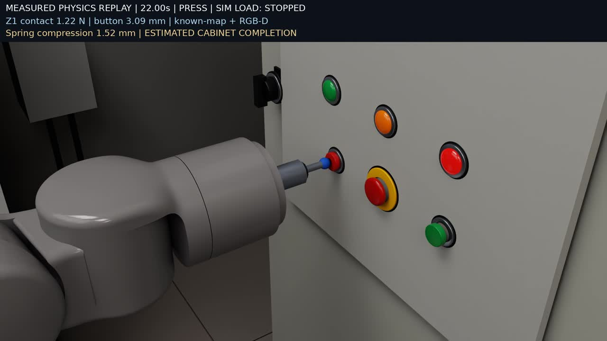

<!-- table: 历史接受任务的测量结果。此表对应同一历史任务，不替换 v0.6 或 v0.7 的独立记录。 -->
<!-- columns: 0.95,0.80,1.25 -->

| 指标 | 历史接受值 | 解释 |
|---|---|---|
| 模拟时长 / 水平位移 | 28.528 s / 1.2945 m | 已准备场景中的单个选定任务 |
| 有效按压 / 独立审计 | 1 次 / 20 项通过 | 接触与按钮位移共同触发 |
| 按钮最大行程 / 峰值接触力 | 3.130 mm / 1.228 N | 完整传感器序列的峰值 |
| 工具最大 / 最终压缩 | 1.533 / 0.040 mm | 4 mm、800 N/m 的被动柱塞 |
| 近距定位误差 / 最大倾角 | 1.111 mm / 4.606° | 相对仿真碰撞前表面及机身测量 |
| 规划阶段 / 在线碰撞检查 | 3 / 889 | 已绑定路径和接触集合 |

真实曲线显示目标接触力、按钮位移与工具压缩在按压阶段同步变化，之后回到释放状态。它们来自传感器日志，不是手工关键帧；公开曲线按原日志每 10 个样本导出，完整日志用于峰值与事件审计。

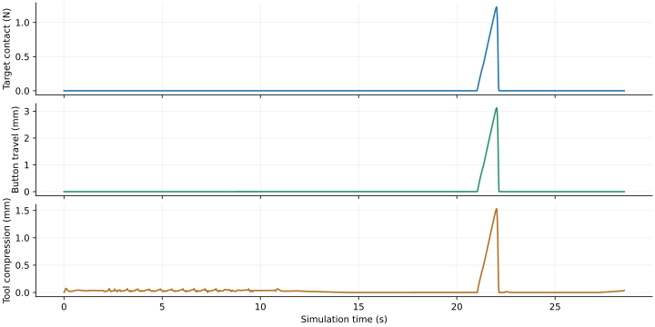

该历史任务输出 1920×1080、25 fps、714 帧、28.56 秒原生视频。最后一个回放采样约在 28.522 秒，成功事件约在 28.526 秒，末帧仍可能显示回撤阶段。系统保留这一采样事实，而不为展示改写成功时间。零非目标接触只适用于已绑定的接触集合，也不证明真实电气功能或全场景安全。

### v0.6：已准备场景的一键完整执行

v0.6 使用最终导出的真实资产包，在 Docker 中顺序完成来源观测、物理任务、独立审计和录像。变电站整轮源码绑定 commit `10c250b` 的 96 个运行文件；其后只增加两处失败分支保护及 5 个 CPU 负例，控制、物理与渲染代码未变，最终源码另完成星巴克短预览。

<!-- table: v0.6 完整任务与短预览。两种运行具有不同工作量和验收范围。 -->
<!-- columns: 0.80,1.20,1.00 -->

| 执行 | 实测结果 | 验证范围 |
|---|---|---|
| 变电站完整流程 | 20/20 审计；28.508 s 模拟、1.294082 m 位移、一次按压 | 已准备资产的物理任务与交付 |
| 变电站原生录像 | 1920×1080、25 fps、713 帧、28.52 s | 本轮实测轨迹回放，非历史 714 帧复用 |
| 星巴克短预览 | 640×360、30 fps、8 帧、0.267 s、2 子帧 | G2 编排入口与交付检查 |
| CPU 与静态检查 | 297 项通过、1 项跳过；Ruff、格式、编译与架构检查 | 当时版本的回归范围 |
| 资产规格导出 | 实际导出 30 个文件；缺 Isaac 时预检失败 | 导出路径和失败汇总，未启动 GPU |

<!-- table: v0.6 阶段实际耗时。总时长另含阶段外检查和编排，不与嵌套计时相加。 -->
<!-- columns: 1.00,1.00,1.00 -->

| 阶段 | 变电站 / 秒 | 星巴克预览 / 秒 |
|---|---|---|
| 来源观测 | 7.528 | 7.710 |
| 物理任务 | 679.012 | 不适用 |
| 独立审计 | 3.792 | 不适用 |
| 原生录像 | 403.469 | 272.256 |
| 入口总耗时 | 1095.164 | 281.670 |

变电站入口总耗时为 18 分 15.164 秒，内部工作流为 1093.885 秒。该窗口包含环境检查、worker 启动和冷 shader 编译，不包含 SDK/镜像安装、新云重建和事先资产准备。它验证的是一次完整复现；此前把约 56 分钟工程窗口的同等工作量压缩至 15 分钟的目标尚未达到，不能用本次不同工作量替代原目标。

### 星巴克：清晰展示与物理导航的分界

星巴克案例以已准备 Gaussian USD 和 G2 模型展示通道往返。处理包括 Graphdeco 风格高阶球谐的通道修正、G2 模型与材质准备、灯光、DLAA 和去噪，机器人根位姿及轮向、轮转按编排更新。历史输出为 3840×2160、30 fps、900 帧、30 秒原生视频。


球谐修正解决格式解释错误，灯光与去噪改变成像；本案例没有借这些操作证明咖啡店背景已经完成独立网格补建或来源验收。历史 Difix [8] 预览属于二维生成式展示，没有被用来认证几何或控件类别。v0.5 与 v0.6 的 G2 封装核验均只新增短预览及对应 USD 位姿检查，不是重新生成完整 4K 视频，更没有由此获得物理导航成绩。

### 来源一致性研究：误差改善为何没有获得正式晋升

独立的远端柜面研究以固定 Isaac 渲染与留出实拍配准比较。旧候选的模板抽屉与原片不符，来源约束支线改用照片支持的柜面纹理，并仅为得到跨帧观测支持的灯位增加视觉部件。左右柜分别使用 6/9 个拟合帧和 4/7 个检查帧；检查帧不参与纹理混合与增益选择，但仍来自同一视频，不能当作独立采集真值。

<!-- table: 远端柜面研究的自定义综合误差，越低越好。候选均未通过整柜推广门槛，不属于已接受任务环境。 -->
<!-- columns: 0.65,0.80,0.80,0.75 -->

| 柜面 | 旧候选 | 来源拟合候选 | 后续细节候选 |
|---|---|---|---|
| 左柜 | 0.5847 | 0.2757 | 0.2267 |
| 右柜 | 0.6377 | 0.2950 | 0.2704 |

来源拟合使左右综合误差相对下降约 52.8% 和 53.7%，随后清晰来源选择继续改善已观察部分。高采样密度支持范围仅约 45.6% 和 45.4%，它是采样密度代理；真实清晰无遮挡覆盖与完整控件对应尚未完成，不能证明满足整柜 90% 的覆盖要求。后续 `detail_g075` 仍被判为未晋升，正式环境未改变，没有新最终交付视频。这个反例说明，特征改善和局部清晰度不能推导整柜还原准确率，更不能继承变电站的 20 项任务审计。

### v0.7：新视频入口的构建、恢复与诊断巡览

v0.7 使用历史真实原片和操作者声明关联的既有 Aholo PLY，不新提交云任务。该实验重新执行观测、场景构建、结构审计与原生巡览，21 份证据及 104 个运行源码文件绑定 commit `2814514`。输入配对由操作者声明，摘要证明文件身份，没有独立重新证明视频与 PLY 的生成关系。

实验显式提供历史视觉对齐的相似变换、估计地面与近景相机，尺度仍未验证，未配置独立 box/button。抽帧保存 183 张参考图，导入 156764 个三阶球谐高斯。107008 个满足条件的点中抽样 10 万点，体素从 0.25 粗化到 4.0 个世界单位，得到 582 个代理，加估计地面共 583 个碰撞体。该结果检验了资源有界的构建流程，没有检验细尺度几何、无配置自动地面或新增控件动力学。

<!-- table: v0.7 功能验证。CPU 导出、恢复和短 GPU 巡览分别计时，均不包含新云重建。 -->
<!-- columns: 0.80,1.10,1.10 -->

| 验证项 | 实测结果 | 解释 |
|---|---|---|
| CPU 构建与结构审计 | 命令耗时 7.951 s | 重新导出 USD，无 GPU |
| 已完成阶段恢复 | 命令耗时 0.246 s | 4 阶段摘要核对后复用，不重新计算 |
| Docker 短巡览 | 命令耗时 231.874 s | 最终源码、冷启动与原生渲染 |
| 视频规格 | 640×360、24 fps、12 帧、0.5 s | 4 子帧、20° 扫角；非默认 120 帧工作量 |
| CPU 回归 | 427 项通过、1 项跳过 | 路径、恢复与失败保护，不替代质量验收 |

首次 GPU 尝试在编码前退出，被交付检查判为失败，其 224.378 秒和原生帧独立保留。最终运行的宿主调用为 231.744 秒，worker 为 224.477 秒，其中场景准备 1.081 秒、结构审计 0.227 秒、渲染 223.035 秒；宿主抽帧 6.450 秒、清单复用 0.073 秒。命令、宿主和 worker 的窗口相互嵌套，不能相加。安装、历史云重建和人工规格准备不在这些计时中。

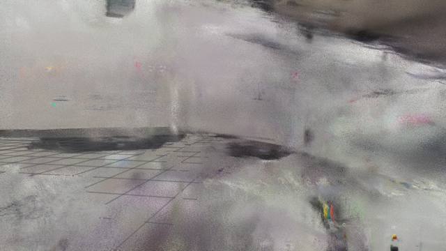

对第 0、6、11 帧的检查确认了这一质量限制。通用入口已能从来源绑定的输入生成可加载场景和可播放巡览，但未通过原片保真 benchmark、独立米制尺度或机器人任务验收。这一结果与历史精修场景形成清楚对照：功能贯通使缺陷能够稳定复现，资产修复与任务验证仍决定 Demo 的实际质量。

### 时间和成本如何归属

除了单次运行，历史工程记录还保存了多轮测试窗口。3350.67 秒（55 分 50.67 秒）由三次物理、三次录像及工程操作组成，不能当作一次原视频端到端时间。下图保留这组原始时间数据，只用于说明工程成本构成。

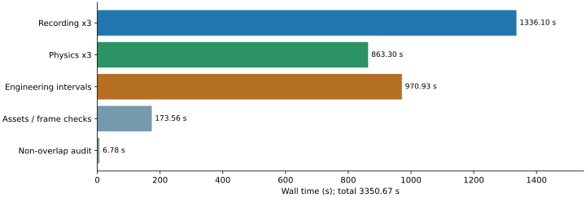

历史一次本地阶段合计为 912.77 秒：资产 169.13、物理 296.54、审计 3.35、录像 443.74 秒。另一次已有资产本机封装核验为 756.632 秒：抽帧 8.353、物理 297.568、审计 4.267、录像 446.381 秒及约 0.064 秒编排；两者均不含新云重建。历史完整录像候选两次运行的中位数约 364.95 秒、相对当时对照下降 18.56%，只属于冻结工作量的历史实验，当前性能优化暂停。

Aholo 历史服务器 create→last-update 约 290 秒，本地 submit→receipt 约 3610.90 秒，差额包含 SSL EOF 后的监控中断。服务更新时间不等于训练结束时间，宿主等待也不等于 GPU kernel 时间。Agent token、云等待、冷启动和有效 worker 时间分别记账；未知 usage 不填零。

## 可复现系统与下一阶段路线

### 将失败恢复纳入完整流水线

长链任务需要把“已完成”变成可以检查的状态，而不是一个文件夹名称。运行计划绑定源视频、场景规格、重建来源、后端及实现身份；阶段只有提交实际产物及摘要后才写入完成记录。恢复时重新核对身份和文件，输入改变、摘要不符或必需产物缺失均停止复用。失败 worker 使用独立尝试目录，保留日志与部分产物，避免覆盖已经接受的结果。

执行环境与资产也分别验证。云客户端在宿主处理上传、监控和下载，重建计算由供应商执行；已验证 PLY 和场景规格作为只读输入送入 Isaac worker，后者先检查环境，再准备场景、独立审计和渲染。USD 组合采用相对引用，打包器递归处理依赖并拒绝未知缺失项。当前自定义 MDL 只支持自包含 UTF-8 模块，带导入或资源依赖的内容明确拒绝；SDK 白名单与自定义材质不混淆。

这些机制让同一失败可以被重现，也让成功结果与输入绑定。它们不能替代可信采集者、独立发布权限和全场景真值。远端服务器可按同一环境与命令部署，但当前没有本轮 SSH 完整任务或多节点扩展成绩。

<!-- portrait -->

<a id="fig-new_video_pipeline"></a>
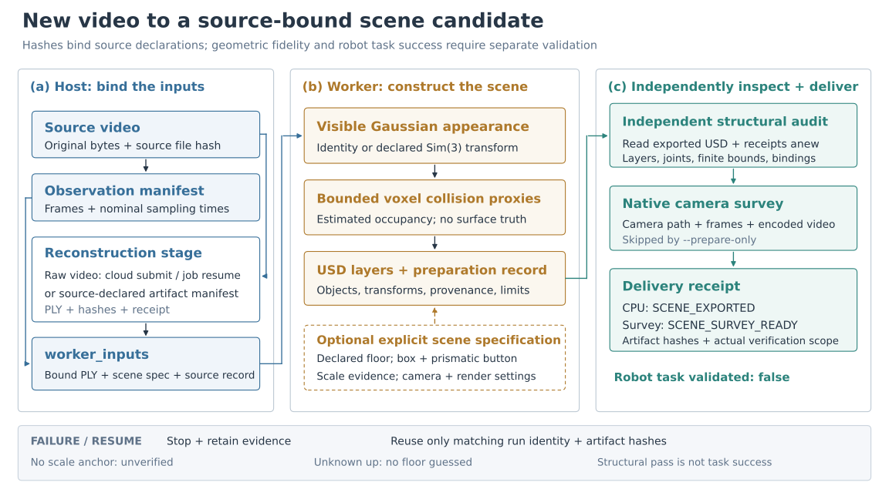

<!-- endportrait -->

### 下一步应优先补齐哪类证据

第一优先级是独立观测与真实尺度。增加新的相机视角、已知尺寸和实例对应，才能把结构可加载提升为几何、外观与资产完整性可评测。应先固定协议和失败样本，再扩展修复动作，避免用更复杂的流程替代缺失的参考证据。

第二优先级是把案例离线资产处理转成受约束插件。照片纹理、面板配准、柜面补建和实例属性修复需要明确输入、适用场景、修改范围及独立回归，逐步接入开发修复循环。参数配方是否能够跨视频、跨布局复用，应由预声明场景集验证，不能由合成示例推断。

第三优先级是新场景中的物理与任务验证。新增按钮应先验收运动轴、行程、接触和释放，再绑定设备状态与机器人策略；新机器人应分别验证支撑、可达、轨迹、接触和回撤。只有完成这些步骤，新的场景候选才获得属于自己的交互演示成绩。

发布级评测应分别报告结构、视觉、几何、实例、物理、任务和交付，不让平均分抵消关键失败。成功率按事先声明的任务与场景采样，保留失败、缺证据和不适用样本。性能实验则需固定代码、资产、步长、帧数、分辨率、子帧与门槛，先测重复运行波动，再比较优化。原 15 分钟同等工作量目标尚未达到，包含新云重建的完整新视频端到端时间也尚未测得；本报告不据短巡览或恢复耗时宣称加速。

## 参考文献

- [1] Kerbl 等. 3D Gaussian Splatting for Real-Time Radiance Field Rendering. SIGGRAPH, 2023. 官方项目：https://repo-sam.inria.fr/fungraph/3d-gaussian-splatting/
- [2] VGGT. 官方模型与实现：https://github.com/facebookresearch/vggt
- [3] Segment Anything. 官方模型与实现：https://github.com/facebookresearch/segment-anything
- [4] DINOv2. 官方模型与实现：https://github.com/facebookresearch/dinov2
- [5] NVIDIA Isaac Sim. 系统要求与容器部署：https://docs.isaacsim.omniverse.nvidia.com/latest/installation/requirements.html
- [6] Isaac Lab. 官方仿真与机器人学习框架：https://github.com/isaac-sim/IsaacLab
- [7] Aholo. 重建服务 API：https://labs.aholo.ai/api-docs/en/openapi.json
- [8] Difix3D+: Improving 3D Reconstructions with Single-Step Diffusion Models. CVPR, 2025. NVIDIA 官方项目：https://research.nvidia.com/labs/toronto-ai/difix3d/ ；官方实现：https://github.com/nv-tlabs/Difix3D

<!-- endreferences -->

<!-- appendix -->

## 运行入口与交付文件

### 新视频构建、离线复用与恢复

安装编排依赖并预先准备 Isaac SDK/镜像及适用 GPU。需要创建云任务时，显式提供提交授权；API key 从运行环境读取：

```bash
python -m pip install -e '.[ingest,aholo]'
simready run --video input.mp4 --out runs/new \
  --submit-reconstruction --accept-eula
```

已有来源绑定的重建可离线复用。默认新视频后端为 Docker；本机纯 CPU 导出需要支持对应 OpenUSD 高斯 schema 的解释器：

```bash
simready run --video input.mp4 --out runs/new-cpu \
  --reconstruction-manifest /path/to/reconstruction.json \
  --scene-spec examples/new_video/scene.json \
  --backend local --python /path/to/usd/python --prepare-only
```

重复相同命令加 `--resume` 才恢复同一输出；输入、规格或代码改变时应新建运行。`--dry-run` 只读生成计划，不创建输出、启动进程或调用云服务。新视频模式的全部选项用 `simready run --video input.mp4 --help` 查看。它支持 local/docker；远端可通过 SSH 执行同一条命令，但没有本轮远端实跑结果。

<!-- table: 新视频入口的目录与状态。机器字段集中在附录，主体按验证含义使用中文描述。 -->
<!-- columns: 1.15,0.85,1.00 -->

| 文件或状态 | 含义 | 验证责任 |
|---|---|---|
| `run-plan.json`、`summary.json` | 输入、实现身份与阶段汇总 | 完成不等于质量或任务通过 |
| `reconstruction/reconstruction.json` | 源视频摘要与本地产物记录 | 外部配对是使用者声明 |
| `execution/attempt-*/scene/` | 外观、碰撞、对象、主场景与准备记录 | 分层依赖和来源可复查 |
| `structure-audit.json`、`delivery.json` | 独立结构检查与交付清单 | 宿主核对来源、规格和必需产物 |
| `SCENE_EXPORTED` | CPU 构建及结构审计完成 | 无渲染或机器人任务 |
| `SCENE_SURVEY_READY` | 巡览产物满足交付合同 | `robot_task_validated=false` |

### 已准备场景复现

先按场景说明准备 `data/substation/bundle.json` 与 Docker 镜像，再运行：

```bash
simready run --scene substation --accept-eula
simready run --scene starbucks --accept-eula
```

默认资产路径为 `data/{scene}`，默认后端为 Docker；未给输出时生成带 UTC 时间和唯一 ID 的运行目录。`--assets` 与 `--bundle-spec` 互斥，后者配合 `--bundle-python` 从已经准备好的资产规格导出，不执行新视频重建。local 使用 `--python` 或 `ISAAC_PYTHON`；SSH 使用已准备好的远端代码、镜像与数据，不自动同步资产。

```bash
simready run --scene substation --bundle-spec /path/to/substation.bundle.json \
  --bundle-python /path/to/pxr/python --accept-eula
simready run --scene substation --backend ssh --ssh-host rtx-server \
  --repo /srv/simready --assets /srv/data/substation --accept-eula
```

已有场景输出的任务审计、传感器和录像位于 `execution/delivery/`。新视频与已有场景使用不同的交付结构，不应跨运行目录借用成功标记。

## 数据合同与实现索引

### 关键表示与形状

重建复用清单为 `schema_version=1`、`status=COMPLETE`，包含 `source_video_sha256` 与 `artifacts[{kind,path,sha256,bytes}]`；PLY 必需，SPZ 可选，相对路径必须留在清单目录。`cache_hit`、`new_submission`、`resumed` 分别记录复用、新提交和恢复，未知云成本不填零。

Gaussian 导入接受 vertex-first、binary little-endian PLY，默认最多 200 万点、768 MiB 顶点表。位置和尺度为 $N\times3$，方向为 $N\times4$，透明度为 $N$；标准字段是 xyz、rot、log-scale、opacity logit 及 SH。完整球谐阶数 $d=0\ldots3$，转换后系数为 $(NK)\times3$、$K=(d+1)^2$，USD `elementSize=K`。RGB uint8 点云可写成 USD Points，但当前完整新视频结构审计要求单一 Gaussian 外观。

`source_to_world` 为列向量约定的 $4\times4$ 正向相似变换；尺度范围 $10^{-8}$ 到 $10^8$。`scale_provenance{status,method,evidence}` 只有配合显式变换和非空来源时，才允许兼容字段 `metric_scale_verified=true`；这表示声明齐全，`metric_scale_independently_validated` 仍为 false。独立对象最多 256 个，ID 必须唯一且合法。

机器人观测的关节位置、速度与目标为 $(1,J)$，根位置为 $(1,3)$，四元数为 $(1,4)$、xyzw。Lite3+Z1 的 $J=19$，策略输入为 $(1,45)$、输出为 $(1,12)$。测量回放中的 `body_poses` 为 $L\times B\times7$，每个姿态包含位置 3 与 xyzw 旋转 4。

### 观测、缺陷与经验合同

观测协议含 `benchmark_id`、`phase`、`profile`、`views[]` 和 `checks[]`。每个视图绑定 `view_id`、`asset_id`、`frame_id`、与 phase 一致的 split、reference_kind 及 RGB 摘要；可附 `depth_unit=m` 的深度、实例与 ROI。RGB 为 $H\times W\times3$，深度为 $H\times W$；实例含 ID、类别和二维中心，ROI 用四整数 `bbox_xyxy`，最小区域为 11×11。

check 定义 metric、op、limit、required、severity、track 和 calibration；缺测量或门槛未标定为 INCOMPLETE，超限为 FAIL。缺陷含检查身份、指标、测量、判据及视图/实例证据，根因为 UNCONFIRMED。候选绑定同一 `protocol_sha256`；开发阶段可输出细粒度缺陷，密封阶段不向修复端提供该反馈。

可执行插件注册表需显式开启，并声明版本、参数范围、输入、可信 argv、DAG 和最终 `candidate.json`。Agent 返回 `RepairDecision(action,proposal_id,reason)`。能力规划器默认每轮最多 4 动作、最多 4 轮，连续 2 轮无进展停止；实际执行预算由工作流配置确定。Skill 自动晋升选项 `auto_promote_skills` 默认关闭，显式晋升也必须通过两场景及 validation 证据条件。

<!-- table: 技术环节到实现的对应。源码是可复现入口，不替代正文的方法与证据说明。 -->
<!-- columns: 0.75,1.35,0.90 -->

| 技术环节 | 包内实现 | 主要输出 |
|---|---|---|
| 视频与重建 | `ingestion.video_frames`、`reconstruction_stage`、`aholo_reconstruction` | 观测、供应商凭据、重建清单 |
| 场景准备 | `simulation.gaussian_asset`、`scene_preparation`、`asset_bundle` | 分层 USD、对象目录、依赖包 |
| 接触与机器人 | `button`、`panel_controls`、`robot_interface`、`substation_mission` | 设备观测、接触事件、任务轨迹 |
| 感知与运动学 | `panel_perception`、`kinematics`、`task_state` | 图像目标、规划、监督状态 |
| 独立验收 | `evaluation.scene_package`、`observations`、`scoring`、`regression`；`simulation.mission_audit` | 结构、质量及任务判定 |
| 修复与经验 | `repair`、`agents`、`workflows.repair_loop`、`experience.skills` | 候选执行、episode、Skill |
| 原生视频 | `simulation.scene_video`、`mission_video`、`cafe_video` | 巡览、测量回放、G2 编排 |
| 编排入口 | `workflows.pipeline_entry`、`video_pipeline`、`video_execution`、`scene_delivery` | 计划、阶段记录、汇总 |

## 历史核验与公开证据

<!-- table: v0.5 封装核验的独立记录。分项成功不合并为未经实际运行的全组合成功。 -->
<!-- columns: 0.90,1.10,1.00 -->

| 历史核验 | 已有结果 | 版本边界 |
|---|---|---|
| 已有资产本机流程 | 756.632 s；物理、20 项审计、714 帧录像 | 接口接入前，无新重建与资产再处理 |
| Docker 统一接口物理 | 28.508 s 模拟、1.294544 m 位移、20/20 审计；启动总耗时 704.019 s | 依赖修复前镜像，未重录视频 |
| G2 端口 | 初版 8 帧 Docker 预览及最终真实 USD 位姿核对 | 非完整 4K 视频或物理导航 |
| 最终导出器 | 两场景重新导出、CPU 迁移闭包检查 | 当时新包未重跑 GPU |
| 镜像依赖与 SDK | urllib3 完整分发与 Kit 启动检查 | 未重跑完整物理任务 |
| SSH / Aholo | 命令构造；已有任务一次只读 GET 与复用 | 无远端完整执行或新付费重建 |

项目与历史发布：https://github.com/miracle-techlink/aholo-powergrid-simready

- v0.7 新视频功能实测：`docs/report/new-video-validation.json`。
- v0.6 已有场景完整入口：`docs/report/one-command-validation.json`。
- 历史接受任务与接触测量：`docs/report/evidence.json`、`contact_trace.csv`。
- v0.5 包装核验：`docs/report/packaging-validation.json`。

各记录独立保存输入、代码、镜像和产物摘要；图像保留原实验归属。运行与示例见仓库 README。

原创代码采用 MIT。原视频、机器人资产、模型权重、Isaac SDK 和云服务遵循各自许可，源码发布不重新授权这些材料；旧报告和历史实验保留独立版本。
