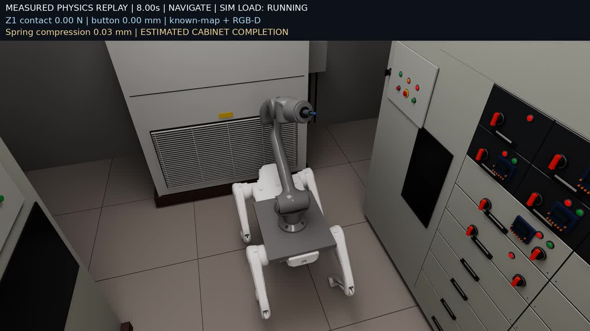
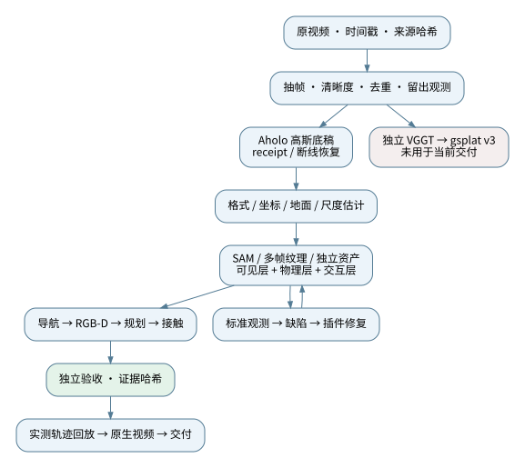
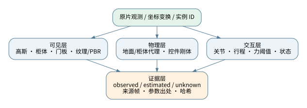
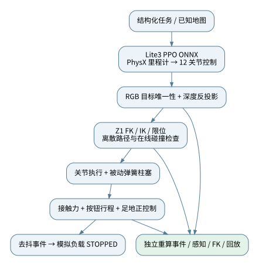
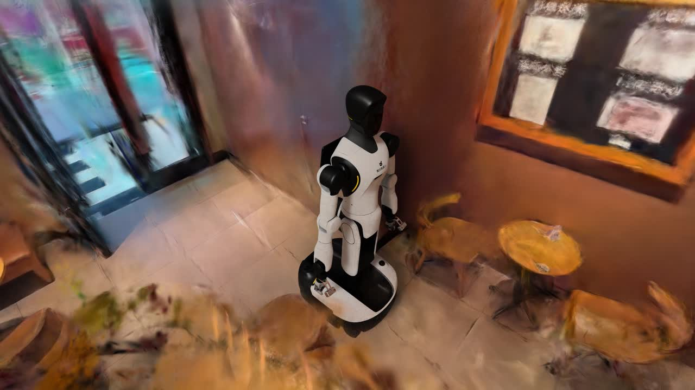
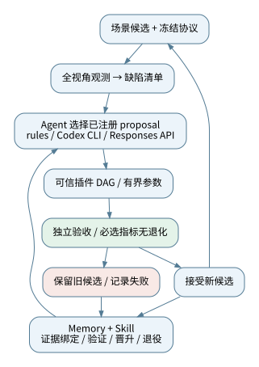
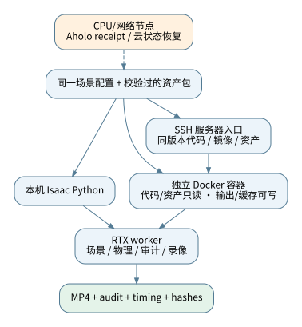

# 视频到可交互仿真场景

## 重建、资产修复与机器人任务闭环：完整 Pipeline 技术报告

**SimReady Pipeline · v0.5.0 · 2026 年 11 月 13 日**

项目仓库：https://github.com/miracle-techlink/aholo-powergrid-simready

报告发布：https://github.com/miracle-techlink/aholo-powergrid-simready/releases/tag/technical-report-2026-11-13

本报告公开方法、代码边界、真实场景演示、物理证据和性能口径。所有结果区分历史接受版本、新增封装验证与未完成能力；不以渲染清晰度代替重建精度，不以单次模拟任务代替真实设备操作能力。



### 摘要

本项目研究如何将真实拍摄视频转化为可渲染、可编辑、可执行交互任务的仿真场景。系统以视频来源登记和多视角观测为起点，结合高斯空间底稿、坐标对齐、表面分割、多帧纹理恢复、参数化几何与物理代理，构建分离的外观、碰撞和交互状态层。在此基础上，将 Lite3 步态控制、RGB-D 目标确认、Z1 机械臂运动规划、接触驱动状态切换和独立审计连接为完整任务链路。

项目提供星巴克与变电站两个案例。星巴克案例验证重建场景中的运动编排与原生 4K 输出；变电站案例在选定任务中完成导航、定位、按压和回撤，记录一次有效接触事件，通过 20 项独立审计，并输出 28.56 秒原生 1080p 视频。系统同时实现有预算约束的 Agent 决策接口、插件调度、冻结评测协议和证据绑定的 memory/skill 复用。完整场景自动资产化、跨场景泛化与商业级无人验收仍需后续验证。

<!-- pagebreak -->

## 1. 问题定义与交付边界

视频中的“看得像”、三维场景中的“结构正确”和机器人任务中的“真的发生接触”是三个不同目标。本项目采用混合表示：高斯重建保留原环境的外观线索，独立几何承担可编辑结构和近距离细节，碰撞体、关节、材料和状态机承担交互语义。

| 交付层 | 核心对象 | 应回答的问题 |
|---|---|---|
| 观测与重建 | 原片、帧、相机、高斯模型 | 场景来自哪里，在哪些视角被观测过？ |
| 场景资产 | 柜体、门板、仪表、按钮、地面等 | 实例是否完整，结构、位置、材质是否有依据？ |
| 物理交互 | 刚体、碰撞、关节、接触事件 | 动作是否由模拟接触产生，而不是动画改状态？ |
| 机器人任务 | 导航、感知、规划、控制、撤回 | 是否定位正确目标并完成受约束动作？ |
| 工程交付 | 配置、代码、资产依赖、日志、验收 | 能否在另一环境启动、追溯、拒绝失败结果？ |

“Sim-ready”在本报告中表示为特定任务准备并通过相应检查的场景，不代表真实世界尺寸、摩擦系数、设备电气功能或所有对象的完整认证。原片覆盖不足的柜面使用显式标记的估计补建；没有把这些表面视作从视频准确恢复的事实。

星巴克与变电站使用不同机器人和任务合同。前者是 G2 编排运动；后者是 Lite3 与 Z1 的自由基座物理任务。二者共享视频观测、资产包装、渲染与证据结构，但不能将前者的视频成功算作后者的导航成功。

### 公开交付物

- 模块化 Python 包、单一 CLI 与两个场景配置。
- 原视频观测、Aholo 任务恢复、场景依赖打包与 Isaac worker。
- 本机、Docker、SSH 启动器及明确的数据准备说明。
- Agent、修复插件、独立验收与 memory/skill 框架。
- 本报告、示意图、历史任务审计摘录与可追溯性能账本。

第三方机器人模型、权重和原视频需要用户自行准备，公开源码的 MIT 许可不重新授权这些资产。代码封装使依赖显式可检查，但不会自动补出未公开的数据。

<!-- pagebreak -->

## 2. 总体架构与产物合同



| 阶段 | 输入 | 处理 | 可复核产物 |
|---|---|---|---|
| 来源登记 | 原始视频 | SHA-256、分辨率、时长、帧时间 | source / frame manifest |
| 空间底稿 | 视频或抽帧 | Aholo；独立 VGGT→gsplat 分支 | PLY、SPZ、相机与模型 |
| 场景结构 | 底稿与原片 | 格式核对、坐标变换、地面与尺度估计、局部分割 | 对齐层、分割索引、碰撞代理 |
| 可编辑资产 | 多帧观测与局部面 | 纹理选择、平面配准、几何/PBR、显式估计补建 | 柜体/门板/仪表/控件 USD |
| 交互合同 | 资产与任务 | 关节、行程、接触阈值、状态机 | control manifest / rig contract |
| 任务运行 | 已知地图、RGB-D、机器人 | 走近、确认、规划、按压、回撤 | sensors / events / replay |
| 独立验收 | 不可变结果与协议 | 重新计算事件、FK、定位及接触检查 | audit / scorecard |
| 视频交付 | 通过验收的实测轨迹 | 独立回放、跟随相机、RTX、编码 | MP4、帧记录、时间账本 |

每个运行输出写入新目录。输入资产、代码、配置和关键结果使用内容哈希绑定，避免仅凭文件名判断“同一实验”。可视化回放读取测量轨迹；它不重新运行物理，也不把拍摄相机作为机器人的感知相机。

<!-- pagebreak -->

## 3. 原始观测与两条重建路线

变电站登记原片长 91.626 秒、1280×720。历史观测集合共 136 帧，其中 122 帧用于训练/参考，14 帧留出。抽帧采用拉普拉斯清晰度筛选和图像哈希去重；抽帧参数、原片哈希和时间位置写入 manifest。时间相邻的视频帧仍可能高度相关，因此留出图像不是天然独立场景测试集。

当前交付场景的初始高斯底稿来自 Aholo。原片上传后返回 world ID，客户端轮询状态并下载 PLY/SPZ。本次封装加入 receipt 续接、传输错误重试、超时预算、独立下载与文件校验；提交结果不明时停止自动重提，防止网络恢复造成重复云任务。

独立研究分支采用 VGGT 估计相机/深度，再训练 gsplat v3。VGGT 输出不是测量级相机真值；跨块位姿与尺度错误会影响优化。该分支保留用于重建对照与评测，没有替换当前交付视频的 Aholo 底稿。

| 独立分支留出指标 | 实测 | 判断 |
|---|---:|---|
| PSNR | 14.2357 dB | 低于内部 22 dB 门槛 |
| SSIM | 0.6205 | 尚有明显结构与外观偏差 |
| LPIPS | 0.6117 | 感知距离仍偏高；越低越好 |

这些指标属于特定模型、相机和留出集合，不能据此为补建后的最终 USD 宣称相同重建精度，也不能把最终视频的清晰外观反推为 gsplat v3 已达标。


<!-- pagebreak -->

## 4. 从高斯外观到独立资产

高斯模型用于外观表示，但不会自然产生可编辑柜门、可按压按钮或可靠碰撞体。桥接首先检查位置、旋转、尺度、颜色系数和坐标约定；再拟合地面、统一 Z-up / meter 场景合同，并保留尺度为估计值的标记。SAM 分割结果关联回原高斯索引，以便局部替换、隐藏或保留外观。

柜面修复利用多帧平面配准、清晰来源选择与纹理拼接。冻结的 DINOv2 特征、边缘以及红绿灯位反馈帮助检查候选与来源的差异。历史候选评分使用 0.45×特征差异 + 0.20×边缘差异 + 0.25×灯位差异 + 0.10×RGB 差异；这是辅助一致性指标，不是重新训练 DINOv2，也不是端到端反向传播训练整个场景。



| 层 | 表示 | 当前做法与限制 |
|---|---|---|
| 可见层 | 高斯 + 几何 + PBR/纹理 | 保留来源外观，局部替换模糊区域；未观测区域标记估计 |
| 碰撞层 | 地面/柜体代理 + 控件碰撞 | 为选定通道与任务检查；不等同完整真实几何 |
| 交互层 | 按钮滑动关节、旋钮、弹簧末端 | 行程、力、去抖与状态独立配置 |
| 证据层 | 实例 ID、来源帧、变换、参数出处 | 区分 observed / estimated / unknown |

当前低压场景资产候选包含 121 个按钮、49 个旋钮。历史将另一个尚未统一配准的高压场景 22 个按钮、6 个旋钮相加得到 143/55，不应称为当前单场景的完整数量。资产一致性应覆盖柜体、门板、手柄、仪表、线缆、地面等跨场景类别，并检查漏检、多出、类型错误、位置偏移、拓扑及状态。

<!-- pagebreak -->

## 5. 机器人与控制运行时



Lite3 通过既有 PPO 步态 ONNX 输出 12 个腿关节动作，转换为关节控制输入；Z1 使用真实六自由度关节模型。USD 中保留的历史 Prim 名 `FrankaArm` 不改变其实际为 Z1 的事实。末端增加被动轴向弹簧柱塞，使用 4 mm 行程、800 N/m 刚度和阻尼配置吸收小范围接触误差；这些是模拟设计参数，未证明真实电气绝缘等级。

任务意图是停止指定柜体关联的“模拟负载”。自然语言描述被固化为结构化配置，确定性监督器执行流程；当前没有把任意自然语言直接输入步态策略，也没有由通用 VLM 自动理解真实按钮功能。按钮功能仅为模拟任务假设。

导航采用已知地图中的停靠位置和 PhysX 测得的机身状态，不声称完成 SLAM。目标识别使用 RGB 颜色、连通区域和灯/按钮的相对布局；候选不唯一时拒绝操作。接近后重复拍摄，使用深度反投影得到目标表面坐标，再送入机械臂 IK。

机械臂利用 USD 关节几何建立 FK，数值求解带限位的 IK，并在离散轨迹上检查保守碰撞包围盒。按压阶段检查 40 个笛卡尔路径采样点，执行时持续检查姿态、关节速度、末端接触与非目标碰撞。它是该场景的受约束规划器，不是通用高性能全空间规划基准。

状态推进依赖实际观测：走近 → 停稳 → 伸臂 → 按压 → 撤离 → 收臂 → 成功。初始化之后不写机器人根部位姿，不写按钮帽的位置来伪造触发。真实接触力和按钮位移同时满足阈值并持续规定采样数后，事件才改变模拟负载状态。

<!-- pagebreak -->

## 6. 接触证据与独立验收


独立审计读取传感器日志重新生成按压事件，核对事件与负载状态的一致性；重新运行图像目标检测、深度反投影和 FK，而不只读取主程序的 passed 标志。足地接触作为正控制，避免传感器始终返回零却被误判为“没有碰撞”。

| 已接受单任务指标 | 数值 |
|---|---:|
| 模拟过程时长 | 28.528 s |
| 机身水平位移 | 1.2945 m |
| 有效按压事件 | 1 次 |
| 按钮最大行程 | 3.130 mm |
| 目标峰值接触力 | 1.228 N |
| 工具最大 / 最终压缩 | 1.533 / 0.040 mm |
| 近距离定位相对碰撞前表面误差 | 1.111 mm |
| 机身最大倾角 | 4.606° |
| 已检查规划阶段 / 在线碰撞检查 | 3 / 889 |
| 独立审计 | 20 / 20 通过 |

定位误差以仿真碰撞表面为参照，不是对现实柜体的测量精度。零非目标接触只适用于绑定的传感器和接触对集合。结果是单个已接受任务的证据，不是大样本成功率或商业安全认证。

<!-- pagebreak -->

## 7. 时间序列与视频形成过程


物理 worker 保存每个采样时刻的机身/刚体、按钮帽位置与旋转，以及关节、接触、状态信息。录制 worker 复制场景到独立回放层，关闭刚体模拟，写入测得的变换并暂停时间线；由此保证录制的是已验证动作，而不是重新积分后产生的另一段运动。

镜头在普通阶段位于机身上方约 45° 跟随，在 PRESS / WITHDRAW 阶段转为接触特写。相机变化仅用于展示，不影响机器人控制。原生 RTX 渲染保留画面分辨率，叠加与传感器时间对应的 HUD 后编码 H.264。

已接受视频为 1920×1080、25 fps、714 帧、28.56 秒。最后一个回放采样约为 28.522 秒，而成功事件出现在约 28.526 秒，所以视频末帧 HUD 仍可显示 RETRACT；不能为了让画面显示 SUCCEEDED 而改写传感器事实。审计 JSON 保留真实最终状态。

画面清晰不等同来源一致。柜面和按钮的独立几何改善了近景边缘，但未观测面的外观仍是估计；缺陷检查必须同时覆盖来源一致性、多视角结构、时序稳定与物理任务结果。

<!-- pagebreak -->

## 8. 星巴克案例与清晰度方法边界



星巴克原生版本修正了高斯球谐系数的颜色通道排列。Graphdeco 风格的高阶系数按通道组织；若直接按基函数维度重排，会造成颜色错误。正确重排恢复颜色合同，再结合原生 4K、DLAA、去噪、环境光与定向光生成视频。

G2 机器人使用准备好的关节姿态和编排的通道往返轨迹，轮向与轮转按轨迹位移更新。该演示验证重建外观和运动展示，不验证自由基座动力学、SLAM 或自主导航。

历史还制作过 Difix 生成式清晰化预览。它对二维帧补充高频细节，可能改变真实物体边界或按钮纹理；没有因此改变三维资产、碰撞体或关节。报告与当前变电站任务的接受证据使用原生渲染，生成式预览单独标记。

| 方法 | 改变对象 | 允许得出的结论 |
|---|---|---|
| 球谐颜色排列纠正 | 高斯颜色表示 | 修复格式解释错误 |
| 多帧纹理和独立几何 | 三维资产与材质 | 指定区域更清楚、可编辑；仍需来源一致性验收 |
| 光照、DLAA、去噪 | 渲染结果 | 改善边缘和成像，不增加真实观测 |
| Difix 等生成式增强 | 二维输出 | 展示更清晰；不能据此认证几何或按钮类型 |

<!-- pagebreak -->

## 9. 标准观测、插件修复与 RSI



统一观测器应按冻结的相机集合覆盖通道、两侧柜面、远端和交互目标，形成带位置、类别、严重度、置信度和来源证据的缺陷清单。修复调度器按照共同原因合并任务，例如同一柜面上的纹理配准偏移可一次修复多个局部缺陷；不能通过减少观察视角让缺陷“消失”。

插件注册表区分“声明的能力”与“可执行实现”。可执行插件必须绑定版本、输入、参数边界、任务 DAG 和输出 candidate；Agent 只能返回 proposal ID。决策提供方支持规则、本机已登录 Codex CLI 或 Responses API。没有直接复用账户密码，也没有把任意模型输出作为 shell 执行。

每轮保存观测、决策、调用 usage、插件版本、执行时间、候选哈希与独立验收。必选指标出现退化时拒绝候选，保留上一版。没有进展、超预算、缺少证据或没有可用插件时终止，不为了完成轮数强行修改场景。

Memory 存储成功与失败及其适用条件；Skill 是通过验证的参数配方。配方需要跨预声明的开发验证场景回归后晋升，代码或协议变化使旧指纹失效，退化触发退役。这里的“自改进”发生在经验选择与参数复用层，没有更新基础模型权重，也没有自动发明和验证新的重建算法。

当前真实场景 worker 与框架已封装；所有修复插件对任意新视频的自动覆盖还未完成。合成 learning demo 用于验证框架行为，不能充当真实跨场景任务成功率。

<!-- pagebreak -->

## 10. 统一 Benchmark 与验收分层

| 维度 | 对象与示例指标 | 当前边界 |
|---|---|---|
| 来源一致性 | 多视角重投影、PSNR/SSIM/LPIPS、特征和边缘 | 需相机对齐、有效区域和明确留出集 |
| 资产一致性 | 数量、类别、位置、尺寸、朝向、父子关系 | 应覆盖柜门、手柄、仪表、线缆等，不限按钮 |
| 可观测覆盖 | 已观测/估计/未知表面比例、遮挡情况 | 未见区域不能被默认为真实恢复 |
| 物理可用性 | 地面支撑、穿透、关节限位、摩擦/质量出处 | 代理参数与真实测量分开 |
| 任务有效性 | 导航、定位、可达、接触、释放、错误动作 | 单任务证据不能外推通用成功率 |
| 视频交付 | 分辨率、帧数、视角覆盖、时序、重复/缺帧 | 演示质量和物理成功独立判定 |
| 工程效率 | 阶段 wall、GPU、冷启动、队列、token、费用 | 宿主调用时间不等于 GPU kernel 时间 |

研发协议与最终密封测试应隔离。Agent 不应读取或修改最终测试标签、阈值和评分代码；开发回归通过只说明该协议通过。当前独立进程与哈希检查保障实验一致性，不能宣称已经部署多租户发布审批服务或抵御恶意插件。

跨场景资产评测使用实例图：每个实例保存语义类别、几何范围、变换、材质、物理属性、交互状态和来源。匹配应先做空间与语义关联，再计算漏检、多出、类型错误与位姿偏差；像素相似不能代替实例正确。按钮数量仅是其中一个子集。

性能改动同样需要冻结输入、代码、分辨率、帧数、物理步长、子帧设置、验收标准与硬件环境。A/A 测量建立自然波动，再运行候选；不降低画质、删除任务或调整门槛来宣称等价加速。

<!-- pagebreak -->

## 11. 性能账本：已测数据与口径纠正

历史 55 分 50.67 秒是一个工程窗口，包含三次物理验证、三次录像、资产处理、排错和报告准备，并不是一次从新视频完成重建的 E2E。重叠的审计与等待只计一次。它也不包含一段新的云重建计算。


| 统计口径 | 历史数值 | 解释 |
|---|---:|---|
| 全部工程窗口 | 3350.67 s | 55 分 50.67 秒，含三轮与工程工作 |
| 三次录像合计 | 1336.10 s | 多次相同工作量验证 |
| 三次物理合计 | 863.30 s | 包含启动、任务执行及结果落盘 |
| 工程间隔 | 970.93 s | 分析、准备、排错、报告和等待 |
| 单次本地阶段合计 | 912.77 s | 资产 169.13 + 物理 296.54 + 审计 3.35 + 录像 443.74 |

单次内部 profiler 中，`rep.orchestrator.step` 调用 714 次、耗时 391.2556 秒；`sim.step(render=False)` 调用 14,264 次、耗时 181.5581 秒；`cpu()` 调用 198,867 次、耗时 14.1351 秒。三项属于不同阶段或嵌套调用，不能全部叠加成新的 E2E。渲染大致随帧数、子帧、分辨率及可见场景复杂度变化；物理随步数、接触与约束规模变化；host 回读增加同步点。它们仍是宿主调用计时，未等价于已测 GPU kernel 时间。

已测渲染候选保留前 16 帧的初始化历史后关闭后台视口更新，两次完整录像分别为 366.57、363.32 秒，中位约 364.95 秒；相对历史对照中位 448.09 秒下降约 18.56%，均通过冻结的视频门槛。实验在共享机器上完成，不是随机化多机性能结论。立即关闭视口、CPU 物理及部分并行候选因质量或接触失败被拒绝。

15 分钟全工作量目标未达到，优化已按用户要求暂停。本次封装验证不继续寻找加速配置。

<!-- pagebreak -->

## 12. 云任务计时、token 与可靠性

过去“约 60 分钟 Aholo 重建”的描述混入了本地监控中断。已核对任务的服务器 create→last-update 约 290 秒；本地 submit→下载后 receipt 约 3610.90 秒。两者之间约 55 分钟的差距包含 SSL EOF 使旧轮询进程退出、直到恢复监控后的结果接回，并不能视为 55 分钟 GPU 计算。

服务器更新时间也不等于明确的训练结束计时。没有新的同口径云实验，就不能给出修复后新视频重建 E2E 的确定数值。本次只对既有任务做只读 GET/续接核验，没有提交新的付费重建。

可靠性封装保留输入哈希、提交意图、world ID、心跳、轮询事件和分文件校验。短暂超时、连接错误、429/5xx 可在预算内重试；永久鉴权或未知终态退出；supervisor 只监督自己创建的进程。下载使用独立会话，不向签名资源地址转发 API Authorization。

Token 与时间分开记账。固定资产 worker、PhysX 和 RTX 本身不调用 LLM；Agent 决策调用和工程对话会消耗 token。缓存输入、非缓存输入、输出和 total 分开记录；usage 不可得时不能编造为零。长对话中的多次缓存上下文计数也不能等同于某一轮场景修复的净输入。

| 时间/成本类别 | 记录位置 | 不允许混淆 |
|---|---|---|
| 云任务 | receipt / poll events / provider timestamps | 轮询间隔、网络中断与远端计算 |
| Worker | 阶段 wall 与 profiler | 宿主等待与 GPU kernel 时间 |
| 编排与排错 | 工程窗口账本 | 固定管线运行与人/Agent 分析 |
| Agent | 每轮 usage / provider / budget | 合成零调用示例与真实工程成本 |
| 安装与冷启动 | 镜像构建、SDK doctor 日志 | 稳态任务运行 |

完整历史纠正见仓库中的 Aholo timing correction 与 substation profiling 文档。没有证据支持“全链路已经 15 分钟”或“云重建固定 60 分钟”的发布口径。

<!-- pagebreak -->

## 13. 模块化封装与部署



v0.5.0 将仿真 worker 迁入 `simready.simulation`，不再导入仓库外的 bridge 脚本。`asset_bundle` 递归收集 USD、纹理和模型依赖，改写为包内相对引用，并保存原始与导出哈希。运行时组合场景时再次正确解析相对路径，避免“原机器能打开、换目录引用丢失”。

| 模块 | 公开责任 |
|---|---|
| core / geometry | 严格 JSON、哈希、基础数据、坐标数学 |
| ingestion | 视频筛选、来源清单、Aholo 传输/恢复 |
| simulation | 资产包、场景组合、控制、接触审计与渲染 |
| execution | DAG、资源约束、缓存、进程监督、Docker/SSH |
| workflows | 场景交付与受限修复/性能实验的顺序编排 |
| agents / repair | 决策接口、插件合同与执行计划 |
| evaluation / experience | 冻结协议、独立检查、证据与配方治理 |

本地测试环境为 Linux aarch64、NVIDIA GB10、Isaac Sim 6.1.0、Isaac Lab 3.0.0、Python 3.12。代码基础测试覆盖 Python 3.10/3.12 CI；本地便携测试也运行于 Python 3.14。SDK worker 需要匹配的 Python ABI，不从普通 CPU venv 直接导入 CUDA/Kit。

Docker 启动器创建唯一容器，只读挂载代码/资产，输出与 Kit 缓存独立写入。通过宿主 UID/GID 和 SDK 读取组解决文件权限，显式定位 Kit experience，避免默认服务与工作容器互相覆盖。SSH 入口执行同一个 Docker 启动器；远端节点须先取得代码、镜像和资产，当前不声称已经实测远端完整性能。

<!-- pagebreak -->

## 14. 复现步骤、已知限制与后续工作

先安装核心包并执行无 GPU 的 learning demo；再准备合法来源的机器人与场景材料，填好 bundle spec 并导出。每个场景先用 `--dry-run` 核对哈希和命令，再选择本机、Docker 或 SSH 运行。已有场景复现不会自动上传原视频或重复提交 Aholo。

```bash
python -m pip install -e '.[ingest,aholo]'
python -m examples.repair_workflow.run_learning_demo --out runs/demo
simready workflows scene --config examples/scenes/substation.json \
  --assets data/substation --out runs/grid-check --dry-run
python scripts/launch_isaac.py --backend docker \
  --assets data/substation --config examples/scenes/substation.json \
  --out runs/grid-001 --accept-eula
```

输出包含计划、输入哈希、阶段日志、时间账本、物理结果、独立审计和视频。原始数据与大模型不随源码包发布，数据准备与许可要求列在场景示例和 THIRD_PARTY_NOTICES 中。发布页提供 PDF、代码包和公开证据；不提供尚未上传的数据集占位链接。

### 当前限制

- 新视频到独立可交互资产仍含场景配准、人工检查和参数准备；任意场景无人验收尚未完成。
- 场景尺度、未观测面和物理参数有估计成分；真实电气功能未验证。
- 星巴克为编排运动；变电站只有选定任务的接受证据，缺少跨布局与多任务统计。
- VGGT/gsplat v3 留出指标未达到内部目标，不能替代已接受底稿。
- Agent 修复框架已实现，但真实插件覆盖不完整；Memory/Skill 不代表模型训练或通用能力自增长。
- Docker/SSH 的具体执行证据以 packaging-validation 清单为准，未实测的环境不填成功或性能数据。

后续工作应优先补足跨场景观测覆盖、实例对应、尺度标定与不确定性传播，将真实修复插件接入冻结 benchmark，再扩展多布局机器人任务与独立密封测试。性能优化恢复时沿已有账本逐项验证，保持画质、物理工作量和验收口径不变。

### 参考资料与实现来源

- 3D Gaussian Splatting，Kerbl 等，SIGGRAPH 2023：https://repo-sam.inria.fr/fungraph/3d-gaussian-splatting/
- VGGT 官方实现：https://github.com/facebookresearch/vggt
- Segment Anything 官方实现：https://github.com/facebookresearch/segment-anything
- DINOv2 官方实现：https://github.com/facebookresearch/dinov2
- Isaac Sim 系统要求：https://docs.isaacsim.omniverse.nvidia.com/latest/installation/requirements.html
- Isaac Sim 容器安装：https://docs.isaacsim.omniverse.nvidia.com/latest/installation/install_container.html
- Isaac Lab：https://github.com/isaac-sim/IsaacLab
- Aholo API 合同：https://labs.aholo.ai/api-docs/en/openapi.json
- 本项目公开审计摘录：docs/report/evidence.json；封装核验：docs/report/packaging-validation.json。
