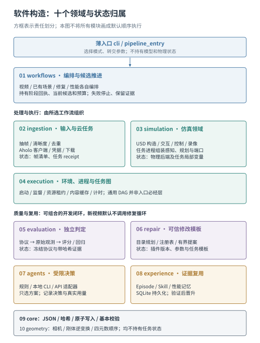
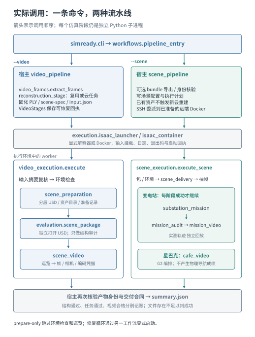

# 软件架构与代码模块构造

本文说明代码怎样组成系统，与[视频到 Demo 的方法链](report/pipeline-overview.md)配套。详细模块正文同时编入[技术白皮书](report/technical-report.md)的“软件架构与模块构造”章，保持同一份来源。

运行包位于 `src/simready`，分为十个领域，共 104 个 Python 文件。顶层 CLI 只选择入口；工作流拥有阶段和候选状态；领域模块完成计算或构造；执行域管理进程和资源；独立验收决定输出是否满足合同。图中分组描述代码责任，不表示每次运行都依次调用全部模块。

## 按模块阅读内部构造

每份说明都覆盖内部构件、实际调用、输入输出、状态归属、失败处理和扩展方式。表中的主文件是阅读入口；分节正文解释其协作模块。

| 代码部分 | 内部组成与主入口 | 详细构造 |
|---|---|---|
| CLI + `workflows` | 动态命令路由；`video_pipeline` / `scene_pipeline`；worker 编排；独立 repair / performance 循环 | [入口与工作流](report/code-parts-workflows.md) |
| `ingestion` | `video_frames` → 观测；`aholo_client` → 服务协议；`aholo_reconstruction` → 作业状态；`reconstruction_stage` → 统一产物 | [摄取模块](report/code-parts-workflows.md) |
| `execution` | Isaac 启动与容器；`task_schema` / `task_graph` / `task_worker`；资源租约、内容缓存、进程监督和计时 | [执行模块](report/code-parts-workflows.md) |
| `simulation` | 新场景构造与已有包导出；控件和工具；感知、运动学、规划、机器人端口、任务主循环；审计及三种录像器 | [仿真模块的四个子系统](report/code-parts-simulation.md) |
| `evaluation` | protocol → observations / asset_graph → scoring；独立 verification；regression；另有 USD 结构和性能检查 | [验收模块](report/code-parts-quality.md) |
| `repair` | 能力规划器；可执行注册表；参数模式、版本、有限方案与任务模板 | [修复模块](report/code-parts-quality.md) |
| `agents` | 统一决策合同；规则、本地 CLI、API 适配器；上下文构造、方案校验与用量记录 | [决策模块](report/code-parts-quality.md) |
| `experience` | SQLite 数据库；EpisodeStore；SkillLibrary；独立 PerformanceMemory | [经验模块](report/code-parts-quality.md) |
| `core` | JSON 和原子写入；文件/对象摘要；证据引用；基本校验与类型别名 | [基础数据模块](report/code-parts-foundation.md) |
| `geometry` | look-at 相机变换；刚体逆矩阵；USD 相机轴转换；四元数顺序 | [几何约定模块](report/code-parts-foundation.md) |
| 仓库支撑部分 | 配置、Docker、示例、测试、CI、报告工具和历史实验的安装边界 | [仓库支撑层](report/code-parts-repository.md) |

资产如何获得碰撞、刚体、质量、接触材质和关节，并通过 USD 进入 Isaac Sim，见[资产到 SimReady 方法专节](report/asset-to-simready.md)。

## 实际执行链

`--video` 的宿主完成来源登记、观测、重建复用/提交和输入固化，worker 完成场景准备、独立结构审计与巡览。`--scene substation` 消费已有资产，执行物理任务、独立任务审计和实测回放；`--scene starbucks` 执行 G2 编排录像。这些路径的产物和成功条件不同。

Agent 修复使用另外的工作流，将有限方案选择、可信任务执行、独立评分和经验记录接起来。通用 DAG、缓存、资源池与 Skill 不因运行一键视频入口就自动参与。`task_state.Mission` 是独立 CPU 监督组件；现有物理 runner 的阶段仍由 `substation_mission.run()` 的局部状态管理。上述区别已在具体模块构造中标明。

## 如何扩展

| 目标 | 应进入的接口 | 同时需要补齐的验证 |
|---|---|---|
| 新重建来源 | 标准 `reconstruction.json` 导入；需要在线服务时实现客户端和恢复合同 | 视频绑定、下载完整性、提交歧义与恢复 |
| 新场景 | 显式场景/对象规格，或已有资产 bundle 与任务配置 | 真实尺度、可见资产、碰撞、观测协议和任务分别验证 |
| 新机器人 | `RobotDescription` + 能力 handler + 观测回调 | 关节映射、控制策略、装配/TCP、感知、规划与接触 |
| 新修复算法 | 可执行插件注册表与可信任务程序 | 输入、版本、参数边界、失败输出及独立前后回归 |
| 新评测指标 | 原始观测计算与协议检查项 | 单位、适用范围、阈值标定、缺测与退化语义 |
| 新模型 Provider | `DecisionProvider.decide` 与显式工厂注册 | 受限方案、超时、实际用量与错误分支 |
| 新部署后端 | 启动器、状态回执和产物交付合同 | 环境、进程生命周期、输入不可变与失败恢复 |

静态依赖规则见 [module_boundaries.json](../configs/architecture/module_boundaries.json)，执行 `python scripts/check_architecture.py` 可检查领域边界。AST/CPU 检查不代替 GPU 任务或视觉验收。本次文档修订没有改变运行代码或新增性能成绩。
