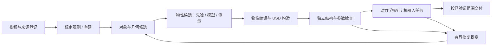

# 软件架构与代码模块构造

本文说明代码怎样组成系统，与[视频到 Demo 的方法链](report/pipeline-overview.md)配套。详细模块正文同时编入[技术白皮书](report/technical-report.md)的“软件架构与模块构造”章，保持同一份来源。

2026-11-14 新增[规范 pipeline 与 baseline 接入](pipeline.md)：资产规范实现归入 assets 域，配置入口复用现有工作流，阶段身份支持局部升级，重建后端与 baseline 矩阵具备可运行 CPU 示例。旧资产 import/CLI 保留薄兼容。此前实施状态见[本轮交付与限制](audits/2026-11-14-remaining-delivery.md)。嵌套取消与单机 GPU 租约已收敛到 execution；搬杯拆分为运行、控制、记录三个职责；NeRF2Physics 数值适配／候选导入已接入视频主链。真实视觉模型推断、GPU 成对搬杯验证仍待执行，不以 CPU 测试替代。

此前的[架构审查](audits/2026-11-14-pipeline-architecture.md)、[并行修复](audits/2026-11-14-parallel-review.md)和[第二轮收敛](audits/2026-11-14-infra-convergence.md)保留为历史记录，以下表格描述当前状态。

运行包位于 `src/simready`，分为十一个领域。顶层 CLI 只选择入口；工作流拥有阶段和候选状态；领域模块完成计算或构造；执行域管理进程和资源；独立验收决定输出是否满足合同。当前分层图见[方法架构](architecture.md)，[本轮验收](audits/2026-11-14-modular-pipeline.md)记录迁移和升级行为。下方保留 v0.7 的十领域图；当前通用资产实现已从 simulation 移入新增 assets 域。

## 按模块阅读内部构造

每份说明都覆盖内部构件、实际调用、输入输出、状态归属、失败处理和扩展方式。表中的主文件是阅读入口；分节正文解释其协作模块。

| 代码部分 | 内部组成与主入口 | 详细构造 |
|---|---|---|
| CLI + `workflows` | 动态命令路由；`video_pipeline` / `scene_pipeline`；worker 编排；独立 repair / performance 循环 | [入口与工作流](report/code-parts-workflows.md) |
| `ingestion` | `video_frames` → 观测；`aholo_client` → 服务协议；`aholo_reconstruction` → 作业状态；`reconstruction_stage` → 统一产物 | [摄取模块](report/code-parts-workflows.md) |
| `execution` | Isaac 启动与容器；`task_schema` / `task_graph` / `task_worker`；资源租约、内容缓存、进程监督和计时 | [执行模块](report/code-parts-workflows.md) |
| `assets` | appearance / association / physics / compilation，负责候选与 USD 构造 | [规范 pipeline](pipeline.md) |
| `simulation` | 已有包导出；控件和工具；感知、运动学、规划、机器人端口、任务主循环；审计及三种录像器 | [仿真模块的四个子系统](report/code-parts-simulation.md) |
| `evaluation` | protocol → observations / asset_graph → scoring；独立 verification；regression；另有 USD 结构和性能检查 | [验收模块](report/code-parts-quality.md) |
| `repair` | 能力规划器；可执行注册表；参数模式、版本、有限方案与任务模板 | [修复模块](report/code-parts-quality.md) |
| `agents` | 统一决策合同；规则、本地 CLI、API 适配器；上下文构造、方案校验与用量记录 | [决策模块](report/code-parts-quality.md) |
| `experience` | SQLite 数据库；EpisodeStore；SkillLibrary；独立 PerformanceMemory | [经验模块](report/code-parts-quality.md) |
| `core` | JSON 和原子写入；文件/对象摘要；证据引用；基本校验与类型别名 | [基础数据模块](report/code-parts-foundation.md) |
| `geometry` | look-at 相机变换；刚体逆矩阵；USD 相机轴转换；四元数顺序 | [几何约定模块](report/code-parts-foundation.md) |
| 仓库支撑部分 | 配置、Docker、示例、测试、CI、报告工具和历史实验的安装边界 | [仓库支撑层](report/code-parts-repository.md) |

资产如何获得碰撞、刚体、质量、接触材质和关节，并通过 USD 进入 Isaac Sim，见[资产到 SimReady 方法专节](report/asset-to-simready.md)。

## 实际执行链

`--video` 的宿主完成来源登记、观测、重建复用/提交和输入固化，worker 完成场景准备、独立结构审计与巡览。`--scene substation` 消费已有资产，执行物理任务、独立任务审计和实测回放；`--scene starbucks` 执行 G2 编排录像。这些路径的产物和成功条件不同。

Agent 修复使用另外的工作流，将有限方案选择、可信任务执行、独立评分和经验记录接起来。通用 DAG、缓存、资源池与 Skill 不因运行一键视频入口就自动参与。`task_state.Mission` 是独立 CPU 监督组件；现有物理 runner 的阶段仍由 `substation_mission.run()` 的局部状态管理。上述区别已在具体模块构造中标明。

## 如何扩展

| 目标 | 应进入的接口 | 同时需要补齐的验证 |
|---|---|---|
| 新重建来源 | 标准 `reconstruction.json` 导入；需要在线服务时实现客户端和恢复合同 | 视频绑定、下载完整性、提交歧义与恢复 |
| 新场景 | 显式场景/对象规格，或已有资产 bundle 与任务配置 | 真实尺度、可见资产、碰撞、观测协议和任务分别验证 |
| 新机器人 | `RobotDescription` + 能力 handler + 观测回调 | 关节映射、控制策略、装配/TCP、感知、规划与接触 |
| 新修复算法 | 可执行插件注册表与可信任务程序 | 输入、版本、参数边界、失败输出及独立前后回归 |
| 新评测指标 | 原始观测计算与协议检查项 | 单位、适用范围、阈值标定、缺测与退化语义 |
| 新模型 Provider | `DecisionProvider.decide` 与显式工厂注册 | 受限方案、超时、实际用量与错误分支 |
| 新部署后端 | 启动器、状态回执和产物交付合同 | 环境、进程生命周期、输入不可变与失败恢复 |

静态依赖规则见 [module_boundaries.json](../configs/architecture/module_boundaries.json)，执行 `python scripts/check_architecture.py` 可检查领域边界。AST/CPU 检查不代替 GPU 任务或视觉验收。v0.8 新模块、独立 USD 检查和 PhysX 合成响应的证据与边界见[物性管线说明](physical-assets.md)。

## 收敛设计：模块化单仓库与隔离 worker

保留既有领域并新增 assets，将资产编译从 simulation 下沉；当前共十一个领域。产品入口收敛到 `simready run`；开发命令保留为可独立调试的阶段入口，但应委托同一组阶段实现。新增研究方法通过独立环境和显式适配器加入，模型依赖不进入宿主 CLI。

以下是**目标调用链**，其中语义融合、物性预测、修复和机器人任务的主入口编排尚未全部贯通；显式对象的 NeRF2Physics 质量候选、编译决定和 USD 读回已接通：

每个阶段只消费明确的输入产物并输出新产物。算法选择由配置固定，Agent 只能选择已注册的提案和有界参数；验收规则由 evaluation 持有。原始数据、候选、编译后的参数和验收报告各自保留版本，避免同一个 JSON 既当预测又当真值。

### 责任与状态归属

| 模块 | 保留的责任 | 明确排除 / 升级边界 |
|---|---|---|
| `core` | 版本化数据合同、单位/坐标/证据引用、基础 IO | 不加载模型、USD、仿真或工作流 |
| `ingestion` | 视频、相机、重建、语义/材料模型适配及原始输出 | 估计器只产候选；不编译 USD、不自行判定任务通过 |
| `geometry` | 无场景状态的坐标变换和几何计算 | 场景修补策略属于 repair；场景硬编码属于 examples |
| `assets` | 外观／关联／物性候选与 USD 编译 | 仅依赖 core/geometry，不启动仿真或自判质量 |
| `simulation` | 物理引擎适配、机器人端口、控制、观测、记录及渲染 | 不再拥有迁出的资产编译实现；其他任务runner仍逐步拆分 |
| `evaluation` | 数据集划分、指标、USD 独立读回、任务审计 | 不导入 writer、修复器或策略；报告中区分缺测与失败 |
| `repair` | 注册可执行修复、参数边界、产物转换 | 不启动模型服务或自行占用 GPU |
| `agents` | 在已注册候选中决策、预算和用量记录 | 不拥有执行权或验收判据 |
| `experience` | 已验证 episode 和适用范围内的经验 | 密封测试结果不得用于技能晋升 |
| `workflows` | 运行阶段、依赖关系、接受/回退决策 | 不写 mesh、不实现材料估计、不再新增 subprocess 包装 |
| `execution` | 进程/容器生命周期、资源租约、日志、超时、产物提交 | 不解释任务成功；执行成功只表示产生了完整候选 |

### 跨模块合同

下面的类型是待收敛的逻辑合同，现有同义字段逐步迁移；**还没有宣称全部实现**。

| 合同 | 最小内容 | 当前基础 / 缺口 |
|---|---|---|
| `ObservationBundle` | 视频/帧/深度哈希、相机内外参、坐标约定、尺度来源、对象关联 | 现有 manifest 和 calibration；缺统一多视角实例关系 |
| `SceneCandidate` | source ID、稳定对象/部件 ID、几何/材质引用、坐标变换、来源 | scene spec 和 catalog 可用；完整网格、缺失面与可操作部件仍有专用步骤 |
| `PhysicalCandidate` | 参数、单位、区间、来源、模型身份、接触对、缺失理由、证据哈希 | NeRF2Physics candidate v1 已包含来源、区间、未知项与证据；真实模型和对象自动关联未验收 |
| `CompiledScene` | 采用值、选值/默认策略、USD 层及完整依赖清单 | 质量候选与 compilation 分开保留；冲突／缺尺度拒绝，USD 独立读回 |
| `TaskSpec` / `TaskResult` | 场景与控制器身份、种子、资源、命令、超时、attempt、产物 | 通用 task schema 已有；视频/场景入口需要迁移 |
| `ValidationReport` | 协议身份、逐项结果、输入/依赖哈希、适用范围、未评估项 | 多种报告已有；本轮抽出了共享物性回执校验 |

升级时为输入 schema 和适配器版本制定迁移规则；旧版本先在边界转换，内部只运行规范形式。新估计器只需产同一 `PhysicalCandidate`，USD writer 和机器人控制器无需了解它来自 NeRF2Physics 还是其他模型。

### Infra 设计与迁移

**宿主控制流程**管理计划、状态和产物索引，**隔离 worker**运行模型、USD、PhysX 或 RTX。默认采用单机可复现执行，服务接入仍沿既有客户端；跨节点排队在本地取消、恢复和输入身份统一之后实现。

| 关注点 | 收敛方式 | 当前状态 |
|---|---|---|
| 运行状态 | 一个 run 计划、多 stage、多 attempt；统一 `PENDING/RUNNING/SUCCEEDED/FAILED/CANCELLED`，业务验证另列 `PASS/FAIL/NOT_EVALUATED` | 多套回执并存；已修语义、DAG、并行 worker 与修复循环中断终态，统一状态转换仍待迁移 |
| 本地执行 | 复用 `execution.processes`，argv 无 shell；统一总期限、子进程组清理、stdout/stderr | DAG、launcher、场景／视频与语义 worker 复用 run_process；嵌套管道取消、父进程死亡和总期限已回归 |
| 容器执行 | adapter 保存容器身份、镜像 digest、输入只读挂载、独立输出；取消停止所属容器并记录回执 | 已有 ownership 校验、有限清理和不确定状态隔离；真实 daemon 回归、镜像 digest 与全量 TaskSpec 迁移待补 |
| 资源 | 用同一资源模型区分 CPU、CUDA、RTX、云并发；所有 GPU 入口遵守同一租约 | DAG、worker_groups、launcher、公开场景和语义 GPU 入口共用物理 UUID 锁；嵌套密封 FD 委派；内部 worker 由宿主持租约 |
| 产物与缓存 | 输入不可变、内容哈希寻址、先写 attempt 临时目录，验全后发布；代码/模型/配置/种子/环境都参与身份 | 已补跨阶段绑定、缓存软链接拒绝、显式环境身份；旧未约束继承和凭据任务禁缓存。规范配置入口已有阶段身份及上游传播；旧视频入口保留整包严格恢复 |
| 重试与恢复 | 完成阶段需产物复核；新尝试保留旧日志；云提交用服务 receipt 查重，任务失败不自动变成重试成功 | 新视频恢复已有；统一跨流程语义待完成 |
| 环境 | 编排、分割/物性研究、USD CPU、Isaac/RTX 分环境；锁依赖/权重/镜像身份 | 数值回归适配在隔离 CPU 子进程执行；真实 CLIP／材料服务权重环境仍未取得，未称为新模型推断 |
| 可观测性 | 分列排队、启动、计算、模型用量、验证耗时；未知用量保留未知 | profiler/DAG 已有字段，主流程未全部覆盖 |
| 远端后端 | 本地 worker 合同不变，增加提交/查询/取消/取产物接口 | SSH 仅执行远端命令，跨节点生产调度尚未实现 |

产物目录的目标形态为 `run-plan.json`、`inputs/`、`stages/<stage>/attempt-<n>/`、`validation/`、`delivery.json`。业务 summary 是索引，不复制或改写原始证据。新代码按这个模式组织；已有目录通过读取适配保持历史可追溯。

### 开发、减法和迁移顺序

| 批次 | 具体改动 | 可以判定完成的条件 | 状态 |
|---|---|---|---|
| ARCH-01 | 打通显式对象物性验收，复用回执校验/进程执行，修动态导入边界，移出咖啡馆专用 helper | 真 USD 导出与独立读回、错误回执拒绝、全仓回归、构包 | 本轮实施；范围见复审记录 |
| PHYS-01 | 先固定候选合同和公开数据划分，再通过现有执行层运行 NeRF2Physics 独立 worker；补齐单位和转换策略 | 固定版本真实推断；离线重放可复现；独立测量集评分；未知物性不填假精度 | 部分实施：候选合同、数值核、独立评分与主链接线完成；官方权重／公开测量集真实运行未完成 |
| PIPE-01 | 把语义关联、参数估计/显式先验、USD 编译、验证组合进 `simready run` | 新输入从单入口得到有来源的结果；模型失败、缺尺度、缺物性有明确退化/停止策略 | 配置入口已组合重建／可选语义代理／质量候选→USD；自动跨视图关联、完整资产生成和真实新模型推断未完成 |
| INFRA-01 | 现有流程迁入同一 TaskSpec/执行回执；归并超时、GPU 租约、缓存和恢复 | CPU 超时、GPU 争用、所属容器取消、失败重试、跨目录复现均通过；无新增并行执行器 | 单机生命周期／租约已收敛；全量 TaskSpec 化和真实 GPU／容器集成回归待完成 |
| SIM-01 | 分解 mission/cup/video 大函数，数据化场景常量；撤掉旧内部实现 | 固定输入、控制步长、阈值和同资产 GPU 行为回归；原 CLI 兼容，独立报告可比 | 搬杯已拆分并做 CPU 命令重建回归；GPU 行为回归及其他大 runner 迁移待完成 |
| CONTROL-01 | 根据搬杯失败轨迹定位失稳阶段，在 development 样本上修复夹持/转移/释放反馈 | 冻结新控制器，在新留出参数上与原控制器成对比较；原门槛、频率和失败分母不变 | 候选 stabilized-v2 已实现、默认保持 baseline-v1；新留出成对场景已准备，真实动力学未运行 |
| PHYS-02 | GaussianProperty 适配到相同候选合同和评测协议 | 独立环境真实推断、公开样本对照、同一 USD 编译链；范围不支持时明确记录 | PHYS-01 和主链通过后实施 |
| RELEASE-01 | 多场景密封验收、安装包/远端复现、收敛文档和兼容入口 | 全新环境可复现；明确任务/视觉/参数各自通过范围；旧包装层有删除版本 | 待开发 |

每批只保留一份规范实现。兼容入口委托规范实现；完成调用方迁移后删包装。`examples/` 保存场景特例，`runs/` 保存不可变实验与媒体产物，`legacy/` 保存不参与安装的研究历史。通用视频剪辑产品化单独演进，不进入物理控制和验收依赖链。

迁移先保留现有按钮、巡览和搬杯的行为证据；架构清理不顺便改变控制器、参数默认值或验收阈值。新增功能则必须同时提供调用路径、产物契约、失败行为和验证记录，才能进入“已集成”清单。

### 下一步开发与修复执行清单（2026-11-14）

本清单保留分批验收顺序；已实施部分以上方状态和最新交付记录为准。阶段按依赖推进，不以文件创建或测试数量判定功能完成。这里的批次编号用于路线跟踪；长期物性研究计划中的细分 PR 编号不代表对应研究已实施。

| 顺序 | 交付与具体工作 | 主要改动位置 | 验收 / 停止条件 |
|---|---|---|---|
| 0 · 冻结基线 | 登记当前工作树源码、配置、依赖与资产哈希；保存按钮/巡览/搬杯现有证据；形成固定回归命令 | `configs/architecture`、现有示例、验证清单 | 接入前基线可重跑；CPU 646 通过/1 跳过是上轮记录，GPU 历史证据另列，不视为本次重跑 |
| 1 · 物性合同 | 定义对象/部件 ID、尺度与坐标、参数单位、候选区间、来源/模型身份、证据引用和未知值；将“候选”与“编译选值”分开 | `core` 合同、`simulation/physical_spec.py`；扩展现有规范化入口 | 非法单位、缺尺度、冲突、缺少接触条件可拒绝或显式保留未知；旧 spec v1 兼容；现有参数默认值不变 |
| 2 · 最小研究执行链 | 固定上游版本和模型身份；登记数据版本/哈希/对象划分；研究环境通过既有 TaskSpec 和进程管理启动 | `ingestion` 模型适配、`execution/task_schema.py` / `task_worker.py`、独立环境配置 | 一个公开样本真实执行并保留原始输出；超时、取消、缺模型和错误输出有回执；不增加第二套资源调度器 |
| 3 · NeRF2Physics 评测与编译 | 首先打通质量候选及其独立参考数据；再按支持范围处理摩擦等属性；建立先验基线和独立评分，接入候选→采用值→USD | `ingestion` 数据适配、`evaluation` 数据协议/指标、现有物性 writer | 预测误差与覆盖范围可复算；同一对象不同视图不跨划分；无依据的字段保持未知；模型未优于基线时仍可保留为实验后端，不默认晋升 |
| 4 · 新视频主链 | 在 `simready run` 组合标定观测、对象关联、选定估计器、物性编译、独立验收；独立阶段命令委托相同实现 | `workflows/video_pipeline.py`、`semantic_assets.py`、worker 输入打包 | 至少一份新场景完整运行；输入与坐标全程绑定；失败恢复不重复提交云作业；显式允许先验回退时记录采用的来源，否则停止对应阶段 |
| 5 · Infra 归并 | 逐个迁移本地进程和容器启动、状态、租约、总期限、缓存身份与 attempt；移除被替代分支 | `execution`、`workflows/*execution.py`、`scene_delivery.py` | 两个作业争用 GPU、超时子进程清理、所属容器取消、失效缓存拒绝、失败恢复和异地目录运行都通过；保留历史回执读取能力 |
| 6 · 仿真拆分与代码减法 | 从 cup 任务开始，分开环境生命周期、观测、控制阶段、轨迹记录和录像；再迁移 substation/cafe；场景常量进显式配置 | `simulation/cup_grasp.py`、`substation_mission.py`、`cafe_video.py`、示例配置 | 每次迁移使用相同资产、物性、控制频率和审计门槛做 GPU 行为回归；迁移调用方后删旧实现；历史实验只留在 runs/legacy |
| 7 · 搬杯失稳修复 | 分析 dev-01 接触、姿态和放置时序；根据原因选择夹持约束、姿态反馈、速度限制或释放确认；单独冻结修复后的控制器 | 提取后的杯任务控制模块、`workflows/cup_robustness.py`、评测协议 | 原失败样本作为开发/回归用；另建未参与调参的新留出集，固定频率/阈值成对比较；全部失败计入；记录仿真真值反馈的限制 |
| 8 · 第二模型与交付 | GaussianProperty 复用相同合同接入；完成多场景验收、干净环境安装及可用远端节点复现；清理旧包装和重复说明 | 模型适配、`evaluation`、`deploy`、文档索引 | 替换模型不改 USD/控制器内部；每个后端有真实结果；本地与远端分别报告；新环境构包和安装不依赖本机缓存 |

**本轮实施**：单机嵌套取消／租约归并、杯任务职责拆分、候选反馈控制，以及 NeRF2Physics 数值适配与质量候选主链。CPU 回归和 USD 参数读回可执行；新视觉推断、公开测量集评分、真实 GPU／Docker 及杯控制成对物理结果尚未取得。详见[物性接线](nerf2physics.md)与[杯控制候选](cup-stability-candidate.md)。

**后续按依赖推进**：先在可用 GPU 与官方权重／数据环境执行已冻结的验收，再决定候选晋升；随后扩展自动实例关联、更多参数／模型、其他仿真 runner 拆分与多场景交付。不要用继续拆文件或增加测试数量替代缺失的物理／模型证据。

**每批交付固定包含**：代码及入口、输入输出合同、最小复现命令、成功/失败证据、受影响旧场景回归、已删除或待退役实现清单。没有真实运行的研究、模型成绩、机器人动作或远端部署，状态继续保留为未验证。

**范围约束**：当前优先完成单机模块化主链；大规模跨节点调度、更多机器人、策略训练和通用视频制作入口列入后续功能批次。历史性能提速任务保持暂停，可靠性与恢复测试不计作重新启动提速研究。按实际完成的验收批次更新进度，数据/环境就绪后再估算具体工期。
