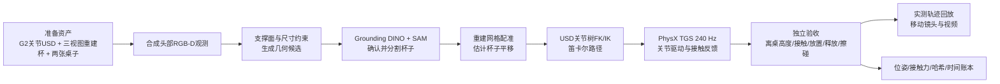

# 星巴克任务区：G2 将重建杯子搬到另一张桌子

此例运行真实 PhysX 刚体接触和关节驱动：观察桌面上的杯子，抓起、保持、搬到另一张桌子、放稳、松爪并退回。视频回放使用仿真实测位姿。执行过程中没有杯子挂接关节，没有直接修改杯子位姿。

**场景交付更正：** 最初的双桌视频用了参数化局部补建背景，不能作为“在原视频重建场景中执行任务”的交付。纠正版直接引用原视频训练出的 750,239 点高斯 USD，视觉点一个不删；原桌面保持可见，拟合的碰撞代理隐藏。下方 `--require-original-video` 用来源哈希和场景合同拒绝替换背景。

**范围是固定基座 G2_90d 的双桌任务，不是移动导航或整店重建验收。** 原星巴克 `root_pose` 编排入口仍然保留；本例新增独立的关节操控入口，尚未取代通用机器人端口。



## 一键运行

需要检查动作对物性假设是否敏感时，使用新增[固定控制器鲁棒性入口](../../docs/cup-robustness.md)。`robustness.json` 给出带单位与来源声明的质量/接触摩擦区间，以及不重叠的 development/heldout 种子；它不改变本例的成功阈值，也不会训练策略。

需要已准备资产，Isaac Docker 镜像和模型环境。环境安装、镜像构建见仓库 [Isaac 部署说明](../../docs/deployment.md)。

```bash
python -m pip install -e '.[physical-assets,simulation,segmentation]'
# 首次下载 Grounding DINO / SAM 后，此例用 --local-files-only 离线执行。
python examples/starbucks_grasp/run.py \
  --assets /path/to/prepared_assets \
  --scene scene/scene.usda --require-original-video \
  --out runs/my_cup_transfer \
  --model-python /path/to/model_env/bin/python \
  --render --width 1920
```

`--out` 必须是新目录。省略 `--render` 只做传感、定位、规划、物理执行和验收；省略 `--scene` 使用隔离双桌环境。FFmpeg 用于最后编码。默认 Docker 镜像为 `simready-isaac:6.1.0`，可用 `--image`、`--gpu` 覆盖。私有原片和第三方机器人资产未打进代码仓库。

原场景模式还需 `task_layout.json` 和 `scene/scene_contract.json`，由 `align_original_scene.py` 生成。该脚本在原高斯中拟合地面、桌面和圆桌边界，再建立场景到任务坐标的变换；以名义 0.85 m 桌高估计尺度，仍非实物标定。`prepare.py --layout ...` 与一键入口会使用拟合后的桌面位置、半径和高度。

准备输入的结构：

```text
prepared_assets/
├── task.usda            # 机器人、杯、桌面及初始条件
├── plan.json            # 初始关节配置与案例参数
├── robot.usdc           # 展平的原生 G2_90d 铰接体
├── cup.usdc             # 三视图 Aholo 重建的纹理网格与凸包碰撞体
├── textures/
├── task_layout.json     # 原场景拟合得到的两张桌面
└── scene/               # 原视频重建外观 + 隐藏碰撞代理
    ├── scene.usda
    ├── original_video_splats.usdc
    ├── proxies/
    └── scene_contract.json
```

已有机器人和杯子 USD 时，先生成独立双桌输入：

```bash
python examples/starbucks_grasp/prepare.py \
  --robot /path/to/G2_90d/robot_fixed.usda \
  --cup /path/to/cup_multi.usda \
  --out runs/cup_assets
python examples/starbucks_grasp/run.py \
  --assets runs/cup_assets --out runs/cup_run \
  --model-python /path/to/model_env/bin/python --render
```

这不是任意新视频的自动重建入口。它复用已重建杯子、已知桌面及配置好的场景；不包含云重建时间。

## 模块与证据

| 模块 | 输入、处理与输出 |
|---|---|
| `prepare.py` | 展平引用、复制纹理、设置质量/摩擦/关节驱动，按真实 USD 关节坐标求解右臂 7-DOF 路径；输出 portable USD 与计划 |
| `align_original_scene.py` | 从原 3DGS 拟合地面与两张桌子，保持全量原高斯外观，生成隐藏碰撞代理、来源合同与 `task_layout.json`；原场景模式使用此入口 |
| `cup_localization.py` | 合成 RGB-D、支撑面/尺寸约束、DINO/SAM、裁剪相机内参更新、带离群点剔除的模型配准；不读取杯子真值位姿 |
| `articulated_kinematics.py` | 解析父子关节坐标，提供 FK 和有限位 IK；数值求解成功不等于碰撞通过 |
| `cup_grasp.py` | CPU PhysX TGS，240 Hz，32/8 次位置/速度迭代；驱动原生关节，记录真实刚体状态与接触力 |
| `cup_transfer.py` | 不导入控制器；独立重算杯碰撞网格位置、离桌高度、承托、倾角、释放和环境擦碰，校验文件哈希 |
| `grasp_video.py` | 初始 RGB-D 采集或实测轨迹渲染；回放时禁用动力学，避免二次仿真改变已验证轨迹 |
| `run.py` | 按依赖顺序运行，任一步失败即停止，逐段写入 `timing.json` |

旧 `annotate.py`、`prepare_cafe.py`、`repair_corner.py` 不参与当前任务链，已移除；历史源码见[固定提交](https://github.com/miracle-techlink/video-to-simready/tree/6574907ded8aa8dac34de90d988303aede07d8b3/examples/starbucks_grasp)。原场景准备使用上面的 `align_original_scene.py`。

输出 `artifacts/physics/rollout.npz` 保存 5,400 个物理采样点，包含关节实际值、驱动目标、杯子与机器人刚体位姿、接触力以及阶段标签。`artifacts/audit.json` 是独立验收；`G2_two_table_transfer.mp4` 为 22.5 秒、30 fps 的演示。`timing.json` 区分模型、规划、仿真、渲染与编码耗时。

## 明确的先验与限制

- 杯子由既有三视图 Aholo 产物导入，约高 105 mm、直径 80 mm；它是另一组物体照片重建的独立资产，不是从星巴克原视频中自动抽出的同一只杯。
- 杯质量 **0.085 kg**、静/动摩擦 **0.8/0.6**、恢复系数 **0** 都是未测量先验。未模拟纸杯变形，不能据此证明实物不会压坏。
- 已知源桌面中心 `(0.65, -0.13)`、半径 `0.32 m`、高度 `0.85 m`；目标放置点为 `(0.40, -0.70, 0.85) m`。杯子初始位置由图像和深度估计，目标桌面由案例配置提供。
- 上述桌面数值属于隔离验证的默认值；原场景模式使用 `task_layout.json` 的拟合值。本次两桌半径为 0.358 / 0.353 m，目标桌面高 0.8492 m，桌上原有物件仍来自原高斯，尚无独立交互参数。
- 配准假设杯子直立、尺度已知；不估计杯子的完整朝向，不覆盖任意物体识别。
- 搬运前的定位来自合成 RGB-D。**放置高度修正仍读取仿真杯子和夹爪位姿**，属于有特权状态反馈，尚非纯视觉闭环。
- 机器人基座固定、躯干五关节锁定，源模型自碰撞关闭。验收覆盖两桌、配置的墙面和长椅，不证明自主导航、全身平衡或真实机器人安全。
- 参数化局部测试模式采用显式几何补建。原场景模式保留原视频重建的全量高斯外观，包括尚存的模糊、人物残影和孔洞；两种模式都不能以任务成功代替整店视觉保真度验收。
- 正式一键链路没有 LLM 调用；DINO/SAM 是本地模型推理。报告中的 0 API tokens 不包含开发对话，不能当作整个开发过程零 token。
