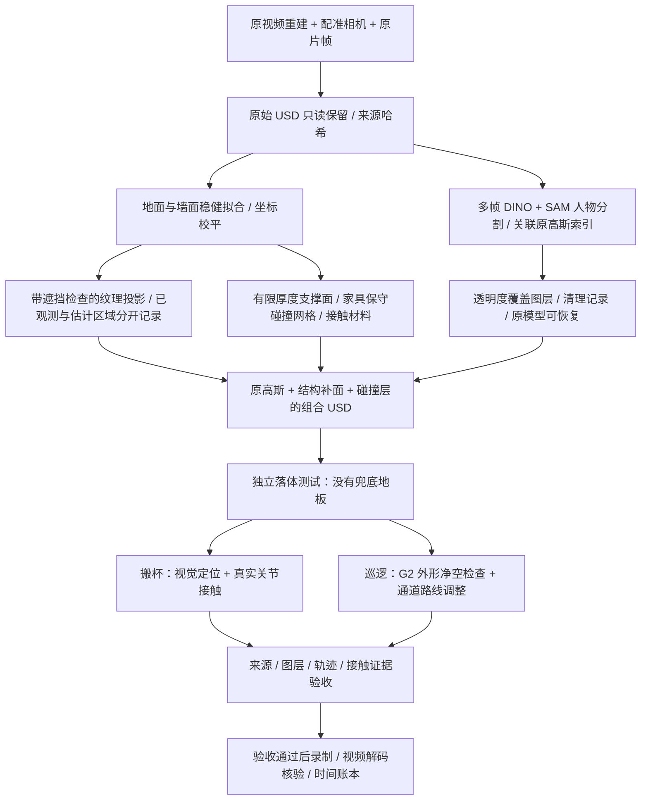

# 星巴克：原场景的任务级 Sim-Ready 修复

本例为两项已有任务补充同一套场景资产合同：**G2 双桌搬杯**和**30 秒编排巡逻**。原视频重建作为空间依据；在已建模区域内，以原片约束的独立桌椅、长椅、墙面、地砖及重建杯资产替换模糊高斯表面，同时更新碰撞、物性来源与独立验收。

原始高斯文件和被抑制索引保留，可回滚。未观测墙画使用同店照片的纹理样本补全；人物挡住的小块壁画使用有掩码与提示词记录的生成补全，木纹使用清洁桌面样本；这些像素明确标记为估计，不能当作原片逐像素还原。搬杯视角的未替换区域仍保留原重建及保守碰撞；巡逻视角隐藏全部残留高斯，使用配准到原场景的可编辑几何背景。巡逻是有净空检查的编排运动，不是自主导航或轮式底盘动力学验证。

## 一键验证与录制

已准备的修复资产可直接运行：

```bash
# 真正执行 RGB-D 观测、分割定位、规划、PhysX 搬杯，再回放实测轨迹。
python examples/starbucks_simready/run.py --case grasp \
  --assets /path/to/grasp_simready --out runs/cafe-grasp \
  --model-python /path/to/model-env/bin/python --render

# 检查静态承托与巡逻净空，再渲染完整 30 秒。
python examples/starbucks_simready/run.py --case tour \
  --assets /path/to/patrol_simready --out runs/cafe-patrol \
  --camera-focal-length 18 --dome-intensity 650 --synchronous-capture \
  --render --render-subframes 6
```

默认输出为 1920×1080、30 fps。搬杯为 22.5 秒，巡逻为 30 秒。省略 `--render` 只运行验证；失败时停止，不录制未通过版本。需要本地 `simready-isaac:6.1.0` Docker 镜像；部署方式见 [Isaac 部署](../../docs/deployment.md)。模型环境需安装项目及已缓存的 Grounding DINO/SAM 权重。

此例默认每个输出帧使用 6 个 RTX 子帧。每一输出帧都实际渲染，不插帧、不重复帧扩展时长。单 GPU 建议依次运行两个案例，避免多个 RTX 进程同时占用设备。

建模时写出的 `build.json` / `scene_contract.json` 保持原始候选状态，避免验收后改写资产哈希。最终结果以本次运行的 `artifacts/readiness.json`、`task/artifacts/audit.json`（搬杯）、`artifacts/route/route_check.json`（巡逻）及 `timing.json` 为准。首次 RTX 冷缓存初始化可能耗时数分钟；录制等待真实、非空白帧就绪后才推进相机和机器人。

此入口默认采用 480 Hz 物理步进（`--physics-hz 480`）；240 Hz 对照在本次家具接触材质下放杯失败，因此未通过验收。搬杯控制，使用起止速度、加速度为零的五次时间插值，闭爪目标为 0.70 rad。放杯使用实测位姿修正末端位置，先将杯底落到目的桌面再松爪，避免悬空松爪造成横向推移。该反馈使用仿真真值，尚不是实机力控。接触门槛保持不变；闭合目标是当前已知杯模型的任务设置，不是适用于任意杯子的通用夹持策略。运行保存全部瞬态接触力，未对峰值做平滑或删减。

## 从已有原始资产重新修复

在下面的结构修复基础上，调用可见资产修复入口。抓取案例首次生成公共纹理与几何；巡逻案例复用它们，并应用两个重建之间已记录的配准：

```bash
python examples/starbucks_simready/repair_appearance.py \
  --assets /path/to/structurally_repaired_grasp \
  --reference-assets /path/to/structurally_repaired_grasp \
  --sfm-root /path/to/starbucks/scene_rsi_v3 --out runs/cafe-visible-grasp

python examples/starbucks_simready/repair_appearance.py \
  --assets /path/to/structurally_repaired_patrol \
  --reference-assets /path/to/structurally_repaired_grasp \
  --sfm-root /path/to/starbucks/scene_rsi_v3 \
  --reuse-reference runs/cafe-visible-grasp/scene \
  --reference-to-case /path/to/reference_to_aholo.json \
  --editable-patrol-background --out runs/cafe-visible-patrol
```

2026-11-14 的远端巡逻修订恢复原约 **4.8 米纵向跨度**、原固定相机和转向目标。桌面点云局部对齐后重新生成家具碰撞；中心线搜索同时考虑端点的全部转身角度，通道横向修正最多 0.33 米，最后仍逐帧检查 900 帧。旧版 1.3 米近景录像保留为历史产物。`--patrol-x-range` 和 `--follow-camera` 仍可显式选择短路线或高位跟随，默认入口保留原相机。远端版本需要下述新资产，不能将旧资产直接换成未经检查的长路线。

`--camera-focal-length 18` 对应历史录像实际的 18 mm 镜头；已修复渲染器内部写死焦距、覆盖命令行参数的问题。`--dome-intensity` 与镜头模式独立。入口默认启用 `--synchronous-capture`，在推进下一姿态前拷贝当前 RGB，避免异步写图的横向撕裂。完整视频仍逐帧渲染；历史写图模式仅通过 `--no-synchronous-capture` 显式选择。

```bash
python examples/starbucks_simready/prepare.py --case grasp \
  --input /path/to/original_grasp_bundle \
  --sfm-root /path/to/starbucks/scene_rsi_v3 \
  --model-python /path/to/model-env/bin/python \
  --out runs/cafe-grasp-repair --run --render

python examples/starbucks_simready/prepare.py --case tour \
  --input /path/to/original_starbucks_bundle \
  --sfm-root /path/to/starbucks/scene_rsi_v3 \
  --source-trajectory /path/to/original_30s/trajectory.json \
  --model-python /path/to/model-env/bin/python \
  --out runs/cafe-patrol-repair --run --render
```

输入已经包含视频重建、配准相机和机器人。此例不重新调用云重建，不是任意新视频的全自动建模入口。`scene_rsi_v3` 需包含 `integration/full_alignment.json`、`full_sfm/images/` 和 `full_sfm/reconstruction/sparse/0/trajectory.json`。五张分割帧及墙面区域属于当前星巴克案例配置；复用其他场景需要替换这些配置。

## 恢复远端巡逻视角

这一步复用已修复近景资产，补回此前被估计西侧封闭墙挡住的远端。输入仍是当前咖啡店的两份重建和配准相机，不是任意场景的自动建模。

```bash
python examples/starbucks_simready/prepare_wide_patrol.py \
  --reference /path/to/completed_visible_patrol/scene \
  --reference-assets /path/to/structurally_repaired_grasp \
  --sfm-root /path/to/scene_rsi_v3 --out runs/wide-reference

python examples/starbucks_simready/align_wide_patrol.py \
  --reference-assets /path/to/structurally_repaired_grasp \
  --case-assets /path/to/structurally_repaired_patrol \
  --sfm-alignment /path/to/scene_rsi_v3/integration/full_alignment.json \
  --reference-to-case /path/to/reference_to_aholo.json \
  --out runs/wide-local-alignment.json

python examples/starbucks_simready/refine_wide_patrol.py \
  --reference runs/wide-reference --alignment runs/wide-local-alignment.json \
  --out runs/wide-reference-aligned

python examples/starbucks_simready/repair_appearance.py \
  --assets /path/to/structurally_repaired_patrol \
  --reference-assets /path/to/structurally_repaired_grasp \
  --sfm-root /path/to/scene_rsi_v3 \
  --reuse-reference runs/wide-reference-aligned \
  --reference-to-case /path/to/reference_to_aholo.json \
  --editable-patrol-background --out runs/cafe-wide-assets

python examples/starbucks_simready/run.py --case tour \
  --assets runs/cafe-wide-assets --out runs/cafe-wide-delivery \
  --camera-focal-length 18 --dome-intensity 650 --synchronous-capture \
  --render --render-subframes 6
```

长桌高度由来源点云拟合；随后使用重力方向校平桌面、将桌腿落到地面。原拟合斜率会令独立支撑球持续滚动，因此不保留这一重建倾斜。胶囊形轮廓、水平先验、桌腿和凳子布置仍是估计。局部对齐只修正两份重建之间的桌组位置，不代表真实尺度标定。远端窗面保留原片投影；误投到窗面下部的前景桌椅不用于渲染，该区域改为明确记录的深色估计基座。观测不足的通道墙面使用估计材质，不将残缺贴图当成高清实测墙面。

碰撞必须从**结构基础资产**重新生成，不可复用旧可见家具版本的占用图；新增远端地面也加入实际碰撞和落体采样。最终文件中的 `appearance_reference.json` 保留平面拟合点数、局部对齐偏移、原片索引及估计区域说明。

### 远端左侧：楼梯口和遗漏座位

后续原片核查发现，长路线版本虽然显示了远端长桌，却遗漏了门边圆桌、楼梯口座位、木饰面侧墙和金属网护栏。碰撞测试通过不能证明资产种类齐全。`restore_far_left.py` 使用原片 0–3 秒与 74–84 秒的观测补回这些独立资产；木饰面采用来源点云平面拟合与多帧纹理投影。后墙原始投影中混入了前景护栏和椅子，这些像素不进入最终后墙渲染，原始诊断图保留。

楼梯的可见入口与护栏有原片依据；更深处的 11 级台阶、级高、级宽和下层平台属于显式参数化估计，不能作为实测尺寸或机器人上下楼能力的证据。`floor_openings.py` 同时裁切可见地板和原碰撞面，保持实际高差。台阶验收从上层地面上方投放刚体，检查其是否落到三个不同深度的台阶；如果保留了隐形平地，测试会失败。独立审计重新核对起始高度、最终高度与资产中的目标位置。

```bash
python examples/starbucks_simready/fit_far_left_layout.py \
  --reference-assets /path/to/structurally_repaired_grasp \
  --sfm-root /path/to/scene_rsi_v3 --out runs/far-left-layout-fits.json

python examples/starbucks_simready/restore_far_left.py \
  --reference runs/wide-reference-aligned \
  --reference-assets /path/to/structurally_repaired_grasp \
  --case-assets /path/to/structurally_repaired_patrol \
  --reference-to-case /path/to/reference_to_aholo.json \
  --sfm-root /path/to/scene_rsi_v3 \
  --layout-evidence runs/far-left-layout-fits.json --out runs/far-left-reference
```

随后将 `runs/far-left-reference` 作为 `repair_appearance.py --reuse-reference` 的输入，从结构基础资产重建碰撞。`layout_fits.json` 保存指定区域内平面拟合的系数、点数、残差和支持不足记录；它是该场景的证据输入，不是通用布局模板。

可选的 `focus_far_left.py` 仅改变镜头：前后保留原视角，6–12 秒平滑侧移，12–18 秒观察楼梯区，18–24 秒回到原镜头。机器人位置和转向不变，最后依然通过 `run.py` 对新资产重新检查完整 900 帧路线。

```bash
python examples/starbucks_simready/focus_far_left.py \
  --trajectory /path/to/original_trajectory.json \
  --reference-manifest runs/far-left-reference/appearance_reference.json \
  --out /path/to/new_assets/source_trajectory.json
```

输出路径必须不存在；先保留旧轨迹，再写入新轨迹及相邻的 `.camera.json` 来源记录。准备好的新资产继续使用本页开头的 `run.py --case tour --render` 一键验收与录制。

## 原理与模块



| 模块 | 作用与限制 |
|---|---|
| `repair/structural_completion.py` | RANSAC/迭代拟合平面；投影原片并以重建深度排除前景遮挡；记录未观测纹理；将稠密连通占用体素转换为静态三角碰撞网格 |
| `build.py` | 保留原视频重建的可见背景；生成墙面、连续地面、支持面及物性清单；低覆盖地面采用原片取色的哑光补面，避免伪造大面积纹理拼接 |
| `clean_transients.py` | 多帧人物候选与深度约束关联高斯；保护地面/墙面附近点；只通过透明度覆盖层抑制候选，保留原始 USD 与索引；同步重建碰撞代理 |
| `repair_appearance.py` / `finish_materials.py` | 当前咖啡店布局配置、独立可见几何及有记录的材质补全；按替换区域抑制旧高斯，避免两套家具重叠 |
| `repair/source_texture.py` | 复用变电站清晰源选择、边界羽化与 SIFT/MAGSAC 配准；保留来源索引，隔离每第七个相机作为留出视角 |
| `repair/visible_geometry.py` / `workflows/appearance_collision.py` | 可编辑倒角几何、UV、法线与 PBR；聚合静态碰撞并从新几何生成保守占用地图 |
| `prepare_nav_pose.py` | 使用原 G2 USD 的关节坐标及限位收拢双臂，导出导航展示姿态与分层外形包络；不声称通过全身动力学与自碰撞验证 |
| `check_route.py` | 用分层机器人包络、体素体积和 2 cm 额外裕量检查全部 900 帧；必要时在原通道内搜索连续中心线，并再次检查完整轨迹 |
| `simulation/scene_probe.py` | 在实际组合场景中投放刚体，记录 240 步后的承托高度与运动；没有通用兜底地面，碰撞缺失会直接暴露 |
| `evaluation/scene_readiness.py` | 独立检查原始点位/尺度未改、透明度改动有记录、材料与碰撞有效、落体结果和任务结果绑定正确的文件哈希 |
| `prepare.py` / `run.py` | 串联修复与验收，记录分段时间；校验失败即停止，保留失败证据 |

## 资产和物性格式

```text
assets/
├── scene/
│   ├── scene.usda                  # 唯一组合入口
│   ├── original_video_splats.usdc   # 原模型，未修改
│   ├── source_scene.usda           # 原模型坐标映射
│   ├── completion.usda             # 可见补面 + 隐藏静态碰撞
│   ├── people_cleanup.usdc         # 可回滚透明度覆盖
│   ├── person_gaussian_indices.npy
│   ├── transient_cleanup.json
│   ├── appearance_reference.usda   # 可编辑几何与相对纹理引用
│   ├── appearance_reference.json   # 原片来源、留出索引与估计区域
│   ├── appearance_replacement.usdc # 仅覆盖已声明的高斯透明度
│   ├── appearance_gaussian_indices.npy
│   ├── appearance_repair.json      # 几何、索引与清单哈希
│   ├── appearance_textures/        # 原始候选、最终纹理、观测/估计掩码
│   ├── physical_assets.json        # 物性与来源
│   ├── obstacles.npz               # 占用网格和坐标变换
│   ├── scene_contract.json
│   └── textures/                   # 原片投影、观测掩码、来源索引
├── task.usda / plan.json / cup.usdc / robot.usdc   # 搬杯输入
└── robot_nav.usdc / height_profile.json / source_trajectory.json  # 巡逻输入
```

`physical_assets.json` 复用现有 `normalize_physics`：`motion_type`、`contact`、`provenance`、`validation` 分开。摩擦为无量纲；长度为米。地面静/动摩擦为 0.8/0.6，墙体与未知障碍为 0.6/0.45，桌面为 0.65/0.5，恢复系数为 0。全部是明确标记、带区间的类别先验，**没有实物标定**。固定环境采用静态碰撞，不虚构整桌、整墙质量。杯子仍使用独立任务的 0.085 kg 刚体与其接触参数；长椅没有软体或弹性坐垫模型。

旧结构版本中的两个任务桌沿用引擎默认接触材质。可见修复版本已对实际任务 USD 的 `/World/Table` 与 `/World/TableB` 显式绑定静/动摩擦 **0.65/0.5**、恢复系数 **0**；替换家具的静态碰撞也显式绑定这组预设。搬杯运行停用重复背景桌碰撞，使用任务桌。任务杯碰撞为 **0.8/0.6、恢复系数 0**、质量 **0.085 kg**。这些不是实测参数；更改接触层后必须重新跑 PhysX 和独立任务审计。

## 验收的边界

- **结构与任务门槛**：来源匹配、补面图层可回滚、碰撞材料有效、实际场景承托通过，且搬杯接触/放置通过或巡逻几何净空通过。
- **视觉单独评估**：原生多视角预览与最终视频逐段检查；同店材质样本补全并不证明每个装饰细节与原片一致，估计像素保留单独掩码。视角留出仅用于隔离选源，不能冒充已经通过完整 photometric benchmark。
- **真实物理单独评估**：没有实测尺度、摩擦或质量辨识，不能把仿真成功推广为实物成功。
- **导航单独评估**：巡逻录像保留编排运动性质；几何净空通过不等于定位、规划控制器、轮地接触和全身稳定性通过。

补面不再次给已烘焙照明的高斯投影阴影，避免双重遮暗；相关渲染语义参考 [NVIDIA 的 Gaussian Particle Fields 文档](https://docs.omniverse.nvidia.com/materials-and-rendering/latest/particle-fields.html)。

## 材质补全与缓存复用

可见修复入口可追加 `--transient-mask /path/to/person.png --generated-mural /path/to/mural.png`；生成图片旁必须有同名 JSON，记录提示词、输入和输出哈希、未观测属性。生成图配准到原纹理，仅将人物掩码内的像素写入材质；估计掩码和来源索引同步更新。未知墙画并未经过真实观测验证。

验证入口可追加 `--runtime-seed /path/to/completed/artifacts` 复制已有着色器缓存到本次隔离目录；不复用旧物理结果，不共享可写缓存。缓存复制计入本次耗时，所有验证仍绑定本次资产和嵌套纹理哈希。
