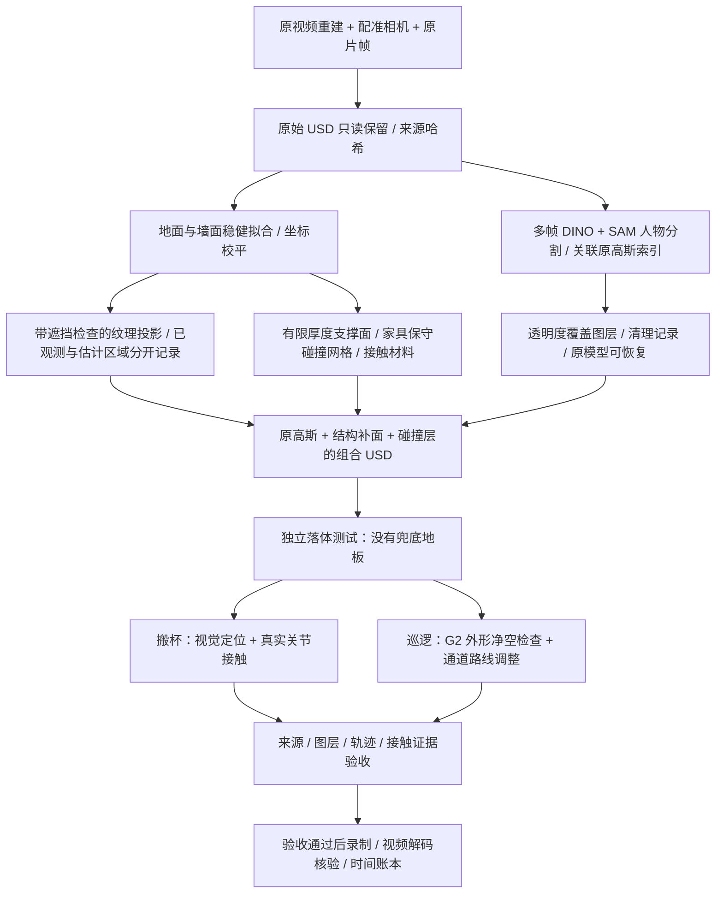

# 星巴克：原场景的任务级 Sim-Ready 修复

本例为两项已有任务补充同一套场景资产合同：**G2 双桌搬杯**和**30 秒编排巡逻**。保留各自使用的原视频重建，增加可回滚的结构补面、静态碰撞、物性来源和独立验收。

这不是“整店高清重建完成”的声明。原高斯仍有模糊、残影和缺失细节；未知家具使用保守碰撞代理，未全部恢复成独立可操作资产。巡逻是有净空检查的编排运动，不是自主导航或轮式底盘动力学验证。

## 一键验证与录制

已准备的修复资产可直接运行：

```bash
# 真正执行 RGB-D 观测、分割定位、规划、PhysX 搬杯，再回放实测轨迹。
python examples/starbucks_simready/run.py --case grasp \
  --assets /path/to/grasp_simready --out runs/cafe-grasp \
  --model-python /path/to/model-env/bin/python --render

# 检查静态承托与巡逻净空，再渲染完整 30 秒。
python examples/starbucks_simready/run.py --case tour \
  --assets /path/to/patrol_simready --out runs/cafe-patrol --render
```

默认输出为 1920×1080、30 fps。搬杯为 22.5 秒，巡逻为 30 秒。省略 `--render` 只运行验证；失败时停止，不录制未通过版本。需要本地 `simready-isaac:6.1.0` Docker 镜像；部署方式见 [Isaac 部署](../../docs/deployment.md)。模型环境需安装项目及已缓存的 Grounding DINO/SAM 权重。

建模时写出的 `build.json` / `scene_contract.json` 保持原始候选状态，避免验收后改写资产哈希。最终结果以本次运行的 `artifacts/readiness.json`、`task/artifacts/audit.json`（搬杯）、`artifacts/route/route_check.json`（巡逻）及 `timing.json` 为准。首次 RTX 冷缓存初始化可能耗时数分钟；录制等待真实、非空白帧就绪后才推进相机和机器人。

搬杯控制保持 240 Hz 物理步进，使用起止速度、加速度为零的五次时间插值，闭爪目标为 0.70 rad。接触门槛保持不变；闭合目标是当前已知杯模型的任务设置，不是适用于任意杯子的通用夹持策略。运行保存全部瞬态接触力，未对峰值做平滑或删减。

## 从已有原始资产重新修复

```bash
python examples/starbucks_simready/prepare.py --case grasp \
  --input /path/to/original_grasp_bundle \
  --sfm-root /path/to/starbucks/scene_rsi_v3 \
  --model-python /path/to/model-env/bin/python \
  --out runs/cafe-grasp-repair --run --render

python examples/starbucks_simready/prepare.py --case tour \
  --input /path/to/original_starbucks_bundle \
  --sfm-root /path/to/starbucks/scene_rsi_v3 \
  --source-trajectory /path/to/original_30s/trajectory.json \
  --model-python /path/to/model-env/bin/python \
  --out runs/cafe-patrol-repair --run --render
```

输入已经包含视频重建、配准相机和机器人。此例不重新调用云重建，不是任意新视频的全自动建模入口。`scene_rsi_v3` 需包含 `integration/full_alignment.json`、`full_sfm/images/` 和 `full_sfm/reconstruction/sparse/0/trajectory.json`。五张分割帧及墙面区域属于当前星巴克案例配置；复用其他场景需要替换这些配置。

## 原理与模块



| 模块 | 作用与限制 |
|---|---|
| `repair/structural_completion.py` | RANSAC/迭代拟合平面；投影原片并以重建深度排除前景遮挡；记录未观测纹理；将稠密连通占用体素转换为静态三角碰撞网格 |
| `build.py` | 保留原视频重建的可见背景；生成墙面、连续地面、支持面及物性清单；低覆盖地面采用原片取色的哑光补面，避免伪造大面积纹理拼接 |
| `clean_transients.py` | 多帧人物候选与深度约束关联高斯；保护地面/墙面附近点；只通过透明度覆盖层抑制候选，保留原始 USD 与索引；同步重建碰撞代理 |
| `prepare_nav_pose.py` | 使用原 G2 USD 的关节坐标及限位收拢双臂，导出导航展示姿态与分层外形包络；不声称通过全身动力学与自碰撞验证 |
| `check_route.py` | 用分层机器人包络、体素体积和 2 cm 额外裕量检查全部 900 帧；必要时在原通道内搜索连续中心线，并再次检查完整轨迹 |
| `simulation/scene_probe.py` | 在实际组合场景中投放刚体，记录 240 步后的承托高度与运动；没有通用兜底地面，碰撞缺失会直接暴露 |
| `evaluation/scene_readiness.py` | 独立检查原始点位/尺度未改、透明度改动有记录、材料与碰撞有效、落体结果和任务结果绑定正确的文件哈希 |
| `prepare.py` / `run.py` | 串联修复与验收，记录分段时间；校验失败即停止，保留失败证据 |

## 资产和物性格式

```text
assets/
├── scene/
│   ├── scene.usda                  # 唯一组合入口
│   ├── original_video_splats.usdc   # 原模型，未修改
│   ├── source_scene.usda           # 原模型坐标映射
│   ├── completion.usda             # 可见补面 + 隐藏静态碰撞
│   ├── people_cleanup.usdc         # 可回滚透明度覆盖
│   ├── person_gaussian_indices.npy
│   ├── transient_cleanup.json
│   ├── physical_assets.json        # 物性与来源
│   ├── obstacles.npz               # 占用网格和坐标变换
│   ├── scene_contract.json
│   └── textures/                   # 原片投影、观测掩码、来源索引
├── task.usda / plan.json / cup.usdc / robot.usdc   # 搬杯输入
└── robot_nav.usdc / height_profile.json / source_trajectory.json  # 巡逻输入
```

`physical_assets.json` 复用现有 `normalize_physics`：`motion_type`、`contact`、`provenance`、`validation` 分开。摩擦为无量纲；长度为米。地面静/动摩擦为 0.8/0.6，墙体与未知障碍为 0.6/0.45，桌面为 0.65/0.5，恢复系数为 0。全部是明确标记、带区间的类别先验，**没有实物标定**。固定环境采用静态碰撞，不虚构整桌、整墙质量。杯子仍使用独立任务的 0.085 kg 刚体与其接触参数；长椅没有软体或弹性坐垫模型。

## 验收的边界

- **结构与任务门槛**：来源匹配、补面图层可回滚、碰撞材料有效、实际场景承托通过，且搬杯接触/放置通过或巡逻几何净空通过。
- **视觉单独评估**：补面减少穿透空白，并不证明全部物体清晰或与原片完全一致。原高斯残影、未观测面及未知物体保留在缺陷清单中。
- **真实物理单独评估**：没有实测尺度、摩擦或质量辨识，不能把仿真成功推广为实物成功。
- **导航单独评估**：巡逻录像保留编排运动性质；几何净空通过不等于定位、规划控制器、轮地接触和全身稳定性通过。

补面不再次给已烘焙照明的高斯投影阴影，避免双重遮暗；相关渲染语义参考 [NVIDIA 的 Gaussian Particle Fields 文档](https://docs.omniverse.nvidia.com/materials-and-rendering/latest/particle-fields.html)。
